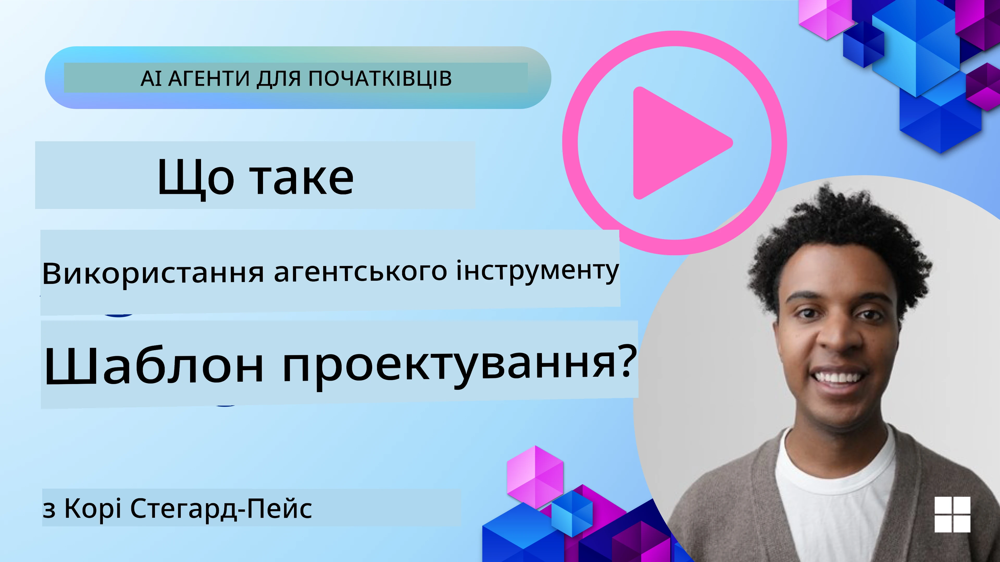
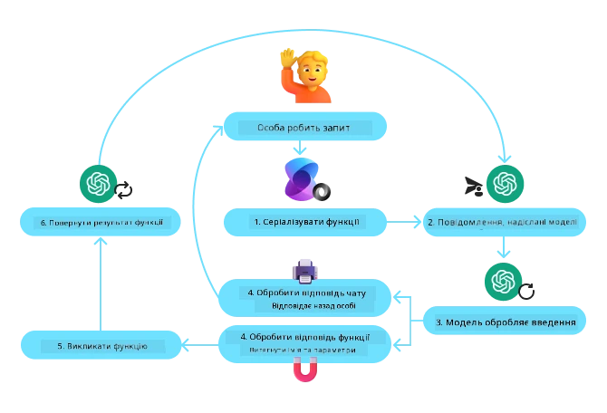
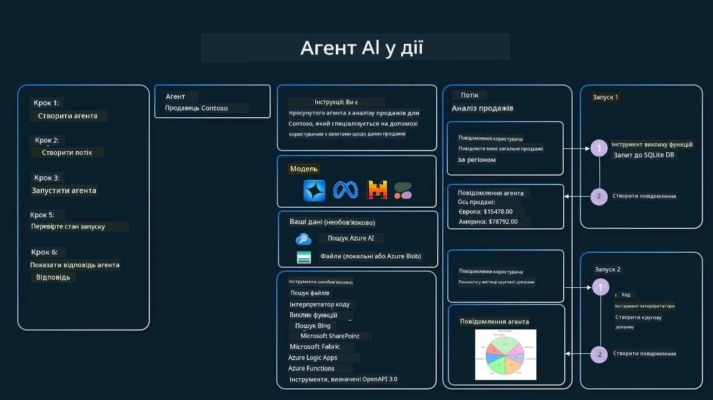

[](https://youtu.be/vieRiPRx-gI?si=cEZ8ApnT6Sus9rhn)

> _(Натисніть на зображення вище, щоб переглянути відеоурок)_

# Шаблон проектування використання інструментів

Інструменти цікаві тим, що дозволяють AI агентам мати ширший спектр можливостей. Замість того, щоб агент мав обмежений набір дій, він може виконувати широкий спектр дій, додавши інструмент. У цій главі ми розглянемо Шаблон проектування використання інструментів, який описує, як AI агенти можуть використовувати конкретні інструменти для досягнення своїх цілей.

## Вступ

У цьому уроці ми намагаємося відповісти на такі питання:

- Що таке шаблон проектування використання інструментів?
- Для яких випадків він застосовний?
- Які елементи/будівельні блоки необхідні для реалізації цього шаблону?
- Які особливі міркування слід враховувати при використанні цього шаблону для створення надійних AI агентів?

## Цілі навчання

Після завершення цього уроку ви зможете:

- Визначити Шаблон проектування використання інструментів та його мету.
- Визначити випадки застосування, де цей шаблон корисний.
- Зрозуміти ключові елементи для впровадження цього шаблону.
- Визнавати міркування щодо забезпечення надійності AI агентів, що використовують цей шаблон.

## Що таке Шаблон проектування використання інструментів?

**Шаблон проектування використання інструментів** зосереджений на наданні LLM можливості взаємодіяти з зовнішніми інструментами для досягнення конкретних цілей. Інструменти — це код, який агент може виконувати, щоб здійснювати дії. Інструментом може бути проста функція, наприклад калькулятор, або виклик API стороннього сервісу, такого як пошук ціни акцій чи прогноз погоди. В контексті AI агентів інструменти проєктуються для виконання агентами у відповідь на **виклики функцій, створені моделлю**.

## Для яких випадків він застосовний?

AI агенти можуть використовувати інструменти для виконання складних завдань, отримання інформації чи прийняття рішень. Шаблон проектування використання інструментів часто застосовується у сценаріях, що потребують динамічної взаємодії із зовнішніми системами, такими як бази даних, веб-сервіси чи інтерпретатори коду. Ця можливість корисна у таких випадках:

- **Динамічне отримання інформації:** агенти можуть опитувати зовнішні API або бази даних для отримання актуальних даних (наприклад, опитування бази даних SQLite для аналізу, отримання цін акцій або інформації про погоду).
- **Виконання та інтерпретація коду:** агенти можуть виконувати код або сценарії для розв’язання математичних задач, генерації звітів чи проведення симуляцій.
- **Автоматизація процесів:** автоматизація повторюваних чи багатокрокових робочих процесів інтеграцією інструментів, таких як планувальники завдань, поштові сервіси чи конвеєри даних.
- **Підтримка клієнтів:** агенти можуть взаємодіяти з CRM-системами, платформами для обробки запитів або базами знань для вирішення користувацьких питань.
- **Генерація та редагування контенту:** агенти можуть використовувати інструменти, такі як коректори граматики, резюмувальники тексту або оцінювачі безпеки контенту для допомоги у створенні контенту.

## Які елементи/будівельні блоки потрібні для реалізації шаблону використання інструментів?

Ці будівельні блоки дозволяють AI агенту виконувати широкий спектр завдань. Розглянемо ключові елементи для реалізації Шаблону проектування використання інструментів:

- **Схеми функцій/інструментів:** детальні визначення доступних інструментів, включно з ім’ям функції, призначенням, необхідними параметрами та очікуваними вихідними даними. Ці схеми дозволяють LLM розуміти, які інструменти доступні та як створювати коректні запити.

- **Логіка виконання функцій:** регулює, як і коли інструменти викликаються на основі намірів користувача та контексту розмови. Це може включати модулі планувальників, механізми маршрутизації чи умовні потоки, які динамічно визначають використання інструментів.

- **Система обробки повідомлень:** компоненти, які керують потоком розмови між введеннями користувача, відповідями LLM, викликами інструментів та їх результатами.

- **Фреймворк інтеграції інструментів:** інфраструктура, що з’єднує агента з різними інструментами, будь то прості функції чи складні зовнішні сервіси.

- **Обробка помилок та валідація:** механізми для обробки збоїв виконання інструментів, перевірки параметрів та керування несподіваними відповідями.

- **Управління станом:** відстежує контекст розмови, попередні взаємодії з інструментами та збережені дані для забезпечення узгодженості під час багатокрокових взаємодій.

Далі розглянемо Детальніше Виклик функцій/інструментів.
 
### Виклик функцій/інструментів

Виклик функцій — це основний спосіб, який дозволяє Великим Мовним Моделям (LLM) взаємодіяти з інструментами. Часто ви бачитимете, що терміни 'Функція' і 'Інструмент' використовуються взаємозамінно, тому що «функції» (блоки багаторазового коду) — це «інструменти», які агенти застосовують для виконання завдань. Щоб викликати код функції, LLM має зіставити запит користувача з описом функції. Для цього в LLM надсилається схема, що містить опис усіх доступних функцій. Потім LLM вибирає найвідповіднішу функцію для завдання і повертає її ім'я та аргументи. Обрана функція виконується, її відповідь надсилається назад LLM, яка використовує цю інформацію для відповіді користувачу.

Щоб реалізувати виклик функцій для агентів, розробникам потрібно:

1. Модель LLM, яка підтримує виклик функцій
2. Схема з описаннями функцій
3. Код для кожної описаної функції

Приклад: отримання поточного часу у місті.

1. **Ініціалізація LLM з підтримкою виклику функцій:**

    Не всі моделі підтримують виклик функцій, тому важливо перевірити, чи це робить модель, яку ви використовуєте. <a href="https://learn.microsoft.com/azure/ai-services/openai/how-to/function-calling" target="_blank">Azure OpenAI</a> підтримує виклик функцій. Ми можемо почати, ініціалізувавши клієнт OpenAI через Azure OpenAI **Responses API** (стабільний `/openai/v1/` — без необхідності `api_version`).

    ```python
    # Initialize the OpenAI client for Azure OpenAI (Responses API, v1 endpoint)
    client = OpenAI(
        base_url=f"{os.environ['AZURE_OPENAI_ENDPOINT'].rstrip('/')}/openai/v1/",
        api_key=os.environ["AZURE_OPENAI_API_KEY"],
    )
    deployment_name = os.environ["AZURE_OPENAI_DEPLOYMENT"]
    ```

2. **Створення схеми функції:**

    Далі визначимо JSON-схему, яка міститиме ім'я функції, опис її дії та імена й описи параметрів.
    Потім ми передамо цю схему клієнту разом із запитом користувача, щоб знайти час у Сан-Франциско. Важливо зауважити, що повертається **виклик інструменту**, а не кінцева відповідь на питання. Як згадувалося раніше, LLM повертає ім’я вибраної функції та аргументи, які будуть передані їй.

    ```python
    # Function description for the model to read (Responses API flat tool format)
    tools = [
        {
            "type": "function",
            "name": "get_current_time",
            "description": "Get the current time in a given location",
            "parameters": {
                "type": "object",
                "properties": {
                    "location": {
                        "type": "string",
                        "description": "The city name, e.g. San Francisco",
                    },
                },
                "required": ["location"],
            },
        }
    ]
    ```
   
    ```python
  
    # Initial user message
    messages = [{"role": "user", "content": "What's the current time in San Francisco"}]

    # First API call: Ask the model to use the function
    response = client.responses.create(
        model=deployment_name,
        input=messages,
        tools=tools,
        tool_choice="auto",
        store=False,
    )

    # The Responses API returns tool calls as function_call items in response.output.
    # Append them to the conversation so the model has full context on the next turn.
    messages += response.output

    print("Model's response:")
    print(response.output)
  
    ```

    ```bash
    Model's response:
    [ResponseFunctionToolCall(arguments='{"location":"San Francisco"}', call_id='call_pOsKdUlqvdyttYB67MOj434b', name='get_current_time', type='function_call')]
    ```
  
3. **Код функції для виконання завдання:**

    Після вибору функції LLM потрібно реалізувати код, що виконує завдання.
    Ми можемо реалізувати код для отримання поточного часу на Python. Також потрібно написати код для вилучення імені та аргументів із response_message, щоб отримати кінцевий результат.

    ```python
      def get_current_time(location):
        """Get the current time for a given location"""
        print(f"get_current_time called with location: {location}")  
        location_lower = location.lower()
        
        for key, timezone in TIMEZONE_DATA.items():
            if key in location_lower:
                print(f"Timezone found for {key}")  
                current_time = datetime.now(ZoneInfo(timezone)).strftime("%I:%M %p")
                return json.dumps({
                    "location": location,
                    "current_time": current_time
                })
      
        print(f"No timezone data found for {location_lower}")  
        return json.dumps({"location": location, "current_time": "unknown"})
    ```

     ```python
    # Handle function calls
    tool_calls = [item for item in response.output if item.type == "function_call"]
    if tool_calls:
        for tool_call in tool_calls:
            if tool_call.name == "get_current_time":

                function_args = json.loads(tool_call.arguments)

                time_response = get_current_time(
                    location=function_args.get("location")
                )

                # Return the tool result as a function_call_output item
                messages.append({
                    "type": "function_call_output",
                    "call_id": tool_call.call_id,
                    "output": time_response,
                })
    else:
        print("No tool calls were made by the model.")

    # Second API call: Get the final response from the model
    final_response = client.responses.create(
        model=deployment_name,
        input=messages,
        tools=tools,
        store=False,
    )

    return final_response.output_text
     ```

     ```bash
      get_current_time called with location: San Francisco
      Timezone found for san francisco
      The current time in San Francisco is 09:24 AM.
     ```

Виклик функцій є серцем більшості, якщо не всіх, шаблонів використання інструментів агентами, але його реалізація з нуля може бути іноді складною.
Як ми дізналися в [Уроці 2](../../../02-explore-agentic-frameworks), агентські фреймворки надають готові будівельні блоки для реалізації використання інструментів.
 
## Приклади використання інструментів з агентськими фреймворками

Ось кілька прикладів того, як можна застосувати Шаблон проектування використання інструментів за допомогою різних агентських фреймворків:

### Microsoft Agent Framework

<a href="https://learn.microsoft.com/azure/ai-services/agents/overview" target="_blank">Microsoft Agent Framework</a> — це відкритий AI фреймворк для створення AI агентів. Він спрощує процес використання виклику функцій, дозволяючи визначати інструменти як Python-функції з декоратором `@tool`. Фреймворк керує двонаправленою комунікацією між моделлю та вашим кодом. Він також надає доступ до готових інструментів, таких як File Search і Code Interpreter через `FoundryChatClient`.

Наступна діаграма ілюструє процес виклику функції за допомогою Microsoft Agent Framework:



У Microsoft Agent Framework інструменти визначаються як декоровані функції. Ми можемо перетворити функцію `get_current_time`, яку бачили раніше, на інструмент, використовуючи декоратор `@tool`. Фреймворк автоматично серіалізує функцію та її параметри, створюючи схему для відправлення в LLM.

```python
import os
from agent_framework import tool
from agent_framework.foundry import FoundryChatClient
from azure.identity import AzureCliCredential

@tool(approval_mode="never_require")
def get_current_time(location: str) -> str:
    """Get the current time for a given location"""
    ...

# Create the client
provider = FoundryChatClient(
    project_endpoint=os.environ["AZURE_AI_PROJECT_ENDPOINT"],
    model=os.environ["AZURE_AI_MODEL_DEPLOYMENT_NAME"],
    credential=AzureCliCredential(),
)

# Create an agent and run with the tool
agent = provider.as_agent(name="TimeAgent", instructions="Use available tools to answer questions.", tools=get_current_time)
response = await agent.run("What time is it?")
```

#### Інструменти з MCP серверу

Інструменти не обов’язково мають бути функціями у вашому коді. Сервер, що підтримує Model Context Protocol (MCP, розглянутий у [Уроці 11](../11-agentic-protocols/README.md)), публікує свої інструменти разом із їхніми схемами, і фреймворк може завантажувати їх так само, як і серіалізовану декоровану функцію. `MCPStreamableHTTPTool` підключається до такого сервера через HTTP, отримує схеми інструментів і пропонує їх моделі поряд з локальними інструментами.

Наведений приклад використовує сервер веб-пошуку, розміщений <a href="https://keenable.ai" target="_blank">Keenable</a>. Він безкоштовний для використання без облікового запису чи API ключа (запити обмежені за IP), тож єдині облікові дані, які потрібні, це від вашої моделі. Як і для будь-якого віддаленого інструменту, запити, які модель формує, надсилаються на цей сервер.

```python
from agent_framework import MCPStreamableHTTPTool

web_search = MCPStreamableHTTPTool(
    name="Keenable web search",
    url="https://api.keenable.ai/mcp",
)

# Connecting loads the server's tool schemas; the agent decides when to call them
async with web_search:
    agent = provider.as_agent(
        name="ResearchAgent",
        instructions="Use available tools to answer questions.",
        tools=[web_search],
    )
    response = await agent.run("What is new in the latest Python release?")
    print(response.text)
```

Сервер публікує два інструменти, `search_web_pages` і `fetch_page_content`. Коли потрібно отримати актуальну інформацію, модель викликає `search_web_pages`, отримує назви, URL-адреси і фрагменти тексту, і складає відповідь з них, так само, як у прикладі `get_current_time` вище.
  
### Microsoft Foundry Agent Service

<a href="https://learn.microsoft.com/azure/ai-services/agents/overview" target="_blank">Microsoft Foundry Agent Service</a> — це новий агентський фреймворк, створений для розробників, щоб безпечно будувати, розгортати і масштабувати якісних і розширюваних AI агентів, не керуючи базовими обчислювальними та сховищними ресурсами. Це особливо корисно для корпоративних застосунків, оскільки це повністю керована служба з корпоративним рівнем безпеки.

У порівнянні з розробкою безпосередньо через LLM API, Microsoft Foundry Agent Service має кілька переваг:

- Автоматичний виклик інструментів — вам не потрібно парсити виклик інструменту, викликати інструмент і обробляти відповідь; все це тепер відбувається на сервері
- Безпечно керовані дані — замість керування власним станом розмови, можна покладатися на нитки для збереження всієї необхідної інформації
- Інструменти «з коробки» — інструменти для роботи з джерелами даних, такі як Bing, Azure AI Search і Azure Functions.

Інструменти в Microsoft Foundry Agent Service можна розділити на дві категорії:

1. Інструменти знань:
    - <a href="https://learn.microsoft.com/azure/ai-services/agents/how-to/tools/bing-grounding?tabs=python&pivots=overview" target="_blank">Пошук із Bing</a>
    - <a href="https://learn.microsoft.com/azure/ai-services/agents/how-to/tools/file-search?tabs=python&pivots=overview" target="_blank">Пошук файлів</a>
    - <a href="https://learn.microsoft.com/azure/ai-services/agents/how-to/tools/azure-ai-search?tabs=azurecli%2Cpython&pivots=overview-azure-ai-search" target="_blank">Azure AI Search</a>

2. Інструменти дії:
    - <a href="https://learn.microsoft.com/azure/ai-services/agents/how-to/tools/function-calling?tabs=python&pivots=overview" target="_blank">Виклик функції</a>
    - <a href="https://learn.microsoft.com/azure/ai-services/agents/how-to/tools/code-interpreter?tabs=python&pivots=overview" target="_blank">Інтерпретатор коду</a>
    - <a href="https://learn.microsoft.com/azure/ai-services/agents/how-to/tools/openapi-spec?tabs=python&pivots=overview" target="_blank">Інструменти, визначені OpenAPI</a>
    - <a href="https://learn.microsoft.com/azure/ai-services/agents/how-to/tools/azure-functions?pivots=overview" target="_blank">Azure Functions</a>

Служба Agent Service дає змогу використовувати ці інструменти разом як `toolset`. Вона також використовує `threads`, які відстежують історію повідомлень у конкретній розмові.

Уявіть, що ви агент з продажу в компанії Contoso. Ви хочете розробити розмовного агента, який зможе відповідати на питання про ваші дані продажів.

Наступне зображення ілюструє, як ви могли б використати Microsoft Foundry Agent Service для аналізу ваших даних продажів:



Щоб використовувати будь-який із цих інструментів із службою, ми можемо створити клієнта і визначити інструмент або набір інструментів. Для практичної реалізації ми можемо застосувати наступний Python код. LLM зможе переглянути набір інструментів і вирішити, чи використати користувацьку функцію, `fetch_sales_data_using_sqlite_query`, чи вбудований Інтерпретатор коду залежно від запиту користувача.

```python 
import os
from azure.ai.projects import AIProjectClient
from azure.identity import DefaultAzureCredential
from fetch_sales_data_functions import fetch_sales_data_using_sqlite_query # fetch_sales_data_using_sqlite_query function which can be found in a fetch_sales_data_functions.py file.
from azure.ai.projects.models import ToolSet, FunctionTool, CodeInterpreterTool

project_client = AIProjectClient.from_connection_string(
    credential=DefaultAzureCredential(),
    conn_str=os.environ["PROJECT_CONNECTION_STRING"],
)

# Initialize toolset
toolset = ToolSet()

# Initialize function calling agent with the fetch_sales_data_using_sqlite_query function and adding it to the toolset
fetch_data_function = FunctionTool(fetch_sales_data_using_sqlite_query)
toolset.add(fetch_data_function)

# Initialize Code Interpreter tool and adding it to the toolset. 
code_interpreter = CodeInterpreterTool()toolset.add(code_interpreter)

agent = project_client.agents.create_agent(
    model="gpt-5-mini", name="my-agent", instructions="You are helpful agent", 
    toolset=toolset
)
```

## Які особливі міркування для використання Шаблону проектування використання інструментів при побудові надійних AI агентів?

Звичайна проблема з динамічно сформованими SQL-запитами від LLM — це безпека, зокрема ризики SQL-ін’єкцій або шкідливих дій, таких як видалення або пошкодження бази даних. Хоча ці занепокоєння є слушними, їх можна ефективно пом’якшити шляхом належного налаштування прав доступу до бази даних. Для більшості баз їх налаштовують у режимі лише для читання. Для сервісів баз даних, таких як PostgreSQL чи Azure SQL, застосунок повинен мати роль із правами виключно на читання (SELECT).

Запуск додатка в безпечному середовищі додатково підсилює захист. У корпоративних сценаріях дані зазвичай витягуються і трансформуються з операційних систем у базу даних або сховище даних лише для читання з орієнтованою на користувача схемою. Такий підхід гарантує, що дані захищені, оптимізовані для продуктивності та доступності, а додаток має обмежений доступ тільки для читання.

## Приклади коду

- Python: [Agent Framework](./code_samples/04-python-agent-framework.ipynb)
- .NET: [Agent Framework](./code_samples/04-dotnet-agent-framework.md)

## Маєте ще запитання щодо Шаблонів проектування використання інструментів?

Приєднуйтесь до [Microsoft Foundry Discord](https://discord.com/invite/ATgtXmAS5D), щоб зустрітися з іншими учнями, відвідати години консультацій і отримати відповіді на запитання по AI агентах.

## Додаткові ресурси

- <a href="https://microsoft.github.io/build-your-first-agent-with-azure-ai-agent-service-workshop/" target="_blank">Майстер-клас із Azure AI Agents Service</a>
- <a href="https://github.com/Azure-Samples/contoso-creative-writer/tree/main/docs/workshop" target="_blank">Майстерня з кількох агентів Contoso Creative Writer</a>
- <a href="https://learn.microsoft.com/azure/ai-services/agents/overview" target="_blank">Огляд Microsoft Agent Framework</a>

## Попереднє тестування цього агента (необов’язково)

Після того, як ви навчитеся розгортати агентів у [Уроці 16](../16-deploying-scalable-agents/README.md), ви можете провести попереднє тестування `TravelToolAgent` цього уроку (чи він досі викликає свої інструменти та відповідає?) за допомогою [`tests/lesson-04-smoke-tests.json`](../../../tests/lesson-04-smoke-tests.json). Дивіться [`tests/README.md`](../tests/README.md), щоб дізнатись, як його запустити.

## Попередній урок

[Розуміння агентських патернів дизайну](../03-agentic-design-patterns/README.md)

## Наступний урок

[Agentic RAG](../05-agentic-rag/README.md)

---

<!-- CO-OP TRANSLATOR DISCLAIMER START -->
**Відмова від відповідальності**:
Цей документ було перекладено за допомогою сервісу штучного інтелекту для перекладу [Co-op Translator](https://github.com/Azure/co-op-translator). Хоча ми прагнемо до точності, будь ласка, майте на увазі, що автоматичні переклади можуть містити помилки або неточності. Оригінальний документ рідною мовою слід вважати авторитетним джерелом. Для критично важливої інформації рекомендується професійний людський переклад. Ми не несемо відповідальності за будь-які непорозуміння або неправильні тлумачення, що виникли внаслідок використання цього перекладу.
<!-- CO-OP TRANSLATOR DISCLAIMER END -->