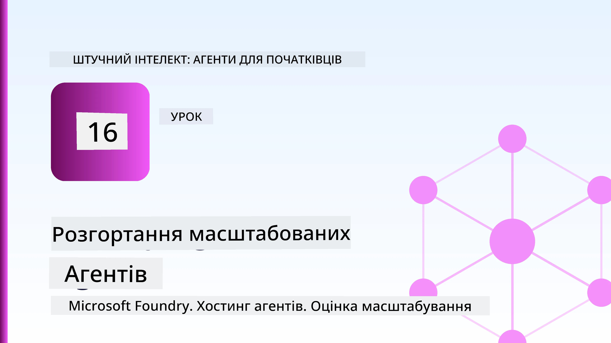
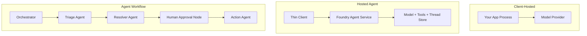
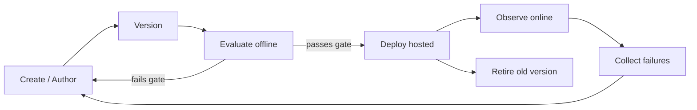
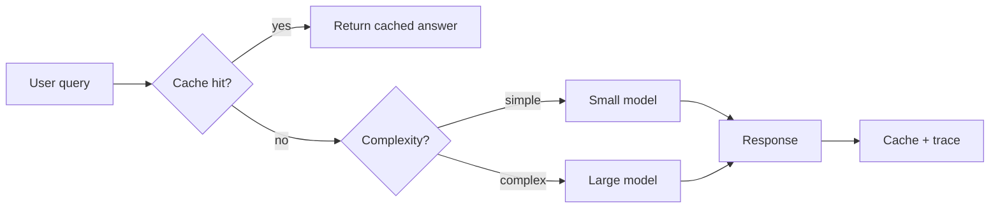
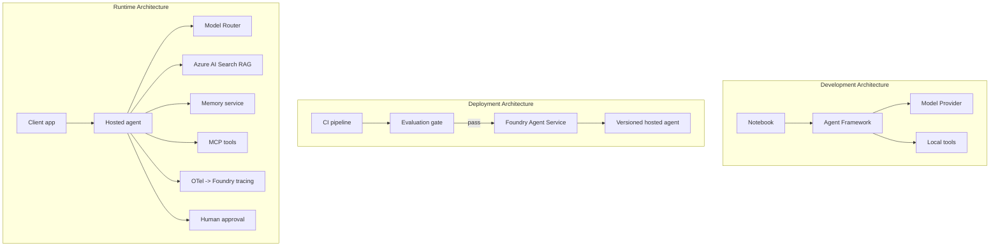

# Розгортання масштабованих агентів з Microsoft Foundry



До цього моменту в курсі ви створювали агентів, які працюють на вашому ноутбуці, всередині блокнота, керованого `az login` і кількома змінними середовища. Це саме правильний спосіб навчання. Проте це не правильний спосіб запуску агента, від якого залежать тисячі клієнтів о 3 годині ночі.

Цей урок стосується розриву між "все працює на моєму комп’ютері" і "це працює надійно та економно у виробництві". Ми закриваємо цей розрив за допомогою **Microsoft Foundry** та **Microsoft Foundry Agent Service**, створюючи реального агента підтримки клієнтів із інструментами, пошуком, пам’яттю, оцінкою та моніторингом.

## Вступ

Цей урок охоплює:

- Різницю між **прототипним агентом** та **розгорнутим агентом**, і чому перехід здебільшого стосується всього *навколо* моделі.
- **Патерни розгортання** агентів: клієнтське розміщення, розміщення як сервіс (Hosted Agents), та оркестрація робочих процесів.
- **Життєвий цикл агента** у Microsoft Foundry — створення, версія, розгортання, оцінка, спостереження, виведення з експлуатації.
- **Стратегії масштабування**: маршрутизація моделей, кешування, паралелізм, та безстанний дизайн.
- **Спостережуваність** з OpenTelemetry та трасуванням у Foundry.
- **Оптимізація вартості** через вибір моделі, маршрутизацію та ворота оцінки.
- **Питання підприємства**: керування, людське затвердження, безпечна робота MCP серверів у виробництві.

## Навчальні цілі

Після завершення цього уроку ви знатимете, як:

- Обрати правильний патерн розгортання для конкретного навантаження агента.
- Розгорнути агента у Microsoft Foundry Agent Service для версіювання, керування та спостережуваності.
- Інструментувати агента для трасування та налаштувати конвеєр оцінки перед кожним релізом.
- Застосувати маршрутизацію моделей і кешування для контролю затримки та вартості при масштабуванні.
- Додати людське підтвердження для дій з високим ризиком і інтегрувати MCP сервер у безпечний спосіб.

## Необхідні знання

Цей урок передбачає, що ви пройшли попередні уроки і комфортно працюєте з:

- Створення агентів з [Microsoft Agent Framework](../14-microsoft-agent-framework/README.md) (Урок 14).
- [Використання інструментів](../04-tool-use/README.md) (Урок 4) та [Agentic RAG](../05-agentic-rag/README.md) (Урок 5).
- [Пам’ять агента](../13-agent-memory/README.md) (Урок 13) та [Agentic Protocols / MCP](../11-agentic-protocols/README.md) (Урок 11).
- [Спостережуваність та оцінка](../10-ai-agents-production/README.md) (Урок 10) — цей урок безпосередньо спирається на нього.

Вам також знадобиться:

- **Підписка Azure** та **проект Microsoft Foundry** з щонайменше однією розгорнутою моделлю чату.
- **Azure CLI**, автентифікований (`az login`).
- Python 3.12+ та пакунки з репозиторію [`requirements.txt`](../../../requirements.txt).

## Від прототипу до виробництва: що справді змінюється

Прототипний агент та виробничий агент мають спільний основний цикл — міркування, виклик інструментів, відповідь. Змінюється все, що оточує цей цикл. Модель — це приблизно 20% виробничого агента; решта 80% — це операційний каркас.

| Питання | Прототип | Виробництво |
| --- | --- | --- |
| **Розміщення** | Працює у вашому блокноті | Працює як хостингова служба, версіонується та розгортається |
| **Ідентичність** | Ваш токен `az login` | Керована ідентичність з обмеженим RBAC |
| **Стан** | В пам’яті, втрачається при перезапуску | Зовнішній (сховище потоків, сервіс пам’яті) |
| **Збої** | Ви бачите трейсбек | Повтори, резервні варіанти, dead-letter, оповіщення |
| **Вартість** | "Це кілька центів" | Відстежується за запит, маршрутизована, кешована, бюджетована |
| **Якість** | Ви оцінюєте візуально | Автоматично оцінюється перед кожним релізом |
| **Довіра** | Ви схвалюєте кожну дію | Політика + людський контроль для ризикованих дій |

Пам’ятайте цю таблицю. Кожен розділ нижче відповідає одній з цих рядків.

## Патерни розгортання агентів

Є три патерни, які ви часто використовуватимете у комбінації.

### 1. Клієнтське розміщення агентів

Об’єкт агента живе в *вашому* процесі застосунку. Ваш код напряму викликає провайдера моделей; цикл розмірковування виконується у вашій службі. Це саме те, що робив кожен попередній урок.

- **Використовуйте, коли** потрібен повний контроль над циклом, кастомна проміжна логіка, або вбудування агента у існуючий бекенд.
- **Перевага/недолік**: самі відповідаєте за масштабування, стан і надійність.

### 2. Hosted Agents (Foundry Agent Service)

Агент *реєструється як ресурс* у Microsoft Foundry. Foundry розміщує цикл розмірковування, зберігає потокові повідомлення, забезпечує безпеку контенту та RBAC, робить агента видимим у порталі Foundry. Ваш застосунок стає тонким клієнтом, який створює потоки та читає відповіді.

- **Використовуйте, коли** потрібна довговічність, вбудована спостережуваність, керування та менша операційна складність.
- **Перевага/недолік**: менше низькорівневого контролю в обмін на кероване середовище виконання.

### 3. Робочі процеси агентів

Декілька агентів (та інструментів) поєднані у граф з явним контролем потоку — послідовні кроки, розгалуження, вузли людського схвалення, та стійкі контрольні точки, які можуть призупинятися і відновлюватися. Це можливість **Workflows** Microsoft Agent Framework, застосована на рівні розгортання.

- **Використовуйте, коли** одне завдання охоплює кілька спеціалізованих агентів або потребує кроку затвердження посередині.
- **Перевага/недолік**: більше рухомих частин; потребує спостережуваності на рівні оркестрації.



## Життєвий цикл агента в Microsoft Foundry

Розгортання агента — це не одноразове `push`. Це цикл, і він дуже схожий на цикл випуску програмного забезпечення, тому що це саме він.



Ключова ідея, взята з [Урок 10](../10-ai-agents-production/README.md): **офлайн оцінка — це ворота, а не післямова.** Нова версія агента не випускається, якщо не проходить ваші пороги оцінки. Онлайн спостережуваність повертає реальні збої назад у ваш офлайн тестовий набір. Це весь цикл.

## Стратегії масштабування

Масштабування агента відрізняється від масштабування безстанного веб-API, бо кожен запит може викликати кілька дорогих звернень до моделі та інструментів. Чотири техніки беруть на себе більшість навантаження.

**Обробка без стану.** Не зберігайте стан користувача у пам’яті процесу. Зберігайте потоки розмов у сховищі Foundry або сервісі пам’яті, щоб будь-який екземпляр міг обробити будь-який запит. Це дозволяє масштабуватися горизонтально — додавати екземпляри, без "липких" сесій.

**Маршрутизація моделей.** Не кожен запит потребує вашої найпотужнішої (і найдорожчої) моделі. Направляйте прості запити — класифікація наміру, короткі фактичні відповіді — на маленьку, швидку модель, а велику модель залишайте для справжнього розмірковування. Foundry має вбудований **Model Router**, або ви можете реалізувати легку класифікацію самостійно. Ви створите таку версію в лабораторії.

**Кешування відповідей.** Багато запитів служби підтримки є близькими дублями ("як скинути пароль?"). Кешуйте відповіді на поширені запитання і видавайте їх без звернення до моделі. Навіть скромний відсоток попадання у кеш значно знижує вартість і затримку.

**Паралельність та зворотній тиск.** Провайдери моделей мають обмеження швидкості. Обмежуйте паралельність, використовуйте повтори з експоненційним збільшенням затримки, і відмовляйтеся з гідністю (черговий "ми працюємо над цим" кращий за 500).



## Спостережуваність у виробництві

Ви не можете керувати тим, чого не бачите. Як було описано в Уроці 10, Microsoft Agent Framework нативно робить **OpenTelemetry** трасування — кожен виклик моделі, інструменту та крок оркестрації стає спаном. У виробництві ви експортуєте ці спани в Microsoft Foundry (або будь-який сумісний бекенд OTel), щоб:

- Прослідкувати одну скаргу клієнта по кінцях через кожен виклик моделі та інструменту.
- Спостерігати затримку p50/p95 та вартість за запит з часом.
- Отримувати сповіщення про сплески помилок та аномалії вартості раніше, ніж це помітять ваші користувачі (або фінансова команда).

```python
from agent_framework.observability import get_tracer

tracer = get_tracer()

with tracer.start_as_current_span("support_request") as span:
    span.set_attribute("customer.tier", "enterprise")
    span.set_attribute("routed.model", "gpt-5-nano")
    # agent execution is traced automatically inside this span
```

Атрибути як `customer.tier` та `routed.model` перетворюють гору трасувань у питання з відповідями ("чи часто корпоративних клієнтів спрямовують до маленької моделі?").

## Оптимізація вартості

Вартість у виробничих агентах переважно складається з токенів. Три важелі за ступенем впливу:

1. **Правильний розмір моделі.** Мала модель, що проходить вашу оцінку, майже завжди дешевша за велику, що також проходить. Використовуйте оцінку, щоб *довести*, що мала модель достатньо добра, а не за замовчуванням обирайте найбільшу для перестороги.
2. **Маршрутизація за складністю.** Як вище — сплачуйте за велику модель лише для запитів, які потребують її розмірковування.
3. **Агресивне кешування.** Найдешевший виклик моделі — той, який ви ніколи не робите.

Ворота оцінки та контроль вартості — це одна дисципліна, подивлена з двох боків: оцінка каже про *базову якість*, маршрутизація й кешування тримають вас якнайближче до *вартості* цього рівня.

## Питання розгортання на підприємстві

**Управління.** Hosted Agents успадковують RBAC, безпеку контенту та аудит Foundry. Кожному агенту призначайте керовану ідентичність з мінімальними правами — доступ тільки для читання до бази знань, обмежений доступ до API тикетів, нічого зайвого.

**Людина у циклі.** Деякі дії надто важливі для повної автоматизації — видача відшкодування, видалення облікового запису, ескалація до юридичного відділу. Microsoft Agent Framework підтримує інструменти **із необхідним затвердженням**: агент пропонує дію, виконання призупиняється, людина схвалює або відхиляє, і робочий процес відновлюється. Ви бачили примітив у [Уроці 6](../06-building-trustworthy-agents/README.md); тут ви його розгортаєте.

**MCP у виробництві.** [MCP](../11-agentic-protocols/README.md) дозволяє вашому агенту використовувати зовнішні інструменти через стандартний інтерфейс. У виробництві трактуйте кожен MCP сервер як недовірену межу: фіксуйте версію сервера, запускайте з обмеженою ідентичністю, перевіряйте його результати, і ніколи не розкривайте йому секрети. MCP сервер — це залежність, а залежності патчаться, проходять аудит і мають обмеження швидкості.



Ці три діаграми — розробка, розгортання, середовище виконання — це один агент на трьох етапах його життя. Лабораторна робота, що слідує, проведе вас крізь його створення.

## Практична лабораторія: агент підтримки клієнтів, готовий до виробництва

Відкрийте [`code_samples/16-python-agent-framework.ipynb`](./code_samples/16-python-agent-framework.ipynb) і пройдіть його повністю. Ви зберете **агента підтримки клієнтів Contoso** з усіма виробничими аспектами:

1. **Виклик інструментів** — перевірка статусу замовлення та відкриття запитів у підтримці.
2. **RAG** — відповіді на політичні запитання з бази знань (Azure AI Search, з запасним in-memory-варіантом для роботи блокнота без Search-ресурсу).
3. **Пам’ять** — запам’ятовування клієнта між ходами розмови.
4. **Маршрутизація моделей** — класифікатор складності направляє кожен запит до малої або великої моделі.
5. **Кешування відповідей** — повторювані питання видаються з кешу.
6. **Людське затвердження** — відшкодування вище порога призупиняються для підпису людиною.
7. **Конвеєр оцінки** — невеликий офлайн тестовий набір оцінює агента та служить воротами для релізу.
8. **Спостережуваність** — OpenTelemetry трасування для кожного запиту.

### Покроковий огляд

Блокнот організовано так, що кожен виробничий аспект є самостійною, запускаємою секцією. Серцем є обробник запитів із маршрутизацією і кешуванням:

```python
async def handle_support_request(query: str, customer_id: str) -> str:
    # 1. Serve from cache when we can.
    cached = response_cache.get(normalize(query))
    if cached:
        return cached

    # 2. Route by complexity to control cost.
    model = "gpt-5-nano" if is_simple(query) else "gpt-5-mini"

    # 3. Run the agent inside a trace span for observability.
    with tracer.start_as_current_span("support_request") as span:
        span.set_attribute("routed.model", model)
        span.set_attribute("customer.id", customer_id)
        response = await support_agent.run(query, model=model)

    # 4. Cache and return.
    response_cache.set(normalize(query), response.text)
    return response.text
```

Ворота оцінки, що охороняють реліз, виглядають так:

```python
async def evaluation_gate(agent, test_cases, threshold: float = 0.8) -> bool:
    passed = 0
    for case in test_cases:
        result = await agent.run(case["input"])
        if score_response(result.text, case["expected"]) >= 0.8:
            passed += 1
    pass_rate = passed / len(test_cases)
    print(f"Evaluation pass rate: {pass_rate:.0%} (gate: {threshold:.0%})")
    return pass_rate >= threshold  # only deploy if the gate passes
```

Читайте уважно кожен рядок — блокнот свідомо лишає примітиви невеликими, щоб нічого не було сховано за викликами фреймворку.

## Валідація розгорнутого агента за допомогою smoke-тестів

Ворота оцінки вище запускаються *офлайн* на вашому об’єкті агента. Після розгортання агента як Hosted Agent потрібно ще одну, навіть дешевшу перевірку: **чи агент на розгорнутій точці дійсно відповідає?**

«Успішне» розгортання лише доводить, що контрольна площина прийняла визначення — воно не доводить, що агент відповідає. Відсутність залежності, неправильна маршрутизація моделі або прострочене з’єднання може залишити зелене розгортання, яке нічого не повертає. **Smoke-тест** ловить це за секунди, при кожному розгортанні, без витрат на повну оцінку.

Цей репозиторій постачає готову піплайн smoke-тестів на базі GitHub Action [AI Smoke Test](https://github.com/marketplace/actions/ai-smoke-test):

- **Каталог** — [`tests/lesson-16-smoke-tests.json`](../../../tests/lesson-16-smoke-tests.json) містить промпти і твердження для агента підтримки Contoso (засновані відповіді на політичні питання, пошук замовлень, утримання теми, і підтримання послідовності багатокрокових звернень). Каталоги агентів інших уроків розміщені поруч — дивіться [`tests/README.md`](../tests/README.md).
- **Робочий процес** — [`.github/workflows/smoke-test.yml`](../../../.github/workflows/smoke-test.yml) увійде через Azure OIDC і надішле кожен промпт до кінцевої точки Responses агента, провалюючи задачу при будь-якій невдачі твердження.

```yaml
- name: Smoke-test hosted agent
  uses: JFolberth/ai-smoketest@v1
  with:
    project_endpoint: ${{ inputs.project_endpoint }}
    agent_name: ContosoSupportAgent
    tests_file: tests/lesson-16-smoke-tests.json
```

Запустіть це з вкладки **Дії** після розгортання вашого агента, подавши кінцеву точку проекту Foundry та ім’я агента. Федеральна ідентичність повинна мати роль **Azure AI User** в межах області проекту Foundry. Уявіть шари як піраміду: димові тести (досяжний і відповідає?) запускаються при кожному розгортанні, офлайн-оцінка (достатньо гарний для релізу?) виконується перед промоцією, а онлайн-оцінка (як він працює в реальних умовах?) запускається безперервно.

## Перевірка знань

Перевірте свої знання перед переходом до завдання.

**1. Приблизно яка частина виробничого агента — це «модель», а що є рештою?**

<details>
<summary>Відповідь</summary>

Модель є меншістю в системі — часто згадується приблизно 20%. Решта — це операційний «скелет»: хостинг і версіонування, ідентифікація та RBAC, зовнішній стан, обробка збоїв, відстеження вартості, оцінка та контролі з участю людини. Перехід у production переважно про побудову всього *навколо* циклу мислення.
</details>

**2. Коли ви оберете Hosted Agent замість агента, розміщеного на клієнті?**

<details>
<summary>Відповідь</summary>

Коли ви хочете кероване середовище виконання з вбудованою стійкістю (потоки, які зберігаються і можуть продовжуватися), спостережливістю, безпекою контенту та RBAC, і готові пожертвувати деяким низькорівневим контролем циклу мислення заради меншої операційної поверхні. Розміщення на клієнті переважне, коли потрібен повний контроль над циклом або агент інтегрується в існуючий бекенд.
</details>

**3. Чому масштабований агент повинен бути безстанним у власній пам’яті процесу?**

<details>
<summary>Відповідь</summary>

Щоб будь-який екземпляр міг обробити будь-який запит, що дозволяє горизонтальне масштабування без «липких» сесій. Стан розмови для користувача винесений у сховище потоків або сервіс пам’яті. Якби стан зберігався в пам’яті процесу, він губився б при перезапуску і навантаження не можна було б розподіляти вільно.
</details>

**4. Яку проблему вирішує маршрутизація моделей і як це пов’язано з оцінкою?**

<details>
<summary>Відповідь</summary>

Маршрутизація надсилає прості запити до малої, дешевої, швидкої моделі і залишає велику модель для справжнього мислення, контролюючи час відповіді і вартість. Це пов’язано з оцінкою, оскільки оцінка *підтверджує*, що мала модель достатньо хороша для певного класу запитів — маршрутизація без оцінки — це здогадки.
</details>

**5. Що таке «evaluation gate» і де він розташований у життєвому циклі?**

<details>
<summary>Відповідь</summary>

Evaluation gate запускає офлайн-набір тестів для нової версії агента і блокує розгортання, якщо відсоток проходження нижчий за поріг. Він розміщений між «версією» і «розгортанням» у життєвому циклі, роблячи якість передумовою релізу, а не тим, що перевіряється після випуску.
</details>

**6. Чому MCP сервер у production слід розглядати як ненадійний кордон?**

<details>
<summary>Відповідь</summary>

Тому що це зовнішня залежність, до якої звертається ваш агент. Варто зафіксувати його версію, запускати з обмеженою ідентичністю, перевіряти вихідні дані, обмежувати швидкість запитів і ніколи не передавати йому секрети — ті самі дисципліни, що й до будь-якої сторонньої залежності. Його результати впливають на мислення агента, тому необґрунтована довіра — це ризик безпеки.
</details>

**7. Яка одна зміна зазвичай має найбільший вплив на вартість виробничого агента і чому?**

<details>
<summary>Відповідь</summary>

Правильний вибір моделі — використання найменшої моделі, яка все ще проходить ваш evaluation gate. Вартість визначають токени, і менша модель, що відповідає стандартам якості, майже завжди дешевша за більшу. Кешування і маршрутизація знижують вартість далі, але вибір базової моделі має найбільший первинний вплив.
</details>

**8. Яку роль відіграють атрибути span, такі як `customer.tier` та `routed.model`, у спостережливості?**

<details>
<summary>Відповідь</summary>

Вони перетворюють сирі трасування на питання, на які можна дати відповідь у бізнесі. Без атрибутів ви маєте стіну span; з ними можна запитати «чи надто часто корпоративних клієнтів направляють до малої моделі?» або «яка модель обробляє наші найповільніші запити?» Атрибути показують, як розрізати телеметрію за вимірами, важливими для вашої роботи.
</details>

## Завдання

Візьміть агента підтримки клієнтів з лабораторної роботи і адаптуйте його для конкретного сценарію: **агент підтримки передплати для SaaS компанії.**

Ваше завдання:

1. **Замініть інструменти** на релевантні для білінгу: `get_subscription_status`, `get_invoice` і `issue_credit` (кредити понад $50 потребують затвердження людиною).
2. **Додайте три документи RAG** з політикою повернення, циклом білінгу і політикою скасування компанії.
3. **Розширте набір оцінки** до щонайменше восьми випадків, включно з двома, що *мають* активувати шлях затвердження людиною, і переконайтеся, що ваш evaluation gate правильно проходить або блокує.
4. **Додайте звіт про вартість**: після виконання десяти змішаних запитів через агента виведіть, скільки виконано через малу модель, скільки через велику і скільки обслуговано із кешу.

Напишіть короткий абзац (у маркдаун-комірці), пояснюючи, яке правило маршрутизації моделі ви обрали і як ви його перевірите на реальному трафіку. Правильної єдиної відповіді немає — оцінюють, наскільки чітко пов’язані продакшн-проблеми в одне ціле.

## Підсумок

У цьому уроці ви перевели агента з прототипу у production з Microsoft Foundry:

- Перехід у production — здебільшого про **операційний скелет** навколо моделі — хостинг, ідентифікацію, стан, обробку збоїв, вартість, якість і довіру.
- Ви вивчили три **патерни розгортання** — розміщення на клієнті, Hosted Agents і Agent Workflows — та коли кожен підходить.
- Ви пройшли через **життєвий цикл агента**, де офлайн **оцінка виступає як гейт релізу** та онлайн-спостереження подає збої назад у тестовий набір.
- Ви застосували **стратегії масштабування** — безстанність, маршрутизацію моделей, кешування та обмежену конкуренцію — і пов’язали це з **оптимізацією вартості**.
- Ви підключили **корпоративні контролі**: RBAC, затвердження людиною в циклі та безпечну для production інтеграцію MCP.
- Ви створили **агента підтримки клієнтів, готового до production**, що об’єднує всі ці аспекти у виконуваний код.

Наступний урок іде протилежним шляхом: замість масштабування агентів у хмарі ви перенесете їх *назовні* на один комп’ютер розробника і запустите цілком локально.

## Додаткові ресурси

- <a href="https://learn.microsoft.com/azure/ai-foundry/what-is-azure-ai-foundry" target="_blank">Документація Microsoft Foundry</a>
- <a href="https://learn.microsoft.com/azure/ai-foundry/agents/overview" target="_blank">Огляд Microsoft Foundry Agent Service</a>
- <a href="https://learn.microsoft.com/en-us/agent-framework/overview/?wt.mc_id=youtube_26688_organicsocial_reactor&pivots=programming-language-python" target="_blank">Microsoft Agent Framework</a>
- <a href="https://learn.microsoft.com/en-us/azure/ai-foundry/openai/concepts/model-router" target="_blank">Маршрутизатор моделей у Microsoft Foundry</a>
- <a href="https://learn.microsoft.com/azure/search/search-what-is-azure-search" target="_blank">Azure AI Search</a>
- <a href="https://opentelemetry.io/" target="_blank">OpenTelemetry</a>
- <a href="https://github.com/marketplace/actions/ai-smoke-test" target="_blank">AI Smoke Test GitHub Action</a>
- <a href="https://modelcontextprotocol.io/" target="_blank">Model Context Protocol (MCP)</a>

## Попередній урок

[Створення агентів для комп’ютерного використання (CUA)](../15-browser-use/README.md)

## Наступний урок

[Створення локальних AI агентів](../17-creating-local-ai-agents/README.md)

---

<!-- CO-OP TRANSLATOR DISCLAIMER START -->
**Відмова від відповідальності**:
Цей документ було перекладено за допомогою сервісу штучного інтелекту для перекладу [Co-op Translator](https://github.com/Azure/co-op-translator). Хоча ми прагнемо до точності, будь ласка, майте на увазі, що автоматичні переклади можуть містити помилки або неточності. Оригінальний документ рідною мовою слід вважати авторитетним джерелом. Для критично важливої інформації рекомендується професійний людський переклад. Ми не несемо відповідальності за будь-які непорозуміння або неправильні тлумачення, що виникли внаслідок використання цього перекладу.
<!-- CO-OP TRANSLATOR DISCLAIMER END -->