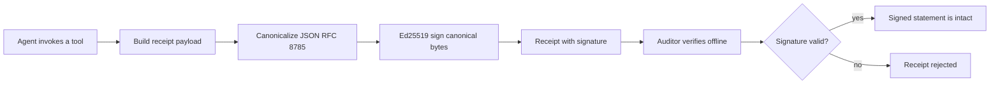
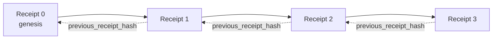

[Перегляньте відеоурок: Захист агентів ШІ за допомогою криптографічних квитанцій](https://youtu.be/PLACEHOLDER_VIDEO_ID)

> _(Відеоурок та мініатюра будуть додані командою Microsoft після злиття, у відповідності зі схемою уроків 14 / 15.)_

# Захист агентів ШІ за допомогою криптографічних квитанцій

## Вступ

У цьому уроці буде розглянуто:

- Чому журнали аудиту для агентів ШІ важливі для відповідності, налагодження та довіри.
- Що таке криптографічна квитанція і чим вона відрізняється від незавіреного рядка логу.
- Як створити підписану квитанцію для виклику інструмента агента на звичайній мові Python.
- Як перевірити квитанцію офлайн і виявити підробку.
- Як ланцюжити квитанції так, щоб видалення або зміна порядку однієї порушувала ланцюг.
- Що квитанції доводять і що вони явно не доводять.

## Цілі навчання

Після завершення уроку ви будете вміти:

- Визначати режими відмов, які стимулюють використання криптографічного походження для дій агента.
- Створювати квитанцію, підписану Ed25519, на канонічному JSON-пейлоаді.
- Перевіряти квитанцію незалежно, використовуючи лише публічний ключ підписувача.
- Виявляти підробку шляхом повторної перевірки модифікованої квитанції.
- Створювати хеш-ланцюжок квитанцій і пояснювати, чому ланцюг важливий.
- Розрізняти межі між тим, що квитанції доводять (атрибуція, цілісність, впорядкування) і тим, що вони не доводять (коректність дії, обґрунтованість політики).

## Проблема: журнал аудиту вашого агента

Уявіть, що ви розгорнули агента ШІ для Contoso Travel. Агент читає запити клієнтів, викликає API авіарейсів для пошуку варіантів і бронює місця від імені клієнта. У минулому кварталі агент обробив 50 000 бронювань.

Сьогодні прибув аудитор. Він задає просте питання: «Покажіть, що зробив ваш агент».

Ви передаєте журнали. Аудитор дивиться на них і ставить складніше питання: «Як я можу бути впевненим, що ці журнали не редагувалися?»

Це і є проблема журналу аудиту. Більшість розгортань агентів сьогодні покладаються на:

- **Журнали застосунку**: пишуться самим агентом, можуть редагуватись будь-ким з доступом до файлової системи.
- **Хмарні служби журналювання**: захищені від підробок на рівні платформи, але лише якщо аудитор довіряє оператору платформи.
- **Журнали транзакцій бази даних**: добре підходять для змін у базі, але не для довільних викликів інструментів.

Жоден із цих способів не може відповісти аудитору без вимоги довіряти комусь (вам, вашому хмарному провайдеру, вашому продавцю БД). Для внутрішнього використання ця довіра часто прийнятна. Для регульованих робочих навантажень (фінанси, охорона здоров’я, будь-що під регуляцією Закону ЄС про ШІ) це неприпустимо.

Криптографічні квитанції звужують цю проблему, роблячи підписані заяви незалежно
перевірними. Аудитор все ще потребує поза каналом підстав довіри до ключа підпису
і компонента, що створив заяву. Вбудований ключ гарантує внутрішню узгодженість,
а не особистість видавця або місце застосування запобіжних заходів.

## Що таке криптографічна квитанція?

Квитанція — це JSON-об’єкт, який записує, що зробив агент, підписаний цифровим підписом.



Мінімальна квитанція виглядає так:

```json
{
  "type": "agent.tool_call.v1",
  "agent_id": "contoso-travel-bot",
  "tool_name": "lookup_flights",
  "tool_args_hash": "sha256:a3f9c1...",
  "result_hash": "sha256:7b2e1d...",
  "policy_id": "contoso-travel-policy-v3",
  "timestamp": "2026-04-25T14:30:00Z",
  "sequence": 47,
  "previous_receipt_hash": "sha256:9d4e6a...",
  "signature": {
    "alg": "EdDSA",
    "sig": "c5af83...",
    "public_key": "8f3b2c..."
  }
}
```

Три властивості забезпечують роботу:

1. **Підпис**. Квитанція підписується шлюзом агента за допомогою приватного ключа Ed25519. Кожен, хто має відповідний публічний ключ, може перевірити підпис офлайн. Сторона, що покладається (relying party), повинна зафіксувати цей ключ або отримати його з довіреного реєстру поза квитанцією. Підробка будь-якого підписаного поля анулює підпис.

2. **Канонічне кодування**. Перед підписом квитанція серіалізується за схемою JSON Canonicalization Scheme (JCS, RFC 8785). Це гарантує, що дві реалізації, що генерують ідентичний логічний документ, створюють бінарно тотожний результат. Без канонізації різні серіалізатори JSON мали б різні підписи для одного й того ж вмісту.

3. **Хеш-ланцюжок**. Поле `previous_receipt_hash` пов’язує кожну квитанцію з попередньою. Видалення або зміна порядку квитанції порушує послідовність. Виявлення обрізання або підробки, контрольованої підписувачем, також потребує зафіксованої поточної вершини ланцюга, незалежно підтвердженого контрольного пункту або автентифікованого замкнутого зобов’язання населення.

Разом ці властивості забезпечують три гарантії:

- **Атрибуція ключу**: цей ключ підписав цей вміст. Організаційна або людська ідентичність потребує довіреного зв’язку з ключем.
- **Цілісність**: вміст не змінювався з моменту підпису.
- **Впорядкування у верифікованій послідовності**: ця квитанція посилається на попередню.

## Створення квитанції на Python

Для створення квитанції не потрібна спеціальна бібліотека. Криптографічні примітиви широко доступні, а логіка складається з кількох десятків рядків Python.

Практичні вправи в `code_samples/18-signed-receipts.ipynb` проходять увесь процес. Канторельований `code_samples/18-signed-receipts.execution-receipt.json` фіксує точний хеш записної книжки, середовище Python, кількість клітинок і перевірки останнього чистого запуску без зміни збережених результатів уроку. Коротка версія:

```python
import json
import hashlib
import base64
from nacl import signing
from jcs import canonicalize  # RFC 8785 canonical JSON

def b64url_nopad(data: bytes) -> str:
    return base64.urlsafe_b64encode(data).decode("ascii").rstrip("=")

def sha256_canonical(obj) -> str:
    """SHA-256 of a Python object's JCS-canonical JSON form."""
    return f"sha256:{hashlib.sha256(canonicalize(obj)).hexdigest()}"

# Generate or load a signing key (in production, store in a key vault)
signing_key = signing.SigningKey.generate()
verify_key = signing_key.verify_key
TRUSTED_PUBLIC_KEYS = {b64url_nopad(bytes(verify_key))}  # pinned out of band by the verifier

# Build the receipt payload (no signature yet)
tool_args = {"origin": "SYD", "destination": "LAX"}
tool_result = [{"flight": "QF11", "price": 1850, "stops": 0}]

payload = {
    "type": "agent.tool_call.v1",
    "agent_id": "contoso-travel-bot",
    "tool_name": "lookup_flights",
    "tool_args_hash": sha256_canonical(tool_args),
    "result_hash": sha256_canonical(tool_result),
    "policy_id": "contoso-travel-policy-v3",
    "timestamp": "2026-04-25T14:30:00Z",
    "sequence": 0,
    "previous_receipt_hash": None,
}

# Canonicalize and sign the JCS bytes directly. PureEdDSA hashes internally.
canonical_bytes = canonicalize(payload)
signature_bytes = signing_key.sign(canonical_bytes).signature

# Attach a structured signature object.
receipt = {
    **payload,
    "signature": {
        "alg": "EdDSA",
        "sig": b64url_nopad(signature_bytes),
        "public_key": b64url_nopad(bytes(verify_key)),
    },
}
```

Це вся конвеєрна логіка підпису. Вправи в записній книжці проходять кожен крок.

## Перевірка квитанції та виявлення підробки

Перевірка — це обернена операція:

```python
import base64
import hashlib
from nacl import signing
from nacl.exceptions import CryptoError
from jcs import canonicalize

def b64url_decode(s: str) -> bytes:
    # Strict: Python's decoder skips characters outside the alphabet and also
    # accepts padding, the standard +/ alphabet and non-zero spare bits.
    # Re-encoding and comparing accepts only the one unpadded base64url form.
    padding = "=" * ((4 - len(s) % 4) % 4)
    data = base64.urlsafe_b64decode(s + padding)
    if base64.urlsafe_b64encode(data).decode("ascii").rstrip("=") != s:
        raise ValueError("not canonical unpadded base64url")
    return data

def verify_receipt(receipt: dict, trusted_public_key: str) -> bool:
    # trusted_public_key is the issuer's key, obtained from somewhere other
    # than this receipt. Never use receipt["signature"]["public_key"] here:
    # see "What Receipts Prove (and What They Do Not)" below.
    # Fails closed: anything malformed returns False instead of raising.
    if not isinstance(receipt, dict) or not isinstance(trusted_public_key, str):
        return False
    sig_obj = receipt.get("signature")
    if not isinstance(sig_obj, dict) or sig_obj.get("alg") != "EdDSA":
        return False
    sig_b64 = sig_obj.get("sig")
    if not isinstance(sig_b64, str):
        return False

    try:
        # Reconstruct the payload that was actually signed (everything except signature).
        payload = {k: v for k, v in receipt.items() if k != "signature"}
        canonical_bytes = canonicalize(payload)
        verify_key = signing.VerifyKey(b64url_decode(trusted_public_key))
        verify_key.verify(canonical_bytes, b64url_decode(sig_b64))
        return True
    except (CryptoError, TypeError, ValueError, KeyError, OverflowError):
        return False
    except Exception:
        # An undecodable key or signature, or a payload that cannot be
        # canonicalized: fail closed rather than raise.
        return False
```

Ця функція приймає квитанцію та публічний ключ видавця й повертає `True`, якщо підпис дійсний, і `False` інакше, у тому числі при некоректному форматі вхідних даних. Жодних мережевих викликів і жодного сервісу перевірки: після отримання ключа видавця перевірка цілком локальна і офлайн. Єдина вимога — цей ключ, отриманий не з самої квитанції.

Щоб побачити виявлення підробки на практиці, записна книжка проходить:

1. Створення дійсної квитанції та підтвердження її валідації.
2. Зміну одного байта поля `tool_args_hash`.
3. Повторну перевірку та виявлення помилки.
4. Підробку з повторним підписом з ключа, створеного атакуючим, який вбудовується у квитанцію.

Крок 4 вартий особливої уваги. Та квитанція внутрішньо узгоджена: її підпис справжній для її вмісту і для ключа, який вона містить, тому вона валідна проти вбудованого ключа. Вона не проходить перевірку лише проти справжнього ключа видавця. Кроки 2 і 3 ловлять тих, хто не повторно підписав; крок 4 ловить того, хто підписав.

Це практична демонстрація того, що квитанції є свідками підробок: будь-яка зміна підписаного поля ламає підпис, за умови перевірки з ключем, якого не надав атакуючий. Об’єкт `signature` поза підписаними байтами, тому ключ для перевірки має бути отриманий не з квитанції.

## Ланцюжок квитанцій для багатокрокових агентів

Одна підписана квитанція захищає одну дію. Ланцюжок квитанцій захищає послідовність.



Кожна квитанція записує хеш попередньої квитанції. Щоб тихо видалити квитанцію 2, атакуючий мав би:

- Змінити поле `previous_receipt_hash` квитанції 3 (порушить підпис квитанції 3), АБО
- Сфальсифікувати новий підпис для зміненої квитанції 3 (потрібен приватний ключ агента).

Якщо приватний ключ знаходиться у апаратному сховищі ключів і перевіряльники перевіряють кожну квитанцію проти публічного ключа видавця, отриманого незалежно (опублікований набір JWK або зафіксоване конфігураційне значення), жодна атака не здійсненна без виявлення. Публікація ключа всередині кожної квитанції не є достатньою: атакуючий може повторно підписати власним ключем і вбудувати його, це виправлення `04_resigned_receipt.json`.

У записній книжці проходиться:

1. Створення ланцюга з трьох квитанцій.
2. Перевірка, що кожне поле `previous_receipt_hash` співпадає з фактичним хешем попередньої квитанції.
3. Підробка однієї квитанції посередині і спостереження розриву ланцюга саме в цій точці.

Ось як ви створюєте журнал аудиту, який зовнішній аудитор може перевірити з власними
зафіксованими ключами видавця та контрольними точками ланцюга, без довіри до вашого змінного сховища журналів.

## Що доводять квитанції (і що ні)

Це найважливіша секція уроку. Квитанції потужні, але їх сила обмежена.

**Квитанції доводять три речі:**

1. **Атрибуція**: певний ключ підписав певний пейлоад.
2. **Цілісність**: пейлоад не змінювався після підпису.
3. **Впорядкування у заданій, перевіреній послідовності**: ця квитанція посилається на попередню.

**Квитанції НЕ доводять:**

1. **Коректність**: що дія агента була правильною. Квитанція може бути підписана за неправильну відповідь так само легко, як і за правильну.
2. **Дотримання політики**: що політика, згадана у `policy_id`, була справді оцінена або що вона дозволила б цю дію, якби була перевірена. Квитанція фіксує те, що заявлено, а не те, що застосовано.
3. **Ідентичність поза ключем**: квитанція каже «цей ключ підписав цей вміст». Вона не каже «це людина авторизувала це.» Зв’язок ключа з людиною чи організацією потребує окремої інфраструктури ідентифікації (каталог, реєстр публічних ключів тощо).
4. **Правдивість вхідних даних**: якщо агент отримує змінений запит і діє на його основі, квитанція точно фіксує дію. Квитанції — це наступний рівень після валідації вхідних даних, а не її заміна.
5. **Виконання або ефект у реальному світі**: квитанція після виклику фіксує те, що видавець стверджує, що сталося. Доказ прийому чи узгодження зовнішнього ефекту потребує доказів від фактичного виконавця або межі провайдера.
6. **Повноту**: відсутня квитанція може означати заблоковану, пропущену, втратовану або необладнану дію. Відсутність стає доказом лише у автентифікованій обмеженій групі.
7. **Довірений час**: підписаний часовий штамп доводить, що підписувач володів значенням, а не що значення було правильним. Довірений час потребує окремого авторитету часу або контрольної точки.

**Ключ у квитанції не є ключем, яким ви перевіряєте.** Це випливає з пункту 3 та єдиний випадок, коли ця відмінність має змінити ваш код, а не розуміння. `public_key` у прикладі вище потрібен, щоб приклад був самодостатнім. Перевіряльник ніколи не повинен йому довіряти. Будь-хто може взяти квитанцію, змінити її, підписати ключем, який він створив, і вбудувати цей ключ; результат ідеально підтверджується проти себе. Це фікстура `04_resigned_receipt.json` у `sample_receipts/`, саме тому `verify_receipt` вище приймає ключ як аргумент, а не читає його з квитанції. Отримуйте ключ видавця незалежно, з набору JWK у Перевірочному списку виробництва нижче або з іншої зафіксованої точки, і перевіряйте з цим ключем. Підпис, перевірений ключем, що прийшов у тому ж конверті, доводить лише внутрішню узгодженість конверта.

Ця межа важлива з двох причин:

- Вона пояснює, для чого корисні квитанції: робити поведінку агента аудиторською та піддающеюся виявленню підробок, навіть між організаційними межами.
- Вона вказує, які додаткові шари ще потрібні: валідація вхідних даних (Урок 6), виконання політики (частково нижче) та інфраструктура ідентичності (поза межами цього уроку).

Загальна помилка — вважати, що «ми маємо квитанції» означає «нами керують». Ні. Квитанції — це основа. Керівництво — це система, яку ви будуєте поверх них.

## Прив’язка підпису схвалювача до конкретної дії

Пункт 3 вище заслуговує окремої секції: квитанція про дію каже «цей ключ підписав цей вміст», а не «людина авторизувала це». Для дій з високим ризиком (повернення грошей, видалення, банківські перекази) окремий підпис схвалювача може прив’язати саме цю дію. Зв’язок цього ключа з людиною і перевірка присутності людини залишаються окремими завданнями.

Наступна записна книжка `code_samples/human-authorization-receipts.ipynb` додає другий тип квитанції, `human.approval.v1`, такого ж формату, як і квитанції уроку (типізований пейлоад, підписаний Ed25519 над канонічними байтами JCS, з об’єктом `signature` поза підписом). Ключ схвалювача підписує **повну канонічну дію та її дайджест**; ключ агента підписує заяву з **тим самим дайджестом дії** і `parent_approval_ref`, `receipt_hash` схвалення, так само, як `previous_receipt_hash` у ланцюгу вище. Одна функція `verify_chain` обробляє обидва артефакти під **окремими зафіксованими реєстрами ключів** (ключі схвалювача проти ключів агента), тож код спільний, але авторитети ніколи.

Властивість, яку це дає, висловлена точно: *зафіксований ключ схвалювача підписав цю саме
дію, і ключ агента пізніше підписав заяву з тим самим дайджестом дії.*
Це корисні докази, але самі по собі вони не доводять виконання дії. Щоби
керувати виконанням, точне схвалення повинне бути резервоване і використане один раз на
фактичній межі виконавця; невідомі результати провайдера мають залишатися невідомими, а не
бездумно повторюватися. Відмови у записній книжці тестують шар ланцюга квитанцій:

- підробку, збентеженого посередника, підроблені ключі будь-якої сторони та некоректне введення;
- **протермінований авторитет**: підпис, що ще верифікується, але відмовлено через зміну версії політики, вилучення ключа схвалювача з зафіксованого реєстру чи закінчення терміну схвалення перед часом перевірки;
- **заміщення дайджесту**: дійсно підписана квитанція дії, що вказує на *реальне* схвалення, яке прив’язує *іншу* канонічну дію.

Кожен збій відмовляється з окремою причиною, тож аудитор може визначити, чи протермінувався авторитет або змінилася заявлена дія. Перевірка є тільки для читання і повторювана: вона не споживає схвалення і не викликає провайдера. Окремий виконавець потребує надійного атомарного захисту від повторного запуску та явної індикації успіху, невдачі чи невизначеності. Квитанція з людським схваленням — це освітній композит, визначений цим уроком, а не тип квитанції, визначений `draft-farley-acta-signed-receipts`.

## Посилання для виробництва

Python-код у цьому уроці навмисно мінімальний, щоб ви могли прочитати кожен рядок і точно зрозуміти, що відбувається. У виробничому середовищі у вас є два варіанти:

1. **Працювати безпосередньо з криптографічними примітивами.** 50 рядків, які ви побачили вище, достатньо для багатьох випадків використання. PyNaCl (Ed25519) і пакет `jcs` (канонічний JSON) є добре підтримуваними та перевіреними бібліотеками.

2. **Використовувати виробничу бібліотеку для квитанцій.** Кілька проєктів із відкритим кодом реалізують той самий патерн із додатковими можливостями (ротація ключів, пакетна перевірка, розповсюдження JWK-набору, інтеграція з політичними движками):
   - Процес підписування використовує конвенції JCS та signature-scope у незалежному чернетці IETF Internet-Draft ([`draft-farley-acta-signed-receipts`](https://datatracker.ietf.org/doc/draft-farley-acta-signed-receipts/), ревізія 02). Плоска освітня квитанція цього уроку відрізняється від `{payload, signature}` конверта чернетки і не подається як відповідна до стандарту реалізація. Чернетка публікує спільний набір для перевірки відповідності ([agent-governance-testvectors](https://github.com/ScopeBlind/agent-governance-testvectors)) для реалізацій, орієнтованих на її формат передавання.
   - Microsoft Agent Governance Toolkit компонує квитанції з рішеннями на основі Cedar; дивіться Урок 33 у тому репозиторії для повного прикладу.
   - Пакети `protect-mcp` (npm) та `@veritasacta/verify` (npm) реалізують підписування квитанцій і офлайн-перевірку на Node, призначені для обгортання будь-якого MCP сервера з неможливістю підміни аудиту, включаючи поток затримки співавторизації, де призупинена дія видає квитанцію про схвалення, пов’язану з дайджестом дії (підтверджену WebAuthn у настільному потоці), той самий патерн схвалення, що й у ноутбуці людської авторизації вище.
   - **[nobulex](https://github.com/arian-gogani/nobulex)** Python SDK (`pip install nobulex`) забезпечує той самий патерн підписання Ed25519 + JCS у Python із інтеграціями LangChain та CrewAI, включаючи опубліковані вектори крос-валідації та відповідність, додану через [OWASP PR #2210](https://github.com/OWASP/CheatSheetSeries/pull/2210).
   - **[EMILIA Protocol](https://github.com/emiliaprotocol/emilia-protocol)** надає доповнювальний шар застосування точних дій: офлайн-перевірні квитанції схвалення, вбудований WebAuthn або кворм-авторитет, одноразове споживання на межі виконавця й явний шлях із невизначеним результатом. Її адаптери фреймворку розглядають квитанцію як необхідний доказ, а не як підтвердження факту зовнішнього ефекту.

Вибір між власною реалізацією та бібліотекою відповідає вибору між написанням власної бібліотеки JWT і використанням перевіреної: обидва варіанти розумні; бібліотека економить час і зменшує площу аудиту; підхід „з нуля“ змушує вас розуміти кожен примітив. Цей урок навчає саме підходу з нуля, щоб ви мали основу для будь-якого вибору.

## Перевірка знань

Перевірте свої знання перед тим, як перейти до практичного завдання.

**1. Квитанція підписується приватним ключем Ed25519 агента. Аудитор має лише публічний ключ. Чи може аудитор перевірити квитанцію офлайн?**

<details>
<summary>Відповідь</summary>

Так, криптографічна перевірка вимагає лише публічного ключа і підписаних байтів. 
Аудитор повинен самостійно отримати і закріпити прийнятий публічний ключ незалежно від квитанції.
Після встановлення цієї конфігурації довіри мережеві виклики не потрібні.
</details>

**2. Атакуючий змінює поле `policy_id` у квитанції, щоб заявити, що вона регулювалася більш лояльною політикою. Підпис було зроблено над оригінальним навантаженням. Що станеться під час перевірки?**

<details>
<summary>Відповідь</summary>

Перевірка не вдається. Підпис було обчислено над канонічними байтами оригінального навантаження; зміна будь-якого поля змінює ці байти, що робить підпис недійсним. Атакуючому потрібен приватний ключ для створення нового дійсного підпису, якого він не має.
</details>

**3. Чому квитанція містить `tool_args_hash` і `result_hash` замість сирих аргументів і результату?**

<details>
<summary>Відповідь</summary>

Дві причини. По-перше, квитанцію можливо треба архівувати або передавати у середовищах, де витік сирого вмісту (PII, бізнес-даних) є проблемою. Хешування зберігає квитанцію компактною і захищає вміст; аудитор перевіряє, що хеш відповідає окремо збереженій копії фактичного вмісту. По-друге, хеші мають фіксований розмір; квитанція з хешами обмежена за розміром, незалежно від того, якими великими були вхідні та вихідні дані.
</details>

**4. Поле `previous_receipt_hash` пов’язує кожну квитанцію з її попередником. Якщо атакуючий безшумно видалить одну квитанцію посеред ланцюга, що стане недійсним?**

<details>
<summary>Відповідь</summary>

Кожна квитанція, що йшла після видаленої. Їхні поля `previous_receipt_hash` більше не відповідають фактичному ланцюгу (бо квитанції, на яку вони посилалися, більше не існує, або ланцюг тепер вказує на іншого попередника). Щоб приховати видалення, атакуючий повинен повторно підписати кожну наступну квитанцію, що вимагає приватного ключа видавця. Повторний підпис іншим ключем не проходить перевірку з ключем видавця.
</details>

**5. Квитанція перевірена успішно. Чи доводить це, що дія агента була правильною, коректною або відповідала політиці?**

<details>
<summary>Відповідь</summary>

Ні. При використанні закріпленого ключа і контексту ланцюга дійсна квитанція доводить атрибуцію підпису,
цілісність вмісту та зв’язок із поданим попередником. Вона НЕ доводить, що
дія була правильною або виконаною, що політика була оцінена, що часову позначку
можна довіряти або що набір записів є повним. Це найважливіша межа у цьому уроці.
</details>

## Практичне завдання

Відкрийте `code_samples/18-signed-receipts.ipynb` і виконайте всі чотири частини:

1. **Частина 1**: Підпишіть першу квитанцію і перевірте її.
2. **Частина 2**: Пошукайте втручання в квитанцію і спостерігайте, як перевірка не проходить.
3. **Частина 3**: Побудуйте ланцюг із трьох квитанцій і перевірте цілісність ланцюга.
4. **Частина 4**: Застосуйте патерн до агента, побудованого з Microsoft Agent Framework: обгорніть виклик інструменту в підписування квитанції, а потім перевірте квитанцію окремо.

**Додаткове завдання 1:** розширте схему квитанції власним додатковим полем (наприклад, ID запиту для трасування), оновіть логіку канонічного підписування, щоб його включити, і підтвердіть, що квитанція все ще проходить перевірку. Потім змініть поле після підписання і підтвердіть, що перевірка не проходить. Це змусить вас зрозуміти, як кожен байт канонічного кодування впливає на підпис.

**Додаткове завдання 2:** SHA-256-хешуйте дві свої квитанції разом (конкатенуйте їх канонічні байти у детермінованому порядку) і вставте отриманий дайджест як нове поле в третю квитанцію перед підписанням. Перевірте, що всі три квитанції проходять перевірку. Ви щойно побудували одноступеневе підтвердження включення: будь-хто, хто має третю квитанцію, може довести існування перших двох на момент її підписання, не розкриваючи їхнього вмісту. Це патерн, який використовується квитанціями з вибірковим розкриттям у масштабі (Merkle commitments, RFC 6962).

## Висновок

Криптографічні квитанції дають агентам ШІ аудиторський слід, який є:

- **Незалежно перевірним під закріпленою довірою**: сторона з прийнятими публічними ключами і підписаними байтами може перевірити без залежності від сервісу.
- **Неможливим до підробки**: будь-яка зміна анулює підпис.
- **Портативним**: квитанція — це невеликий JSON-файл; її можна архівувати, передавати і перевіряти будь-де.
- **Відповідним стандартам**: побудована на Ed25519 (RFC 8032), JCS (RFC 8785) і SHA-256, усіх широко використовуваних примітивах.

Вони не є заміною для перевірки вхідних даних, застосування політики, допуску виконавців,
доказів результату, контролю повноти або ідентифікаційної інфраструктури. Вони є основою
для цих шарів. У регульованих або мультиорганізаційних робочих процесах квитанції роблять конкретні
заяви видавця незалежно перевірними під налаштування довіри аудитора.

Найголовніший висновок: квитанції доводять, що певний ключ підписав певний
вміст. Підтримувана часові позначка є твердженням підписувача, якщо її не заверено окремо в часі. Квитанція
не доводить, що її вміст був правдивим, що дія виконана, або що
набір записів є повним. Тримайте ці відмінності чітко.

## Перелік для виробничого застосування

Коли будете готові випустити цих агентів із підписаними квитанціями у реальному середовищі:

- [ ] **Перенесіть ключ підписування з ноутбука розробника.** Використовуйте Azure Key Vault, AWS KMS або модуль апаратної безпеки. Приватний ключ, що підписує квитанції, ніколи не повинен зберігатися в системах контролю версій або в відкритому вигляді на машинах додатків.
- [ ] **Встановіть довіру до ключа перевіряючого.** Публікуйте ключі через JWK-набір або реєстр, а сторони, що користуються, повинні закріпити прийнятний Ідентифікатор видавця, набір ключів і політику ротації поза окремими квитанціями. Вбудований ключ сам по собі не є анкером довіри.
- [ ] **Закріпіть ланцюг зовні.** Періодично записуйте хеш останньої голови ланцюга у журнал прозорості (Sigstore Rekor, авторитет часових позначок RFC 3161 або внутрішня система), щоб зовнішня сторона могла підтвердити «цей ланцюг існував на цей час».
- [ ] **Зберігайте квитанції незмінними.** Сховища, що підтримують лише додавання (Azure Storage з політиками незмінності, AWS S3 Object Lock), заважають внутрішньому користувачу переписувати історію на рівні зберігання.
- [ ] **Визначте строки зберігання.** Багато вимог відповідності передбачають багаторічне зберігання. Плануйте зростання квитанцій (кожна квитанція приблизно 500 байт; агент, який робить 10 тис. викликів на день, створює близько 1,8 ГБ на рік).
- [ ] **Документуйте, що квитанції не охоплюють.** Квитанції доводять атрибуцію, цілісність і впорядкування. Ваш робочий порядок має явно перераховувати додаткові контролі (перевірка вхідних даних, застосування політики, обмеження швидкості, ідентифікаційна інфраструктура), які працюють разом із квитанціями у вашій політиці управління.

### Є більше питань про захист агентів ШІ?

Приєднуйтеся до [Microsoft Foundry Discord](https://aka.ms/ai-agents/discord), щоб зустрітися з іншими учнями, відвідати години для відповідей і отримати відповіді на ваші запитання про агенти ШІ.

## Поза цим уроком

Цей урок охоплює підписування однієї квитанції і послідовності у вигляді хеш-ланцюга. Ті ж примітиви складають кілька більш складних патернів, що можуть з’явитись у міру розвитку вашої системи керування:

- **Вибіркове розкриття.** Коли поля квитанції окремо зафіксовані (дерево Меркла у стилі RFC 6962), ви можете розкривати конкретні поля конкретним аудиторам і доводити, що решта не змінилися, не розкриваючи їх. Корисно, коли одна квитанція має відповідати одночасно повному аудиту (який вимагає повноти) та правилам мінімізації даних, як-от GDPR (який хоче, щоб аудитор побачив якомога менше).
- **Скасування квитанцій.** Якщо ключ підписування скомпрометовано, потрібно спосіб позначити всі квитанції, підписані цим ключем, як недовірені з певного моменту часу. Стандартні патерни: короткострокові ключі підписування плюс опублікований список скасувань або журнал прозорості з записами про скасування.
- **Двосторонні / розділені квитанції з підписами.** Деякі реалізації розділяють підпис для частин навантаження до виконання (`authorization_*`) і після виконання (`result_*`) окремими підписами, корисно, коли рішення на авторизацію та спостережуваний результат роблять різні учасники або у різний час. Це додатково накладається на формат квитанції з цього уроку.
- **Композиція навантаження.** Квитанція запечатує будь-які байти в `result_hash`. В реальному світі навантаження часто багатше за результат одного виклику інструменту: передрішення (прогноз моделі, розглянуті опції, докази і їхня повнота, позиція ризику, ланцюг відповідальності, результат воріт) усе може міститися у навантаженні і бути запечатаним однією квитанцією. Це зберігає формат квитанції мінімальним і дозволяє розвивати схеми навантаження по доменах.
- **Перекрестна перевірка відповідності реалізацій.** Кілька незалежних реалізацій того самого формату квитанції (Python, TypeScript, Rust, Go) перевіряють одна одну за спільними тестовими векторами. Якщо ви побудуєте власну реалізацію, перевірка за опублікованими векторами підтвердить сумісність формату.
- **Перехід на постквантові алгоритми.** Ed25519 широко використовується сьогодні, але не є квантово-стійким. Маркер `alg` сам по собі не є переходом: профіль повинен визначати кодування ключа ML-DSA, канонічні підписані байти, перевірку, політику довіри сторони, стійкість до пониження та семантику переходу. Плануйте і тестуйте перехід із подвійним підписом за спільними векторами до проголошення сумісності.

## Додаткові ресурси

- <a href="https://datatracker.ietf.org/doc/draft-farley-acta-signed-receipts/" target="_blank">IETF Internet-Draft: Підписані квитанції-рішення для машинного контролю доступу</a>
- <a href="https://learn.microsoft.com/azure/ai-studio/responsible-use-of-ai-overview" target="_blank">Огляд відповідального ШІ (Azure AI)</a>
- <a href="https://datatracker.ietf.org/doc/html/rfc8032" target="_blank">RFC 8032: Алгоритм цифрового підпису на кривій Едвардса (EdDSA)</a>
- <a href="https://datatracker.ietf.org/doc/html/rfc8785" target="_blank">RFC 8785: Схема канонізації JSON (JCS)</a>
- <a href="https://datatracker.ietf.org/doc/html/rfc6962" target="_blank">RFC 6962: Прозорість сертифікатів</a> (побудова дерева Меркла, що використовується квитанціями з вибірковим розкриттям)
- <a href="https://github.com/microsoft/agent-governance-toolkit/blob/main/docs/tutorials/33-offline-verifiable-receipts.md" target="_blank">Microsoft Agent Governance Toolkit, Урок 33: Офлайн-перевірні квитанції-рішення</a>
- <a href="https://github.com/ScopeBlind/agent-governance-testvectors" target="_blank">Вектори тестів для перевірки відповідності реалізацій</a> формату квитанцій цього уроку (Apache-2.0)
- <a href="https://pynacl.readthedocs.io/" target="_blank">Документація PyNaCl</a> (Ed25519 у Python)

## Попередній урок

[Створення локальних агентів ШІ](../17-creating-local-ai-agents/README.md)

---

<!-- CO-OP TRANSLATOR DISCLAIMER START -->
**Відмова від відповідальності**:
Цей документ було перекладено за допомогою сервісу штучного інтелекту для перекладу [Co-op Translator](https://github.com/Azure/co-op-translator). Хоча ми прагнемо до точності, будь ласка, майте на увазі, що автоматичні переклади можуть містити помилки або неточності. Оригінальний документ рідною мовою слід вважати авторитетним джерелом. Для критично важливої інформації рекомендується професійний людський переклад. Ми не несемо відповідальності за будь-які непорозуміння або неправильні тлумачення, що виникли внаслідок використання цього перекладу.
<!-- CO-OP TRANSLATOR DISCLAIMER END -->