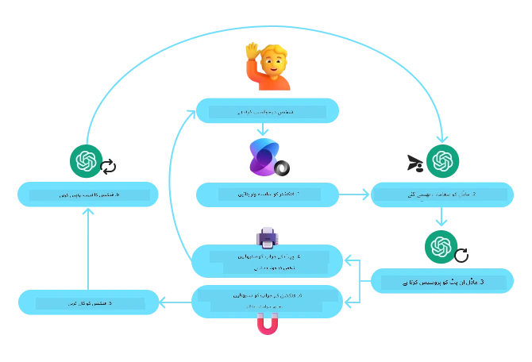
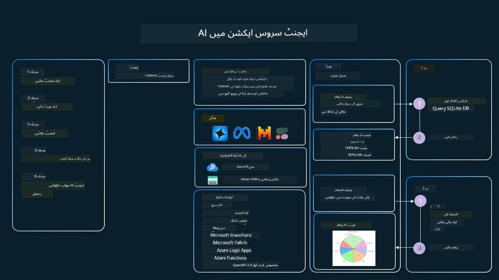

[](https://youtu.be/vieRiPRx-gI?si=cEZ8ApnT6Sus9rhn)

> _(اس سبق کی ویڈیو دیکھنے کے لیے اوپر والی تصویر پر کلک کریں)_

# ٹول استعمال کرنے کا ڈیزائن پیٹرن

ٹولز دلچسپ ہوتے ہیں کیونکہ وہ AI ایجنٹس کو وسیع تر صلاحیتوں کی اجازت دیتے ہیں۔ ایجنٹ کے پاس محدود کارروائیوں کا سیٹ ہونے کے بجائے، ٹول شامل کرنے سے ایجنٹ اب وسیع پیمانے پر کارروائیاں انجام دے سکتا ہے۔ اس باب میں، ہم ٹول استعمال کرنے کے ڈیزائن پیٹرن کو دیکھیں گے، جو بیان کرتا ہے کہ AI ایجنٹس مخصوص ٹولز کا استعمال کیسے کر سکتے ہیں تاکہ اپنے مقاصد حاصل کر سکیں۔

## تعارف

اس سبق میں، ہم مندرجہ ذیل سوالات کے جواب تلاش کرنے جا رہے ہیں:

- ٹول استعمال کرنے کا ڈیزائن پیٹرن کیا ہے؟
- کن استعمال کے معاملات میں اسے لاگو کیا جا سکتا ہے؟
- اس ڈیزائن پیٹرن کو نافذ کرنے کے لیے کن اجزاء/بلڈنگ بلاکس کی ضرورت ہوتی ہے؟
- قابل اعتماد AI ایجنٹس بنانے کے لیے ٹول استعمال کرنے کے ڈیزائن پیٹرن کے استعمال کے لیے کیا خاص غور و فکر درکار ہیں؟

## سیکھنے کے مقاصد

اس سبق مکمل کرنے کے بعد، آپ قابل ہو جائیں گے:

- ٹول استعمال کرنے کے ڈیزائن پیٹرن اور اس کے مقصد کی تعریف کریں۔
- ان استعمال کے معاملات کی نشاندہی کریں جہاں ٹول استعمال کرنے کا ڈیزائن پیٹرن قابل اطلاق ہو۔
- ڈیزائن پیٹرن کو نافذ کرنے کے لیے درکار اہم اجزاء کو سمجھیں۔
- اس ڈیزائن پیٹرن کا استعمال کرنے والے AI ایجنٹس میں اعتماد کو یقینی بنانے کے لیے غور و خوض کو پہچانیں۔

## ٹول استعمال کرنے کا ڈیزائن پیٹرن کیا ہے؟

**ٹول استعمال کرنے کا ڈیزائن پیٹرن** LLMs کو مخصوص ٹولز کے ساتھ تعامل کرنے کی صلاحیت دیتا ہے تاکہ مخصوص اہداف حاصل کیے جا سکیں۔ ٹولز وہ کوڈ ہوتے ہیں جنہیں ایجنٹ چلانے کے لیے استعمال کرتا ہے تاکہ کارروائیاں کی جا سکیں۔ کوئی ٹول ایک سادہ فنکشن ہو سکتا ہے جیسے کیلکولیٹر، یا تیسری پارٹی کی خدمت کے لیے API کال جیسے اسٹاک کی قیمت جانچنا یا موسم کی پیش گوئی۔ AI ایجنٹس کے تناظر میں، ٹولز کو ایجنٹس کے ذریعہ **ماڈل کی جانب سے تیار کردہ فنکشن کالز** کے جواب میں چلانے کے لیے ڈیزائن کیا گیا ہے۔

## کن استعمال کے معاملات میں اسے لاگو کیا جا سکتا ہے؟

AI ایجنٹس ٹولز کا استعمال کرکے پیچیدہ کام مکمل کر سکتے ہیں، معلومات حاصل کر سکتے ہیں، یا فیصلے کر سکتے ہیں۔ ٹول استعمال کرنے کا ڈیزائن پیٹرن اکثر ایسے مناظرات میں استعمال ہوتا ہے جہاں بیرونی نظاموں کے ساتھ متحرک تعامل کی ضرورت ہوتی ہے، جیسے ڈیٹابیس، ویب خدمات، یا کوڈ انٹرپیٹر۔ یہ صلاحیت درج ذیل مختلف استعمال کے معاملات کے لیے مفید ہے:

- **متحرک معلومات کی بازیافت:** ایجنٹس بیرونی APIs یا ڈیٹابیس کو سوال کرکے تازہ ترین معلومات حاصل کر سکتے ہیں (مثلاً، ڈیٹا اینالیسز کے لیے SQLite ڈیٹابیس سے پوچھنا، اسٹاک کی قیمتیں یا موسم کی معلومات حاصل کرنا)۔
- **کوڈ کا نفاذ اور تشریح:** ایجنٹس ریاضی کے مسائل حل کرنے، رپورٹس تیار کرنے، یا سیمولیشن کرنے کے لیے کوڈ یا اسکرپٹس چلا سکتے ہیں۔
- **ورک فلو آٹومیشن:** کام کو آسان یا کثیر مرحلہ ورکس کو خودکار بنانے کے لیے ٹاسک شیڈیولرز، ای میل سروسز، یا ڈیٹا پائپ لائنز جیسے ٹولز کو شامل کرنا۔
- **کسٹمر سپورٹ:** ایجنٹس CRM سسٹمز، ٹکٹنگ پلیٹ فارمز، یا نالج بیس سے تعامل کرکے صارف کے سوالات کا جواب دے سکتے ہیں۔
- **مواد کی تخلیق اور ترمیم:** ایجنٹس گرامر چیکرز، ٹیکسٹ سمریزرز، یا مواد کی حفاظت کے تجزیہ کاروں جیسے ٹولز کا استعمال کرکے مواد کی تخلیق میں مدد دے سکتے ہیں۔

## ٹول استعمال کرنے کے ڈیزائن پیٹرن کو نافذ کرنے کے لیے کن اجزاء/بلڈنگ بلاکس کی ضرورت ہوتی ہے؟

یہ بلڈنگ بلاکس AI ایجنٹ کو وسیع رینج کی کارروائیاں کرنے کے قابل بناتے ہیں۔ آئیے ٹول استعمال کرنے کے ڈیزائن پیٹرن کو نافذ کرنے کے لیے درکار کلیدی عناصر دیکھتے ہیں:

- **فنکشن/ٹول اسکیمہ:** دستیاب ٹولز کی تفصیلی تعریفیں، جن میں فنکشن کا نام، مقصد، مطلوبہ پیرامیٹرز، اور متوقع نتائج شامل ہیں۔ یہ اسکیمات LLM کو سمجھنے میں مدد دیتی ہیں کہ کون سے ٹولز دستیاب ہیں اور درست درخواستیں کیسے بنائیں۔

- **فنکشن کے نفاذ کا منطقی طریقہ:** اس سے یہ طے ہوتا ہے کہ صارف کے ارادے اور گفتگو کے سیاق و سباق کی بنیاد پر ٹولز کب اور کیسے بلائے جاتے ہیں۔ اس میں منصوبہ ساز ماڈیولز، روٹنگ میکانزم، یا شرطی فلو شامل ہو سکتے ہیں جو ٹول کے استعمال کا متحرک تعین کرتے ہیں۔

- **پیغام سنبھالنے کا نظام:** وہ اجزاء جو صارف کی ان پٹ، LLM کے جوابات، ٹول کالز، اور ٹول آؤٹ پٹس کے درمیان بات چیت کے بہاؤ کو منظم کرتے ہیں۔

- **ٹول انٹیگریشن فریم ورک:** وہ بنیادی ڈھانچہ جو ایجنٹ کو مختلف ٹولز سے جوڑتا ہے، چاہے وہ سادہ فنکشن ہوں یا پیچیدہ بیرونی خدمات۔

- **خرابی سنبھالنا اور توثیق:** وہ میکانزم جو ٹول کے نفاذ میں ناکامی کو سنبھالتے ہیں، پیرامیٹرز کی توثیق کرتے ہیں، اور غیر متوقع جوابات کا انتظام کرتے ہیں۔

- **حالت کا انتظام:** گفتگو کے سیاق و سباق، گزشتہ ٹول تعاملات، اور مستقل ڈیٹا کو ٹریک کرتا ہے تاکہ کثیر مرحلہ تعاملات میں مطابقت برقرار رہے۔

اب، آئیے فنکشن/ٹول کالنگ کو مزید تفصیل سے دیکھتے ہیں۔
 
### فنکشن/ٹول کالنگ

فنکشن کالنگ وہ بنیادی طریقہ ہے جس سے ہم بڑے زبان کے ماڈلز (LLMs) کو ٹولز سے بات چیت کرنے کے قابل بناتے ہیں۔ آپ اکثر 'فنکشن' اور 'ٹول' کو باری باری استعمال ہوتے دیکھیں گے کیونکہ 'فنکشنز' (دوبارہ استعمال کے قابل کوڈ کے بلاک) وہ 'ٹولز' ہیں جنہیں ایجنٹس کام انجام دینے کے لیے استعمال کرتے ہیں۔ کسی فنکشن کے کوڈ کو چلانے کے لیے، LLM کو صارف کی درخواست کو فنکشن کی تفصیل کے ساتھ موازنہ کرنا ہوتا ہے۔ اس کے لیے دستیاب فنکشنز کی تفصیل پر مشتمل اسکیمہ LLM کو بھیجی جاتی ہے۔ پھر LLM سب سے مناسب فنکشن منتخب کرتا ہے اور اس کا نام اور دلائل لوٹاتا ہے۔ منتخب کردہ فنکشن چلایا جاتا ہے، اس کا جواب دوبارہ LLM کو بھیجا جاتا ہے، جو معلومات کو صارف کی درخواست کے جواب کے لیے استعمال کرتا ہے۔

ڈویلپرز کے لیے فنکشن کالنگ کو نافذ کرنے کے لیے، آپ کو درج ذیل کی ضرورت ہوگی:

1. ایک ایسا LLM ماڈل جو فنکشن کالنگ کی حمایت کرتا ہو
2. ایک اسکیمہ جس میں فنکشن کی تفصیلات شامل ہوں
3. ہر بیان کردہ فنکشن کا کوڈ

مثال کے طور پر کسی شہر میں موجودہ وقت معلوم کرنے کے لیے استعمال کرتے ہیں:

1. **فنکشن کالنگ کی حمایت کرنے والا LLM شروع کریں:**

    تمام ماڈلز فنکشن کالنگ کی حمایت نہیں کرتے، اس لیے یہ یقینی بنانا ضروری ہے کہ آپ جو LLM استعمال کر رہے ہیں وہ کرتا ہو۔     <a href="https://learn.microsoft.com/azure/ai-services/openai/how-to/function-calling" target="_blank">Azure OpenAI</a> فنکشن کالنگ کی حمایت کرتا ہے۔ ہم Azure OpenAI **Responses API** (جامد `/openai/v1/` انڈ پوائنٹ — کسی `api_version` کی ضرورت نہیں) کے خلاف OpenAI کلائنٹ شروع کرکے آغاز کر سکتے ہیں۔ 

    ```python
    # Initialize the OpenAI client for Azure OpenAI (Responses API, v1 endpoint)
    client = OpenAI(
        base_url=f"{os.environ['AZURE_OPENAI_ENDPOINT'].rstrip('/')}/openai/v1/",
        api_key=os.environ["AZURE_OPENAI_API_KEY"],
    )
    deployment_name = os.environ["AZURE_OPENAI_DEPLOYMENT"]
    ```

1. **فنکشن اسکیمہ بنائیں:**

    اگلے مرحلے میں ہم ایک JSON اسکیمہ تعریف کریں گے جس میں فنکشن کا نام، اس کے کام کی وضاحت، اور فنکشن پیرامیٹرز کے نام اور وضاحتیں شامل ہوں گی۔
    پھر ہم اس اسکیمہ کو پہلے سے بنائے گئے کلائنٹ کو صارف کی درخواست کے ساتھ بھیجیں گے تاکہ سان فرانسسکو میں وقت معلوم کیا جا سکے۔ اہم بات یہ ہے کہ جو چیز واپس آتی ہے وہ **ٹول کال** ہوتی ہے، سوال کا آخری جواب نہیں۔ جیسا کہ پہلے بتایا گیا ہے، LLM اس کام کے لیے منتخب کردہ فنکشن کا نام اور اسے دیے جانے والے دلائل واپس کرتا ہے۔

    ```python
    # Function description for the model to read (Responses API flat tool format)
    tools = [
        {
            "type": "function",
            "name": "get_current_time",
            "description": "Get the current time in a given location",
            "parameters": {
                "type": "object",
                "properties": {
                    "location": {
                        "type": "string",
                        "description": "The city name, e.g. San Francisco",
                    },
                },
                "required": ["location"],
            },
        }
    ]
    ```
   
    ```python
  
    # Initial user message
    messages = [{"role": "user", "content": "What's the current time in San Francisco"}]

    # First API call: Ask the model to use the function
    response = client.responses.create(
        model=deployment_name,
        input=messages,
        tools=tools,
        tool_choice="auto",
        store=False,
    )

    # The Responses API returns tool calls as function_call items in response.output.
    # Append them to the conversation so the model has full context on the next turn.
    messages += response.output

    print("Model's response:")
    print(response.output)
  
    ```

    ```bash
    Model's response:
    [ResponseFunctionToolCall(arguments='{"location":"San Francisco"}', call_id='call_pOsKdUlqvdyttYB67MOj434b', name='get_current_time', type='function_call')]
    ```
  
1. **کام انجام دینے کے لیے فنکشن کا کوڈ:**

    اب جب کہ LLM نے جو فنکشن چلانا ہے منتخب کر لیا ہے، اس کام کو انجام دینے والا کوڈ نافذ کرنا اور چلانا ہو گا۔
    ہم Python میں موجودہ وقت حاصل کرنے والا کوڈ لکھ سکتے ہیں۔ ہمیں جواب سے فنکشن کا نام اور دلائل نکالنے کے لیے بھی کوڈ لکھنا ہوگا تاکہ آخری نتیجہ حاصل کیا جا سکے۔

    ```python
      def get_current_time(location):
        """Get the current time for a given location"""
        print(f"get_current_time called with location: {location}")  
        location_lower = location.lower()
        
        for key, timezone in TIMEZONE_DATA.items():
            if key in location_lower:
                print(f"Timezone found for {key}")  
                current_time = datetime.now(ZoneInfo(timezone)).strftime("%I:%M %p")
                return json.dumps({
                    "location": location,
                    "current_time": current_time
                })
      
        print(f"No timezone data found for {location_lower}")  
        return json.dumps({"location": location, "current_time": "unknown"})
    ```

     ```python
    # Handle function calls
    tool_calls = [item for item in response.output if item.type == "function_call"]
    if tool_calls:
        for tool_call in tool_calls:
            if tool_call.name == "get_current_time":

                function_args = json.loads(tool_call.arguments)

                time_response = get_current_time(
                    location=function_args.get("location")
                )

                # Return the tool result as a function_call_output item
                messages.append({
                    "type": "function_call_output",
                    "call_id": tool_call.call_id,
                    "output": time_response,
                })
    else:
        print("No tool calls were made by the model.")

    # Second API call: Get the final response from the model
    final_response = client.responses.create(
        model=deployment_name,
        input=messages,
        tools=tools,
        store=False,
    )

    return final_response.output_text
     ```

     ```bash
      get_current_time called with location: San Francisco
      Timezone found for san francisco
      The current time in San Francisco is 09:24 AM.
     ```

فنکشن کالنگ زیادہ تر، اگر تمام نہیں، تو ایجنٹ ٹول استعمال کرنے کے ڈیزائن کی بنیاد ہے، تاہم اسے شروع سے نافذ کرنا بعض اوقات چیلنجنگ ہو سکتا ہے۔
جیسا کہ ہم نے [سبق 2](../../../02-explore-agentic-frameworks) میں سیکھا کہ ایجنٹک فریم ورکس ہمارے لیے ٹول استعمال کرنے کے لیے پہلے سے بنائے گئے بلڈنگ بلاکس فراہم کرتے ہیں۔
 
## ایجنٹک فریم ورکس کے ساتھ ٹول استعمال کی مثالیں

یہاں کچھ مثالیں ہیں کہ آپ مختلف ایجنٹک فریم ورکس کا استعمال کرتے ہوئے ٹول استعمال کرنے کے ڈیزائن پیٹرن کو کیسے نافذ کر سکتے ہیں:

### مائیکروسافٹ ایجنٹ فریم ورک

<a href="https://learn.microsoft.com/azure/ai-services/agents/overview" target="_blank">مائیکروسافٹ ایجنٹ فریم ورک</a> ایک اوپن سورس AI فریم ورک ہے جو AI ایجنٹس بنانے کے لیے استعمال ہوتا ہے۔ یہ فنکشن کالنگ کے عمل کو آسان بناتا ہے جس کی مدد سے آپ ٹولز کو Python فنکشنز کے طور پر `@tool` ڈیکوریٹر کے ذریعے ڈیفائن کر سکتے ہیں۔ یہ فریم ورک ماڈل اور آپ کے کوڈ کے درمیان بات چیت کو سنبھالتا ہے۔ یہ پیشگی بنے ہوئے ٹولز جیسے فائل سرچ اور کوڈ انٹرپریٹر تک رسائی بھی فراہم کرتا ہے جو `FoundryChatClient` کے ذریعے دستیاب ہیں۔

ذیل کا خاکہ مائیکروسافٹ ایجنٹ فریم ورک کے ساتھ فنکشن کالنگ کے عمل کو ظاہر کرتا ہے:



مائیکروسافٹ ایجنٹ فریم ورک میں، ٹولز کو ڈیکوریٹڈ فنکشنز کے طور پر ڈیفائن کیا جاتا ہے۔ ہم پہلے دیکھے گئے `get_current_time` فنکشن کو `@tool` ڈیکوریٹر کا استعمال کرکے ایک ٹول میں تبدیل کر سکتے ہیں۔ فریم ورک خود بخود فنکشن اور اس کے پیرامیٹرز کو سیریلائز کرتا ہے، اسکیمہ تیار کرتا ہے تاکہ اسے LLM کو بھیجا جا سکے۔

```python
import os
from agent_framework import tool
from agent_framework.foundry import FoundryChatClient
from azure.identity import AzureCliCredential

@tool(approval_mode="never_require")
def get_current_time(location: str) -> str:
    """Get the current time for a given location"""
    ...

# Create the client
provider = FoundryChatClient(
    project_endpoint=os.environ["AZURE_AI_PROJECT_ENDPOINT"],
    model=os.environ["AZURE_AI_MODEL_DEPLOYMENT_NAME"],
    credential=AzureCliCredential(),
)

# Create an agent and run with the tool
agent = provider.as_agent(name="TimeAgent", instructions="Use available tools to answer questions.", tools=get_current_time)
response = await agent.run("What time is it?")
```

#### MCP سرور سے ٹولز

ٹولز آپ کے اپنے کوڈ میں فنکشنز ہونے ضروری نہیں ہیں۔ ایسا سرور جو ماڈل کانٹیکسٹ پروٹوکول (MCP، جو [سبق 11](../11-agentic-protocols/README.md) میں شامل ہے) بولتا ہے، اپنے ٹولز کو ان کے اسکیمہ کے ساتھ شائع کرتا ہے، اور فریم ورک انہیں اسی طرح لوڈ کر سکتا ہے جیسے ڈیکوریٹڈ فنکشن کو سیریلائز کرتا ہے۔ `MCPStreamableHTTPTool` ایسے سرور سے HTTP کے ذریعے جڑتا ہے، ٹول اسکیمہ پڑھتا ہے، اور انہیں ماڈل کو مقامی ٹولز کے ساتھ پیش کرتا ہے۔

نیچے کی مثال میں ویب سرچ سرور استعمال کیا گیا ہے جو <a href="https://keenable.ai" target="_blank">Keenable</a> کی میزبانی میں ہے۔ یہ بغیر اکاؤنٹ یا API کی کے مفت استعمال کے لیے دستیاب ہے (درخواستوں کی رفتار IP کے لحاظ سے محدود ہے)، اس لیے آپ کو صرف اپنی ماڈل کی اسناد کی ضرورت ہے۔ کسی بھی ریموٹ ٹول کی طرح، ماڈل جو سوالات لکھتا ہے وہ اس سرور کو بھیجے جاتے ہیں۔

```python
from agent_framework import MCPStreamableHTTPTool

web_search = MCPStreamableHTTPTool(
    name="Keenable web search",
    url="https://api.keenable.ai/mcp",
)

# Connecting loads the server's tool schemas; the agent decides when to call them
async with web_search:
    agent = provider.as_agent(
        name="ResearchAgent",
        instructions="Use available tools to answer questions.",
        tools=[web_search],
    )
    response = await agent.run("What is new in the latest Python release?")
    print(response.text)
```

سرور دو ٹولز، `search_web_pages` اور `fetch_page_content`، شائع کرتا ہے۔ جب کسی سوال کو تازہ ترین معلومات کی ضرورت ہوتی ہے، تو ماڈل `search_web_pages` کو کال کرتا ہے، عناوین، URLs اور ٹیکسٹ کے ٹکڑے وصول کرتا ہے، اور انہی سے جواب لکھتا ہے، جیسا کہ اوپر `get_current_time` کی مثال میں تھا۔
  
### مائیکروسافٹ فاؤنڈری ایجنٹ سروس

<a href="https://learn.microsoft.com/azure/ai-services/agents/overview" target="_blank">مائیکروسافٹ فاؤنڈری ایجنٹ سروس</a> ایک نیا ایجنٹک فریم ورک ہے جو ڈویلپرز کو اہل بناتا ہے کہ وہ محفوظ طریقے سے اعلیٰ معیار کے، توسیع پذیر AI ایجنٹس کو بلا کسی بنیادی کمپیوٹنگ اور اسٹوریج وسائل کو منظم کیے بغیر تعمیر، تعینات، اور اسکیل کر سکیں۔ یہ خاص طور پر انٹرپرائز درخواستوں کے لیے مفید ہے کیونکہ یہ مکمل طور پر مینیجڈ سروس ہے جس میں انٹرپرائز معیار کی سیکیورٹی ہوتی ہے۔

جب اسے براہ راست LLM API کے ساتھ کام کرنے سے موازنہ کیا جائے تو مائیکروسافٹ فاؤنڈری ایجنٹ سروس میں کچھ فوائد شامل ہیں، جیسے:

- خودکار ٹول کالنگ – ٹول کال کو پارس کرنے، ٹول کو چلانے اور جواب سنبھالنے کی ضرورت نہیں؛ یہ سب کچھ اب سرور سائیڈ پر ہوتا ہے
- محفوظ طریقے سے منظم شدہ ڈیٹا – اپنی گفتگو کی حالت کو منظم کرنے کی بجائے آپ تھریڈز پر اعتماد کر سکتے ہیں جو تمام مطلوبہ معلومات محفوظ کرتے ہیں
- تیار شدہ ٹولز – ایسے ٹولز جو آپ کو اپنے ڈیٹا ذرائع کے ساتھ بات چیت کرنے کی اجازت دیتے ہیں، جیسے Bing، Azure AI سرچ، اور Azure فنکشنز۔

مائیکروسافٹ فاؤنڈری ایجنٹ سروس میں دستیاب ٹولز کو دو قسموں میں تقسیم کیا جا سکتا ہے:

1. علم کے ٹولز:
    - <a href="https://learn.microsoft.com/azure/ai-services/agents/how-to/tools/bing-grounding?tabs=python&pivots=overview" target="_blank">Bing سرچ کے ساتھ گراؤنڈنگ</a>
    - <a href="https://learn.microsoft.com/azure/ai-services/agents/how-to/tools/file-search?tabs=python&pivots=overview" target="_blank">فائل سرچ</a>
    - <a href="https://learn.microsoft.com/azure/ai-services/agents/how-to/tools/azure-ai-search?tabs=azurecli%2Cpython&pivots=overview-azure-ai-search" target="_blank">Azure AI سرچ</a>

2. عمل کے ٹولز:
    - <a href="https://learn.microsoft.com/azure/ai-services/agents/how-to/tools/function-calling?tabs=python&pivots=overview" target="_blank">فنکشن کالنگ</a>
    - <a href="https://learn.microsoft.com/azure/ai-services/agents/how-to/tools/code-interpreter?tabs=python&pivots=overview" target="_blank">کوڈ انٹرپریٹر</a>
    - <a href="https://learn.microsoft.com/azure/ai-services/agents/how-to/tools/openapi-spec?tabs=python&pivots=overview" target="_blank">OpenAPI سے متعین ٹولز</a>
    - <a href="https://learn.microsoft.com/azure/ai-services/agents/how-to/tools/azure-functions?pivots=overview" target="_blank">Azure فنکشنز</a>

ایجنٹ سروس ہمیں ان ٹولز کو ایک ساتھ استعمال کرنے کی اجازت دیتی ہے جیسے کہ ایک `toolset`۔ یہ `threads` کا بھی استعمال کرتی ہے جو کسی مخصوص گفتگو کے پیغامات کی تاریخ کو ٹریک کرتے ہیں۔

تصور کریں کہ آپ Contoso نامی کمپنی میں ایک سیلز ایجنٹ ہیں۔ آپ ایک ایسا بات چیت کرنے والا ایجنٹ تیار کرنا چاہتے ہیں جو آپ کے سیلز ڈیٹا کے سوالات کے جواب دے سکے۔

ذیل کی تصویر دکھاتی ہے کہ آپ مائیکروسافٹ فاؤنڈری ایجنٹ سروس کو اپنے سیلز ڈیٹا کا تجزیہ کرنے کے لیے کیسے استعمال کر سکتے ہیں:



اس سروس کے ساتھ ان میں سے کسی بھی ٹول کو استعمال کرنے کے لیے ہم کلائنٹ بنا سکتے ہیں اور ایک ٹول یا ٹول سیٹ تعریف کر سکتے ہیں۔ عملی طور پر اسے نافذ کرنے کے لیے ہم درج ذیل Python کوڈ استعمال کر سکتے ہیں۔ LLM ٹول سیٹ کو دیکھ کر فیصلہ کرے گا کہ صارف کے بنائے ہوئے فنکشن `fetch_sales_data_using_sqlite_query` کو استعمال کرنا ہے یا پیش تیار شدہ کوڈ انٹرپریٹر کو، صارف کی درخواست کے مطابق۔

```python 
import os
from azure.ai.projects import AIProjectClient
from azure.identity import DefaultAzureCredential
from fetch_sales_data_functions import fetch_sales_data_using_sqlite_query # fetch_sales_data_using_sqlite_query function which can be found in a fetch_sales_data_functions.py file.
from azure.ai.projects.models import ToolSet, FunctionTool, CodeInterpreterTool

project_client = AIProjectClient.from_connection_string(
    credential=DefaultAzureCredential(),
    conn_str=os.environ["PROJECT_CONNECTION_STRING"],
)

# Initialize toolset
toolset = ToolSet()

# Initialize function calling agent with the fetch_sales_data_using_sqlite_query function and adding it to the toolset
fetch_data_function = FunctionTool(fetch_sales_data_using_sqlite_query)
toolset.add(fetch_data_function)

# Initialize Code Interpreter tool and adding it to the toolset. 
code_interpreter = CodeInterpreterTool()toolset.add(code_interpreter)

agent = project_client.agents.create_agent(
    model="gpt-5-mini", name="my-agent", instructions="You are helpful agent", 
    toolset=toolset
)
```

## قابل اعتماد AI ایجنٹس بنانے کے لیے ٹول استعمال کرنے کے ڈیزائن پیٹرن استعمال کرنے میں خاص غور و فکر کیا ہیں؟

LLMs کے ذریعہ متحرک طور پر تیار کردہ SQL کے ساتھ ایک عام تشویش سیکیورٹی ہے، خاص طور پر SQL انجیکشن یا نقصان دہ کارروائیوں کا خطرہ، جیسے ڈیٹابیس کو حذف کرنا یا چھیڑ چھاڑ کرنا۔ اگرچہ یہ خدشات بجا ہیں، لیکن ڈیٹابیس تک رسائی کی اجازتوں کو مناسب طریقے سے ترتیب دے کر ان کو مؤثر طریقے سے کم کیا جا سکتا ہے۔ زیادہ تر ڈیٹابیس کے لیے اس میں ڈیٹابیس کو صرف پڑھنے والے (read-only) کے طور پر ترتیب دینا شامل ہے۔ پوسٹگریSQL یا Azure SQL جیسے ڈیٹابیس سروسز کے لیے، ایپ کو صرف پڑھنے والا (SELECT) کردار تفویض کرنا چاہیے۔

ایپ کو محفوظ ماحول میں چلانا مزید تحفظ فراہم کرتا ہے۔ ادارہ جاتی مناظر میں، ڈیٹا عموماً آپریشنل سسٹمز سے نکالا اور تبدیل کیا جاتا ہے تاکہ اسے پڑھنے والے ڈیٹابیس یا ڈیٹا ویئر ہاؤس میں رکھا جا سکے جس کا اسکیمہ صارف دوست ہو۔ یہ طریقہ ڈیٹا کو محفوظ، کارکردگی اور قابل رسائی کے لیے بہتر بناتا ہے اور ایپ کو محدود، صرف پڑھنے کی رسائی دیتا ہے۔

## نمونہ کوڈز

- Python: [ایجنٹ فریم ورک](./code_samples/04-python-agent-framework.ipynb)
- .NET: [ایجنٹ فریم ورک](./code_samples/04-dotnet-agent-framework.md)

## ٹول استعمال کرنے کے ڈیزائن پیٹرنز کے بارے میں مزید سوالات ہیں؟

[Microsoft Foundry Discord](https://discord.com/invite/ATgtXmAS5D) میں شامل ہوں تاکہ دیگر سیکھنے والوں سے ملیں، آفس آورز میں شرکت کریں اور اپنے AI ایجنٹس کے سوالات کے جواب حاصل کریں۔

## اضافی وسائل

- <a href="https://microsoft.github.io/build-your-first-agent-with-azure-ai-agent-service-workshop/" target="_blank">Azure AI Agents سروس ورکشاپ</a>
- <a href="https://github.com/Azure-Samples/contoso-creative-writer/tree/main/docs/workshop" target="_blank">کانٹوسو کریٹیو رائٹر ملٹی-ایجنٹ ورکشاپ</a>
- <a href="https://learn.microsoft.com/azure/ai-services/agents/overview" target="_blank">مائیکروسافٹ ایجنٹ فریم ورک کا جائزہ</a>

## اس ایجنٹ کا سموک ٹیسٹنگ (اختیاری)

جب آپ [سبق 16](../16-deploying-scalable-agents/README.md) میں ایجنٹس کو تعینات کرنا سیکھ جائیں، آپ اس سبق کے `TravelToolAgent` (کیا یہ اب بھی اپنے آلات کو کال کرتا ہے اور جواب دیتا ہے؟) کو [`tests/lesson-04-smoke-tests.json`](../../../tests/lesson-04-smoke-tests.json) کے ساتھ سموک ٹیسٹ کر سکتے ہیں۔ اسے چلانے کے طریقہ کار کے لیے [`tests/README.md`](../tests/README.md) دیکھیں۔

## پچھلا سبق

[ایجینٹک ڈیزائن پیٹرنز کو سمجھنا](../03-agentic-design-patterns/README.md)

## اگلا سبق

[ایجینٹک RAG](../05-agentic-rag/README.md)

---

<!-- CO-OP TRANSLATOR DISCLAIMER START -->
**ڈس کلیمر**:
یہ دستاویز AI ترجمہ سروس [Co-op Translator](https://github.com/Azure/co-op-translator) کے ذریعے ترجمہ کی گئی ہے۔ جبکہ ہم درستگی کے لیے کوشاں ہیں، براہ کرم اس بات سے آگاہ رہیں کہ خودکار ترجمے میں غلطیاں یا عدم درستیاں ہو سکتی ہیں۔ اصل دستاویز اپنے مادری زبان میں مستند ماخذ سمجھی جائے گی۔ حساس معلومات کے لیے پیشہ ور انسانی ترجمہ کی سفارش کی جاتی ہے۔ اس ترجمے کے استعمال سے پیدا ہونے والی کسی بھی غلط فہمی یا غلط تشریح کی ذمہ داری ہم قبول نہیں کرتے۔
<!-- CO-OP TRANSLATOR DISCLAIMER END -->