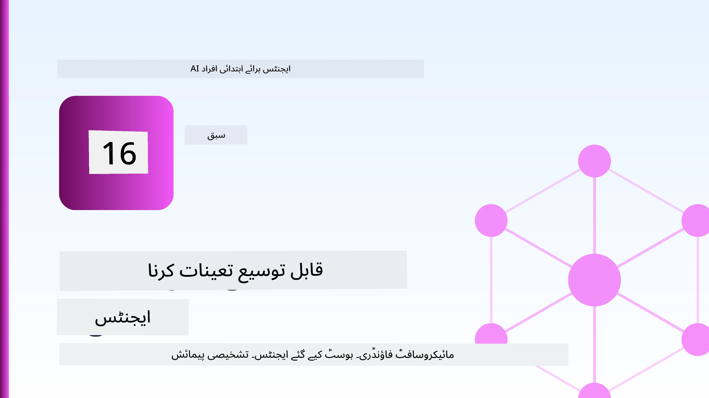
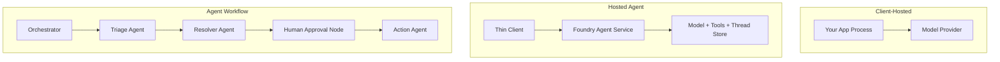
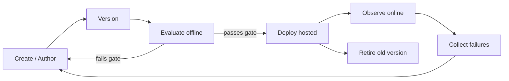
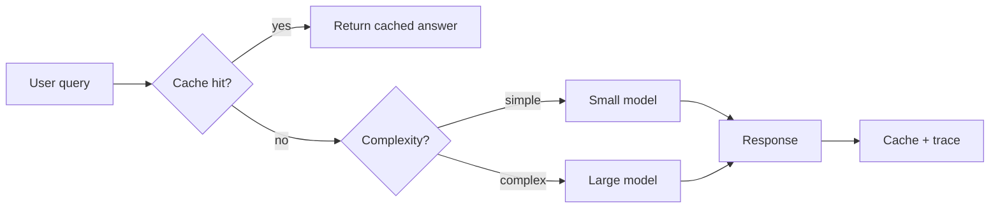
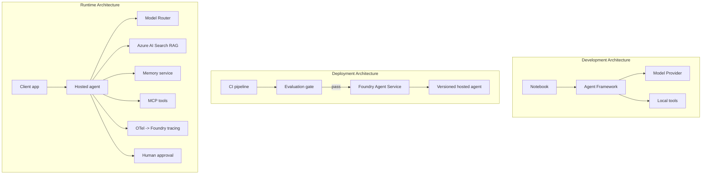

# مائیکروسافٹ فاؤنڈری کے ساتھ اسکیل ایبل ایجنٹس کی تعیناتی



اب تک اس کورس میں آپ نے ایسے ایجنٹس بنائے جو آپ کے لیپ ٹاپ پر، نوٹ بک کے اندر چلتے ہیں، `az login` اور چند ماحولیاتی متغیرات کے ذریعے چلائے جاتے ہیں۔ یہ سیکھنے کے لیے بالکل درست طریقہ ہے۔ یہ وہ صحیح طریقہ نہیں ہے کہ ایک ایسا ایجنٹ چلایا جائے جس پر ہزاروں صارفین رات کے 3 بجے انحصار کریں۔

یہ سبق "یہ میرے مشین پر کام کرتا ہے" اور "یہ پروڈکشن میں معتبر اور سستی طریقے سے کام کرتا ہے" کے درمیان فرق کے بارے میں ہے۔ ہم اس فرق کو **مائیکروسافٹ فاؤنڈری** اور **مائیکروسافٹ فاؤنڈری ایجنٹ سروس** کا استعمال کرتے ہوئے ختم کرتے ہیں، اور ہم ایک حقیقی کسٹمر سپورٹ ایجنٹ بنا کر یہ کرتے ہیں جس کے پاس ٹولز، بازیابی، میموری، جائزہ اور مانیٹرنگ کے آلات ہوتے ہیں۔

## تعارف

یہ سبق درج ذیل موضوعات کا احاطہ کرے گا:

- ایک **پروٹوٹائپ ایجنٹ** اور ایک **متعین شدہ ایجنٹ** کے درمیان فرق، اور یہ تبدیلی زیادہ تر ماڈل کے *گردونواح* سے متعلق ہوتی ہے۔
- ایجنٹس کے لیے **تعیناتی کے نمونے**: کلائنٹ میزبان، سروس میزبان (ہوسٹڈ ایجنٹس)، اور ورک فلو آرکیسٹریٹڈ۔
- مائیکروسافٹ فاؤنڈری پر **ایجنٹ کی زندگی کا دور** — تخلیق، ورژن، تعیناتی، جائزہ، مشاہدہ، ریٹائرمنٹ۔
- **اسکیلنگ کی حکمت عملیوں**: ماڈل راؤٹنگ، کیشنگ، کنکرنسی، اور بغیر ریاست کے ڈیزائن۔
- **اوبرسیبلٹی** اوپن ٹیلی میٹری اور فاؤنڈری ٹریسنگ کے ساتھ۔
- ماڈل کے انتخاب، راؤٹنگ، اور جائزہ گیشن کے ذریعے **لاگت کی اصلاح**۔
- **انٹرپرائز کے خیالات**: گورننس، انسانی منظوری، اور MCP سرورز کو پروڈکشن میں محفوظ طریقے سے چلانا۔

## سیکھنے کے مقاصد

اس سبق کو مکمل کرنے کے بعد، آپ جانیں گے کہ:

- کسی مخصوص ایجنٹ کے کام کے لیے صحیح تعیناتی کا نمونہ کیسے منتخب کیا جائے۔
- کسی ایجنٹ کو مائیکروسافٹ فاؤنڈری ایجنٹ سروس پر تعینات کرنا تاکہ وہ ورژن شدہ، گورنڈ، اور مشاہدہ کے قابل ہو۔
- ٹریسنگ کے لیے ایجنٹ کو انسٹرومنٹ کرنا اور ایک جائزہ پائپ لائن سے منسلک کرنا جو ہر ریلیز سے قبل چلتی ہے۔
- اسکیل پر لیٹنسی اور لاگت کو کنٹرول کرنے کے لیے ماڈل راؤٹنگ اور کیشنگ کو لاگو کرنا۔
- خطرناک اقدامات کے لیے انسانی منظوری کا گیٹ شامل کرنا اور پروڈکشن کے محفوظ طریقے سے MCP سرور کو مربوط کرنا۔

## ضروریات

یہ سبق فرض کرتا ہے کہ آپ نے پچھلے اسباق مکمل کیے ہیں اور آپ کو درج ذیل چیزوں میں مہارت حاصل ہے:

- [مائیکروسافٹ ایجنٹ فریم ورک](../14-microsoft-agent-framework/README.md) کے ساتھ ایجنٹس بنانا (سبق 14)۔
- [ٹول کا استعمال](../04-tool-use/README.md) (سبق 4) اور [ایجینٹک RAG](../05-agentic-rag/README.md) (سبق 5)۔
- [ایجنٹ کی میموری](../13-agent-memory/README.md) (سبق 13) اور [ایجنٹک پروٹوکولز / MCP](../11-agentic-protocols/README.md) (سبق 11)۔
- [اوبرسیبلٹی اور جائزہ](../10-ai-agents-production/README.md) (سبق 10) — یہ سبق براہ راست اس پر مبنی ہے۔

آپ کو یہ بھی چاہیے:

- ایک **ایذور سبسکرپشن** اور ایک **مائیکروسافٹ فاؤنڈری پروجیکٹ** جس میں کم از کم ایک تعین شدہ چیٹ ماڈل ہو۔
- **ایذور CLI** کی تصدیق شدہ (`az login`)۔
- Python 3.12+ اور رپوزیٹری کے پیکجز [`requirements.txt`](../../../requirements.txt)۔

## پروٹوٹائپ سے پروڈکشن تک: حقیقت میں کیا تبدیلی آتی ہے

ایک پروٹوٹائپ ایجنٹ اور ایک پروڈکشن ایجنٹ ایک ہی بنیادی لوپ شیئر کرتے ہیں — سوچنا، ٹولز کو کال کرنا، جواب دینا۔ جو چیز بدلتی ہے وہ اس لوپ کے گرد ہر چیز ہے۔ ماڈل پروڈکشن ایجنٹ کا شاید 20٪ ہوتا ہے؛ باقی 80٪ آپریشنل ڈھانچہ ہوتا ہے۔

| پہلو | پروٹوٹائپ | پروڈکشن |
| --- | --- | --- |
| **ہوسٹنگ** | آپ کے نوٹ بک میں چلتا ہے | بطور ہوسٹڈ سروس چلتا ہے، ورژنڈ اور رول آؤٹ کیا جاتا ہے |
| **شناخت** | آپ کا `az login` ٹوکن | منیجڈ شناخت کے ساتھ محدود RBAC |
| **ریاست** | میموری میں، ری اسٹارٹ پر ختم ہوجاتی ہے | بیرونی (تھریڈ اسٹور، میموری سروس) |
| **ناکامی** | آپ کو ٹریس بیک نظر آتا ہے | ریٹریز، فال بیکس، ڈیڈ لیٹر، الارٹس |
| **لاگت** | "یہ کچھ سینٹس ہے" | ہر درخواست کے لیے ٹریک کی جاتی ہے، راؤٹ کی جاتی ہے، کیش کی جاتی ہے، بجٹ بنائی جاتی ہے |
| **معیار** | آپ آؤٹ پٹ کو دیکھ کر فیصلہ کرتے ہیں | ہر ریلیز سے پہلے خودکار طریقے سے جائزہ لیا جاتا ہے |
| **اعتماد** | آپ ہر اقدام کی منظوری دیتے ہیں | حکمت عملی + خطرناک اقدامات کے لیے انسانی مداخلت |

اس جدول کو ذہن میں رکھیں۔ نیچے ہر سیکشن ان قطاروں میں سے ایک کے مطابق ہے۔

## ایجنٹ تعیناتی کے نمونے

ایسے تین نمونے ہیں جن کا آپ استعمال کریں گے، اکثر اکٹھے۔

### 1. کلائنٹ-ہوسٹڈ ایجنٹس

ایجنٹ آبجیکٹ *آپ* کے ایپلیکیشن پراسیس کے اندر رہتا ہے۔ آپ کا کوڈ ماڈل فراہم کنندہ کو براہ راست کال کرتا ہے؛ سوچنے کا لوپ آپ کی سروس میں چلتا ہے۔ یہ وہی ہے جو ہر پچھلے سبق نے کیا ہے۔

- **استعمال کریں جب** آپ کو لوپ پر مکمل کنٹرول چاہیے، کسٹم مڈل ویئر چاہیے، یا آپ ایجنٹ کو موجودہ بیک اینڈ میں شامل کر رہے ہیں۔
- **معاوضہ**: اسکیلنگ، ریاست، اور مزاحمت کی ذمہ داری آپ خود اٹھاتے ہیں۔

### 2. ہوسٹڈ ایجنٹس (فاؤنڈری ایجنٹ سروس)

ایجنٹ کو مائیکروسافٹ فاؤنڈری میں *ایک ریسورس کے طور پر رجسٹر* کیا جاتا ہے۔ فاؤنڈری سوچنے کے لوپ کو ہوسٹ کرتا ہے، تھریڈز محفوظ کرتا ہے، مواد کی حفاظت اور RBAC نافذ کرتا ہے، اور ایجنٹ کو فاؤنڈری پورٹل میں ظاہر کرتا ہے۔ آپ کی ایپ ایک پتلی کلائنٹ بن جاتی ہے جو تھریڈز بناتی ہے اور جوابات پڑھتی ہے۔

- **استعمال کریں جب** آپ کو پائیداری، بلٹ ان اوبرسیبلٹی، گورننس، اور عملیاتی سطح کی کم ضرورت ہو۔
- **معاوضہ**: کم درجے کا کنٹرول دینے کے بدلے میں ایک منظم رن ٹائم۔

### 3. ایجنٹ ورک فلو

متعدد ایجنٹس (اور ٹولز) کو ایک گراف میں جوڑا جاتا ہے جس میں واضح کنٹرول فلو ہوتا ہے — متوالی مراحل، شاخیں، انسانی منظوری کے نوڈز، اور پائیدار چیک پوائنٹس جو روک سکتے اور دوبارہ شروع کر سکتے ہیں۔ یہ مائیکروسافٹ ایجنٹ فریم ورک کی **ورک فلو** صلاحیت ہے جو تعیناتی کی سطح پر لاگو کی گئی ہے۔

- **استعمال کریں جب** ایک ہی کام مختلف تخصصی ایجنٹس پر محیط ہو یا درمیان میں منظوری کا مرحلہ درکار ہو۔
- **معاوضہ**: مزید متحرک حصے؛ آرکیسٹریشن سطح کی اوبرسیبلٹی کی ضرورت ہے۔



## مائیکروسافٹ فاؤنڈری پر ایجنٹ کی زندگی کا دور

ایک ایجنٹ کی تعیناتی ایک وقتی `push` نہیں ہے۔ یہ ایک لوپ ہے، اور یہ سافٹ ویئر ریلیز سائیکل کی طرح نظر آتا ہے کیونکہ وہی چیز ہے۔



کلیدی خیال، جو [سبق 10](../10-ai-agents-production/README.md) سے لیا گیا ہے: **آف لائن جائزہ گیٹ ہے، بعد میں سوچ نہیں۔** نیا ایجنٹ ورژن تب تک جاری نہیں کیا جاتا جب تک وہ آپ کے جائزہ کے معیارات پورے نہ کرے۔ آن لائن اوبرسیبلٹی پھر حقیقی دنیا کی ناکامیوں کو آپ کے آف لائن ٹیسٹ سیٹ میں بھیجتی ہے۔ یہی پورا لوپ ہے۔

## اسکیلنگ کی حکمت عملیاں

ایک ایجنٹ کی اسکیلنگ اسٹیٹ لیس ویب API کی اسکیلنگ سے مختلف ہے، کیونکہ ہر درخواست متعدد مہنگے ماڈل اور ٹول کالز کو متحرک کر سکتی ہے۔ چار تکنیکیں زیادہ تر بوجھ اٹھاتی ہیں۔

**اسٹیٹ لیس ریکویسٹ ہینڈلنگ۔** اپنے پراسیس کی میموری میں ہر صارف کی ریاست نہ رکھیں۔ گفتگو کے تھریڈز کو فاؤنڈری تھریڈ اسٹور یا میموری سروس میں محفوظ کریں تاکہ کوئی بھی انسٹینس کوئی بھی درخواست سنبھال سکے۔ یہ آپ کو افقی طور پر اسکیل کرنے دیتا ہے — انسٹینسز ڈالیں، بغیر کسی چپکنے والے سیشن کے۔

**ماڈل راؤٹنگ۔** ہر درخواست کو آپ کے سب سے قابل اور مہنگے ماڈل کی ضرورت نہیں ہوتی۔ سادہ درخواستوں — ارادے کی درجہ بندی، مختصر حقائق پر مبنی جوابات — کو ایک چھوٹے اور تیز ماڈل پر بھجوائیں، اور بڑے ماڈل کو اصلی سوچ کے لیے مخصوص کریں۔ فاؤنڈری کا **ماڈل راؤٹر** یہ آپ کے لیے کر سکتا ہے، یا آپ خود ایک ہلکا پھلکا کلاسیفائر بنا سکتے ہیں۔ آپ لیب میں DIY ورژن بنائیں گے۔

**جواب کی کیشنگ۔** بہت سے سپورٹ سوالات قریب قریب ایک جیسے ہوتے ہیں ("میں اپنا پاس ورڈ کیسے ری سیٹ کروں؟")۔ عام سوالات کے جوابات کیش کریں اور بغیر ماڈل کو کال کیے سرو کریں۔ ایک معمولی کیش ہٹ ریٹ بھی لاگت اور لیٹنسی کو قابل ذکر طور پر کم کرتا ہے۔

**کنکرنسی اور بیک پریشر۔** ماڈل فراہم کنندگان کی شرح کی حدیں ہوتی ہیں۔ اپنی کنکرنسی کی حد مقرر کریں، ریٹریز استعمال کریں جن میں آہستہ آہستہ بیک آف ہو، اور شائستگی سے ناکام ہوں (ایک قطار بند "ہم کام کر رہے ہیں" جواب 500 سے بہتر ہے)۔



## پروڈکشن میں اوبرسیبلٹی

آپ وہ نہیں چلا سکتے جو آپ دیکھ نہیں سکتے۔ جیسا کہ سبق 10 میں بیان کیا گیا، مائیکروسافٹ ایجنٹ فریم ورک **اوپن ٹیلی میٹری** ٹریسز قدرتی طور پر خارج کرتا ہے — ہر ماڈل کال، ٹول کال، اور آرکیسٹریشن قدم ایک اسپین بن جاتا ہے۔ پروڈکشن میں آپ ان اسپینز کو مائیکروسافٹ فاؤنڈری (یا کسی OTel مطابقت پذیر بیک اینڈ) پر ایکسپورٹ کرتے ہیں تاکہ آپ:

- ایک کسٹمر کی شکایت کو ہر ماڈل اور ٹول کال میں مکمل طور پر ٹریس کر سکیں۔
- وقت کے ساتھ ہر درخواست پر p50/p95 کی لیٹنسی اور لاگت دیکھ سکیں۔
- غلطی کی شرح میں اضافے اور لاگت کی عجیب باتوں پر اپنے صارفین (یا آپ کی مالی ٹیم) کے محسوس کرنے سے پہلے الرٹ دے سکیں۔

```python
from agent_framework.observability import get_tracer

tracer = get_tracer()

with tracer.start_as_current_span("support_request") as span:
    span.set_attribute("customer.tier", "enterprise")
    span.set_attribute("routed.model", "gpt-5-nano")
    # agent execution is traced automatically inside this span
```

`customer.tier` اور `routed.model` جیسے صفات ٹریسز کی دیوار کو قابل جوابی سوالات میں بدل دیتے ہیں ("کیا انٹرپرائز صارفین کو زیادہ بار چھوٹے ماڈل پر بھیجا جا رہا ہے؟")۔

## لاگت کی اصلاح

پروڈکشن ایجنٹس میں لاگت ٹوکنز کی وجہ سے غالب ہوتی ہے۔ تین مقامات، اثر کے حساب سے:

1. **ماڈل کا صحیح سائز منتخب کریں۔** ایک چھوٹا ماڈل جو آپ کے جائزہ کے گیٹ سے گزرتا ہے تقریباً ہمیشہ ایک بڑے ماڈل سے سستا ہوتا ہے جو بھی گزرتا ہو۔ جائزہ کا استعمال کریں تاکہ ثابت کریں کہ چھوٹا ماڈل کافی اچھا ہے بجائے اس کے کہ محتاط رہ کر سب سے بڑے ماڈل کا انتخاب کریں۔
2. **پیچیدگی کے لحاظ سے راؤٹنگ کریں۔** جیسا کہ اوپر — بڑے ماڈل کی قیمت صرف ان درخواستوں کے لیے ادا کریں جنہیں بڑے ماڈل کا سوچنے کی ضرورت ہو۔
3. **زبردست کیشنگ کریں۔** سب سے سستی ماڈل کال وہ ہے جو آپ کبھی نہ کریں۔

جائزہ کے گیٹ اور لاگت کا کنٹرول دو نقطہ نظر سے ایک ہی اصول ہیں: جائزہ آپ کو *معیار کی حد* بتاتا ہے، راؤٹنگ اور کیشنگ آپ کو اس حد کی *لاگت* کے قریب رکھتے ہیں۔

## انٹرپرائز تعیناتی کے خیالات

**گورننس۔** ہوسٹڈ ایجنٹس فاؤنڈری کے RBAC، مواد کی حفاظت، اور آڈٹ لاگنگ کو وراثت میں لیتے ہیں۔ ہر ایجنٹ کو کم سے کم مراعات کے ساتھ ایک منظم شناخت دیں — علم کی بنیاد تک صرف پڑھنے کی رسائی، ٹکٹنگ API تک محدود رسائی، اور کچھ نہیں۔

**انسانی مداخلت۔** کچھ اقدامات اتنے اہم ہوتے ہیں کہ انہیں مکمل خودکار نہیں کیا جا سکتا — رقم واپس کرنا، اکاؤنٹ کو حذف کرنا، قانونی ٹیم کو معاملہ دینا۔ مائیکروسافٹ ایجنٹ فریم ورک **منظوری-ضروری** ٹولز کی حمایت کرتا ہے: ایجنٹ اقدام تجویز کرتا ہے، عمل رکتا ہے، انسانی منظوری یا رد ہوتی ہے، اور ورک فلو دوبارہ شروع ہوتا ہے۔ آپ نے اس بنیادی فنکشن کو [سبق 6](../06-building-trustworthy-agents/README.md) میں دیکھا؛ یہاں آپ اسے تعینات کرتے ہیں۔

**MCP پروڈکشن میں۔** [MCP](../11-agentic-protocols/README.md) آپ کے ایجنٹ کو خارجی ٹولز کو معیاری انٹرفیس کے ذریعے استعمال کرنے دیتا ہے۔ پروڈکشن میں ہر MCP سرور کو غیر معتبر سرحد سمجھیں: سرور کا ورژن کنٹرول کریں، اسے محدود شناخت کے ساتھ چلائیں، اس کے آؤٹ پٹ کی تصدیق کریں، اور کبھی بھی اس کے سامنے راز ظاہر نہ کریں۔ MCP سرور ایک انحصار ہے، اور انحصارات کی پیچنگ، آڈٹنگ، اور شرح کی حد بندی کی جاتی ہے۔



یہ تین ڈایاگرامز — ترقی، تعیناتی، رن ٹائم — اسی ایجنٹ کے زندگی کے تین مراحل ہیں۔ نیچے والا لیب آپ کو اسے بنانے کے ذریعے لے جائے گا۔

## عملی لیب: پروڈکشن کے لیے تیار کسٹمر سپورٹ ایجنٹ

[`code_samples/16-python-agent-framework.ipynb`](./code_samples/16-python-agent-framework.ipynb) کھولیں اور آخر تک کام کریں۔ آپ ایک **کانٹوسو کسٹمر سپورٹ ایجنٹ** تیار کریں گے جس میں ہر پروڈکشن کی فکر شامل ہو گی:

1. **ٹول کالنگ** — آرڈر کا اسٹیٹس دیکھیں اور سپورٹ ٹکٹ کھولیں۔
2. **RAG** — علم کی بنیاد سے پالیسی سوالات کا جواب دیں (Azure AI Search، ایک ان-میموری بیک اپ کے ساتھ تاکہ نوٹ بک سرچ ریسورس کے بغیر چلے)۔
3. **میموری** — گفتگو کے مختلف دوروں کے دوران کسٹمر کو یاد رکھیں۔
4. **ماڈل راؤٹنگ** — پیچیدگی کا کلاسیفائر ہر درخواست کو چھوٹے یا بڑے ماڈل کی طرف بھیجتا ہے۔
5. **جواب کی کیشنگ** — دہرائے گئے سوالات کیش سے دیے جاتے ہیں۔
6. **انساني منظوری** — حد سے اوپر کی واپسیوں پر انسانی تصدیق درکار ہوتی ہے۔
7. **جائزہ پائپ لائن** — ایک چھوٹا آف لائن ٹیسٹ سیٹ ایجنٹ کو اسکور کرتا ہے اور ریلیز کا دروازہ بنتا ہے۔
8. **اوبرسیبلٹی** — ہر درخواست کے گرد اوپن ٹیلی میٹری ٹریسنگ۔

### مرحلہ وار

نوٹ بک اس طرح منظم ہے کہ ہر پروڈکشن مسئلہ ایک خود مختار، چلانے والا سیکشن ہے۔ اس کا دل روٹنگ-پلس-کیشنگ ریکویسٹ ہینڈلر ہے:

```python
async def handle_support_request(query: str, customer_id: str) -> str:
    # 1. Serve from cache when we can.
    cached = response_cache.get(normalize(query))
    if cached:
        return cached

    # 2. Route by complexity to control cost.
    model = "gpt-5-nano" if is_simple(query) else "gpt-5-mini"

    # 3. Run the agent inside a trace span for observability.
    with tracer.start_as_current_span("support_request") as span:
        span.set_attribute("routed.model", model)
        span.set_attribute("customer.id", customer_id)
        response = await support_agent.run(query, model=model)

    # 4. Cache and return.
    response_cache.set(normalize(query), response.text)
    return response.text
```

وہ جائزہ گیٹ جو ریلیز کی حفاظت کرتا ہے، اس طرح دکھائی دیتا ہے:

```python
async def evaluation_gate(agent, test_cases, threshold: float = 0.8) -> bool:
    passed = 0
    for case in test_cases:
        result = await agent.run(case["input"])
        if score_response(result.text, case["expected"]) >= 0.8:
            passed += 1
    pass_rate = passed / len(test_cases)
    print(f"Evaluation pass rate: {pass_rate:.0%} (gate: {threshold:.0%})")
    return pass_rate >= threshold  # only deploy if the gate passes
```

ہر لائن پڑھیں — نوٹ بک بنیادی فنکشنز کو جان بوجھ کر چھوٹا رکھتی ہے تاکہ کچھ بھی فریم ورک کال کے پیچھے نہ چھپا رہے۔

## تعین شدہ ایجنٹ کی تمباکو نوشی کے ٹیسٹ سے تصدیق

اوپر دیا گیا جائزہ گیٹ آپ کے ایجنٹ آبجیکٹ کے خلاف *آف لائن* چلتا ہے۔ جب ایجنٹ بطور ہوسٹڈ ایجنٹ تعینات ہو جاتا ہے، تو آپ کو ایک اور، حتیٰ کہ سستا چیک درکار ہوتا ہے: **کیا تعین شدہ اینڈ پوائنٹ واقعی جواب دے رہا ہے؟**

"کامیابی سے تعیناتی" کا مطلب صرف یہ ہوتا ہے کہ کنٹرول پلین نے تعریف قبول کر لی ہے — اس کا مطلب یہ نہیں کہ ایجنٹ جواب دیتا ہے۔ کوئی گمشدہ انحصار، خراب ماڈل راؤٹنگ، یا معیاد ختم ہونے والا کنیکشن ایسا سبز تعیناتی چھوڑ سکتا ہے جو کچھ واپس نہیں کرتا۔ **تمباکو نوشی کا ٹیسٹ** چند سیکنڈ میں، ہر تعیناتی پر، مکمل جائزے کی لاگت کے بغیر اسے پکڑ لیتا ہے۔

یہ ریپوزیٹری استعمال کے لیے تیار تمباکو نوشی کے ٹیسٹ پائپ لائن کو شامل کرتی ہے جو [AI Smoke Test](https://github.com/marketplace/actions/ai-smoke-test) GitHub ایکشن پر مبنی ہے:

- **کیٹلاگ** — [`tests/lesson-16-smoke-tests.json`](../../../tests/lesson-16-smoke-tests.json) کانٹوسو سپورٹ ایجنٹ کے لیے پرامپٹس اور دعوے رکھتا ہے (زمین پر مبنی پالیسی جوابات، آرڈر چیک، موضوع پر رہنا، اور متعدد دوروں کی تھریڈ کی تسلسل)۔ دوسرے اسباق کے ایجنٹس کے کیٹلاگز اس کے ساتھ ہوتے ہیں — دیکھیں [`tests/README.md`](../tests/README.md)۔
- **ورک فلو** — [`.github/workflows/smoke-test.yml`](../../../.github/workflows/smoke-test.yml) Azure OIDC کے ساتھ لاگ ان کرتا ہے اور ایجنٹ کی Responses اینڈ پوائنٹ پر ہر پرامپٹ POST کرتا ہے، کسی بھی دعوے کی ناکامی پر کام ناکام ہو جاتا ہے۔

```yaml
- name: Smoke-test hosted agent
  uses: JFolberth/ai-smoketest@v1
  with:
    project_endpoint: ${{ inputs.project_endpoint }}
    agent_name: ContosoSupportAgent
    tests_file: tests/lesson-16-smoke-tests.json
```

اپنے ایجنٹ کو تعینات کرنے کے بعد **Actions** ٹیب سے چلائیں، اپنا Foundry پروجیکٹ اینڈپوائنٹ اور ایجنٹ کا نام فراہم کرتے ہوئے۔ وفاقی شناخت کو Foundry پروجیکٹ دائرہ کار میں **Azure AI User** کا کردار ہونا ضروری ہے۔ تہوں کو ایک ہرم کے طور پر سمجھیں: سموک ٹیسٹ (کیا قابل رسائی اور جواب دے رہا ہے؟) ہر تعیناتی پر چلتے ہیں، آف لائن تشخیص (کیا بھیجنے کے لئے کافی اچھا ہے؟) فروغ سے پہلے چلتی ہے، اور آن لائن تشخیص (یہ جنگل میں کیسا کام کر رہا ہے؟) مسلسل چلتی ہے۔

## علم کی جانچ

اسائنمنٹ شروع کرنے سے پہلے اپنی سمجھ کو پرکھیں۔

**1. ایک پروڈکشن ایجنٹ میں تقریبا کتنا حصہ "ماڈل" ہوتا ہے، اور باقی کیا ہے؟**

<details>
<summary>جواب</summary>

ماڈل نظام کا اقلیت حصہ ہوتا ہے — عام طور پر تقریباً 20% کے طور پر ذکر کیا جاتا ہے۔ باقی آپریشنل ڈھانچہ ہے: ہوسٹنگ اور ورژننگ، شناخت اور RBAC، خارجی حالت، ناکامی کا انتظام، لاگت کی نگرانی، تشخیص، اور انسانی شمولیت کے کنٹرولز۔ پروڈکشن میں جانا زیادہ تر اس بات کے بارے میں ہے کہ منطقی لوپ کے ارد گرد سب کچھ بنائیں۔
</details>

**2. آپ کب Hosted Agent کو کلائنٹ-ہوسٹڈ ایجنٹ کے بجائے منتخب کریں گے؟**

<details>
<summary>جواب</summary>

جب آپ ایک منظم رن ٹائم چاہتے ہیں جس میں بلٹ ان تحفظ (ایسے تھریڈز جو برقرار رہتے ہیں اور دوبارہ شروع ہو سکتے ہیں)، مشاہدہ پذیری، مواد کی حفاظت، اور RBAC ہو، اور آپ منطقی لوپ پر کم درجے کا کنٹرول قربان کر کے کم آپریشنل سطح قبول کرنے کو تیار ہوں۔ کلائنٹ-ہوسٹڈ اس وقت ترجیحی ہے جب آپ کو لوپ پر مکمل کنٹرول کی ضرورت ہو یا ایجنٹ کو موجودہ بیک اینڈ میں ضم کر رہے ہوں۔
</details>

**3. ایک قابل توسیع ایجنٹ کو اپنے عمل کی میموری میں بغیر حالت کا کیوں ہونا چاہیے؟**

<details>
<summary>جواب</summary>

تاکہ کوئی بھی مثال کسی بھی درخواست کو سنبھال سکے، جو کہ بغیر چپکنے والے سیشنز کے افقی اسکیلنگ کی اجازت دیتا ہے۔ فی صارف گفتگو کی حالت تھریڈ اسٹور یا میموری سروس میں خارجی ہوتی ہے۔ اگر حالت عمل کی میموری میں ہوتی، تو آپ اسے دوبارہ شروع کرنے پر کھو دیتے اور آزادانہ طور پر لوڈ تقسیم نہیں کر سکتے تھے۔
</details>

**4. ماڈل راؤٹنگ کس مسئلے کو حل کرتی ہے، اور یہ تشخیص سے کیسے منسلک ہے؟**

<details>
<summary>جواب</summary>

راؤٹنگ سادہ درخواستوں کو ایک چھوٹے، سستے، تیز ماڈل کی طرف بھیجتی ہے اور بڑے ماڈل کو حقیقی استدلال کے لیے مخصوص کرتی ہے، تاخیر اور لاگت دونوں کو کنٹرول کرتی ہے۔ یہ تشخیص سے منسلک ہے کیونکہ تشخیص وہ چیز ہے جو چھوٹے ماڈل کو کسی درخواست کی کلاس کے لیے کافی ثابت کرتی ہے — راؤٹنگ بغیر تشخیص کے محض قیاس آرائی ہے۔
</details>

**5. "تشخیصی دروازہ" کیا ہے اور یہ زندگی کے چکر میں کہاں واقع ہوتا ہے؟**

<details>
<summary>جواب</summary>

ایک تشخیصی دروازہ نیا ایجنٹ ورژن کے خلاف آف لائن ٹیسٹ سیٹ چلتا ہے اور اگر پاس ریٹ ایک حد کو عبور نہ کرے تو تعیناتی کو بلاک کرتا ہے۔ یہ "ورژن" اور "ڈیپلائے" کے درمیان زندگی کے چکر میں واقع ہوتا ہے، معیار کو ریلیز کے لیے ایک شرط بناتے ہوئے نہ کہ شپنگ کے بعد چیک کرنے والی چیز۔
</details>

**6. پروڈکشن میں MCP سرور کو کیوں ایک غیر معتبر حد کے طور پر سمجھنا چاہیے؟**

<details>
<summary>جواب</summary>

کیونکہ یہ ایک بیرونی انحصار ہے جسے آپ کا ایجنٹ کال کرتا ہے۔ آپ کو اس کا ورژن پِن کرنا چاہیے، اسے ایک محدود شناخت کے ساتھ چلانا چاہیے، اس کے نتائج کی تصدیق کرنی چاہیے، اسے ریٹ-لمٹ کرنا چاہیے، اور اسے کبھی بھی راز ظاہر نہیں کرنے چاہئیں — وہی نظم و ضبط جو آپ کسی تیسرے فریق کے انحصار پر لاگو کرتے ہیں۔ اس کے نتائج آپ کے ایجنٹ کی منطق میں آتے ہیں، اس لیے بغیر تصدیق کے اعتماد ایک سیکیورٹی خطرہ ہے۔
</details>

**7. عام طور پر کون سا واحد تبدیلی پروڈکشن ایجنٹ کی لاگت پر سب سے زیادہ اثر ڈالتی ہے، اور کیوں؟**

<details>
<summary>جواب</summary>

ماڈل کا مناسب سائز منتخب کرنا — سب سے چھوٹا ماڈل استعمال کرنا جو آپ کے تشخیصی دروازے کو پاس کرتا ہو۔ لاگت ٹوکنز پر منحصر ہوتی ہے، اور ایک چھوٹا ماڈل جو معیار کے معیار کو پورا کرتا ہو اکثر بڑے سے سستا ہوتا ہے۔ کیشنگ اور راؤٹنگ پھر لاگت کو مزید کم کرتے ہیں، لیکن درست بنیادی ماڈل کا انتخاب سب سے بڑا فوری اثر رکھتا ہے۔
</details>

**8. مشاہدہ پذیری میں اسپین خصوصیات جیسے `customer.tier` اور `routed.model` کا کیا کردار ہے؟**

<details>
<summary>جواب</summary>

وہ خام ٹریسز کو جواب دینے والے کاروباری سوالات میں بدل دیتے ہیں۔ خصوصیات کے بغیر آپ کے پاس اسپینز کی دیوار ہوتی ہے؛ ان کے ساتھ آپ پوچھ سکتے ہیں "کیا صنعتی گاہک بہت زیادہ چھوٹے ماڈل کی طرف جا رہے ہیں؟" یا "کون سا ماڈل ہماری سب سے سست درخواستوں کو سنبھالتا ہے؟" خصوصیات وہ طریقہ ہیں جس سے آپ ٹیلی میٹری کو ایسے ابعاد کے لحاظ سے ٹکڑوں میں تقسیم کرتے ہیں جو آپ کے آپریشن کے لیے اہم ہیں۔
</details>

## اسائنمنٹ

لیب سے کسٹمر سپورٹ ایجنٹ لیں اور اسے ایک خاص منظرنامے کے لیے سخت بنائیں: **ایک SaaS کمپنی کے لیے سبسکرپشن بلنگ سپورٹ ایجنٹ۔**

آپ کی جمع کروائی میں شامل ہونا چاہیے:

1. **اوزاروں کو متبادل کرنا** بلنگ سے متعلقہ اوزار سے: `get_subscription_status`، `get_invoice`، اور `issue_credit` (50 ڈالر سے اوپر کریڈٹس کو انسانی منظوری کی ضرورت ہے)۔
2. **تین RAG دستاویزات شامل کریں** جو کمپنی کی ریفنڈ پالیسی، بلنگ سائیکل، اور منسوخی پالیسی کا احاطہ کرتی ہوں۔
3. **تشخیصی سیٹ کو کم از کم آٹھ کیسز تک بڑھائیں، جن میں کم از کم دو ایسے بھی ہوں جو انسانی منظوری کا راستہ فعال کریں، اور اپنے تشخیصی دروازے کی درستگی کی تصدیق کریں۔**
4. **ایک لاگت کی رپورٹ شامل کریں**: ایجنٹ کے ذریعے دس مخلوط سوالات چلانے کے بعد، پرنٹ کریں کہ کتنے چھوٹے ماڈل کی طرف گئے، کتنے بڑے ماڈل کی طرف، اور کتنے کیش سے فراہم کیے گئے۔

ایک مختصر پیراگراف (ایک مارک ڈاؤن سیل میں) لکھیں جس میں بیان کریں کہ آپ نے کون سا ماڈل راؤٹنگ رول منتخب کیا اور اسے حقیقی ٹریفک کے ذریعے کیسے تصدیق کریں گے۔ کوئی واحد صحیح جواب نہیں ہے — آپ کی جانچ اس بات پر ہو رہی ہے کہ آیا پروڈکشن کے خدشات کو مربوط طریقے سے جوڑا گیا ہے۔

## خلاصہ

اس سبق میں آپ نے Microsoft Foundry کے ساتھ ایک ایجنٹ کو پروٹو ٹائپ سے پروڈکشن میں منتقل کیا:

- پروڈکشن کی طرف جانا زیادہ تر ماڈل کے ارد گرد **آپریشنل ڈھانچے** کے بارے میں ہے — ہوسٹنگ، شناخت، حالت، ناکامی کا انتظام، لاگت، معیار، اور اعتماد۔
- آپ نے تین **تعیناتی کے نمونے** سیکھے — کلائنٹ-ہوسٹڈ، Hosted Agents، اور Agent Workflows — اور کب کون سا مناسب ہے۔
- آپ نے **ایجنٹ کے زندگی کے چکر** کو سمجھا، جہاں آف لائن **تشخیص ایک ریلیز گیٹ کے طور پر کام کرتی ہے** اور آن لائن مشاہدہ پذیری ناکامیوں کو ٹیسٹ سیٹ میں واپس بھرتی ہے۔
- آپ نے **اسکیلنگ کی حکمت عملیوں** — بغیر حالت کے ڈیزائن، ماڈل راؤٹنگ، کیشنگ، اور محدود ہم وقتی عمل — کو لاگو کیا اور انہیں **لاگت کی بہتر سازی** سے جوڑا۔
- آپ نے **ادارتی کنٹرولز** منسلک کیے: RBAC، انسانی منظوری، اور پروڈکشن-محفوظ MCP انضمام۔
- آپ نے ایک **پروڈکشن کے لیے تیار کسٹمر سپورٹ ایجنٹ** بنایا جو ان سب خدشات کو چلائے جانے والے کوڈ میں جوڑتا ہے۔

اگلا سبق الٹ سفر کرے گا: ایجنٹس کو کلاؤڈ میں بڑھانے کی بجائے، آپ انہیں *نیچے* لے جائیں گے ایک واحد ڈیولپر مشین پر اور مکمل طور پر مقامی طور پر چلائیں گے۔

## اضافی وسائل

- <a href="https://learn.microsoft.com/azure/ai-foundry/what-is-azure-ai-foundry" target="_blank">Microsoft Foundry کی دستاویزات</a>
- <a href="https://learn.microsoft.com/azure/ai-foundry/agents/overview" target="_blank">Microsoft Foundry Agent Service کا جائزہ</a>
- <a href="https://learn.microsoft.com/en-us/agent-framework/overview/?wt.mc_id=youtube_26688_organicsocial_reactor&pivots=programming-language-python" target="_blank">Microsoft Agent Framework</a>
- <a href="https://learn.microsoft.com/en-us/azure/ai-foundry/openai/concepts/model-router" target="_blank">Microsoft Foundry میں ماڈل راؤٹر</a>
- <a href="https://learn.microsoft.com/azure/search/search-what-is-azure-search" target="_blank">Azure AI سرچ</a>
- <a href="https://opentelemetry.io/" target="_blank">OpenTelemetry</a>
- <a href="https://github.com/marketplace/actions/ai-smoke-test" target="_blank">AI Smoke Test GitHub Action</a>
- <a href="https://modelcontextprotocol.io/" target="_blank">Model Context Protocol (MCP)</a>

## پچھلا سبق

[کمپیوٹر یوز ایجنٹس (CUA) کی تعمیر](../15-browser-use/README.md)

## اگلا سبق

[مقامی AI ایجنٹس کی تخلیق](../17-creating-local-ai-agents/README.md)

---

<!-- CO-OP TRANSLATOR DISCLAIMER START -->
**ڈس کلیمر**:
یہ دستاویز AI ترجمہ سروس [Co-op Translator](https://github.com/Azure/co-op-translator) کے ذریعے ترجمہ کی گئی ہے۔ جبکہ ہم درستگی کے لیے کوشاں ہیں، براہ کرم اس بات سے آگاہ رہیں کہ خودکار ترجمے میں غلطیاں یا عدم درستیاں ہو سکتی ہیں۔ اصل دستاویز اپنے مادری زبان میں مستند ماخذ سمجھی جائے گی۔ حساس معلومات کے لیے پیشہ ور انسانی ترجمہ کی سفارش کی جاتی ہے۔ اس ترجمے کے استعمال سے پیدا ہونے والی کسی بھی غلط فہمی یا غلط تشریح کی ذمہ داری ہم قبول نہیں کرتے۔
<!-- CO-OP TRANSLATOR DISCLAIMER END -->