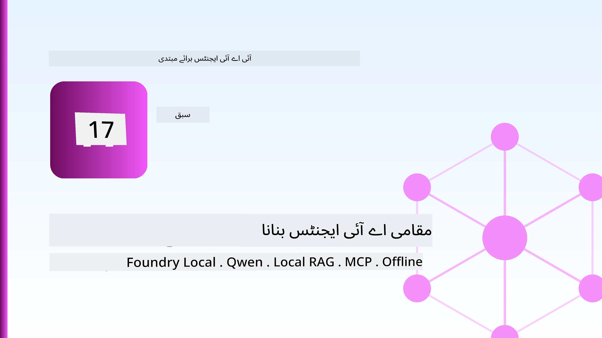
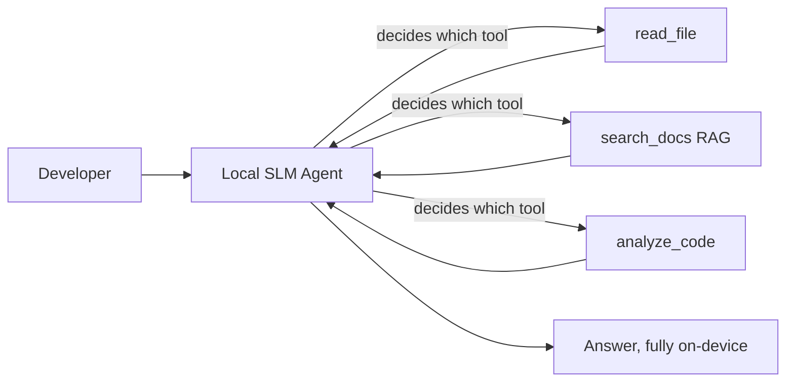
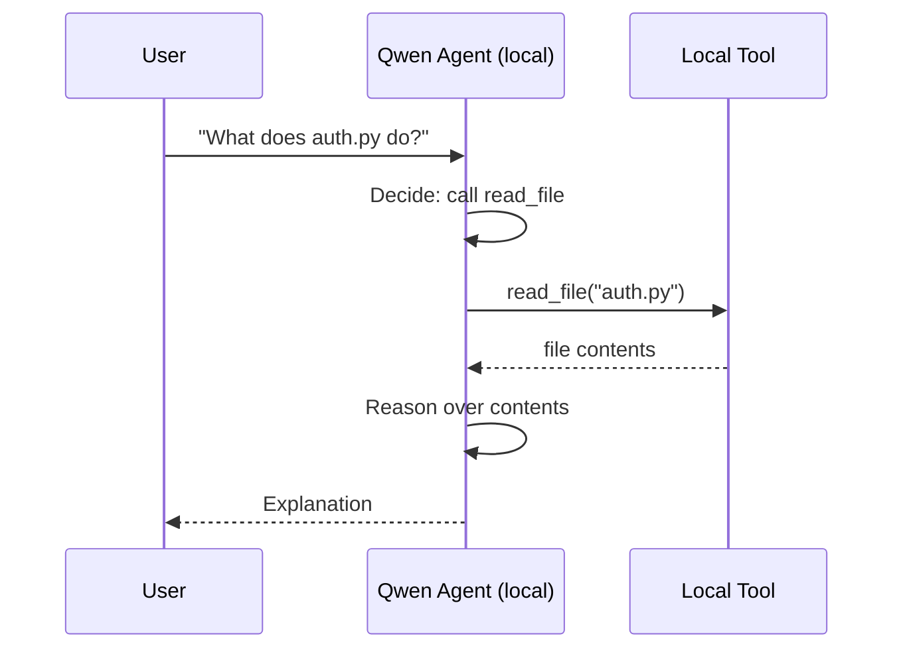
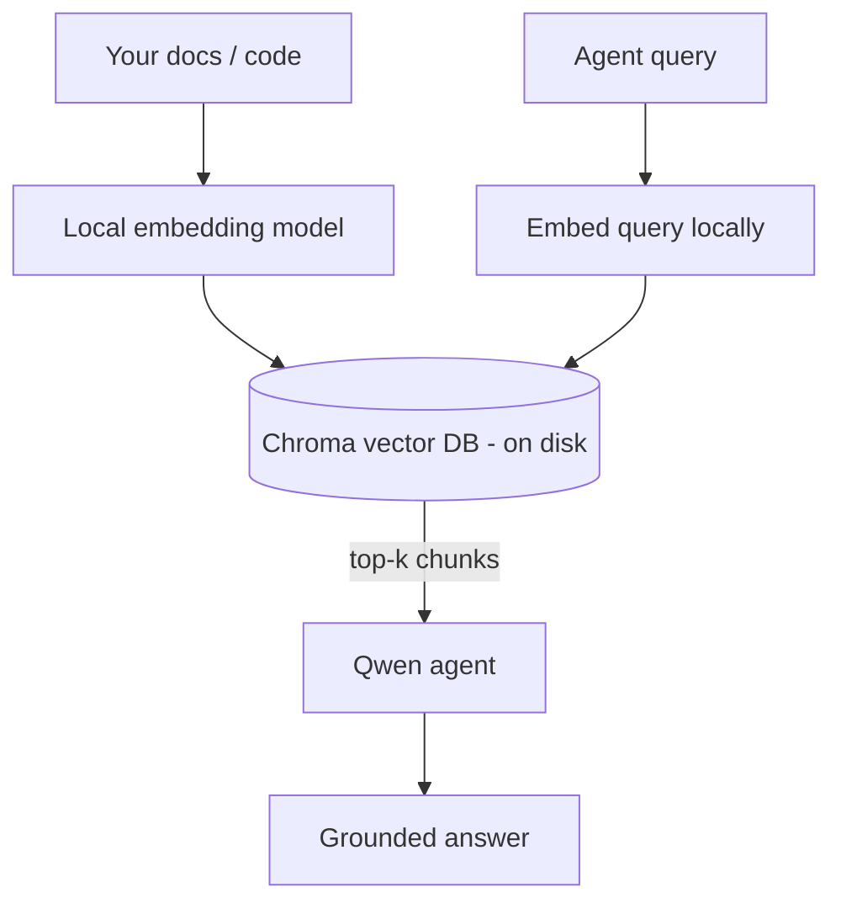
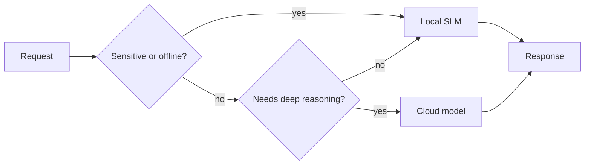

# مائیکروسافٹ فاؤنڈری لوکل اور کیون سے لوکل AI ایجنٹس بنانا



پچھلا سبق ایجنٹس کو کلاؤڈ میں *بڑھانے* پر مرکوز تھا۔ یہ سبق انہیں ایک واحد مشین پر *لانے* کے بارے میں ہے۔ آخر تک آپ کے پاس ایک کام کرنے والا انجینئرنگ اسسٹنٹ ہوگا جو دلائل دیتا ہے، ٹولز کال کرتا ہے، آپ کی فائلیں پڑھتا ہے، اور آپ کی دستاویزات تلاش کرتا ہے — **ایک بھی کلاؤڈ انفرینس کال کے بغیر۔**

آپ ایسا کیوں چاہیں گے؟ تین وجوہات جو حقیقی انجینئرنگ کام میں ہمیشہ زیرِ بحث آتی ہیں:

- **پرائیویسی۔** کوڈ اور دستاویزات کبھی مشین سے باہر نہیں نکلتی۔ کوئی پرامپٹ، کوئی ٹکڑا، کوئی صارف کا ڈیٹا نیٹ ورک کی حدود کو عبور نہیں کرتا۔
- **قیمت۔** لوکل انفرینس کی کوئی فی ٹوکن چارج نہیں ہوتی۔ آپ دن بھر بجلی کے دام پر تجربہ کر سکتے ہیں۔
- **آف لائن۔** ہوائی جہاز میں، محفوظ جگہ میں، یا بندش کے دوران، ایجنٹ پھر بھی کام کرتا رہتا ہے۔

مسئلہ یہ ہے کہ آپ ایک جدید کلاؤڈ ماڈل کے بدلے ایک **چھوٹا زبان کا ماڈل (SLM)** چلاتے ہیں جو آپ کے CPU، GPU، یا NPU پر چلتا ہے۔ یہ سبق ایسے ایجنٹس بنانے کے بارے میں ہے جو اس حد بندی میں *اچھے* ہوں بجائے اس کے کہ یہ دکھاوا کریں کہ یہ حد بندی موجود نہیں ہے۔

## تعارف

یہ سبق درج ذیل موضوعات کا احاطہ کرے گا:

- **چھوٹے زبان کے ماڈلز (SLMs)** — کیا ہیں، کہاں بہتر کام کرتے ہیں، اور کہاں نہیں۔
- **مائیکروسافٹ فاؤنڈری لوکل** — ایک رن ٹائم جو ماڈلز کو ڈاؤن لوڈ کر کے ڈیوائس پر **اوپن اے آئی-مطابق API** کے ذریعے سروس کرتا ہے۔
- **کیون فنکشن کالنگ ماڈلز** — SLMs جو قابلِ اعتماد طریقے سے ٹول کالز بناتے ہیں، جو مقامی *ایجنٹس* (صرف چیٹ نہیں) کو ممکن بناتے ہیں۔
- **لوکل ٹولز، لوکل RAG، اور لوکل MCP** — کلاؤڈ کے بغیر ایجنٹ کو صلاحیت فراہم کرنا۔
- **ہائبرڈ پیٹرنز** — کب چیزیں لوکل رکھیں اور کب کلاؤڈ کی طرف جائیں۔

## تعلیمی مقاصد

اس سبق کو مکمل کرنے کے بعد، آپ جان پائیں گے کہ:

- SLMs کے فائدے اور نقصانات کو سمجھیں اور مناسب لوکل ایجنٹ کے استعمال کے کیسز منتخب کریں۔
- فاؤنڈری لوکل کے ذریعے کیون ماڈل کو لوکل طور پر چلا کر اوپن اے آئی-مطابق اینڈ پوائنٹ سے کنیکٹ کریں۔
- ایک ایسا ٹول کالنگ ایجنٹ بنائیں جو مکمل طور پر آپ کے ورک سٹیشن پر چلتا ہو۔
- اپنی دستاویزات پر لوکل RAG شامل کریں لوکل ویکٹر ڈیٹا بیس (Chroma) کے ذریعے۔
- ایجنٹ کو لوکل MCP سرور سے جوڑیں اور ہائبرڈ لوکل/کلاؤڈ ڈیزائن پر غور کریں۔

## ضروریاتِ پیشگی

یہ سبق فرض کرتا ہے کہ آپ نے پہلے کے اسباق مکمل کر لیے ہیں اور آپ کے پاس یہ مہارتیں ہیں:

- [ٹول استعمال](../04-tool-use/README.md) (سبق 4) اور [ایجنٹک RAG](../05-agentic-rag/README.md) (سبق 5)۔
- [ایجنٹک پروٹوکولز / MCP](../11-agentic-protocols/README.md) (سبق 11)۔
- [مائیکروسافٹ ایجنٹ فریم ورک](../14-microsoft-agent-framework/README.md) (سبق 14)۔

آپ کو مزید یہ درکار ہوں گے:

- ایک ڈویلپر ورک سٹیشن۔ **8 جی بی ریم کم از کم حقیقت پسندانہ ہے**؛ 16 جی بی یا زیادہ آرام دہ ہے۔ GPU یا NPU مددگار ہے لیکن ضروری نہیں۔
- **مائیکروسافٹ فاؤنڈری لوکل** انسٹال شدہ (نیچے سیٹ اپ سیکشن دیکھیں)۔
- پائتھن 3.12+ اور رپوزیٹری میں موجود پیکجز [`requirements.txt`](../../../requirements.txt)، ساتھ ہی اس سبق کے لیے `foundry-local-sdk`، `openai`، اور `chromadb`۔

## چھوٹے زبان کے ماڈلز: مقامی کام کے لیے درست آلہ

ایک فرنٹیئر کلاؤڈ ماڈل میں سینکڑوں ارب کی تعداد میں پیرا میٹر ہوتے ہیں اور اس کے پیچھے ایک ڈیٹا سینٹر ہوتا ہے۔ ایک SLM میں چند ارب پیرا میٹر ہوتے ہیں اور اسے آپ کے لیپ ٹاپ کی ریم میں فٹ ہونا ہوتا ہے۔ یہ فرق واضح توقعات قائم کرتا ہے۔

**SLMs ان کاموں میں اچھے ہیں:**

- منظم، محدود کام — درجہ بندی، معروف دستاویز کا استخراج، خلاصہ۔
- **ٹول کالنگ** — فیصلہ کرنا کہ کون سا فنکشن کال کرنا ہے اور کس دلیل کے ساتھ۔
- اپنی ہی ڈیٹا پر تیز، سستا، نجی تکرار۔

**SLMs کمزور ہیں:**

- کھلا اختتام، کثیر مرحلائی استدلال بڑے سیاق و سباق میں۔
- وسیع دنیاوی علم (انہیں کم دیکھا ہے، اور وہ زیادہ بھول جاتے ہیں)۔

اس لیے مقامی ایجنٹس کے لیے کامیاب حکمت عملی یہ ہے: **SLM کو آرکسٹریٹ کرنے دو، اور ٹولز کو بھاری کام کرنے دو۔** ماڈل کو آپ کے کوڈ بیس کا *علم* نہیں ہونا چاہیے — اسے جب `read_file` اور `search_docs` کو کال کرنا ہے، یہ جاننا چاہیے۔ یہ براہ راست SLM کی صلاحیتوں کو استعمال کرتا ہے۔



## Microsoft Foundry Local

**Microsoft Foundry Local** ایک ہلکا پھلکا رن ٹائم ہے جو ماڈلز کو مکمل طور پر آپ کے مشین پر ڈاؤن لوڈ، منظم اور پیش کرتا ہے۔ ہمارے لیے اس کی سب سے اہم خصوصیت یہ ہے کہ یہ ایک **OpenAI-مطابق HTTP اینڈ پوائنٹ** فراہم کرتا ہے — جس کا مطلب ہے کہ OpenAI SDK اور Microsoft Agent Framework کا OpenAI کلائنٹ صرف `base_url` کی تبدیلی کے ساتھ اس کے خلاف کام کرتے ہیں۔ ایجنٹس بنانے کے متعلق آپ نے جو کچھ بھی سیکھا ہے، وہ براہِ راست منتقل ہوتا ہے؛ صرف اینڈ پوائنٹ کلاؤڈ سے `localhost` منتقل ہوتا ہے۔

Foundry Local خود بخود آپ کے ہارڈویئر کے لیے ماڈل کی بہترین تعمیر منتخب کرتا ہے — CPU بلڈ، CUDA/GPU بلڈ، یا NPU بلڈ — تاکہ آپ ہر مشین کے لیے ہاتھ سے اصلاح نہ کریں۔

### سیٹ اپ

Foundry Local انسٹال کریں (اپنے OS کے لیے [دستاویزات](https://learn.microsoft.com/azure/ai-foundry/foundry-local/) دیکھیں)، پھر تصدیق کریں کہ یہ کام کر رہا ہے:

```bash
# Install (example; follow the docs for your platform)
winget install Microsoft.FoundryLocal      # Windows
# brew install microsoft/foundrylocal/foundrylocal   # macOS

# Download and run a Qwen model, then start the local service
foundry model run qwen2.5-7b-instruct
foundry service status
```

جب سروس چل رہی ہو تو آپ کے پاس ایک مقامی، OpenAI-مطابق اینڈ پوائنٹ ہوتا ہے (عام طور پر `http://localhost:PORT/v1`)۔ نوٹ بک خودکار طریقے سے اینڈ پوائنٹ تلاش کرنے کے لیے `foundry-local-sdk` استعمال کرتی ہے، اس لیے آپ کو پورٹ ہارڈ کوڈ کرنے کی ضرورت نہیں۔

## Qwen فنکشن کالنگ: یہ کیوں اہم ہے

ایجنٹ صرف تب ایجنٹ ہوتا ہے جب وہ ٹولز کو کال کر سکے۔ بہت سے SLMs چیٹ کر سکتے ہیں لیکن ناقابل بھروسہ، خراب شدہ ٹول کالز پیدا کرتے ہیں۔ **Qwen** ماڈلز فنکشن کالنگ کے لیے تربیت یافتہ ہیں اور مسلسل اچھی طرح سے ساخت شدہ ٹول کال اسٹرکچرز جاری کرتے ہیں — جو بالکل ایک مقامی چیٹ ماڈل کو ایک مقامی *ایجنٹ* میں تبدیل کرتا ہے۔

فلو وہی معیاری ٹول کالنگ لوپ ہے جسے آپ پہلے سے جانتے ہیں، بس ڈیوائس پر چل رہا ہے:



## لوکل RAG

دستاویزات کی تلاش وہ جگہ ہے جہاں مقامی ایجنٹس اپنی افادیت ثابت کرتے ہیں۔ اس کے بجائے کہ آپ امید کریں کہ SLM نے آپ کے فریم ورک کی دستاویزات یاد کر لی ہیں، آپ ان دستاویزات کو ایک **مقامی ویکٹر ڈیٹا بیس** میں ایمبیڈ کرتے ہیں اور ایجنٹ کو متعلقہ حصے طلب کرنے دیتے ہیں۔

ہم **Chroma** استعمال کرتے ہیں، جو ایک ایمبیڈڈ ویکٹر اسٹور ہے جو بغیر کسی سرور کے پروسیس میں چلتا ہے۔ پورا پائپ لائن مقامی ہے: مقامی ایمبیڈنگ ماڈل → مقامی ویکٹرز → مقامی بازیافت → مقامی SLM۔



یہ وہی Agentic RAG پیٹرن ہے جو سبق 5 سے ہے — صرف فرق یہ ہے کہ ہر جز آپ کی مشین پر چل رہا ہے۔

## لوکل MCP سرورز

[MCP](../11-agentic-protocols/README.md) ایک ٹرانسپورٹ ہے، کلاؤڈ سروس نہیں۔ ایک MCP سرور مقامی پروسیس کے طور پر `stdio` پر چل سکتا ہے، جو آپ کے ایجنٹ کو معیاری پروٹوکول کے ذریعے ٹولز فراہم کرتا ہے۔ یہ آپ کو MCP سرورز کے بڑھتے ہوئے ایکو سسٹم کو دوبارہ استعمال کرنے دیتا ہے — فائل سسٹم تک رسائی، git آپریشنز، ڈیٹابیس سوالات — مکمل طور پر آف لائن۔

سیکیورٹی کا زاویہ کلاؤڈ سے مختلف ہے، لیکن موجود ہے: ایک مقامی MCP سرور اب بھی آپ کے صارف کی اجازتوں کے تحت چلتا ہے، اس لیے اس کی رسائی کو محدود کریں کہ وہ کیا چھو سکتا ہے (ایک پروجیکٹ ڈائریکٹری، آپ کے مکمل ہوم فولڈر نہیں) اور اس کے نتائج کو درستگی کے لیے ان پُٹس کے طور پر سمجھیں۔

## ہائبرڈ کلاؤڈ اور مقامی پیٹرنز

لوکل-فرسٹ کا مطلب صرف لوکل نہیں ہوتا۔ پختہ نظام حساسیت اور مشکل کے حساب سے راستہ نکالتے ہیں:

| صورت حال | کہاں چلتا ہے |
| --- | --- |
| حساس کوڈ/ڈیٹا، یا آف لائن | **مقامی SLM** |
| سادہ، محدود کام | **مقامی SLM** (سستا، تیز) |
| حساس نہ ہونے والے ڈیٹا پر سخت ملٹی ہاپ استدلال | **کلاؤڈ ماڈل** |
| ہر چیز، کسی بندش کے دوران | **مقامی SLM** (نرمی سے کمی) |

یہ سبق 16 کے **ماڈل روٹنگ** کے خیال کی عکاسی کرتا ہے — سوائے اس کے کہ "ماڈلز" میں سے ایک آپ کا اپنا مشین ہے۔ ایک مضبوط ڈیزائن کلاؤڈ کے دستیاب نہ ہونے پر لوکل پر واپس آتا ہے، تاکہ ایجنٹ اچانک ناکام ہونے کے بجائے معیار میں کمی کرے۔



## عملی تجربہ: ایک مقامی انجینئرنگ اسسٹنٹ

[`code_samples/17-local-agent-foundry-local.ipynb`](./code_samples/17-local-agent-foundry-local.ipynb) کھولیں اور اسے مکمل کریں۔ آپ ایک **مقامی انجینئرنگ اسسٹنٹ** بنائیں گے جو مکمل طور پر آپ کے ورک سٹیشن پر چلے گا اور یہ کام کر سکتا ہے:

1. **ٹولز کال کریں** — Foundry Local کے ذریعے Qwen فنکشن کالنگ کے ذریعے۔
2. **مقامی فائل آپریشنز انجام دیں** — پروجیکٹ ڈائریکٹری میں فائلیں لسٹ اور پڑھیں۔
3. **کوڈ کا تجزیہ کریں** — ایک سورس فائل پر بنیادی میٹرکس کی رپورٹ کریں۔
4. **دستاویزات میں تلاش کریں** — Chroma کے ساتھ ڈاک فولڈر پر مقامی RAG۔
5. **MCP استعمال کریں** — ایک مقامی MCP سرور سے جڑیں (اگر کوئی کنفیگر نہ ہو تو نرمی سے چھوڑ دیں)۔

کسی بھی وقت کوئی کلاؤڈ انفرنس استعمال نہیں کی جاتی۔

### جائزہ

اسسٹنٹ OpenAI کے مطابقت پذیر اینڈپوائنٹ کے ذریعے Foundry Local سے جڑتا ہے، لہٰذا ایجنٹ کا کوڈ تقریباً کلاؤڈ اسباق جیسا ہی دکھتا ہے — صرف کلائنٹ بدلتا ہے:

```python
from foundry_local import FoundryLocalManager
from openai import OpenAI

# Foundry Local discovers/downloads the model and gives us a local endpoint.
manager = FoundryLocalManager(\"qwen2.5-7b-instruct\")
client = OpenAI(base_url=manager.endpoint, api_key=manager.api_key)  # api_key is a local placeholder
```

ٹولز عام Python فنکشنز ہیں جو ایک پروجیکٹ ڈائریکٹری تک محدود ہیں:

```python
def read_file(path: str) -> str:
    \"\"\"Read a file, but only inside the sandboxed project directory.\"\"\"
    full = (PROJECT_ROOT / path).resolve()
    if PROJECT_ROOT not in full.parents and full != PROJECT_ROOT:
        return \"Access denied: path is outside the project directory.\"
    return full.read_text(encoding=\"utf-8\")
```

سینڈ باکس چیک پر نوٹ کریں — یہاں تک کہ لوکل بھی، کوئی ٹول جو بے ترتیب راستے پڑھتا ہے ایک خطرہ ہوتا ہے۔ نوٹ بک ہر ٹول کو ایک ہی پروجیکٹ روٹ تک محدود رکھتی ہے۔

## علم کی جانچ

اسائنمنٹ پر جانے سے پہلے اپنی سمجھ کی جانچ کریں۔

**1. لوکل ایجنٹ چلانے کے دو واضح اسباب دیں بہ نسبت کلاؤڈ میں چلانے کے۔**

<details>
<summary>جواب</summary>

ان میں سے کوئی بھی دو: **رازداری** (کوڈ اور ڈیٹا کبھی مشین سے باہر نہیں جاتے)، **لاگت** (فی ٹوکن انفرنس بل نہیں آتا)، اور **آف لائن صلاحیت** (نیٹ ورک کے بغیر کام کرتا ہے — ہوائی جہاز میں، محفوظ سہولت میں، یا بندش کے دوران). ضوابط/تعمیل کی پابندیاں جو ڈیٹا کو آلے سے باہر بھیجنے سے منع کرتی ہیں، رازداری کی وجوہات کی ایک عام وجہ ہیں۔
</details>

**2. مقامی ایجنٹ میں SLM اور اس کے ٹولز کے درمیان مشورہ کردہ کام کی تقسیم کیا ہے، اور کیوں؟**

<details>
<summary>جواب</summary>

SLM کو **انتصاب کرنے دیں** (فیصلہ کرے کہ کون سا ٹول کال کرنا ہے اور کس دلائل کے ساتھ) اور **ٹولز کو بھاری کام کرنے دیں** (فائلیں پڑھنا، دستاویزات حاصل کرنا، نتائج کا حساب لگانا). SLM محدود فیصلوں جیسے ٹول منتخب کرنے میں مضبوط ہوتے ہیں لیکن وسیع معلومات اور طویل ملٹی ہاپ استدلال میں کمزور، اس لیے ٹولز پر انحصار ان کی خوبیوں کو اجاگر کرتا ہے۔
</details>

**3. Foundry Local کے ساتھ کلاؤڈ ایجنٹ کوڈ دوبارہ استعمال کیوں ممکن ہے؟**

<details>
<summary>جواب</summary>

Foundry Local ایک **OpenAI-مطابقت پذیر HTTP اینڈپوائنٹ** فراہم کرتا ہے۔ OpenAI SDK اور ایجنٹ فریم ورک کے OpenAI کلائنٹ صرف `base_url` کو تبدیل کر کے اور ایک لوکل پلس ہولڈر API کلید استعمال کر کے اس کے خلاف کام کرتے ہیں۔ ایجنٹ کوڈ کی باقی سب کچھ ویسا ہی رہتا ہے۔
</details>

**4. ہم مخصوص طور پر Qwen فنکشن کالنگ ماڈل کیوں استعمال کرتے ہیں بجائے کسی بھی SLM کے؟**

<details>
<summary>جواب</summary>

کیونکہ ایک ایجنٹ کو قابلِ اعتماد، درست **ٹول کالز** پیدا کرنی چاہیے۔ بہت سے SLM چیٹ کر سکتے ہیں لیکن بگڑے ہوئے یا غیر مستقل ٹول کال ڈھانچے جاری کرتے ہیں۔ Qwen ماڈلز فنکشن کالنگ کے لیے تربیت یافتہ ہیں اور مستقل ٹول کالز فراہم کرتے ہیں، جو ایک مقامی چیٹ ماڈل کو کام کرنے والا مقامی ایجنٹ بناتا ہے۔
</details>

**5. مقامی RAG پائپ لائن میں کون سے اجزاء مشین پر چلتے ہیں؟**

<details>
<summary>جواب</summary>

سب: ایمبیڈنگ ماڈل، ویکٹر ڈیٹابیس (Chroma، ڈسک پر)، بازیافت کا مرحلہ، اور SLM۔ دستاویزات مقامی طور پر ایمبیڈ، ذخیرہ، بازیافت اور مقامی ماڈل کے ذریعہ استدلال کی جاتی ہیں — کوئی بھی جزو کلاؤڈ کو نہیں چھوتا۔
</details>

**6. ایک مقامی MCP سرور آپ کی مشین پر چل رہا ہے۔ کیا یہ خودبخود اسے محفوظ بناتا ہے؟ آپ کو کیا احتیاطی تدابیر لےنی چاہیے؟**

<details>
<summary>جواب</summary>

نہیں۔ ایک مقامی MCP سرور آپ کے صارف کی اجازتوں کے ساتھ چلتا ہے، لہٰذا یہ آپ کی طرح کسی بھی چیز کو چھو سکتا ہے۔ اسے اس چیز تک محدود کریں جس کی اسے ضرورت ہے (مثلاً ایک واحد پروجیکٹ ڈائریکٹری، پورے ہوم فولڈر کی بجائے) اور اس کے نتائج کو کرنے سے پہلے ان پُٹس کے طور پر ویریفائی کریں۔
</details>

**7. ایک معقول ہائبرڈ روٹنگ اصول بیان کریں جس میں ایک لوکل ماڈل شامل ہو۔**

<details>
<summary>جواب</summary>

حساس یا آف لائن درخواستوں کو مقامی SLM کی طرف روٹ کریں؛ سادہ محدود کاموں کو رفتار اور لاگت کے لیے مقامی SLM پر روٹ کریں؛ حساس نہ ہونے والے ڈیٹا پر سخت ملٹی ہاپ استدلال کو کلاؤڈ ماڈل کو روٹ کریں؛ اور اگر کلاؤڈ دستیاب نہ ہو تو واپس مقامی SLM پر آئیں تاکہ ایجنٹ نرمی سے کم ہو جائے بجائے اس کے کہ ناکام ہو۔ یہ سبق 16 کا ماڈل روٹنگ ہے جس میں لوکل مشین ایک ماڈل کے طور پر ہے۔
</details>

**8. اس سبق میں مقامی ایجنٹ چلانے کے لیے حقیقی کم از کم RAM کی مقدار کیا ہے، اور زیادہ RAM آپ کو کیا فائدہ دیتا ہے؟**

<details>
<summary>جواب</summary>

تقریباً **8 جی بی** ایک حقیقی کم از کم مقدار ہے؛ 16 جی بی+ آرام دہ ہے۔ زیادہ RAM آپ کو بڑے، زیادہ قابل ماڈلز چلانے اور زیادہ کانٹیکسٹ میموری میں رکھنے دیتا ہے۔ GPU یا NPU انفرنس کو تیز کرتا ہے مگر ضروری نہیں — جب کوئی ایکسیلیریٹر دستیاب نہیں ہوتا تو Foundry Local CPU بلڈ منتخب کرتا ہے۔
</details>

## اسائنمنٹ

مقامی انجینئرنگ اسسٹنٹ کو ایک **مقامی ڈاکیومنٹیشن ریویور** میں بڑھائیں کسی چھوٹے پروجیکٹ کے لیے (اگر چاہیں تو اس ریپو کے سبق فولڈرز میں سے کسی ایک کا استعمال کریں)۔

آپ کی جمع کرائی گئی فائل کو چاہیے کہ:

1. **چند دستاویزات/کوڈ کی فولڈر کو Chroma میں انڈیکس کرے** (کم از کم پانچ فائلیں)۔
2. **ایک `find_todos` ٹول شامل کریں** جو پروجیکٹ میں `TODO`/`FIXME` تبصرے اسکین کرے اور انہیں فائل اور لائن نمبر کے ساتھ واپس کرے — اور `read_file` کی طرح ایک ہی سینڈباکس چیک رکھے۔
3. **ایجنٹ سے تین سوالات پوچھیں** جو اسے ٹولز کو ملانے پر مجبور کریں: ایک خالص RAG سوال، ایک جو مخصوص فائل پڑھنے کا مطالبہ کرے، اور ایک جو TODOs تلاش کرنے کا مطالبہ کرے۔
4. **اس کا وقت لیں**: تینوں جوابات کا وقت ناپیں اور انہیں ایک مارک ڈاؤن سیل میں نوٹ کریں۔ تبصرہ کریں کہ آیا لیٹینسی آپ کے متوقع ورک فلو کے لیے قابل قبول ہے یا نہیں۔

پھر ایک مختصر پیراگراف لکھیں کہ **آپ اس ریویور کے لیے کیا کلاؤڈ پر منتقل کریں گے اور کیا لوکل رکھیں گے**، اور کیوں۔ آپ کا اندازہ اس بات پر ہوتا ہے کہ آیا لوکل اجزاء کو صحیح طریقے سے ساتھ جوڑا گیا ہے اور آیا آپ کی ہائبرڈ دلیل منطقی ہے — ماڈل کے معیار پر نہیں۔

## خلاصہ

اس سبق میں آپ نے ایک ایجنٹ بنایا جو مکمل طور پر آپ کی اپنی مشین پر چلتا ہے:

- **SLMs** پرائیویسی، لاگت، اور آف لائن آپریشن کے لیے وسعت کی قربانی دیتے ہیں — اور تب چمکتے ہیں جب وہ **ٹولز کا انتظام کرتے ہیں** بجائے اس کے کہ وہ سارا علم خود رکھیں۔
- **Foundry Local** ماڈلز کو ڈیوائس پر **OpenAI مطابقت پذیر اینڈ پوائنٹ** کے پیچھے سرونگ کرتا ہے، لہٰذا آپ کا کلاؤڈ ایجنٹ کوڈ ایک لائن کی تبدیلی کے ساتھ منتقل ہو جاتا ہے۔
- **Qwen فنکشن کالنگ ماڈلز** قابل اعتماد لوکل ٹول کالنگ ممکن بناتے ہیں — اور اس طرح لوکل *ایجنٹس* کو۔
- **لوکل RAG** (Chroma) اور **لوکل MCP** ایجنٹ کو مشین چھوڑے بغیر صلاحیت دیتے ہیں۔
- **ہائبرڈ پیٹرنز** آپ کو حساسیت اور مشکل کی بنیاد پر راستہ اختیار کرنے دیتے ہیں، جہاں لوکل ایک خوش اسلوبانہ فال بیک ہے۔

یہ ڈیپلائمنٹ آرک مکمل کرتا ہے: سبق 16 نے ایجنٹس کو Microsoft Foundry میں بڑھایا، اور یہ سبق انہیں ایک ہی ورک سٹیشن پر کم کرتا ہے۔ اگلا سبق تعین شدہ ایجنٹس کو محفوظ رکھنے پر توجہ دیتا ہے۔

## اضافی وسائل

- <a href="https://learn.microsoft.com/azure/ai-foundry/foundry-local/" target="_blank">Microsoft Foundry Local کی دستاویزات</a>
- <a href="https://learn.microsoft.com/azure/ai-foundry/what-is-azure-ai-foundry" target="_blank">Microsoft Foundry کی دستاویزات</a>
- <a href="https://learn.microsoft.com/en-us/agent-framework/overview/?wt.mc_id=youtube_26688_organicsocial_reactor&pivots=programming-language-python" target="_blank">Microsoft Agent Framework</a>
- <a href="https://qwen.readthedocs.io/en/latest/framework/function_call.html" target="_blank">Qwen فنکشن کالنگ دستاویزات</a>
- <a href="https://modelcontextprotocol.io/" target="_blank">ماڈل کانٹیکسٹ پروٹوکول (MCP)</a>
- <a href="https://docs.trychroma.com/" target="_blank">Chroma ویکٹر ڈیٹا بیس</a>

## پچھلا سبق

[Deploying Scalable Agents](../16-deploying-scalable-agents/README.md)

## اگلا سبق

[Securing AI Agents](../18-securing-ai-agents/README.md)

---

<!-- CO-OP TRANSLATOR DISCLAIMER START -->
**ڈس کلیمر**:
یہ دستاویز AI ترجمہ سروس [Co-op Translator](https://github.com/Azure/co-op-translator) کے ذریعے ترجمہ کی گئی ہے۔ جبکہ ہم درستگی کے لیے کوشاں ہیں، براہ کرم اس بات سے آگاہ رہیں کہ خودکار ترجمے میں غلطیاں یا عدم درستیاں ہو سکتی ہیں۔ اصل دستاویز اپنے مادری زبان میں مستند ماخذ سمجھی جائے گی۔ حساس معلومات کے لیے پیشہ ور انسانی ترجمہ کی سفارش کی جاتی ہے۔ اس ترجمے کے استعمال سے پیدا ہونے والی کسی بھی غلط فہمی یا غلط تشریح کی ذمہ داری ہم قبول نہیں کرتے۔
<!-- CO-OP TRANSLATOR DISCLAIMER END -->