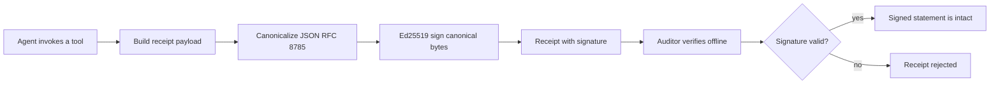
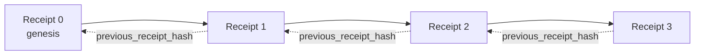

[سبق کی ویڈیو دیکھیں: کرپٹوگرافک رسیدوں کے ساتھ مصنوعی ذہانت کے ایجنٹس کی حفاظت](https://youtu.be/PLACEHOLDER_VIDEO_ID)

> _(سبق کی ویڈیو اور تھمب نیل Microsoft کے مواد کی ٹیم کے ذریعے مرج کے بعد شامل کیے جائیں گے، سبق 14 / 15 کے نمونے سے میل کھاتے ہوئے.)_

# کرپٹوگرافک رسیدوں کے ساتھ مصنوعی ذہانت کے ایجنٹس کی حفاظت

## تعارف

یہ سبق درج ذیل موضوعات کا احاطہ کرے گا:

- کیوں مصنوعی ذہانت کے ایجنٹس کے آڈٹ ٹریل تعمیل، ڈیبگنگ، اور اعتماد کے لیے اہم ہیں۔
- کرپٹوگرافک رسید کیا ہے اور یہ ایک غیر دستخط شدہ لاگ لائن سے کیسے مختلف ہے۔
- ایک ایجنٹ کے ٹول کال کے لیے سادہ Python میں دستخط شدہ رسید کیسے تیار کی جائے۔
- رسید کو آف لائن کیسے تصدیق کریں اور چھیڑ چھاڑ کا پتہ کیسے چلائیں۔
- رسیدوں کو اس طرح چین کرنا کہ ایک کو ہٹانے یا ترتیب بدلنے سے چین ٹوٹ جائے۔
- رسید کیا ثابت کرتی ہیں اور وہ واضح طور پر کیا ثابت نہیں کرتیں۔

## سیکھنے کے اہداف

اس سبق کو مکمل کرنے کے بعد، آپ جانیں گے کہ کیسے:

- وہ ناکامی کے طریقے شناخت کریں جو ایجنٹ کے اعمال کے لیے کرپٹوگرافک ماخذ (provenance) کی ضرورت کو متحرک کرتے ہیں۔
- ایک canonical JSON پی لوڈ پر Ed25519 سے دستخط شدہ رسید تیار کریں۔
- صرف دستخط کنندہ کی عوامی کلید استعمال کرتے ہوئے ایک رسید کو آزادانہ طور پر تصدیق کریں۔
- تبدیل شدہ رسید پر دوبارہ تصدیق چلوا کر چھیڑ چھاڑ کا پتہ لگائیں۔
- رسیدوں کا ایک ہیش چینڈ سلسلہ بنائیں اور وضاحت کریں کہ چین کیوں اہم ہے۔
- اس حد کو پہچانیں کہ رسید کیا ثابت کرتی ہیں (منسوبیت، سالمیت، ترتیب) اور کیا ثابت نہیں کرتیں (عمل کی درستگی، پالیسی کی مضبوطی)۔

## مسئلہ: آپ کے ایجنٹ کا آڈٹ ٹریل

فرض کریں آپ نے Contoso Travel کے لیے ایک مصنوعی ذہانت ایجنٹ تعینات کیا ہے۔ ایجنٹ کسٹمر کی درخواستیں پڑھتا ہے، flights API کو کال کرتا ہے تاکہ آپشنز دیکھے جا سکیں، اور صارف کی جانب سے نشستیں بک کرتا ہے۔ پچھلے سہ ماہی میں، اس ایجنٹ نے 50,000 بکنگز پراسیس کیں۔

آج ایک آڈیٹر آتا ہے۔ وہ ایک سادہ سوال پوچھتا ہے: "مجھے دکھائیں آپ کے ایجنٹ نے کیا کیا؟"

آپ اپنے لاگ فائلز تھما دیتے ہیں۔ آڈیٹر انہیں دیکھتا ہے اور ایک مشکل سوال پوچھتا ہے: "مجھے کیسے معلوم کہ ان لاگز میں ترمیم نہیں کی گئی؟"

یہ آڈٹ ٹریل کا مسئلہ ہے۔ آج کل زیادہ تر ایجنٹ کی تنصیبات ان پر منحصر ہیں:

- **ایپلیکیشن لاگز**: ایجنٹ خود لکھتا ہے، اور فائل سسٹم تک رسائی رکھنے والا کوئی بھی شخص انہیں ایڈیٹ کر سکتا ہے۔
- **کلاؤڈ لاگنگ سروسز**: پلیٹ فارم کی سطح پر چھیڑچھاڑ کا پتہ لگتی ہے لیکن صرف اس صورت میں جب آڈیٹر پلیٹ فارم آپریٹر پر اعتماد کرتا ہو۔
- **ڈیٹا بیس ٹرانزیکشن لاگز**: ڈیٹا بیس میں تبدیلیوں کے لیے موزوں ہیں لیکن عام ٹول کالز کے لیے نہیں۔

ان میں سے کوئی بھی آڈیٹر کے سوال کا جواب اس کے بغیر نہیں دے سکتا کہ آڈیٹر کسی پر اعتماد کرے (آپ، آپ کا کلاؤڈ فراہم کنندہ، آپ کے ڈیٹا بیس وینڈر). اندرونی استعمال کے لیے، یہ اعتماد اکثر قابلِ قبول ہوتا ہے۔ ضابطے والے ورک لوڈز (فنانس، ہیلتھ کیئر، یا EU AI Act کے تابع کوئی بھی چیز) کے لیے، یہ قابلِ قبول نہیں ہے۔

کرپٹوگرافک رسیدیں اس مسئلے کو اس طرح کم کرتی ہیں کہ ایک دستخط شدہ بیان کو آزادانہ طور پر
قابلِ تصدیق بنایا جا سکتا ہے۔ آڈیٹر کو پھر بھی دستخط کرنے والی کلید اور
اس جزو پر اعتماد کرنے کے لیے باہری ثبوت کی ضرورت ہوتی ہے جو یہ بیان تیار کرتا ہے۔ ایک اندر شامل کلید خود مطابقت کو ثابت کرتی ہے،
اشیر کی شناخت یا نفاذ کے مقام کو نہیں۔

## کرپٹوگرافک رسید کیا ہے؟

رسید ایک JSON آبجیکٹ ہے جو ریکارڈ کرتا ہے کہ ایجنٹ نے کیا کیا، اور یہ ایک ڈیجیٹل دستخط کے ساتھ دستخط شدہ ہوتا ہے۔



ایک کم از کم رسید اس طرح دکھتی ہے:

```json
{
  "type": "agent.tool_call.v1",
  "agent_id": "contoso-travel-bot",
  "tool_name": "lookup_flights",
  "tool_args_hash": "sha256:a3f9c1...",
  "result_hash": "sha256:7b2e1d...",
  "policy_id": "contoso-travel-policy-v3",
  "timestamp": "2026-04-25T14:30:00Z",
  "sequence": 47,
  "previous_receipt_hash": "sha256:9d4e6a...",
  "signature": {
    "alg": "EdDSA",
    "sig": "c5af83...",
    "public_key": "8f3b2c..."
  }
}
```

تین خصوصیات کام کر رہی ہیں:

1. **دستخط**۔ رسید ایجنٹ کے گیٹ وے کی طرف سے Ed25519 نجی کلید استعمال کرتے ہوئے دستخط کی جاتی ہے۔ متعلقہ عوامی کلید رکھنے والا کوئی بھی شخص دستخط کو آف لائن تصدیق کر سکتا ہے۔ جس فریق پر انحصار کیا جائے وہ اس کلید کو pin کرے یا اسے رسید کے باہر ایک قابلِ اعتماد رجسٹری سے حل کرے۔ کسی بھی دستخط شدہ فیلڈ میں چھیڑ چھاڑ دستخط کو نامعتبر بنا دیتی ہے۔

2. **کینونیکل انکوڈنگ**۔ دستخط کرنے سے پہلے، رسید کو JSON Canonicalization Scheme (JCS, RFC 8785) استعمال کرتے ہوئے سیریلائز کیا جاتا ہے۔ یہ یقینی بناتا ہے کہ دو نفاذ جو ایک ہی منطقی رسید تیار کرتے ہیں وہ بائٹس کی سطح پر ایک جیسے آؤٹ پٹ پیدا کریں۔ کینونیکلائزیشن کے بغیر، مختلف JSON سیریلائزرز ایک ہی مواد کے لیے مختلف دستخط پیدا کریں گے۔

3. **ہیش چیننگ**۔ `previous_receipt_hash` فیلڈ ہر رسید کو اس سے پہلے والی رسید سے جوڑتی ہے۔ کسی رسید کو ہٹانے یا ترتیب بدلنے سے پیش کی گئی تسلسل ٹوٹ جاتا ہے۔ ٹرنکیشن یا دستخط کنندہ کے زیرِ کنٹرول دوبارہ تحریر کا پتہ لگانے کے لیے بھی ایک پِن کیے گئے موجودہ چین ہیڈ، آزادانہ طور پر گواہ شدہ چیک پوائنٹ، یا مستند بند آبادی کمٹمنٹ درکار ہوتا ہے۔

یہ تمام خصوصیات مل کر تین ضمانتیں فراہم کرتی ہیں:

- **کلید کے ساتھ منسوبیت**: اس کلید نے اس مواد پر دستخط کیے۔ تنظیمی یا انسانی شناخت کے لیے ایک قابلِ اعتماد کلید بائنڈنگ ضروری ہے۔
- **سالمیت**: مواد دستخط کے بعد تبدیل نہیں ہوا ہے۔
- **توثیق شدہ تسلسل کے اندر ترتیب**: یہ رسید اس پِچھلی رسید سے منسلک ہے۔

## Python میں رسید تیار کرنا

ایک رسید تیار کرنے کے لیے کسی خاص لائبریری کی ضرورت نہیں ہے۔ کرپٹوگرافک بنیادیات عام دستیاب ہیں اور منطق چند درجن سطروں کی Python کوڈ ہے۔

ہاتھوں پر کرنے والی مشقیں `code_samples/18-signed-receipts.ipynb` میں پورے عمل کو قدم بہ قدم دکھاتی ہیں۔ سورس کنٹرول شدہ `code_samples/18-signed-receipts.execution-receipt.json` نوٹ بُک کا عین ہیش، Python ماحول، سیل کی گنتی، اور تازہ ترین صفا اجرا کی جانچیں ریکارڈ کرتا ہے بغیر سبق کے محفوظ شدہ آؤٹ پٹس کو تبدیل کیے۔ خلاصہ ورژن:

```python
import json
import hashlib
import base64
from nacl import signing
from jcs import canonicalize  # RFC 8785 canonical JSON

def b64url_nopad(data: bytes) -> str:
    return base64.urlsafe_b64encode(data).decode("ascii").rstrip("=")

def sha256_canonical(obj) -> str:
    """SHA-256 of a Python object's JCS-canonical JSON form."""
    return f"sha256:{hashlib.sha256(canonicalize(obj)).hexdigest()}"

# Generate or load a signing key (in production, store in a key vault)
signing_key = signing.SigningKey.generate()
verify_key = signing_key.verify_key
TRUSTED_PUBLIC_KEYS = {b64url_nopad(bytes(verify_key))}  # pinned out of band by the verifier

# Build the receipt payload (no signature yet)
tool_args = {"origin": "SYD", "destination": "LAX"}
tool_result = [{"flight": "QF11", "price": 1850, "stops": 0}]

payload = {
    "type": "agent.tool_call.v1",
    "agent_id": "contoso-travel-bot",
    "tool_name": "lookup_flights",
    "tool_args_hash": sha256_canonical(tool_args),
    "result_hash": sha256_canonical(tool_result),
    "policy_id": "contoso-travel-policy-v3",
    "timestamp": "2026-04-25T14:30:00Z",
    "sequence": 0,
    "previous_receipt_hash": None,
}

# Canonicalize and sign the JCS bytes directly. PureEdDSA hashes internally.
canonical_bytes = canonicalize(payload)
signature_bytes = signing_key.sign(canonical_bytes).signature

# Attach a structured signature object.
receipt = {
    **payload,
    "signature": {
        "alg": "EdDSA",
        "sig": b64url_nopad(signature_bytes),
        "public_key": b64url_nopad(bytes(verify_key)),
    },
}
```

یہی پورا دستخطی پائپ لائن ہے۔ نوٹ بُک کی مشقیں ہر قدم کو دکھاتی ہیں۔

## رسید کی تصدیق اور چھیڑ چھاڑ کا پتہ لگانا

تصدیق الٹی کارروائی ہے:

```python
import base64
import hashlib
from nacl import signing
from nacl.exceptions import CryptoError
from jcs import canonicalize

def b64url_decode(s: str) -> bytes:
    # Strict: Python's decoder skips characters outside the alphabet and also
    # accepts padding, the standard +/ alphabet and non-zero spare bits.
    # Re-encoding and comparing accepts only the one unpadded base64url form.
    padding = "=" * ((4 - len(s) % 4) % 4)
    data = base64.urlsafe_b64decode(s + padding)
    if base64.urlsafe_b64encode(data).decode("ascii").rstrip("=") != s:
        raise ValueError("not canonical unpadded base64url")
    return data

def verify_receipt(receipt: dict, trusted_public_key: str) -> bool:
    # trusted_public_key is the issuer's key, obtained from somewhere other
    # than this receipt. Never use receipt["signature"]["public_key"] here:
    # see "What Receipts Prove (and What They Do Not)" below.
    # Fails closed: anything malformed returns False instead of raising.
    if not isinstance(receipt, dict) or not isinstance(trusted_public_key, str):
        return False
    sig_obj = receipt.get("signature")
    if not isinstance(sig_obj, dict) or sig_obj.get("alg") != "EdDSA":
        return False
    sig_b64 = sig_obj.get("sig")
    if not isinstance(sig_b64, str):
        return False

    try:
        # Reconstruct the payload that was actually signed (everything except signature).
        payload = {k: v for k, v in receipt.items() if k != "signature"}
        canonical_bytes = canonicalize(payload)
        verify_key = signing.VerifyKey(b64url_decode(trusted_public_key))
        verify_key.verify(canonical_bytes, b64url_decode(sig_b64))
        return True
    except (CryptoError, TypeError, ValueError, KeyError, OverflowError):
        return False
    except Exception:
        # An undecodable key or signature, or a payload that cannot be
        # canonicalized: fail closed rather than raise.
        return False
```

یہ فنکشن ایک رسید اور جاری کرنے والے کی عوامی کلید لیتا ہے، اور اگر دستخط درست ہو تو `True` واپس کرتا ہے ورنہ `False`، بشمول اس وقت جب ان پٹ خراب ہو۔ کوئی نیٹ ورک کال یا تصدیقی سروس درکار نہیں: ایک بار جب آپ کے پاس جاری کرنے والے کی کلید ہو، تو تصدیق مکمل طور پر لوکل اور آف لائن ہوتی ہے۔ جو چیز پھر بھی درکار ہے وہ وہی کلید ہے، جو رسید کے بجائے کہیں اور سے حاصل کی گئی ہو۔

چھیڑ چھاڑ کی شناخت کو عملی طور پر دیکھنے کے لیے، نوٹ بُک میں یہ مراحل دکھائے گئے ہیں:

1. ایک درست رسید تیار کرنا اور اس کی تصدیق کرنا۔
2. `tool_args_hash` فیلڈ کے ایک بائٹ میں تبدیلی کرنا۔
3. تصدیق دوبارہ چلانا اور ناکامی دیکھنا۔
4. دوبارہ چھیڑ چھاڑ کرنا، مگر اس بار حملہ آور نے جو کلید بنائی ہے اس کے ساتھ دوبارہ دستخط کرنا اور وہ کلید رسید میں شامل کرنا۔

مرحلہ 4 وہ ہے جس پر غور کرنا ضروری ہے۔ وہ رسید داخلی اعتبار سے مطابقت رکھتی ہے: اس کا دستخط اس کے مواد اور اس کلید کے لیے اصلی ہے جو یہ ساتھ رکھتی ہے، لہٰذا یہ اسی کے اندر موجود کلید کے مقابلے میں تصدیق ہو جاتی ہے۔ یہ صرف اس وقت ناکام ہوتی ہے جب اسے جاری کرنے والے کی حقیقی کلید کے خلاف چیک کیا جائے۔ مراحل 2 اور 3 ایسے حملہ آور کو پکڑتے ہیں جنہوں نے دوبارہ دستخط تک زحمت نہیں کی؛ مرحلہ 4 اُس حملہ آور کو پکڑتا ہے جس نے دستخط کی۔

یہ عملی مظہر ہے کہ رسیدیں چھیڑ چھاڑ کے خلاف واضح ہوتی ہیں: دستخط شدہ فیلڈ میں کوئی بھی تبدیلی دستخط کو توڑ دیتی ہے، بشرطیکہ آپ اس کلید کے خلاف تصدیق کریں جو حملہ آور نے فراہم نہ کی ہو۔ `signature` آبجیکٹ خود دستخط شدہ بائٹس کے باہر ہے، اسی لیے جس کلید کے خلاف آپ تصدیق کریں وہ رسید کے علاوہ کہیں سے آنی چاہیے۔

## کثیر مرحلوں والے ایجنٹس کے لیے رسیدوں کی چیننگ

ایک واحد دستخط شدہ رسید ایک عمل کی حفاظت کرتی ہے۔ رسیدوں کی ایک چین ایک سلسلے کی حفاظت کرتی ہے۔



ہر رسید اس سے پہلے والی رسید کا ہیش ریکارڈ کرتی ہے۔ رسید 2 کو خاموشی سے ہٹانے کے لیے، حملہ آور کو یا تو یہ کرنا ہوگا:

- رسید 3 کے `previous_receipt_hash` فیلڈ میں ترمیم کرنا (رسید 3 کے دستخط کو توڑتا ہے)، OR
- ترمیم شدہ رسید 3 پر نیا دستخط جعلسازی کرنا (ایجنٹ کی نجی کلید درکار ہوتی ہے).

اگر نجی کلید ہارڈویئر کلید والٹ میں ہے اور تصدیق کنندگان ہر رسید کو جاری کرنے والے کی عوامی کلید کے خلاف، جو آزادانہ طور پر حاصل کی گئی ہو (ایک شائع شدہ JWK Set یا ایک pinned کنفیگ ویلیو)، چیک کریں تو دونوں حملے بغیر پتا چلے ممکن نہیں ہیں۔ ہر رسید کے اندر کلید شائع کرنا کافی نہیں ہے: ایک حملہ آور اپنے ہی کلید سے دوبارہ دستخط کر سکتا ہے اور وہ کلید اس کے بجائے شامل کر سکتا ہے، جو کہ fixture `04_resigned_receipt.json` ہے۔

نوٹ بُک درج ذیل کو قدم بہ قدم دکھاتی ہے:

1. تین رسیدوں کی ایک چین بنانا۔
2. تصدیق کرنا کہ ہر رسید کا `previous_receipt_hash` پچھلی رسید کے حقیقی ہیش کے برابر ہے۔
3. درمیان والی ایک رسید میں چھیڑ چھاڑ کرنا اور دیکھنا کہ چین بالکل اسی مقام پر ٹوٹ جاتی ہے۔

یہ وہ طریقہ ہے جس سے آپ ایک آڈٹ ٹریل تیار کرتے ہیں جسے ایک بیرونی آڈیٹر اپنی
پِن کی گئی جاری کنندہ کی کلیدوں اور چین چیک پوائنٹس کے تحت تصدیق کر سکتا ہے، بغیر آپ کے قابلِ تبدیلی لاگ اسٹور پر اعتماد کیے۔

## رسیدیں کیا ثابت کرتی ہیں (اور کیا نہیں کرتی)

یہ اس سبق کا سب سے اہم حصہ ہے۔ رسیدیں طاقتور ہیں مگر ان کی طاقت محدود ہے۔

**رسیدیں تین چیزیں ثابت کرتی ہیں:**

1. **منسوبیت**: ایک مخصوص کلید نے ایک مخصوص پی لوڈ پر دستخط کیے۔
2. **سالمیت**: پی لوڈ دستخط کے بعد تبدیل نہیں ہوا۔
3. **پیش کیے گئے، توثیق شدہ تسلسل کے اندر ترتیب**: یہ رسید اس پِچھلی رسید سے منسلک ہے۔

**رسیدیں ثابت نہیں کرتیں:**

1. **درستگی**: کہ ایجنٹ کا عمل درست تھا۔ ایک رسید غلط جواب کے لیے بھی اتنی ہی صفائی سے دستخط کی جا سکتی ہے جتنی کہ درست جواب کے لیے۔
2. **پالیسی کی تعمیل**: کہ `policy_id` میں حوالہ دی گئی پالیسی واقعی میں جانچی گئی تھی، یا کہ اگر چیک کی جاتی تو اس نے اس عمل کی اجازت دی ہوتی۔ رسید وہ ریکارڈ کرتی ہے جو دعویٰ کیا گیا، نہ کہ وہ جو نافذ کیا گیا۔
3. **کلید سے آگے شناخت**: رسید کہتی ہے "اس کلید نے اس مواد پر دستخط کیے۔" یہ نہیں کہتی "اس شخص نے اجازت دی۔" کلید کو کسی فرد یا تنظیم سے جوڑنے کے لیے علیحدہ شناختی انفراسٹرکچر درکار ہے (مثلاً ڈائریکٹری، عوامی کلید رجسٹری وغیرہ).
4. **ان پٹس کی سچائی**: اگر ایجنٹ کو ایک تبدیل شدہ پرامپٹ موصول ہوتا ہے اور وہ اسی کے مطابق عمل کرتا ہے، تو رسید عمل کو بھروسے کے ساتھ ریکارڈ کرتی ہے۔ رسیدیں ان پٹ ویلیڈیشن کے بعد آتی ہیں، اس کی جگہ نہیں لے سکتیں۔
5. **عملدرآمد یا حقیقی دنیا کا اثر**: کال کے بعد کی رسید اس چیز کو ریکارڈ کرتی ہے جو جاری کرنے والا دعویٰ کرتا ہے کہ ہوا۔ داخلے کا ثبوت دینا یا بیرونی اثر کو میل کرنا اصل ایگزیکیٹر یا فراہم کنندہ کی سرحد سے شواہد طلب کرتا ہے۔
6. **مکملیت**: غیر موجود رسید کا مطلب ہو سکتا ہے کہ وہ بلاک کی گئی، چھوڑ دی گئی، گم ہو گئی، یا آلہ بند نہیں کیا گیا۔ عدم موجودگی صرف ایک مستند بند آبادی کے اندر ثبوت بن پاتی ہے۔
7. **قابلِ اعتماد وقت**: دستخط شدہ ٹائم اسٹیمپ یہ ثابت کرتا ہے کہ دستخط کنندہ نے وہ قدر رکھی تھی، نہ کہ وہ قدر درست تھی۔ قابلِ اعتماد وقت کے لیے ایک الگ وقت اتھارٹی یا گواہ شدہ چیک پوائنٹ درکار ہے۔

**رسید میں موجود کلید وہ کلید نہیں ہے جس کے ساتھ آپ تصدیق کرتے ہیں۔** یہ نکتہ 3 سے اخذ ہوتا ہے، اور یہ واحد جگہ ہے جہاں امتیاز آپ کی سمجھ کے بجائے آپ کے کوڈ کو بدلنا ہوگا۔ اوپر کے نمونے میں `public_key` اس لیے موجود ہے تاکہ مثال خود مختار ہو۔ ایک تصدیق کنندہ کو اس پر کبھی بھروسہ نہیں کرنا چاہیے۔ کوئی بھی رسید لے سکتا ہے، اس میں رد و بدل کر سکتا ہے، اسے اپنی بنائی ہوئی کلید سے دستخط کر سکتا ہے، اور وہ کلید اس میں شامل کر سکتا ہے؛ نتیجہ خود کے خلاف کامل طور پر تصدیق ہو جاتا ہے۔ یہ fixture `04_resigned_receipt.json` ہے `sample_receipts/` میں، اور اسی وجہ سے `verify_receipt` اوپر کلید کو رسید سے نکالنے کی بجائے ایک دلیل کے طور پر لیتا ہے۔ جاری کرنے والے کی کلید خود مختار طریقے سے حاصل کریں، نیچے Production Checklist میں موجود JWK Set سے یا کسی اور اینکر سے جو آپ نے پہلے پِن کیا تھا، اور اسی کے خلاف تصدیق کریں۔ ایک ایسی کلید کے ساتھ چیک کیا گیا دستخط جو اسی لفافے میں آیا ہو صرف یہ ثابت کرتا ہے کہ لفافہ خود مطابقت پذیر ہے۔

یہ حد دو وجوہات کی بنا پر اہم ہے:

- یہ بتاتا ہے کہ رسیدیں کس چیز کے لیے مفید ہیں: ایجنٹ کے رویے کو آڈیٹیبل اور چھیڑ چھاڑ کے خلاف واضح بنانا، حتیٰ کہ تنظیمی حدود کے پار بھی۔
- یہ بتاتا ہے کہ آپ کو کون سی اضافی پرتیں ابھی درکار ہیں: ان پٹ ویلیڈیشن (سبق 6)، پالیسی کا نفاذ (ذیل میں مختصراً بیان)، اور شناختی انفراسٹرکچر (اس سبق کے دائرہ کار سے باہر)۔

ایک عام غلطی یہ ماننا ہے کہ "ہمارے پاس رسیدیں ہیں" مطلب "ہم منظم ہیں۔" ایسا نہیں ہے۔ رسیدیں ایک بنیاد ہیں۔ حکمرانی وہ نظام ہے جو آپ اس کے اوپر بناتے ہیں۔

## منظور کنندہ کے دستخط کو درست عمل کے ساتھ جوڑنا

اوپر آئٹم 3 اپنی ایک سیکشن کے لائق ہے: ایک عمل رسید کہتی ہے "اس کلید نے اس مواد پر دستخط کیے"، کبھی نہیں کہ "ایک انسان نے اس کی منظوری دی۔" اعلیٰ خطرے والے اعمال (ریفنڈز، ڈیلیشنز، وائر ٹرانسفرز) کے لیے ایک الگ منظور کنندہ کا دستخط درست عمل کو باندھ سکتا ہے۔ اس کلید کو کسی انسان سے جوڑنا اور انسانی موجودگی کی جانچ کرنا الگ ذمہ داریاں رہتی ہیں۔

متبع نوٹ بُک `code_samples/human-authorization-receipts.ipynb` ایک دوسرا رسید قسم شامل کرتا ہے، `human.approval.v1`، اسی لفافے کی شکل میں جیسی اس سبق کی رسیدیں ہیں (ایک ٹائپڈ پی لوڈ جس پر Ed25519 کے ذریعے اس کے کینونیکل JCS بائٹس پر دستخط کیے جاتے ہیں، جبکہ `signature` آبجیکٹ دستخط شدہ بائٹس کے باہر ہوتا ہے). ایک منظور کنندہ کلید **پورے کینونیکل عمل اور اس کے ڈائجسٹ** پر دستخط کرتی ہے؛ ایک ایجنٹ کلید ایک دعویٰ پر دستخط کرتی ہے جو **اسی عمل کے ڈائجسٹ** اور ایک `parent_approval_ref`، منظور کی `receipt_hash`، وہی روایات کے مطابق ہے جیسا کہ آپ نے اوپر بنائی ہوئی چین میں `previous_receipt_hash`۔ ایک `verify_chain` دونوں آثار کو **الگ الگ pinned کلید رجسٹریز** (منظور کنندہ کلیدیں بمقابلہ ایجنٹ کلیدیں) کے تحت چلاتا ہے، اس لیے کوڈ راستہ مشترک ہے مگر اختیار کبھی مشترک نہیں ہوتے۔

یہ خصوصیت احتیاط سے بیان کی گئی: *پِن کی گئی منظور کنندہ کلید نے اسی
عین عمل پر دستخط کیے، اور بعد میں ایجنٹ کی کلید نے اسی عمل کے ڈائجسٹ کو لے کر ایک بیان پر دستخط کیے۔*
یہ مفید ثبوت ہے، مگر خود میں یہ ثبوت نہیں ہے کہ عمل انجام پایا۔
عملدرآمد کو کنٹرول کرنے کے لیے، عین منظوری کو بھی اصل ایگزیکیٹر سرحد پر ایک بار محفوظ کیا جانا اور استعمال کیا جانا چاہیے؛
نامعلوم فراہم کنندہ کے نتائج نامعلوم ہی رہنے چاہئیں بجائے اس کے کہ انہیں اندھا دھند دوبارہ کوشش کیا جائے۔
نوٹ بُک کے انکار کے فیچرز رسید چین لیئر کا ٹیسٹ کرتے ہیں:

- چھیڑ چھاڑ، confused deputy، دونوں جانب جعل شدہ کلیدیں، اور خراب شدہ ان پٹ؛
- **stale authority**: ایک ایسا دستخط جو ابھی بھی تصدیق ہو، مگر بہرحال مسترد کیا جائے کیونکہ پالیسی ورژن بدل گیا، منظور کنندہ کلید pinned رجسٹری سے روٹیٹ آؤٹ کر دی گئی، یا منظوری فراہم کردہ تصدیقی وقت سے پہلے ختم ہو گئی؛
- **digest substitution**: ایک درست طور پر دستخط شدہ عمل رسید جو ایک *حقیقی* منظوری کی طرف اشارہ کرتی ہے جو ایک *مختلف* کینونیکل عمل کو باندھتی ہے۔

ہر ناکامی ایک مخصوص وجہ کے ساتھ انکار کرتی ہے، لہٰذا ایک آڈیٹر جو ایک انکار پڑھتا ہے بتا سکتا ہے کہ آیا اختیار پرانا ہو گیا یا دعویٰ شدہ عمل بدل گیا۔ تصدیق صرف پڑھنے کے لیے اور دہرائی جانے والی ہوتی ہے: یہ منظوری کو استعمال نہیں کرتی اور نہ ہی کسی فراہم کنندہ کو کال کرتی ہے۔ ایک علیحدہ ایگزیکیٹر کو مضبوط، اٹامک ری پلے پروٹیکشن اور واضح کامیابی، ناکامی، اور غیر معین نتائج درکار ہوتے ہیں۔ انسانی منظوری کی رسید اس سبق کے ذریعے تعریف شدہ ایک تعلیمی کمپوزیشن ہے، `draft-farley-acta-signed-receipts` کی طرف سے تعریف شدہ رسید کی قسم نہیں۔

## پروڈکشن حوالہ جات

اس سبق میں پائتھون کوڈ جان بوجھ کر بہت مختصر رکھا گیا ہے تاکہ آپ ہر لائن پڑھ کر بالکل سمجھ سکیں کہ کیا ہو رہا ہے۔ پروڈکشن میں، آپ کے پاس دو اختیارات ہیں:

1. **سِگننگ کرپٹوگرافک پرمیٹیوِوز کے اوپر براہِ راست تعمیر کریں۔** اوپر دکھائی گئی 50 لائنیں بہت سے استعمال کے معاملات کے لیے کافی ہیں۔ PyNaCl (Ed25519) اور `jcs` پیکج (معیاری JSON) اچھی طرح برقرار رکھی جانے والی اور آڈٹ شدہ لائبریریز ہیں۔

2. **پروڈکشن رسید لائبریری استعمال کریں۔** کئی اوپن سورس پروجیکٹس اضافی خصوصیات کے ساتھ اسی پیٹرن کو نافذ کرتے ہیں (کلیدوں کا گردش، بیچ تصدیق، JWK Set کی تقسیم، پالیسی انجنز کے ساتھ انضمام):
   - The signing pipeline uses the JCS and signature-scope conventions in an independent IETF Internet-Draft ([`draft-farley-acta-signed-receipts`](https://datatracker.ietf.org/doc/draft-farley-acta-signed-receipts/), revision 02). This lesson's flat educational receipt differs from the draft's `{payload, signature}` envelope and is not presented as a conformant implementation. The draft publishes a shared conformance suite ([agent-governance-testvectors](https://github.com/ScopeBlind/agent-governance-testvectors)) for implementations targeting its wire format.
   - The Microsoft Agent Governance Toolkit composes receipts with Cedar-based policy decisions; see Tutorial 33 in that repository for an end-to-end example.
   - The `protect-mcp` (npm) and `@veritasacta/verify` (npm) packages provide a Node-based implementation of receipt signing and offline verification, intended for wrapping any MCP server with a tamper-evident audit trail, including a held-for-co-sign flow in which a paused action emits an approval receipt bound to the action digest (WebAuthn-backed in the desktop flow), the same approval-receipt pattern as the human-authorization notebook above.
   - The **[nobulex](https://github.com/arian-gogani/nobulex)** Python SDK (`pip install nobulex`) provides the same Ed25519 + JCS signing pattern in Python with LangChain and CrewAI integrations, including published cross-validation test vectors and a compliance mapping contributed via [OWASP PR #2210](https://github.com/OWASP/CheatSheetSeries/pull/2210).
   - **[EMILIA Protocol](https://github.com/emiliaprotocol/emilia-protocol)** provides a complementary exact-action enforcement layer: offline-verifiable approval receipts, pinned WebAuthn or quorum authority, one-time consumption at the executor boundary, and an explicit indeterminate-outcome path. Its framework adapters treat a receipt as necessary evidence rather than proof that an external effect occurred.

اپنا حل خود بنانے اور لائبریری استعمال کرنے کے درمیان فیصلہ اسی طرح ہے جیسے اپنا JWT لائبریری لکھنے اور ایک ٹیسٹ شدہ لائبریری استعمال کرنے کے درمیان فیصلہ: دونوں معقول ہیں؛ لائبریری وقت بچاتی ہے اور آڈٹ سرفیس کو کم کرتی ہے؛ صفر سے شروع کرنے والا طریقہ آپ کو ہر primitive سمجھنے پر مجبور کرتا ہے۔ یہ سبق صفر سے شروعات کا راستہ سکھاتا ہے تاکہ آپ کے پاس دونوں میں سے کسی بھی انتخاب کی بنیاد موجود ہو۔

## علم کی جانچ

عملی مشق پر جانے سے پہلے اپنی سمجھ کو پرکھیں۔

**1. ایک رسید ایجنٹ کی پرائیویٹ Ed25519 کلید کے ساتھ دستخط ہوتی ہے۔ آڈیٹر کے پاس صرف پبلک کی موجود ہے۔ کیا آڈیٹر رسید کو آف لائن تصدیق کر سکتا ہے؟**

<details>
<summary>جواب</summary>

جی ہاں، کرپٹوگرافک تصدیق کے لیے صرف پبلک کی اور دستخط شدہ بائٹس درکار ہوتی ہیں۔
آڈیٹر کو پھر بھی قبول شدہ پبلک کی کو رسید سے آزاد طور پر حاصل اور پن کرنا ہوگا۔
ایک بار وہ اعتماد ترتیب قائم ہو جانے کے بعد کوئی نیٹ ورک کال درکار نہیں ہوتی۔
</details>

**2. ایک حملہ آور رسید کے `policy_id` فیلڈ میں ترمیم کرتا ہے تاکہ دعویٰ کرے کہ اسے زیادہ نرم پالیسی کے تحت گورن کیا گیا تھا۔ دستخط اصل پیلوڈ پر کیے گئے تھے۔ تصدیق کے دوران کیا ہوگا؟**

<details>
<summary>جواب</summary>

تصدیق ناکام ہوجاتی ہے۔ دستخط اصل پیلوڈ کے کینونیکل بائٹس پر حساب کیے گئے تھے؛ کسی بھی پیلوڈ فیلڈ میں ترمیم اُن بائٹس کو بدل دیتی ہے، جس سے دستخط غلط ہوجاتے ہیں۔ تازہ درست دستخط تیار کرنے کے لیے حملہ آور کو پرائیویٹ کی درکار ہوگی، جو ان کے پاس نہیں ہے۔
</details>

**3. رسید میں خام دلائل اور نتیجے کے بجائے `tool_args_hash` اور `result_hash` کیوں شامل کیے گئے ہیں؟**

<details>
<summary>جواب</summary>

دو وجوہات۔ سب سے پہلے، رسید کو ایسے ماحول میں آرکائیو یا منتقل کرنا پڑ سکتا ہے جہاں خام مواد (PII، کاروباری ڈیٹا) کا لیک ہونا مسئلہ ہو۔ ہیشنگ رسید کو چھوٹا اور مواد کو نجی رکھتی ہے؛ آڈیٹر اس بات کی تصدیق کرتا ہے کہ ہیش حقیقی مواد کی علیحدہ محفوظ شدہ کاپی سے میل کھاتا ہے۔ دوسری بات، ہیشز کا سائز مقررہ ہوتا ہے؛ چاہے ان پٹ اور آؤٹ پُٹ کتنے ہی بڑے ہوں، ہیشز والی رسید کا سائز محدود رہتا ہے۔
</details>

**4. `previous_receipt_hash` فیلڈ ہر رسید کو اس کے پیش رو سے جوڑتی ہے۔ اگر کوئی حملہ آور خاموشی سے چین کے درمیان سے ایک رسید حذف کر دے تو کیا غیر درست ہوجاتا ہے؟**

<details>
<summary>جواب</summary>

ہر وہ رسید جو حذف شدہ رسید کے بعد آچکی تھی۔ ان کے `previous_receipt_hash` فیلڈز اب اصل چین سے میل نہیں کھاتے (کیونکہ جس رسید کا وہ حوالہ دے رہے تھے وہ اب موجود نہیں ہے، یا چین اب کسی مختلف پیش رو کی طرف اشارہ کرتی ہے)۔ حذف پوشیدہ رکھنے کے لیے حملہ آور کو بعد کی ہر رسید پر دوبارہ دستخط کرنا پڑے گا، جس کے لیے اجرا کرنے والے کی پرائیویٹ کی درکار ہے۔ کسی اور کی سے دوبارہ دستخط اجرا کرنے والے کی کلید کے خلاف جانچنے پر ناکام ہوجاتے ہیں۔
</details>

**5. اگر ایک رسید صاف طور پر تصدیق ہوجائے تو کیا یہ ثابت کرتا ہے کہ ایجنٹ کا عمل درست، معقول، یا پالیسی کے مطابق تھا؟**

<details>
<summary>جواب</summary>

نہیں۔ پن کی گئی کلید اور چین کے سیاق و سباق میں، ایک معتبر رسید دستخط کی نسبت،
مواد کی سالمیت، اور پیش کردہ پیش رو کے ساتھ ایک ربط ثابت کرتی ہے۔ یہ یہ ثابت نہیں کرتی کہ
عمل درست یا انجام دیا گیا تھا، کہ پالیسی کا جائزہ لیا گیا تھا، کہ ٹائم سٹیمپ
قابلِ اعتماد ہے، یا کہ ریکارڈ سیٹ مکمل ہے۔ یہ سبق میں سب سے اہم حد ہے۔
</details>

## عملی مشق

کھولیں `code_samples/18-signed-receipts.ipynb` اور چاروں حصے مکمل کریں:

1. **سیکشن 1**: اپنی پہلی رسید پر دستخط کریں اور اس کی تصدیق کریں۔
2. **سیکشن 2**: رسید میں چھیڑ چھاڑ کریں اور دیکھیں کہ تصدیق ناکام ہو جاتی ہے۔
3. **سیکشن 3**: تین رسیدوں کی زنجیر بنائیں اور زنجیر کی سالمیت کی تصدیق کریں۔
4. **سیکشن 4**: اس نمونے کو Microsoft Agent Framework سے بنے ایجنٹ پر نافذ کریں: ایک ٹول کال کو رسید-دستخط کے اندر لپیٹیں، پھر رسید کو آزادانہ طور پر تصدیق کریں۔

**اضافی چیلنج 1:** رسید کے schema میں اپنی پسند کا ایک اضافی فیلڈ شامل کریں (مثلاً، ٹریسنگ کے لیے ایک request ID)، canonical signing logic کو اسے شامل کرنے کے لیے اپ ڈیٹ کریں، اور تصدیق کریں کہ رسید ابھی بھی تصدیق کے مرحلے سے گزر جاتی ہے۔ پھر دستخط کے بعد اس فیلڈ میں ترمیم کریں اور تصدیق ناکام ہونے کی تصدیق کریں۔ اس سے آپ کو یہ سمجھنے پر مجبور ہونا پڑے گا کہ canonical encoding کا ہر بائٹ دستخط میں کیسے حصہ ڈالتا ہے۔

**اضافی چیلنج 2:** اپنی دو رسیدوں کو SHA-256 سے ہیش کریں (ان کے canonical بائٹس کو ایک متعین ترتیب میں concatenate کریں) اور حاصل شدہ digest کو تیسری رسید پر ایک نئے فیلڈ کے طور پر شامل کریں اس سے پہلے کہ آپ اس پر دستخط کریں۔ تصدیق کریں کہ تینوں رسیدیں اب بھی تصدیق سے گزرتی ہیں۔ آپ نے ابھی ایک ایک مرحلے کا شمولیت ثبوت بنایا ہے: جو بھی تیسری رسید رکھتا ہے وہ ثابت کر سکتا ہے کہ پہلی دو رسیدیں اس وقت موجود تھیں جب اس پر دستخط ہوئے تھے، بغیر ان کا مواد ظاہر کیے۔ یہی وہ نمونہ ہے جو selective-disclosure رسیدیں بڑے پیمانے پر استعمال کرتی ہیں (Merkle commitments, RFC 6962).

## نتیجہ

کریپٹوگرافک رسیدیں AI ایجنٹس کو ایک آڈٹ ٹریل فراہم کرتی ہیں جو:

- **قابلِ آزادانہ تصدیق تحت طے شدہ اعتماد**: کسی فریق کے پاس منظور شدہ public keys اور signed bytes ہوں تو وہ بغیر کسی سروس پر منحصر ہوئے تصدیق کر سکتا ہے۔
- **چھیڑ چھاڑ کا پتہ چلنے والا**: کسی بھی ترمیم سے دستخط نامعتبر ہو جاتے ہیں۔
- **قابلِ نقل**: رسید ایک چھوٹی JSON فائل ہے؛ اسے آرکائیو، منتقل، اور کہیں بھی تصدیق کیا جا سکتا ہے۔
- **معیارات کے مطابق**: Ed25519 (RFC 8032)، JCS (RFC 8785)، اور SHA-256 پر مبنی، جو سبھی وسیع پیمانے پر استعمال ہونے والے primitives ہیں۔

یہ ان پٹ کی توثیق، پالیسی نفاذ، ایکزیکیوٹر کی داخلے کی منظوری،
نتائج کے شواہد، تکمیل کنٹرول، یا شناختی انفراسٹرکچر کا نعم البدل نہیں ہیں۔ یہ ان تہوں کے لیے ایک بنیاد ہیں۔
ضابطے یا کثیر-تنظیمی ورک فلو میں، رسیدیں مخصوص
اجراء کنندہ کے بیانات کو آڈیٹر کی اپنی اعتماد ترتیب کے تحت آزادانہ طور پر جانچا جا سکتا ہے۔

سب سے اہم نتیجہ: رسیدیں ثابت کرتی ہیں کہ ایک مخصوص کلید نے مخصوص
مواد پر دستخط کیے۔ شامل کردہ ٹائم اسٹیمپ دستخط کنندہ کا دعویٰ ہوتا ہے جب تک کہ اسے الگ سے وقت کی توثیق نہ حاصل ہو۔ ایک
رسید یہ ثابت نہیں کرتی کہ اس کا مواد درست تھا، کہ کوئی عمل انجام پایا، یا کہ
ریکارڈ سیٹ مکمل ہے۔ ان تمیزات کو سختی سے برقرار رکھیں۔

## پیداواری چیک لسٹ

جب آپ اس سبق سے فارغ ہو کر رسید-دستخط شدہ ایجنٹس کو حقیقی ماحول میں تعینات کرنے کے لیے تیار ہوں:

- [ ] **سائننگ کلید کو ڈویلپر لیپ ٹاپ سے ہٹا دیں۔** Azure Key Vault، AWS KMS، یا ہارڈویئر سیکیورٹی ماڈیول استعمال کریں۔ آپ کی رسیدوں پر دستخط کرنے والی پرائیویٹ کلید کبھی بھی سورس کنٹرول میں یا ایپلی کیشن مشینوں پر سادہ متن میں نہیں ہونی چاہیے۔
- [ ] **تصدیق کنندہ کلید اعتماد قائم کریں۔** JWK Set یا رجسٹری کے ذریعے کلیدیں شائع کریں، پھر منحصر فریقین سے کہیں کہ وہ منظور شدہ جاری کنندہ کی شناخت، کلید سیٹ، اور گردش پالیسی کو انفرادی رسیدوں سے باہر پِن کریں۔ ایک ان لائن کلید اپنے آپ میں ایک اعتماد اینکر نہیں ہے۔
- [ ] **زنجیر کو بیرونی طور پر اینکر کریں۔** وقتاً فوقتاً تازہ ترین چین ہیڈ ہیش کو ایک شفافیت لاگ (Sigstore Rekor, RFC 3161 timestamp authority, یا ایک دوسرا اندرونی نظام) میں لکھیں تاکہ کوئی بیرونی فریق اس بات کی تصدیق کر سکے کہ "یہ زنجیر اس وقت موجود تھی۔"
- [ ] **رسیدیں ناقابلِ تغیر طور پر محفوظ کریں۔** صرف الحاق شدہ blob اسٹوریج (Azure Storage with immutability policies, AWS S3 Object Lock) ایک اندرونی شخص کو اسٹوریج سطح پر تاریخ کو دوبارہ لکھنے سے روکتی ہے۔
- [ ] **احتفاظ کا فیصلہ کریں۔** کئی تعمیل کے نظاموں میں کئی سالہ احتفاظ کی ضرورت ہوتی ہے۔ رسید کی بڑھوتری کے لیے منصوبہ بندی کریں (ہر رسید تقریباً ~500 بائٹس ہوتی ہے؛ روزانہ 10K کالز کرنے والا ایک ایجنٹ سالانہ تقریباً ~1.8 GB پیدا کرتا ہے)۔
- [ ] **دستاویزی بنائیں کہ رسید کیا چیزیں کور نہیں کرتی۔** رسیدیں نسبت، سالمیت، اور ترتیب کو ثابت کرتی ہیں۔ آپ کی رن بک میں واضح طور پر درج ہونا چاہیے کہ کون سے اضافی کنٹرولز (ان پٹ توثیق، پالیسی نفاذ، ریٹ لمٹنگ، شناختی انفراسٹرکچر) آپ کی گورننس پوزیشن میں رسیدوں کے ساتھ ساتھ موجود ہیں۔

### کیا آپ کے پاس AI ایجنٹس کو محفوظ بنانے کے بارے میں مزید سوالات ہیں؟

اس [Microsoft Foundry Discord](https://aka.ms/ai-agents/discord) میں شامل ہوں تاکہ آپ دوسرے لرنرز سے مل سکیں، آفس آورز میں شرکت کر سکیں، اور اپنے AI Agents کے سوالات کے جوابات حاصل کریں۔

## اس سبق سے آگے

یہ سبق سنگل-رسید دستخط اور ہیش-چین شدہ سلسلوں کو گھیرتا ہے۔ یہی بنیادی عناصر کئی مزید ترقی یافتہ نمونوں میں منظم ہوتے ہیں جو آپ کی گورننس رویے کے پختہ ہونے پر آپ کو مل سکتے ہیں:

- **انتخابی افشاء۔** جب کسی رسید کے فیلڈز علیحدہ طور پر کمٹ کیے جائیں (RFC 6962-اسٹائل Merkle درخت)، آپ مخصوص فیلڈز مخصوص آڈیٹرز کو ظاہر کر سکتے ہیں اور باقی کے غیر تبدیل شدہ ہونے کا ثبوت دے سکتے ہیں بغیر انہیں افشاء کیے۔ یہ تب مفید ہے جب ایک ہی رسید کو ایک جامع آڈٹ (جو تکمیل چاہتا ہے) اور ڈیٹا-کم از کم قواعد جیسے GDPR (جو چاہتا ہے کہ آڈیٹر کو جتنا ضروری ہو کم دکھایا جائے) دونوں کی ضروریت پوری کرنی ہو۔
- **رسید کی منسوخی۔** اگر دستخط کرنے والی کلید سمجھوتہ شدہ ہو جائے تو آپ کو ایک طریقہ درکار ہوگا جس سے اس وقت کے بعد اس کلید سے دستخط شدہ تمام رسیدوں کو غیر قابلِ اعتماد نشان زد کیا جا سکے۔ معیاری نمونے: مختصر مدت کی سائننگ کلیدیں ساتھ میں شائع شدہ منسوخی فہرست، یا منسوخی اندراجات کے ساتھ ایک شفافیت لاگ۔
- **دوطرفہ / تقسیم-دستخط رسیدیں۔** کچھ نفاذات میں دستخط شدہ پیلوڈ کو pre-execution (`authorization_*`) اور post-execution (`result_*`) نصفوں میں تقسیم کر کے آزاد دستخط کیے جاتے ہیں، جو اُس وقت مفید ہیں جب اجازت دینے کا فیصلہ اور مشاہدہ شدہ نتیجہ مختلف فریقین یا مختلف اوقات میں پیدا ہوتے ہوں۔ یہ اس سبق میں سکھائے گئے رسید فارمیٹ کے اوپر بطور تہہ جمع ہوتا ہے۔
- **پیلوڈ ترکیب۔** ایک رسید اُن بائٹس کو سیل کرتی ہے جو آپ `result_hash` میں رکھتے ہیں۔ حقیقی دنیا کے پیلوڈز اکثر ایک واحد ٹول کال کے نتیجے سے زیادہ بھرپور ہوتے ہیں: فیصلہ سے پہلے کی دلیل (ماڈل کی پیش گوئی، زیرِ غور اختیارات، شواہد اور اُن کی تکمیل، خطرے کا موقف، ذمہ داری کی زنجیر، گیٹ کا نتیجہ) سب پیلوڈ کے اندر ہو سکتے ہیں، جنہیں ایک واحد رسید سیل کرتی ہے۔ یہ رسید فارمیٹ کو کم سے کم رکھتا ہے جبکہ پیلوڈ اسکیموں کو ڈومین بہ ڈومین ارتقائی طور پر بدلنے دیتا ہے۔
- **کراس-نفاذ مطابقت۔** ایک ہی رسید فارمیٹ کے متعدد آزاد نفاذات (Python, TypeScript, Rust, Go) مشترکہ ٹیسٹ ویکٹرز کے خلاف باہمی تصدیق کرتے ہیں۔ اگر آپ اپنی نفاذ خود بناتے ہیں تو شائع شدہ ویکٹرز کے خلاف اس کی توثیق وائر مطابقت کی تصدیق کرتی ہے۔
- **پوسٹ-کوانٹم منتقلی۔** Ed25519 آج وسیع پیمانے پر نافذ ہے مگر یہ کوانٹم-مزاحم نہیں ہے۔ ایک `alg` لیبل اکیلا منتقلی نہیں ہے: ایک پروفائل کو ML-DSA کلید انکوڈنگ، canonical signed bytes، تصدیق، منحصر فریق کی پالیسی، ڈاوِن گریڈ مزاحمت، اور منتقلی کے معانی متعین کرنے ہوں گے۔ مطابقت کے دعوے کرنے سے پہلے مشترکہ ویکٹرز کے خلاف دوہری-دستخط منتقلی کی منصوبہ بندی اور جانچ کریں۔

## اضافی وسائل

- <a href="https://datatracker.ietf.org/doc/draft-farley-acta-signed-receipts/" target="_blank">IETF Internet-Draft: مشین-سے-مشین رسائی کنٹرول کے لیے دستخط شدہ فیصلہ رسیدیں</a>
- <a href="https://learn.microsoft.com/azure/ai-studio/responsible-use-of-ai-overview" target="_blank">ذمہ دار AI کا جائزہ (Azure AI)</a>
- <a href="https://datatracker.ietf.org/doc/html/rfc8032" target="_blank">RFC 8032: ایڈورڈز-کرو ڈجیٹل دستخط الگورتھم (EdDSA)</a>
- <a href="https://datatracker.ietf.org/doc/html/rfc8785" target="_blank">RFC 8785: JSON کینونیکلائزیشن اسکیم (JCS)</a>
- <a href="https://datatracker.ietf.org/doc/html/rfc6962" target="_blank">RFC 6962: سرٹیفیکیٹ ٹرانسپیرنسی</a> (Merkle-tree تعمیر جو انتخابی افشاء رسیدوں میں استعمال ہوتی ہے)
- <a href="https://github.com/microsoft/agent-governance-toolkit/blob/main/docs/tutorials/33-offline-verifiable-receipts.md" target="_blank">Microsoft Agent Governance Toolkit، سبق 33: آف لائن-قابلِ تصدیق فیصلہ رسیدیں</a>
- <a href="https://github.com/ScopeBlind/agent-governance-testvectors" target="_blank">کراس-نفاذ مطابقت ٹیسٹ ویکٹرز</a> اس سبق میں استعمال ہونے والے رسید فارمیٹ کے لیے (Apache-2.0)
- <a href="https://pynacl.readthedocs.io/" target="_blank">PyNaCl دستاویزات</a> (Python میں Ed25519)

## پچھلا سبق

[مقامی AI ایجنٹس بنانا](../17-creating-local-ai-agents/README.md)

---

<!-- CO-OP TRANSLATOR DISCLAIMER START -->
**ڈس کلیمر**:
یہ دستاویز AI ترجمہ سروس [Co-op Translator](https://github.com/Azure/co-op-translator) کے ذریعے ترجمہ کی گئی ہے۔ جبکہ ہم درستگی کے لیے کوشاں ہیں، براہ کرم اس بات سے آگاہ رہیں کہ خودکار ترجمے میں غلطیاں یا عدم درستیاں ہو سکتی ہیں۔ اصل دستاویز اپنے مادری زبان میں مستند ماخذ سمجھی جائے گی۔ حساس معلومات کے لیے پیشہ ور انسانی ترجمہ کی سفارش کی جاتی ہے۔ اس ترجمے کے استعمال سے پیدا ہونے والی کسی بھی غلط فہمی یا غلط تشریح کی ذمہ داری ہم قبول نہیں کرتے۔
<!-- CO-OP TRANSLATOR DISCLAIMER END -->