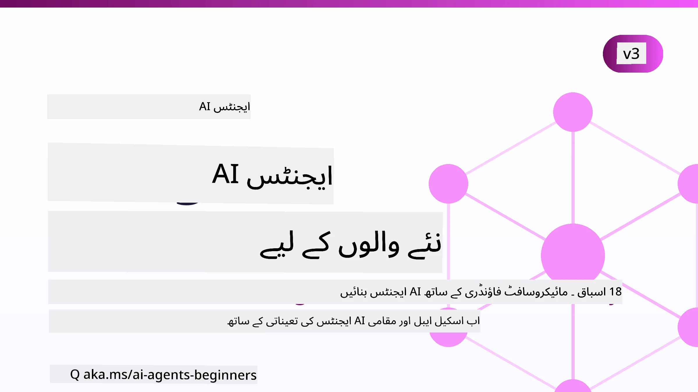

# ابتدائیوں کے لیے AI ایجنٹس - ایک کورس



## ایک کورس جو آپ کو AI ایجنٹس بنانے کا آغاز کرنے کے لیے سب کچھ سکھاتا ہے

[](https://github.com/microsoft/ai-agents-for-beginners/blob/master/LICENSE?WT.mc_id=academic-105485-koreyst)
[](https://GitHub.com/microsoft/ai-agents-for-beginners/graphs/contributors/?WT.mc_id=academic-105485-koreyst)
[](https://GitHub.com/microsoft/ai-agents-for-beginners/issues/?WT.mc_id=academic-105485-koreyst)
[](https://GitHub.com/microsoft/ai-agents-for-beginners/pulls/?WT.mc_id=academic-105485-koreyst)
[](http://makeapullrequest.com?WT.mc_id=academic-105485-koreyst)

### 🌐 کثیرالزبانی حمایت

#### ترجمے [Co-op Translator](https://github.com/Azure/co-op-translator) کے ساتھ برقرار رکھے جاتے ہیں

<!-- CO-OP TRANSLATOR LANGUAGES TABLE START -->
[Arabic](../ar/README.md) | [Bengali](../bn/README.md) | [Bulgarian](../bg/README.md) | [Burmese (Myanmar)](../my/README.md) | [Chinese (Simplified)](../zh-CN/README.md) | [Chinese (Traditional, Hong Kong)](../zh-HK/README.md) | [Chinese (Traditional, Macau)](../zh-MO/README.md) | [Chinese (Traditional, Taiwan)](../zh-TW/README.md) | [Croatian](../hr/README.md) | [Czech](../cs/README.md) | [Danish](../da/README.md) | [Dutch](../nl/README.md) | [Estonian](../et/README.md) | [Finnish](../fi/README.md) | [French](../fr/README.md) | [German](../de/README.md) | [Greek](../el/README.md) | [Hebrew](../he/README.md) | [Hindi](../hi/README.md) | [Hungarian](../hu/README.md) | [Indonesian](../id/README.md) | [Italian](../it/README.md) | [Japanese](../ja/README.md) | [Kannada](../kn/README.md) | [Khmer](../km/README.md) | [Korean](../ko/README.md) | [Lithuanian](../lt/README.md) | [Malay](../ms/README.md) | [Malayalam](../ml/README.md) | [Manipuri (Meitei Mayek)](../mni/README.md) | [Marathi](../mr/README.md) | [Nepali](../ne/README.md) | [Nigerian Pidgin](../pcm/README.md) | [Norwegian](../no/README.md) | [Persian (Farsi)](../fa/README.md) | [Polish](../pl/README.md) | [Portuguese (Brazil)](../pt-BR/README.md) | [Portuguese (Portugal)](../pt-PT/README.md) | [Punjabi (Gurmukhi)](../pa/README.md) | [Romanian](../ro/README.md) | [Russian](../ru/README.md) | [Serbian (Cyrillic)](../sr/README.md) | [Slovak](../sk/README.md) | [Slovenian](../sl/README.md) | [Spanish](../es/README.md) | [Swahili](../sw/README.md) | [Swedish](../sv/README.md) | [Tagalog (Filipino)](../tl/README.md) | [Tamil](../ta/README.md) | [Telugu](../te/README.md) | [Thai](../th/README.md) | [Turkish](../tr/README.md) | [Ukrainian](../uk/README.md) | [Urdu](./README.md) | [Vietnamese](../vi/README.md)

> **کیا آپ مقامی طور پر کلون (ڈاؤن لوڈ) کرنا چاہتے ہیں؟**
>
> یہ مخزن 50+ زبانوں کے ترجمے شامل کرتا ہے جو کہ ڈاؤن لوڈ کا سائز کافی بڑھا دیتے ہیں۔ ترجموں کے بغیر کلون کرنے کے لیے sparse checkout استعمال کریں:
>
> **بش / میک او ایس / لینکس:**
> ```bash
> git clone --filter=blob:none --sparse https://github.com/microsoft/ai-agents-for-beginners.git
> cd ai-agents-for-beginners
> git sparse-checkout set --no-cone '/*' '!translations' '!translated_images'
> ```
>
> **سی ایم ڈی (ونڈوز):**
> ```cmd
> git clone --filter=blob:none --sparse https://github.com/microsoft/ai-agents-for-beginners.git
> cd ai-agents-for-beginners
> git sparse-checkout set --no-cone "/*" "!translations" "!translated_images"
> ```
>
> یہ آپ کو تیز تر ڈاؤن لوڈ کے ساتھ کورس مکمل کرنے کے لیے سب کچھ فراہم کرتا ہے۔
<!-- CO-OP TRANSLATOR LANGUAGES TABLE END -->

**مزید زبانوں کے اختیارات کے لیے، [Co-op Translator کی حمایت یافتہ زبانیں](https://github.com/Azure/co-op-translator/blob/main/docs/supported-languages.md) دیکھیں۔**

[](https://GitHub.com/microsoft/ai-agents-for-beginners/watchers/?WT.mc_id=academic-105485-koreyst)
[](https://GitHub.com/microsoft/ai-agents-for-beginners/network/?WT.mc_id=academic-105485-koreyst)
[](https://GitHub.com/microsoft/ai-agents-for-beginners/stargazers/?WT.mc_id=academic-105485-koreyst)

[](https://discord.com/invite/ATgtXmAS5D)


## 🌱 شروع کریں

یہ کورس AI ایجنٹس بنانے کی بنیادی باتوں کو سکھاتا ہے۔ ہر سبق اپنے موضوع کو کور کرتا ہے اس لیے جہاں چاہیں شروع کریں!

اس کورس کے لیے کثیرالزبانی حمایت موجود ہے۔ ہمارے [دستیاب زبانیں یہاں](#-multi-language-support) دیکھیں۔

اگر یہ آپ کا جنریٹو AI ماڈلز کے ساتھ پہلا تجربہ ہے، تو ہمارا [Generative AI For Beginners](https://aka.ms/genai-beginners) کورس دیکھیں، جس میں GenAI کے ساتھ بنانے پر 21 اسباق شامل ہیں۔

[اس مخزن کو ستارے (🌟) دیں](https://docs.github.com/en/get-started/exploring-projects-on-github/saving-repositories-with-stars?WT.mc_id=academic-105485-koreyst) اور [اس مخزن کو فورک کریں](https://github.com/microsoft/ai-agents-for-beginners/fork) تاکہ کوڈ چلایا جا سکے۔

### دوسرے سیکھنے والوں سے ملیں، اپنے سوالات کے جواب حاصل کریں

اگر آپ کو مشکل پیش آئے یا AI ایجنٹس بنانے کے بارے میں کوئی سوال ہو، تو ہمارے مختص Discord چینل میں شامل ہوں [Microsoft Foundry Discord](https://aka.ms/ai-agents/discord) پر۔

### آپ کو کیا چاہیے

اس کورس کے ہر سبق میں کوڈ مثالیں شامل ہیں، جو code_samples فولڈر میں پائی جا سکتی ہیں۔ آپ [اس مخزن کو فورک کریں](https://github.com/microsoft/ai-agents-for-beginners/fork) تاکہ اپنی کاپی بنا سکیں۔

ان مشقوں میں کوڈ کی مثالیں Microsoft Agent Framework اور Microsoft Foundry Agent Service V2 استعمال کرتی ہیں:

- [Microsoft Foundry](https://aka.ms/ai-agents-beginners/ai-foundry) - Azure اکاؤنٹ ضروری ہے

یہ کورس مندرجہ ذیل AI ایجنٹ فریم ورکس اور خدمات مائیکروسافٹ کی طرف سے استعمال کرتا ہے:

- [Microsoft Agent Framework (MAF)](https://learn.microsoft.com/agent-framework/overview/)
- [Microsoft Foundry Agent Service V2](https://aka.ms/ai-agents-beginners/ai-agent-service)

کچھ کوڈ نمونے متبادل OpenAI-مطابقت رکھنے والے فراہم کنندگان کو بھی سپورٹ کرتے ہیں جیسے [MiniMax](https://platform.minimaxi.com/)، جو بڑے کانٹیکسٹ ماڈلز فراہم کرتا ہے (204K ٹوکنز تک)۔ ترتیب کی تفصیلات کے لیے [Course Setup](./00-course-setup/README.md) دیکھیں۔

اس کورس کے کوڈ چلانے کی مزید معلومات کے لیے، [Course Setup](./00-course-setup/README.md) پر جائیں۔

## 🙏 مدد کرنا چاہتے ہیں؟

کیا آپ کے پاس تجاویز ہیں یا املا یا کوڈ کی غلطیاں ملیں؟ [مسئلہ اٹھائیں](https://github.com/microsoft/ai-agents-for-beginners/issues?WT.mc_id=academic-105485-koreyst) یا [پل ریکوئسٹ بنائیں](https://github.com/microsoft/ai-agents-for-beginners/pulls?WT.mc_id=academic-105485-koreyst)


## 📂 ہر سبق میں شامل ہے

- ایک تحریری سبق جو README میں ہے اور ایک مختصر ویڈیو
- Python کوڈ کی مثالیں جو Microsoft Agent Framework اور Microsoft Foundry کے ساتھ استعمال ہوتی ہیں
- اضافی وسائل کے لیے روابط تاکہ آپ اپنی تعلیم جاری رکھ سکیں


## 🗃️ اسباق

| **سبق**                                   | **متن اور کوڈ**                                    | **ویڈیو**                                                  | **اضافی تعلیم**                                                                     |
|----------------------------------------------|----------------------------------------------------|------------------------------------------------------------|----------------------------------------------------------------------------------------|
| AI ایجنٹس اور ایجنٹ کے استعمال کے مقدمات کا تعارف       | [رابطہ](./01-intro-to-ai-agents/README.md)          | [ویڈیو](https://youtu.be/3zgm60bXmQk?si=z8QygFvYQv-9WtO1)  | [رابطہ](https://aka.ms/ai-agents-beginners/collection?WT.mc_id=academic-105485-koreyst) |
| AI ایجنٹک فریم ورکس کا جائیزہ              | [رابطہ](./02-explore-agentic-frameworks/README.md)  | [ویڈیو](https://youtu.be/ODwF-EZo_O8?si=Vawth4hzVaHv-u0H)  | [رابطہ](https://aka.ms/ai-agents-beginners/collection?WT.mc_id=academic-105485-koreyst) |
| AI ایجنٹک ڈیزائن پیٹرنز کو سمجھنا     | [رابطہ](./03-agentic-design-patterns/README.md)     | [ویڈیو](https://youtu.be/m9lM8qqoOEA?si=BIzHwzstTPL8o9GF)  | [رابطہ](https://aka.ms/ai-agents-beginners/collection?WT.mc_id=academic-105485-koreyst) |
| ٹول استعمال کرنے کا ڈیزائن پیٹرن                      | [رابطہ](./04-tool-use/README.md)                    | [ویڈیو](https://youtu.be/vieRiPRx-gI?si=2z6O2Xu2cu_Jz46N)  | [رابطہ](https://aka.ms/ai-agents-beginners/collection?WT.mc_id=academic-105485-koreyst) |
| ایجنٹک RAG                                  | [رابطہ](./05-agentic-rag/README.md)                 | [ویڈیو](https://youtu.be/WcjAARvdL7I?si=gKPWsQpKiIlDH9A3)  | [رابطہ](https://aka.ms/ai-agents-beginners/collection?WT.mc_id=academic-105485-koreyst) |
| قابل اعتماد AI ایجنٹس بنانا               | [رابطہ](./06-building-trustworthy-agents/README.md) | [ویڈیو](https://youtu.be/iZKkMEGBCUQ?si=jZjpiMnGFOE9L8OK ) | [رابطہ](https://aka.ms/ai-agents-beginners/collection?WT.mc_id=academic-105485-koreyst) |
| منصوبہ بندی کا ڈیزائن پیٹرن                      | [رابطہ](./07-planning-design/README.md)             | [ویڈیو](https://youtu.be/kPfJ2BrBCMY?si=6SC_iv_E5-mzucnC)  | [رابطہ](https://aka.ms/ai-agents-beginners/collection?WT.mc_id=academic-105485-koreyst) |
| کثیر-ایجنٹ ڈیزائن پیٹرن                   | [رابطہ](./08-multi-agent/README.md)                 | [ویڈیو](https://youtu.be/V6HpE9hZEx0?si=rMgDhEu7wXo2uo6g)  | [رابطہ](https://aka.ms/ai-agents-beginners/collection?WT.mc_id=academic-105485-koreyst) |
| میٹا-کگنیشن ڈیزائن پیٹرن                 | [رابطہ](./09-metacognition/README.md)               | [ویڈیو](https://youtu.be/His9R6gw6Ec?si=8gck6vvdSNCt6OcF)  | [رابطہ](https://aka.ms/ai-agents-beginners/collection?WT.mc_id=academic-105485-koreyst) |
| پروڈکشن میں AI ایجنٹس                      | [رابطہ](./10-ai-agents-production/README.md)        | [ویڈیو](https://youtu.be/l4TP6IyJxmQ?si=31dnhexRo6yLRJDl)  | [رابطہ](https://aka.ms/ai-agents-beginners/collection?WT.mc_id=academic-105485-koreyst) |
| ایجنٹک پروٹوکولز کا استعمال (MCP, A2A اور NLWeb) | [رابطہ](./11-agentic-protocols/README.md)           | [ویڈیو](https://youtu.be/X-Dh9R3Opn8)                                 | [رابطہ](https://aka.ms/ai-agents-beginners/collection?WT.mc_id=academic-105485-koreyst) |
| AI ایجنٹس کے لیے کانٹیکسٹ انجینئرنگ            | [رابطہ](./12-context-engineering/README.md)         | [ویڈیو](https://youtu.be/F5zqRV7gEag)                                 | [رابطہ](https://aka.ms/ai-agents-beginners/collection?WT.mc_id=academic-105485-koreyst) |
| ایجنٹک میموری کا انتظام                      | [رابطہ](./13-agent-memory/README.md)     |      [ویڈیو](https://youtu.be/QrYbHesIxpw?si=vZkVwKrQ4ieCcIPx)                                                      |                                                                                        |
| Microsoft Agent Framework کا جائزہ                         | [رابطہ](./14-microsoft-agent-framework/README.md)                            |                                                            |                                                                                        |
| کمپیوٹر یوز ایجنٹس (CUA) بنانا           | [رابطہ](./15-browser-use/README.md)     |                                                            | [رابطہ](https://docs.browser-use.com/examples/templates/playwright-integration)         |
| اسکیل ایبل ایجنٹس کی تعیناتی                    | [رابطہ](./16-deploying-scalable-agents/README.md) |                                                    | [رابطہ](https://learn.microsoft.com/azure/ai-foundry/agents/overview)                   |
| مقامی AI ایجنٹس بنانا                     | [رابطہ](./17-creating-local-ai-agents/README.md)  |                                                    | [رابطہ](https://learn.microsoft.com/azure/ai-foundry/foundry-local/)                    |
| AI ایجنٹس کی سیکیورٹی                           | [رابطہ](./18-securing-ai-agents/README.md)  |                                                            | [رابطہ](https://aka.ms/ai-agents-beginners/collection?WT.mc_id=academic-105485-koreyst) |

## 🎒 دیگر کورسز

ہماری ٹیم دیگر کورسز بھی بناتی ہے! دیکھیں:

<!-- CO-OP TRANSLATOR OTHER COURSES START -->
### LangChain
[](https://aka.ms/langchain4j-for-beginners)
[](https://aka.ms/langchainjs-for-beginners?WT.mc_id=m365-94501-dwahlin)
[](https://github.com/microsoft/langchain-for-beginners?WT.mc_id=m365-94501-dwahlin)
---

### Azure / Edge / MCP / ایجنٹس
[](https://github.com/microsoft/AZD-for-beginners?WT.mc_id=academic-105485-koreyst)
[](https://github.com/microsoft/edgeai-for-beginners?WT.mc_id=academic-105485-koreyst)
[](https://github.com/microsoft/mcp-for-beginners?WT.mc_id=academic-105485-koreyst)
[](https://github.com/microsoft/ai-agents-for-beginners?WT.mc_id=academic-105485-koreyst)

---
 
### جنریٹو AI سیریز
[](https://github.com/microsoft/generative-ai-for-beginners?WT.mc_id=academic-105485-koreyst)
[-9333EA?style=for-the-badge&labelColor=E5E7EB&color=9333EA)](https://github.com/microsoft/Generative-AI-for-beginners-dotnet?WT.mc_id=academic-105485-koreyst)
[-C084FC?style=for-the-badge&labelColor=E5E7EB&color=C084FC)](https://github.com/microsoft/generative-ai-for-beginners-java?WT.mc_id=academic-105485-koreyst)
[-E879F9?style=for-the-badge&labelColor=E5E7EB&color=E879F9)](https://github.com/microsoft/generative-ai-with-javascript?WT.mc_id=academic-105485-koreyst)

---
 
### بنیادی تعلیم
[](https://aka.ms/ml-beginners?WT.mc_id=academic-105485-koreyst)
[](https://aka.ms/datascience-beginners?WT.mc_id=academic-105485-koreyst)
[](https://aka.ms/ai-beginners?WT.mc_id=academic-105485-koreyst)
[](https://github.com/microsoft/Security-101?WT.mc_id=academic-96948-sayoung)
[](https://aka.ms/webdev-beginners?WT.mc_id=academic-105485-koreyst)
[](https://aka.ms/iot-beginners?WT.mc_id=academic-105485-koreyst)
[](https://github.com/microsoft/xr-development-for-beginners?WT.mc_id=academic-105485-koreyst)

---
 
### کوپائلٹ سیریز
[](https://aka.ms/GitHubCopilotAI?WT.mc_id=academic-105485-koreyst)
[](https://github.com/microsoft/mastering-github-copilot-for-dotnet-csharp-developers?WT.mc_id=academic-105485-koreyst)
[](https://github.com/microsoft/CopilotAdventures?WT.mc_id=academic-105485-koreyst)
<!-- CO-OP TRANSLATOR OTHER COURSES END -->

## 🌟 کمیونٹی کا شکریہ

[شیوام گویال](https://www.linkedin.com/in/shivam2003/) کا شکریہ کہ انہوں نے Agentic RAG کو ظاہر کرنے والے اہم کوڈ نمونے فراہم کیے۔

## تعاون

یہ پروجیکٹ تعاون اور تجاویز کا خیرمقدم کرتا ہے۔ بیشتر تعاون کے لیے آپ کو ایک
تعاون کنندہ لائسنس معاہدے (CLA) سے اتفاق کرنا ہوگا جس میں آپ اس بات کا اعلان کرتے ہیں کہ آپ کے پاس
حق ہے اور حقیقت میں آپ ہمیں اپنے تعاون کے استعمال کے حقوق دیتے ہیں۔ تفصیلات کے لیے جائیں <https://cla.opensource.microsoft.com>۔

جب آپ ایک پل ریکویسٹ جمع کرواتے ہیں تو ایک CLA بوٹ خودکار طور پر فیصلہ کرتا ہے کہ کیا آپ کو CLA فراہم کرنا ہے
اور مناسب طریقے سے PR کو سجانا ہے (مثلاً، اسٹیٹس چیک، تبصرہ)۔ بس بوٹ کی ہدایات پر عمل کریں۔
آپ کو ایک بار تمام رپوز میں ہماری CLA کے تحت یہ کرنا ہوگا۔

اس پروجیکٹ نے [مائیکروسافٹ اوپن سورس کوڈ آف کنڈکٹ](https://opensource.microsoft.com/codeofconduct/) اپنایا ہے۔
مزید معلومات کے لیے [کوڈ آف کنڈکٹ FAQ](https://opensource.microsoft.com/codeofconduct/faq/) دیکھیں یا
[opencode@microsoft.com](mailto:opencode@microsoft.com) سے رابطہ کریں اگر آپ کے کوئی اضافی سوالات یا تبصرے ہوں۔

## ٹریڈمارکس

یہ پروجیکٹ کوئی ٹریڈمارک یا لوگوز شامل کر سکتا ہے جو پروجیکٹس، مصنوعات، یا خدمات کے لیے ہیں۔ مائیکروسافٹ
ٹریڈمارک یا لوگوز کے مجاز استعمال کے لیے ضروری ہے کہ آپ [مائیکروسافٹ کے ٹریڈمارک اور برانڈ رہنما اصول](https://www.microsoft.com/legal/intellectualproperty/trademarks/usage/general) کی پیروی کریں۔
مائیکروسافٹ کے ٹریڈمارک یا لوگوز کا اس پروجیکٹ کے ترمیم شدہ ورژنز میں استعمال مائیکروسافٹ کی اسپانسرشپ ظاہر نہیں کرنا چاہیے یا غلط فہمی پیدا نہیں کرنی چاہیے۔
کسی تیسرے فریق کے ٹریڈمارک یا لوگوز کا استعمال ان فریقوں کی پالیسیوں کے تابع ہوگا۔


[](https://aka.ms/foundry/discord)

اگر آپ کے پاس پروڈکٹ کے بارے میں آراء ہیں یا تعمیر کے دوران کوئی غلطیاں آتی ہیں تو یہاں جائیں:

[](https://aka.ms/foundry/forum)

---

<!-- CO-OP TRANSLATOR DISCLAIMER START -->
**ڈس کلیمر**:
یہ دستاویز AI ترجمہ سروس [Co-op Translator](https://github.com/Azure/co-op-translator) کے ذریعے ترجمہ کی گئی ہے۔ جبکہ ہم درستگی کے لیے کوشاں ہیں، براہ کرم اس بات سے آگاہ رہیں کہ خودکار ترجمے میں غلطیاں یا عدم درستیاں ہو سکتی ہیں۔ اصل دستاویز اپنے مادری زبان میں مستند ماخذ سمجھی جائے گی۔ حساس معلومات کے لیے پیشہ ور انسانی ترجمہ کی سفارش کی جاتی ہے۔ اس ترجمے کے استعمال سے پیدا ہونے والی کسی بھی غلط فہمی یا غلط تشریح کی ذمہ داری ہم قبول نہیں کرتے۔
<!-- CO-OP TRANSLATOR DISCLAIMER END -->