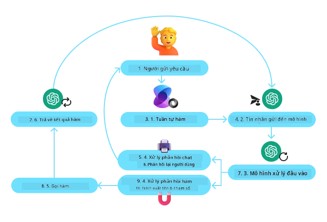
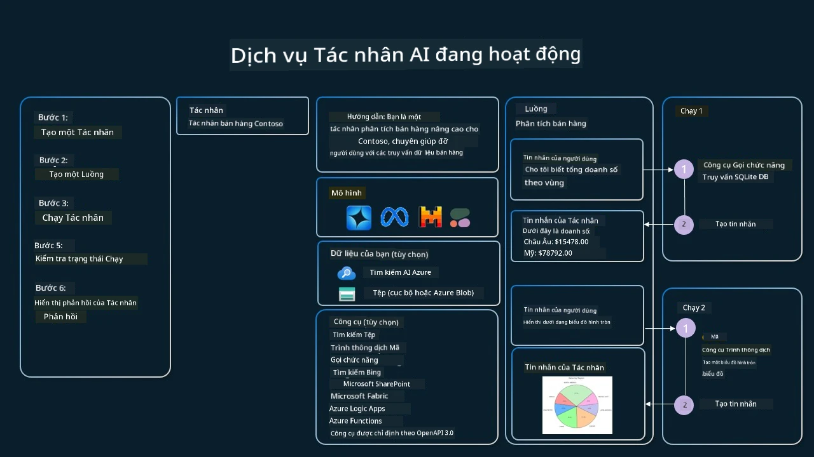

[](https://youtu.be/vieRiPRx-gI?si=cEZ8ApnT6Sus9rhn)

> _(Nhấp vào hình ảnh ở trên để xem video của bài học này)_

# Mẫu Thiết Kế Sử Dụng Công Cụ

Công cụ rất thú vị vì chúng cho phép các tác nhân AI có phạm vi khả năng rộng hơn. Thay vì tác nhân chỉ có một tập hợp hành động hạn chế mà nó có thể thực hiện, bằng cách thêm một công cụ, tác nhân giờ đây có thể thực hiện một loạt hành động rộng lớn hơn. Trong chương này, chúng ta sẽ xem xét Mẫu Thiết Kế Sử Dụng Công Cụ, mô tả cách các tác nhân AI có thể sử dụng các công cụ cụ thể để đạt được mục tiêu của mình.

## Giới Thiệu

Trong bài học này, chúng ta sẽ giải đáp các câu hỏi sau:

- Mẫu thiết kế sử dụng công cụ là gì?
- Các trường hợp sử dụng mà nó có thể áp dụng là gì?
- Các thành phần/khối xây dựng cần thiết để triển khai mẫu thiết kế là gì?
- Các lưu ý đặc biệt khi sử dụng Mẫu Thiết Kế Sử Dụng Công Cụ để xây dựng các tác nhân AI đáng tin cậy là gì?

## Mục Tiêu Học Tập

Sau khi hoàn thành bài học này, bạn sẽ có thể:

- Định nghĩa Mẫu Thiết Kế Sử Dụng Công Cụ và mục đích của nó.
- Xác định các trường hợp sử dụng mà Mẫu Thiết Kế Sử Dụng Công Cụ áp dụng được.
- Hiểu các thành phần chính cần thiết để triển khai mẫu thiết kế.
- Nhận biết các lưu ý để đảm bảo độ tin cậy cho các tác nhân AI sử dụng mẫu thiết kế này.

## Mẫu Thiết Kế Sử Dụng Công Cụ là gì?

**Mẫu Thiết Kế Sử Dụng Công Cụ** tập trung vào việc trang bị cho các Mô Hình Ngôn Ngữ Lớn (LLMs) khả năng tương tác với các công cụ bên ngoài để đạt được các mục tiêu cụ thể. Công cụ là mã có thể được tác nhân thực thi để thực hiện các hành động. Một công cụ có thể là một hàm đơn giản như máy tính, hoặc một gọi API đến dịch vụ bên thứ ba như tra cứu giá cổ phiếu hoặc dự báo thời tiết. Trong bối cảnh các tác nhân AI, công cụ được thiết kế để được tác nhân thực thi dựa trên **các cuộc gọi hàm được mô hình tạo ra**.

## Các trường hợp sử dụng mà nó có thể áp dụng là gì?

Các tác nhân AI có thể tận dụng công cụ để hoàn thành các nhiệm vụ phức tạp, truy xuất thông tin hoặc đưa ra quyết định. Mẫu thiết kế sử dụng công cụ thường được dùng trong các kịch bản cần tương tác động với các hệ thống bên ngoài, chẳng hạn như cơ sở dữ liệu, dịch vụ web hay trình thông dịch mã. Khả năng này hữu ích cho nhiều trường hợp sử dụng khác nhau bao gồm:

- **Truy xuất Thông tin Động:** Các tác nhân có thể truy vấn API bên ngoài hoặc cơ sở dữ liệu để lấy dữ liệu cập nhật (ví dụ: truy vấn cơ sở dữ liệu SQLite cho phân tích dữ liệu, lấy giá cổ phiếu hoặc thông tin thời tiết).
- **Thực Thi và Thông Dịch Mã:** Các tác nhân có thể thực thi mã hoặc kịch bản để giải các bài toán toán học, tạo báo cáo hoặc thực hiện mô phỏng.
- **Tự động hóa Quy trình Làm việc:** Tự động hóa các quy trình lặp đi lặp lại hoặc nhiều bước bằng cách tích hợp các công cụ như bộ lập lịch tác vụ, dịch vụ email hoặc pipeline dữ liệu.
- **Hỗ trợ Khách hàng:** Các tác nhân có thể tương tác với hệ thống CRM, nền tảng phiếu hỗ trợ hoặc cơ sở tri thức để giải đáp thắc mắc người dùng.
- **Tạo và Chỉnh sửa Nội dung:** Các tác nhân có thể tận dụng các công cụ như kiểm tra ngữ pháp, tóm tắt văn bản hoặc đánh giá an toàn nội dung để hỗ trợ các nhiệm vụ tạo nội dung.

## Các thành phần/khối xây dựng cần thiết để triển khai mẫu thiết kế sử dụng công cụ là gì?

Những thành phần này cho phép tác nhân AI thực hiện nhiều loại nhiệm vụ khác nhau. Hãy cùng xem xét các thành phần chính cần thiết để triển khai Mẫu Thiết Kế Sử Dụng Công Cụ:

- **Định nghĩa Hàm/Công Cụ:** Các định nghĩa chi tiết về các công cụ có sẵn, bao gồm tên hàm, mục đích, tham số cần thiết và kết quả dự kiến. Những định nghĩa này giúp LLM hiểu công cụ nào có sẵn và cách tạo các yêu cầu hợp lệ.

- **Logic Thực Thi Hàm:** Quy định cách thức và thời điểm các công cụ được gọi dựa trên ý định của người dùng và ngữ cảnh cuộc trò chuyện. Điều này có thể bao gồm các mô-đun lập kế hoạch, cơ chế định tuyến hoặc luồng điều kiện xác định việc sử dụng công cụ một cách động.

- **Hệ Thống Xử Lý Tin Nhắn:** Các thành phần quản lý luồng hội thoại giữa đầu vào người dùng, phản hồi của LLM, các cuộc gọi công cụ và kết quả trả về.

- **Khung Tích Hợp Công Cụ:** Hạ tầng kết nối tác nhân với các công cụ khác nhau, dù là hàm đơn giản hay dịch vụ bên ngoài phức tạp.

- **Xử lý Lỗi & Xác thực:** Cơ chế xử lý thất bại khi thực thi công cụ, xác thực tham số, và quản lý các phản hồi không mong đợi.

- **Quản lý Trạng thái:** Theo dõi ngữ cảnh cuộc trò chuyện, các tương tác công cụ trước đó và dữ liệu lưu trữ để đảm bảo tính nhất quán qua nhiều lượt tương tác.

Tiếp theo, chúng ta hãy xem xét chi tiết hơn về Gọi Hàm/Công Cụ.
 
### Gọi Hàm/Công Cụ

Gọi hàm là cách chính để chúng ta cho phép các Mô Hình Ngôn Ngữ Lớn (LLMs) tương tác với các công cụ. Bạn sẽ thường thấy 'Hàm' và 'Công cụ' được dùng thay thế cho nhau bởi vì 'hàm' (các đoạn mã có thể tái sử dụng) chính là 'công cụ' mà các tác nhân dùng để thực hiện nhiệm vụ. Để mã của một hàm được gọi, LLM phải so sánh yêu cầu của người dùng với mô tả hàm. Để làm điều này, một định nghĩa (schema) chứa mô tả của tất cả các hàm có sẵn được gửi đến LLM. Sau đó, LLM chọn hàm phù hợp nhất cho nhiệm vụ và trả về tên hàm và các đối số. Hàm được chọn sẽ được gọi, phản hồi từ hàm sẽ được gửi lại cho LLM, và LLM sử dụng thông tin này để trả lời yêu cầu của người dùng.

Để các nhà phát triển triển khai gọi hàm cho các tác nhân, bạn sẽ cần:

1. Một mô hình LLM hỗ trợ gọi hàm
2. Một định nghĩa chứa mô tả các hàm
3. Mã code cho từng hàm đã mô tả

Hãy dùng ví dụ lấy thời gian hiện tại ở một thành phố để minh họa:

1. **Khởi tạo một LLM hỗ trợ gọi hàm:**

    Không phải tất cả các mô hình đều hỗ trợ gọi hàm, vì vậy quan trọng là kiểm tra mô hình LLM bạn đang dùng có tính năng này không. <a href="https://learn.microsoft.com/azure/ai-services/openai/how-to/function-calling" target="_blank">Azure OpenAI</a> hỗ trợ gọi hàm. Chúng ta có thể bắt đầu bằng cách khởi tạo client OpenAI sử dụng **Responses API** của Azure OpenAI (điểm cuối ổn định `/openai/v1/` — không cần `api_version`). 

    ```python
    # Initialize the OpenAI client for Azure OpenAI (Responses API, v1 endpoint)
    client = OpenAI(
        base_url=f"{os.environ['AZURE_OPENAI_ENDPOINT'].rstrip('/')}/openai/v1/",
        api_key=os.environ["AZURE_OPENAI_API_KEY"],
    )
    deployment_name = os.environ["AZURE_OPENAI_DEPLOYMENT"]
    ```

1. **Tạo Định nghĩa Hàm:**

    Tiếp theo, chúng ta sẽ định nghĩa một schema JSON chứa tên hàm, mô tả chức năng và tên cũng như mô tả các tham số của hàm.
    Sau đó chúng ta lấy schema này truyền vào client đã tạo trước đó, cùng với yêu cầu của người dùng để tìm thời gian ở San Francisco. Điều quan trọng cần chú ý là một **cuộc gọi công cụ** là cái được trả về, **không phải** câu trả lời cuối cùng cho câu hỏi. Như đã đề cập, LLM trả về tên hàm mà nó chọn cho nhiệm vụ và các đối số sẽ được truyền vào hàm.

    ```python
    # Function description for the model to read (Responses API flat tool format)
    tools = [
        {
            "type": "function",
            "name": "get_current_time",
            "description": "Get the current time in a given location",
            "parameters": {
                "type": "object",
                "properties": {
                    "location": {
                        "type": "string",
                        "description": "The city name, e.g. San Francisco",
                    },
                },
                "required": ["location"],
            },
        }
    ]
    ```
   
    ```python
  
    # Initial user message
    messages = [{"role": "user", "content": "What's the current time in San Francisco"}]

    # First API call: Ask the model to use the function
    response = client.responses.create(
        model=deployment_name,
        input=messages,
        tools=tools,
        tool_choice="auto",
        store=False,
    )

    # The Responses API returns tool calls as function_call items in response.output.
    # Append them to the conversation so the model has full context on the next turn.
    messages += response.output

    print("Model's response:")
    print(response.output)
  
    ```

    ```bash
    Model's response:
    [ResponseFunctionToolCall(arguments='{"location":"San Francisco"}', call_id='call_pOsKdUlqvdyttYB67MOj434b', name='get_current_time', type='function_call')]
    ```
  
1. **Mã hàm thực thi nhiệm vụ:**

    Khi LLM đã chọn được hàm cần chạy, mã thực thi nhiệm vụ cần được triển khai và thực thi.
    Chúng ta có thể viết mã để lấy thời gian hiện tại bằng Python. Cũng cần viết đoạn mã để trích xuất tên hàm và đối số từ response_message để có kết quả cuối cùng.

    ```python
      def get_current_time(location):
        """Get the current time for a given location"""
        print(f"get_current_time called with location: {location}")  
        location_lower = location.lower()
        
        for key, timezone in TIMEZONE_DATA.items():
            if key in location_lower:
                print(f"Timezone found for {key}")  
                current_time = datetime.now(ZoneInfo(timezone)).strftime("%I:%M %p")
                return json.dumps({
                    "location": location,
                    "current_time": current_time
                })
      
        print(f"No timezone data found for {location_lower}")  
        return json.dumps({"location": location, "current_time": "unknown"})
    ```

     ```python
    # Handle function calls
    tool_calls = [item for item in response.output if item.type == "function_call"]
    if tool_calls:
        for tool_call in tool_calls:
            if tool_call.name == "get_current_time":

                function_args = json.loads(tool_call.arguments)

                time_response = get_current_time(
                    location=function_args.get("location")
                )

                # Return the tool result as a function_call_output item
                messages.append({
                    "type": "function_call_output",
                    "call_id": tool_call.call_id,
                    "output": time_response,
                })
    else:
        print("No tool calls were made by the model.")

    # Second API call: Get the final response from the model
    final_response = client.responses.create(
        model=deployment_name,
        input=messages,
        tools=tools,
        store=False,
    )

    return final_response.output_text
     ```

     ```bash
      get_current_time called with location: San Francisco
      Timezone found for san francisco
      The current time in San Francisco is 09:24 AM.
     ```

Gọi Hàm là trọng tâm của đa số, nếu không muốn nói là tất cả các mẫu thiết kế sử dụng công cụ cho các tác nhân, tuy nhiên việc tự triển khai ngay từ đầu đôi lúc có thể khó khăn.
Như chúng ta đã học trong [Bài học 2](../../../02-explore-agentic-frameworks), các framework tác nhân cung cấp cho ta các khối xây dựng có sẵn để triển khai sử dụng công cụ.
 
## Ví dụ Sử Dụng Công Cụ với Các Framework Tác Nhân

Dưới đây là một số ví dụ về cách bạn có thể triển khai Mẫu Thiết Kế Sử Dụng Công Cụ bằng cách dùng các framework tác nhân khác nhau:

### Microsoft Agent Framework

<a href="https://learn.microsoft.com/azure/ai-services/agents/overview" target="_blank">Microsoft Agent Framework</a> là một framework AI mã nguồn mở để xây dựng các tác nhân AI. Nó đơn giản hóa quá trình sử dụng gọi hàm bằng cách cho phép bạn định nghĩa công cụ như các hàm Python được trang trí bằng `@tool` decorator. Framework lo liệu việc truyền tải qua lại giữa mô hình và mã của bạn. Nó cũng cung cấp truy cập đến các công cụ đã được xây dựng sẵn như Tìm kiếm File và Trình Thông Dịch Mã thông qua `FoundryChatClient`.

Sơ đồ sau minh họa quy trình gọi hàm với Microsoft Agent Framework:



Trong Microsoft Agent Framework, các công cụ được định nghĩa dưới dạng các hàm có decorator. Chúng ta có thể chuyển đổi hàm `get_current_time` mà ta đã thấy trước đó thành một công cụ bằng cách sử dụng decorator `@tool`. Framework sẽ tự động lần lượt tuần tự hàm và các tham số của nó, tạo schema gửi tới LLM.

```python
import os
from agent_framework import tool
from agent_framework.foundry import FoundryChatClient
from azure.identity import AzureCliCredential

@tool(approval_mode="never_require")
def get_current_time(location: str) -> str:
    """Get the current time for a given location"""
    ...

# Create the client
provider = FoundryChatClient(
    project_endpoint=os.environ["AZURE_AI_PROJECT_ENDPOINT"],
    model=os.environ["AZURE_AI_MODEL_DEPLOYMENT_NAME"],
    credential=AzureCliCredential(),
)

# Create an agent and run with the tool
agent = provider.as_agent(name="TimeAgent", instructions="Use available tools to answer questions.", tools=get_current_time)
response = await agent.run("What time is it?")
```

#### Công cụ từ máy chủ MCP

Công cụ không nhất thiết phải là các hàm trong mã của bạn. Một máy chủ tuân theo Model Context Protocol (MCP, đã học trong [Bài học 11](../11-agentic-protocols/README.md)) công bố các công cụ cùng với schema của chúng, và framework có thể tải chúng giống như cách tuần tự hàm có decorator. `MCPStreamableHTTPTool` kết nối tới máy chủ đó qua HTTP, đọc schema công cụ, và cung cấp chúng cho mô hình cùng với bất kỳ công cụ cục bộ nào.

Ví dụ dưới đây sử dụng máy chủ tìm kiếm web do <a href="https://keenable.ai" target="_blank">Keenable</a> vận hành. Nó miễn phí sử dụng không cần tài khoản hay khóa API (các yêu cầu bị giới hạn theo IP), vì vậy chỉ cần cung cấp thông tin xác thực cho mô hình. Như với bất kỳ công cụ từ xa nào, các truy vấn mô hình viết được gửi đến máy chủ này.

```python
from agent_framework import MCPStreamableHTTPTool

web_search = MCPStreamableHTTPTool(
    name="Keenable web search",
    url="https://api.keenable.ai/mcp",
)

# Connecting loads the server's tool schemas; the agent decides when to call them
async with web_search:
    agent = provider.as_agent(
        name="ResearchAgent",
        instructions="Use available tools to answer questions.",
        tools=[web_search],
    )
    response = await agent.run("What is new in the latest Python release?")
    print(response.text)
```

Máy chủ công bố hai công cụ: `search_web_pages` và `fetch_page_content`. Khi câu hỏi cần thông tin hiện tại, mô hình gọi `search_web_pages`, nhận lại tiêu đề, URL và đoạn văn bản, và tạo câu trả lời dựa trên chúng, vòng lặp tương tự ví dụ `get_current_time` bên trên.
  
### Microsoft Foundry Agent Service

<a href="https://learn.microsoft.com/azure/ai-services/agents/overview" target="_blank">Microsoft Foundry Agent Service</a> là một framework tác nhân mới hơn, được thiết kế để giúp các nhà phát triển xây dựng, triển khai và mở rộng các tác nhân AI chất lượng cao và có thể mở rộng một cách an toàn mà không cần quản lý tài nguyên tính toán và lưu trữ nền tảng. Nó đặc biệt hữu ích cho các ứng dụng doanh nghiệp vì là dịch vụ được quản lý hoàn toàn với bảo mật cấp doanh nghiệp.

Khi so sánh với phát triển trực tiếp với API LLM, Microsoft Foundry Agent Service cung cấp một số ưu điểm, bao gồm:

- Gọi công cụ tự động – không cần phân tích cuộc gọi công cụ, gọi công cụ, và xử lý phản hồi; tất cả đều được thực hiện ở phía máy chủ
- Dữ liệu được quản lý an toàn – thay vì tự quản lý trạng thái cuộc trò chuyện, bạn có thể dựa vào các luồng để lưu trữ tất cả thông tin cần thiết
- Các công cụ sẵn có – Công cụ giúp tương tác với nguồn dữ liệu của bạn, như Bing, Azure AI Search, và Azure Functions.

Các công cụ trong Microsoft Foundry Agent Service có thể được chia thành hai loại:

1. Công cụ Kiến thức:
    - <a href="https://learn.microsoft.com/azure/ai-services/agents/how-to/tools/bing-grounding?tabs=python&pivots=overview" target="_blank">Tích hợp với Bing Search</a>
    - <a href="https://learn.microsoft.com/azure/ai-services/agents/how-to/tools/file-search?tabs=python&pivots=overview" target="_blank">Tìm kiếm File</a>
    - <a href="https://learn.microsoft.com/azure/ai-services/agents/how-to/tools/azure-ai-search?tabs=azurecli%2Cpython&pivots=overview-azure-ai-search" target="_blank">Azure AI Search</a>

2. Công cụ Thao tác:
    - <a href="https://learn.microsoft.com/azure/ai-services/agents/how-to/tools/function-calling?tabs=python&pivots=overview" target="_blank">Gọi Hàm</a>
    - <a href="https://learn.microsoft.com/azure/ai-services/agents/how-to/tools/code-interpreter?tabs=python&pivots=overview" target="_blank">Trình Thông Dịch Mã</a>
    - <a href="https://learn.microsoft.com/azure/ai-services/agents/how-to/tools/openapi-spec?tabs=python&pivots=overview" target="_blank">Công cụ định nghĩa theo OpenAPI</a>
    - <a href="https://learn.microsoft.com/azure/ai-services/agents/how-to/tools/azure-functions?pivots=overview" target="_blank">Azure Functions</a>

Dịch vụ Agent Service cho phép chúng ta sử dụng các công cụ này cùng nhau như một `toolset`. Nó cũng sử dụng `threads` để theo dõi lịch sử tin nhắn của một cuộc trò chuyện cụ thể.

Hãy tưởng tượng bạn là một nhân viên bán hàng tại công ty Contoso. Bạn muốn phát triển một tác nhân hội thoại có thể trả lời các câu hỏi về dữ liệu bán hàng của bạn.

Hình ảnh sau minh họa cách bạn có thể sử dụng Microsoft Foundry Agent Service để phân tích dữ liệu bán hàng:



Để sử dụng bất kỳ công cụ nào với dịch vụ, chúng ta có thể tạo một client và định nghĩa một công cụ hoặc bộ công cụ. Để triển khai thực tế, chúng ta có thể sử dụng đoạn mã Python sau. LLM sẽ xem xét bộ công cụ và quyết định dùng hàm do người dùng tạo, `fetch_sales_data_using_sqlite_query`, hoặc Trình Thông Dịch Mã được xây dựng sẵn tùy theo yêu cầu người dùng.

```python 
import os
from azure.ai.projects import AIProjectClient
from azure.identity import DefaultAzureCredential
from fetch_sales_data_functions import fetch_sales_data_using_sqlite_query # fetch_sales_data_using_sqlite_query function which can be found in a fetch_sales_data_functions.py file.
from azure.ai.projects.models import ToolSet, FunctionTool, CodeInterpreterTool

project_client = AIProjectClient.from_connection_string(
    credential=DefaultAzureCredential(),
    conn_str=os.environ["PROJECT_CONNECTION_STRING"],
)

# Initialize toolset
toolset = ToolSet()

# Initialize function calling agent with the fetch_sales_data_using_sqlite_query function and adding it to the toolset
fetch_data_function = FunctionTool(fetch_sales_data_using_sqlite_query)
toolset.add(fetch_data_function)

# Initialize Code Interpreter tool and adding it to the toolset. 
code_interpreter = CodeInterpreterTool()toolset.add(code_interpreter)

agent = project_client.agents.create_agent(
    model="gpt-5-mini", name="my-agent", instructions="You are helpful agent", 
    toolset=toolset
)
```

## Các lưu ý đặc biệt khi sử dụng Mẫu Thiết Kế Sử Dụng Công Cụ để xây dựng các tác nhân AI đáng tin cậy?

Một mối quan tâm phổ biến với SQL được tạo động bởi LLM là bảo mật, đặc biệt là nguy cơ tiêm SQL hoặc hành động độc hại như xóa hoặc thay đổi cơ sở dữ liệu. Mặc dù những lo ngại này là hợp lý, nhưng có thể được giảm thiểu hiệu quả bằng việc cấu hình đúng quyền truy cập cơ sở dữ liệu. Đối với hầu hết các cơ sở dữ liệu, điều này bao gồm việc cấu hình cơ sở dữ liệu ở chế độ chỉ đọc. Đối với dịch vụ cơ sở dữ liệu như PostgreSQL hoặc Azure SQL, ứng dụng nên được cấp vai trò chỉ đọc (SELECT).

Việc chạy ứng dụng trong môi trường bảo mật càng làm tăng cường độ bảo vệ. Trong các kịch bản doanh nghiệp, dữ liệu thường được trích xuất và chuyển đổi từ hệ thống vận hành sang một cơ sở dữ liệu hoặc kho dữ liệu chỉ đọc với schema thân thiện người dùng. Cách tiếp cận này đảm bảo dữ liệu được bảo mật, tối ưu hiệu suất và khả năng truy cập, đồng thời ứng dụng chỉ có quyền truy cập giới hạn, chỉ đọc.

## Mã Mẫu

- Python: [Agent Framework](./code_samples/04-python-agent-framework.ipynb)
- .NET: [Agent Framework](./code_samples/04-dotnet-agent-framework.md)

## Còn Thắc Mắc Gì Về Mẫu Thiết Kế Sử Dụng Công Cụ?

Tham gia [Microsoft Foundry Discord](https://discord.com/invite/ATgtXmAS5D) để gặp gỡ những người học khác, tham dự giờ làm việc và được giải đáp các câu hỏi về Tác Nhân AI.

## Tài Nguyên Bổ Sung

- <a href="https://microsoft.github.io/build-your-first-agent-with-azure-ai-agent-service-workshop/" target="_blank">Hội Thảo Dịch Vụ AI Agents Azure</a>
- <a href="https://github.com/Azure-Samples/contoso-creative-writer/tree/main/docs/workshop" target="_blank">Hội Thảo Nhiều Tác Nhân Contoso Creative Writer</a>
- <a href="https://learn.microsoft.com/azure/ai-services/agents/overview" target="_blank">Tổng Quan Khung Tác Nhân Microsoft</a>

## Kiểm Tra Nhanh Tác Nhân Này (Tùy Chọn)

Sau khi bạn học cách triển khai tác nhân trong [Bài học 16](../16-deploying-scalable-agents/README.md), bạn có thể kiểm tra nhanh `TravelToolAgent` của bài học này (nó vẫn gọi công cụ và trả lời chứ?) với [`tests/lesson-04-smoke-tests.json`](../../../tests/lesson-04-smoke-tests.json). Xem [`tests/README.md`](../tests/README.md) để biết cách chạy nó.

## Bài Học Trước

[Hiểu về Các Mẫu Thiết Kế Agentic](../03-agentic-design-patterns/README.md)

## Bài Học Tiếp Theo

[Agentic RAG](../05-agentic-rag/README.md)

---

<!-- CO-OP TRANSLATOR DISCLAIMER START -->
**Tuyên bố miễn trừ trách nhiệm**:
Tài liệu này đã được dịch bằng dịch vụ dịch thuật AI [Co-op Translator](https://github.com/Azure/co-op-translator). Mặc dù chúng tôi cố gắng đảm bảo độ chính xác, xin lưu ý rằng bản dịch tự động có thể chứa lỗi hoặc sai sót. Tài liệu gốc bằng ngôn ngữ gốc nên được coi là nguồn tin chính thức. Đối với thông tin quan trọng, nên sử dụng dịch vụ dịch thuật chuyên nghiệp bởi con người. Chúng tôi không chịu trách nhiệm về bất kỳ hiểu lầm hoặc giải thích sai nào phát sinh từ việc sử dụng bản dịch này.
<!-- CO-OP TRANSLATOR DISCLAIMER END -->