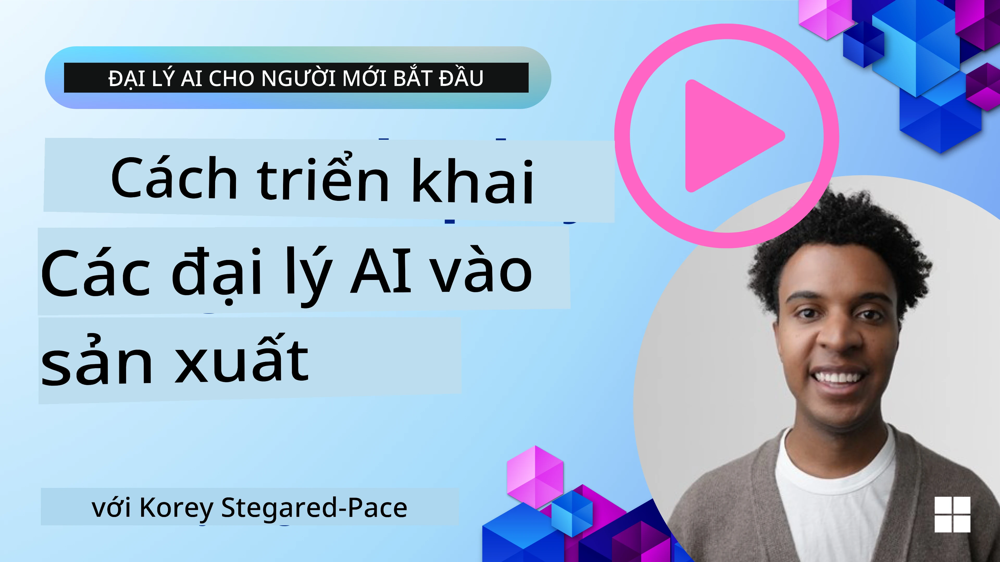

# Các tác nhân AI trong sản xuất: Quan sát & Đánh giá

[](https://youtu.be/l4TP6IyJxmQ?si=reGOyeqjxFevyDq9)

Khi các tác nhân AI chuyển từ nguyên mẫu thử nghiệm sang các ứng dụng thực tế, khả năng hiểu hành vi của chúng, giám sát hiệu suất và đánh giá hệ thống kết quả trở nên quan trọng.

## Mục tiêu học tập

Sau khi hoàn thành bài học này, bạn sẽ biết cách/hiểu được:
- Các khái niệm cốt lõi về khả năng quan sát và đánh giá tác nhân
- Các kỹ thuật cải thiện hiệu suất, chi phí và hiệu quả của các tác nhân
- Cần đánh giá gì và làm thế nào để đánh giá các tác nhân AI của bạn một cách hệ thống
- Cách kiểm soát chi phí khi triển khai tác nhân AI vào sản xuất
- Cách đo đạc tác nhân được xây dựng với Microsoft Agent Framework

Mục tiêu là trang bị cho bạn kiến thức để biến các tác nhân "hộp đen" thành các hệ thống minh bạch, dễ quản lý và đáng tin cậy.

_**Lưu ý:** Việc triển khai các tác nhân AI an toàn và đáng tin cậy là rất quan trọng. Bạn cũng nên xem qua bài học [Xây dựng các tác nhân AI đáng tin cậy](../06-building-trustworthy-agents/README.md)._

## Dấu vết và Khoảng thời gian

Các công cụ quan sát như [Langfuse](https://langfuse.com/) hoặc [Microsoft Foundry](https://learn.microsoft.com/en-us/azure/ai-foundry/what-is-azure-ai-foundry) thường thể hiện các lượt chạy của tác nhân dưới dạng dấu vết và khoảng thời gian.

- **Dấu vết** đại diện cho một nhiệm vụ đầy đủ của tác nhân từ đầu đến cuối (như xử lý câu hỏi của người dùng).
- **Khoảng thời gian** là các bước riêng lẻ trong dấu vết (như gọi mô hình ngôn ngữ hay truy xuất dữ liệu).


<!-- Image URL retained for illustration purposes -->

Nếu không có khả năng quan sát, một tác nhân AI có thể giống như một "hộp đen" - trạng thái bên trong và lý luận đều không minh bạch, khiến việc chẩn đoán sự cố hoặc tối ưu hóa hiệu suất khó khăn. Với khả năng quan sát, các tác nhân trở thành “hộp kính,” cung cấp sự minh bạch thiết yếu để xây dựng lòng tin và đảm bảo chúng hoạt động như mong muốn.

## Tại sao khả năng quan sát quan trọng trong môi trường sản xuất

Việc chuyển các tác nhân AI vào môi trường sản xuất đặt ra một bộ thách thức và yêu cầu mới. Khả năng quan sát không còn là "phụ kiện" mà là năng lực thiết yếu:

*   **Gỡ lỗi và Phân tích nguyên nhân gốc rễ**: Khi tác nhân thất bại hoặc cho ra kết quả bất ngờ, công cụ quan sát sẽ cung cấp dấu vết cần thiết để xác định nguồn lỗi. Điều này đặc biệt quan trọng trong các tác nhân phức tạp có thể bao gồm nhiều lần gọi LLM, tương tác công cụ và logic điều kiện.
*   **Quản lý độ trễ và chi phí**: Các tác nhân AI thường dựa vào các LLM và các API bên ngoài tính phí theo token hoặc theo lượt gọi. Khả năng quan sát cho phép theo dõi chính xác các lần gọi này, giúp xác định các hoạt động quá chậm hoặc đắt đỏ. Điều này cho phép các nhóm tối ưu hóa lời nhắc, chọn mô hình hiệu quả hơn hoặc thiết kế lại quy trình để kiểm soát chi phí vận hành và đảm bảo trải nghiệm người dùng tốt.
*   **Tin cậy, An toàn và Tuân thủ**: Trong nhiều ứng dụng, việc đảm bảo các tác nhân hoạt động an toàn và đạo đức là rất quan trọng. Khả năng quan sát cung cấp dấu vết kiểm toán các hành động và quyết định của tác nhân. Điều này có thể dùng để phát hiện và giảm thiểu các vấn đề như chèn lời nhắc, tạo nội dung có hại, hoặc xử lý sai thông tin cá nhân (PII). Ví dụ, bạn có thể kiểm tra dấu vết để hiểu tại sao tác nhân đưa ra phản hồi hoặc sử dụng công cụ cụ thể.
*   **Vòng lặp cải tiến liên tục**: Dữ liệu quan sát là nền tảng của quy trình phát triển lặp. Bằng việc giám sát hiệu suất của tác nhân trong thế giới thực, các nhóm có thể xác định các điểm cần cải thiện, thu thập dữ liệu để tinh chỉnh mô hình và xác thực tác động của thay đổi. Đây là vòng phản hồi nơi các thông tin từ đánh giá trực tuyến trong sản xuất hỗ trợ cho thử nghiệm ngoại tuyến và tinh chỉnh, dẫn đến hiệu suất tác nhân ngày càng tốt hơn.

## Các chỉ số quan trọng cần theo dõi

Để giám sát và hiểu hành vi của tác nhân, cần theo dõi nhiều chỉ số và tín hiệu. Mặc dù các chỉ số cụ thể có thể khác nhau tùy theo mục đích của tác nhân, nhưng một số chỉ số mang tính phổ quát quan trọng.

Dưới đây là một số chỉ số phổ biến mà các công cụ quan sát thường giám sát:

**Độ trễ:** Tác nhân phản hồi nhanh như thế nào? Thời gian chờ lâu ảnh hưởng tiêu cực tới trải nghiệm người dùng. Bạn nên đo độ trễ cho các nhiệm vụ và các bước riêng lẻ bằng cách theo dõi các lượt chạy tác nhân. Ví dụ, tác nhân mất 20 giây cho tất cả các lần gọi mô hình có thể được tăng tốc bằng cách sử dụng mô hình nhanh hơn hoặc chạy các lần gọi song song.

**Chi phí:** Chi phí cho mỗi lượt chạy tác nhân là bao nhiêu? Các tác nhân AI dựa trên các lần gọi LLM tính phí theo token hoặc API bên ngoài. Việc sử dụng công cụ thường xuyên hoặc nhiều lượt nhắc có thể làm tăng chi phí nhanh chóng. Ví dụ, nếu tác nhân gọi LLM năm lần để cải thiện chất lượng cận biên, bạn cần đánh giá liệu chi phí đó có xứng đáng hay có thể giảm số lần gọi hoặc dùng mô hình rẻ hơn. Việc giám sát thời gian thực cũng giúp xác định các đột biến bất ngờ (ví dụ lỗi gây vòng lặp API quá mức).

**Lỗi yêu cầu:** Có bao nhiêu yêu cầu tác nhân thất bại? Điều này có thể bao gồm lỗi API hoặc lỗi gọi công cụ. Để làm cho tác nhân mạnh mẽ hơn trong sản xuất, bạn có thể thiết lập các phương án dự phòng hoặc thử lại. Ví dụ, nếu nhà cung cấp LLM A bị lỗi, bạn chuyển sang nhà cung cấp LLM B làm dự phòng.

**Phản hồi người dùng:** Việc triển khai đánh giá trực tiếp từ người dùng cung cấp thông tin giá trị. Có thể là đánh giá rõ ràng (👍 thích/👎 không thích, ⭐1-5 sao) hoặc bình luận văn bản. Phản hồi tiêu cực liên tục nên cảnh báo bạn, đây là dấu hiệu tác nhân không hoạt động như mong đợi.

**Phản hồi ngầm từ người dùng:** Hành vi người dùng cung cấp phản hồi gián tiếp ngay cả khi không có đánh giá rõ ràng. Ví dụ như việc hỏi lại câu hỏi ngay lập tức, truy vấn lặp lại hoặc bấm nút thử lại. Ví dụ, nếu bạn thấy người dùng hỏi cùng một câu hỏi nhiều lần, đây là dấu hiệu tác nhân không hoạt động như mong đợi.

**Độ chính xác:** Tác nhân tạo ra kết quả đúng hoặc mong muốn bao nhiêu phần trăm? Định nghĩa độ chính xác có thể khác nhau (ví dụ, độ chính xác giải quyết vấn đề, độ chính xác lấy thông tin, sự hài lòng của người dùng). Bước đầu là xác định thành công của tác nhân là gì. Bạn có thể theo dõi độ chính xác qua các kiểm tra tự động, điểm đánh giá hoặc nhãn hoàn thành nhiệm vụ. Ví dụ, đánh dấu dấu vết là "thành công" hoặc "thất bại".

**Chỉ số đánh giá tự động:** Bạn cũng có thể thiết lập các đánh giá tự động. Ví dụ, dùng LLM để chấm điểm kết quả của tác nhân xem nó có hữu ích, chính xác hay không. Có nhiều thư viện mã nguồn mở giúp bạn chấm điểm các khía cạnh khác nhau của tác nhân. Ví dụ [RAGAS](https://docs.ragas.io/) cho tác nhân RAG hoặc [LLM Guard](https://github.com/protectai/llm-guard) để phát hiện ngôn ngữ có hại hoặc chèn lời nhắc.

Trong thực tế, kết hợp các chỉ số này sẽ cung cấp bao phủ tốt nhất về sức khỏe của tác nhân AI. Trong [notebook ví dụ](./code_samples/10-expense_claim-demo.ipynb) của chương này, chúng tôi sẽ chỉ cho bạn cách những chỉ số này thể hiện trong các ví dụ thực tế nhưng trước hết, chúng ta hãy học cách một quy trình đánh giá điển hình diễn ra như thế nào.

## Đo đạc tác nhân của bạn

Để thu thập dữ liệu theo dõi, bạn cần đo đạc mã nguồn. Mục tiêu là đo đạc mã tác nhân để phát ra dấu vết và chỉ số có thể được thu thập, xử lý và hiển thị bởi nền tảng quan sát.

**OpenTelemetry (OTel):** [OpenTelemetry](https://opentelemetry.io/) đã trở thành tiêu chuẩn ngành cho quan sát LLM. Nó cung cấp tập hợp API, SDK và công cụ để tạo, thu thập và xuất dữ liệu telemetry.

Có nhiều thư viện đo đạc bọc các framework tác nhân hiện có giúp xuất các khoảng thời gian OpenTelemetry vào công cụ quan sát một cách dễ dàng. Microsoft Agent Framework tích hợp natively với OpenTelemetry. Dưới đây là ví dụ đo đạc tác nhân MAF:

```python
from agent_framework.observability import get_tracer, get_meter

tracer = get_tracer()
meter = get_meter()

with tracer.start_as_current_span("agent_run"):
    # Agent execution is traced automatically
    pass
```

[notebook ví dụ](./code_samples/10-expense_claim-demo.ipynb) trong chương này sẽ trình bày cách đo đạc tác nhân MAF của bạn.

**Tạo Khoảng Thời Gian thủ công:** Trong khi các thư viện đo đạc cung cấp cơ bản tốt, thường có các trường hợp cần thông tin chi tiết hoặc tùy chỉnh hơn. Bạn có thể tạo khoảng thời gian thủ công để thêm logic ứng dụng riêng. Quan trọng hơn, bạn có thể thêm thuộc tính tùy chỉnh (hay còn gọi là thẻ metadata) cho các khoảng thời gian tạo tự động hoặc thủ công. Thuộc tính có thể bao gồm dữ liệu đặc thù doanh nghiệp, tính toán trung gian hoặc ngữ cảnh hữu ích cho gỡ lỗi hoặc phân tích, như `user_id`, `session_id`, hoặc `model_version`.

Ví dụ tạo dấu vết và các khoảng thời gian thủ công với [Langfuse Python SDK](https://langfuse.com/docs/sdk/python/sdk-v3):

```python
from langfuse import get_client
 
langfuse = get_client()
 
span = langfuse.start_span(name="my-span")
 
span.end()
```

## Đánh giá tác nhân

Khả năng quan sát cung cấp cho chúng ta các chỉ số, nhưng đánh giá là quá trình phân tích dữ liệu đó (và thực hiện các bài kiểm tra) để xác định tác nhân AI hoạt động hiệu quả thế nào và có thể cải thiện ra sao. Nói cách khác, khi bạn đã có dấu vết và chỉ số đó, làm thế nào để dùng chúng để đánh giá tác nhân và đưa ra quyết định?

Đánh giá thường xuyên quan trọng vì các tác nhân AI thường phi định hướng và có thể phát triển (qua cập nhật hoặc sự dịch chuyển hành vi mô hình) – nếu không đánh giá, bạn sẽ không biết tác nhân "thông minh" của mình có thực sự làm tốt nhiệm vụ hay không hoặc có bị suy giảm.

Có hai loại đánh giá cho tác nhân AI: **đánh giá trực tuyến** và **đánh giá ngoại tuyến**. Cả hai đều có giá trị và bổ trợ cho nhau. Chúng ta thường bắt đầu với đánh giá ngoại tuyến, vì đây là bước tối thiểu cần thiết trước khi triển khai bất kỳ tác nhân nào.

### Đánh giá ngoại tuyến


Điều này liên quan đến đánh giá tác nhân trong môi trường kiểm soát, thường dùng bộ dữ liệu kiểm thử, không phải truy vấn người dùng thực tế. Bạn dùng các bộ dữ liệu được chuẩn bị trước, nơi bạn biết kết quả hoặc hành vi đúng mong đợi và chạy tác nhân trên đó.

Ví dụ, nếu bạn xây dựng tác nhân giải bài toán toán học dạng văn bản, bạn có thể có [bộ dữ liệu kiểm thử](https://huggingface.co/datasets/openai/gsm8k) gồm 100 bài toán với đáp án đã biết. Đánh giá ngoại tuyến thường được làm trong phát triển (và có thể là một phần của pipeline CI/CD) để kiểm tra cải tiến hoặc ngăn ngừa suy giảm. Ưu điểm là **có thể lặp lại và bạn có chỉ số độ chính xác rõ ràng vì có sự thật cơ sở**. Bạn cũng có thể giả lập truy vấn người dùng và đánh giá phản hồi của tác nhân so với câu trả lời lý tưởng hoặc dùng các chỉ số tự động như đã nói trên.

Thách thức chính với đánh giá ngoại tuyến là đảm bảo bộ dữ liệu kiểm thử toàn diện và luôn cập nhật – tác nhân có thể hoạt động tốt trên bộ kiểm thử cố định nhưng gặp phải truy vấn rất khác trong sản xuất. Do đó, bạn nên giữ bộ kiểm thử luôn được cập nhật với các trường hợp biên và ví dụ mới phản ánh các kịch bản thực tế. Hỗn hợp các bộ “smoke test” nhỏ và các bộ đánh giá lớn hơn rất hữu ích: bộ nhỏ để kiểm tra nhanh và bộ lớn để đo chỉ số hiệu suất rộng hơn.

### Đánh giá trực tuyến


Đây là đánh giá tác nhân trong môi trường thực tế, tức là khi tác nhân được sử dụng trực tiếp trong sản xuất. Đánh giá trực tuyến gồm theo dõi hiệu suất tác nhân trên tương tác người dùng thực và phân tích kết quả liên tục.

Ví dụ, bạn có thể theo dõi tỷ lệ thành công, điểm hài lòng của người dùng hoặc các chỉ số khác trên lưu lượng thực. Ưu điểm của đánh giá trực tuyến là **bắt được các tình huống mà bạn không lường trước trong phòng thí nghiệm** – bạn có thể quan sát sự dịch chuyển mô hình theo thời gian (nếu hiệu quả tác nhân giảm khi mẫu đầu vào thay đổi) và phát hiện truy vấn hoặc tình huống bất ngờ không có trong dữ liệu kiểm thử. Nó cung cấp bức tranh thực tế về hành vi tác nhân trong môi trường thực.

Đánh giá trực tuyến thường thu thập phản hồi người dùng gián tiếp và rõ ràng, như đã đề cập, và có thể chạy thử nghiệm bóng tối hoặc A/B test (trong đó phiên bản mới của tác nhân chạy song song để so sánh với phiên bản cũ). Thách thức là khó có được nhãn hoặc điểm tin cậy cho các tương tác trực tiếp – bạn có thể dựa vào phản hồi người dùng hoặc chỉ số hạ nguồn (ví dụ người dùng có nhấp kết quả hay không).

### Kết hợp hai phương pháp

Đánh giá trực tuyến và ngoại tuyến không loại trừ lẫn nhau; chúng bổ sung cho nhau rất tốt. Thông tin từ theo dõi trực tuyến (ví dụ, các loại truy vấn mới mà tác nhân xử lý kém) có thể dùng để tăng cường và cải thiện bộ dữ liệu kiểm thử ngoại tuyến. Ngược lại, các tác nhân làm tốt trong kiểm thử ngoại tuyến có thể được triển khai và giám sát trực tuyến với sự tự tin hơn.

Thực tế, nhiều nhóm áp dụng vòng lặp:

_đánh giá ngoại tuyến -> triển khai -> giám sát trực tuyến -> thu thập các trường hợp thất bại mới -> thêm vào bộ dữ liệu ngoại tuyến -> tinh chỉnh tác nhân -> lặp lại_.

## Các vấn đề thường gặp

Khi bạn triển khai các tác nhân AI vào sản xuất, có thể gặp nhiều thách thức. Dưới đây là một số vấn đề phổ biến và giải pháp tiềm năng:

| **Vấn đề**    | **Giải pháp tiềm năng**   |
| ------------- | ------------------ |
| Tác nhân AI không thực hiện nhiệm vụ nhất quán | - Tinh chỉnh lời nhắc cho tác nhân AI; rõ ràng về mục tiêu.<br>- Xác định nơi cần chia nhỏ nhiệm vụ và phân phối cho nhiều tác nhân xử lý. |
| Tác nhân AI rơi vào vòng lặp liên tục  | - Đảm bảo có điều kiện và quy tắc kết thúc rõ ràng để tác nhân biết khi nào dừng.<br>- Với nhiệm vụ phức tạp cần suy nghĩ và lập kế hoạch, dùng mô hình lớn hơn chuyên biệt cho suy luận. |
| Các lần gọi công cụ của tác nhân AI không hiệu quả  | - Kiểm tra và xác thực kết quả công cụ bên ngoài hệ thống tác nhân.<br>- Tinh chỉnh tham số, lời nhắc và tên gọi công cụ.  |
| Hệ thống đa tác nhân không hoạt động nhất quán | - Tinh chỉnh lời nhắc cho từng tác nhân để đảm bảo rõ ràng và khác biệt.<br>- Xây dựng hệ thống cấp bậc dùng tác nhân "định tuyến" hoặc điều khiển để xác định tác nhân phù hợp. |

Nhiều vấn đề này có thể được phát hiện hiệu quả hơn với khả năng quan sát. Dấu vết và chỉ số đã bàn giúp xác định chính xác vị trí trong quy trình tác nhân xảy ra sự cố, làm gỡ lỗi và tối ưu trở nên hiệu quả hơn nhiều.

## Quản lý chi phí

Dưới đây là một số chiến lược quản lý chi phí khi triển khai tác nhân AI vào sản xuất:

**Sử Dụng Các Mô Hình Nhỏ Hơn:** Các Mô Hình Ngôn Ngữ Nhỏ (SLMs) có thể hoạt động tốt trong một số trường hợp sử dụng có tính tác nhân và sẽ giảm đáng kể chi phí. Như đã đề cập trước đó, xây dựng một hệ thống đánh giá để xác định và so sánh hiệu suất so với các mô hình lớn hơn là cách tốt nhất để hiểu SLM sẽ hoạt động tốt như thế nào trên trường hợp sử dụng của bạn. Hãy cân nhắc sử dụng SLM cho các tác vụ đơn giản như phân loại ý định hoặc trích xuất tham số, trong khi dành các mô hình lớn hơn cho việc suy luận phức tạp.

**Sử Dụng Một Mô Hình Điều Hướng:** Một chiến lược tương tự là sử dụng đa dạng các mô hình và kích cỡ. Bạn có thể sử dụng một LLM/SLM hoặc hàm serverless để định tuyến các yêu cầu dựa trên độ phức tạp đến các mô hình phù hợp nhất. Điều này cũng sẽ giúp giảm chi phí đồng thời đảm bảo hiệu suất cho các tác vụ phù hợp. Ví dụ, định tuyến các truy vấn đơn giản đến các mô hình nhỏ hơn, nhanh hơn, và chỉ sử dụng các mô hình lớn đắt tiền cho các tác vụ suy luận phức tạp.

**Bộ Nhớ Đệm Phản Hồi:** Xác định các yêu cầu và tác vụ phổ biến và cung cấp phản hồi trước khi chúng đi qua hệ thống tác nhân của bạn là một cách tốt để giảm khối lượng các yêu cầu tương tự. Bạn thậm chí có thể triển khai một luồng để xác định mức độ tương đồng của một yêu cầu với các yêu cầu đã được lưu trong bộ nhớ đệm của bạn bằng cách sử dụng các mô hình AI cơ bản hơn. Chiến lược này có thể giảm đáng kể chi phí cho các câu hỏi thường gặp hoặc quy trình làm việc phổ biến.

## Hãy xem cách điều này hoạt động trong thực tế

Trong [sổ tay ví dụ của phần này](./code_samples/10-expense_claim-demo.ipynb), chúng ta sẽ xem các ví dụ về cách sử dụng công cụ quan sát để giám sát và đánh giá tác nhân của chúng ta.


### Có Thêm Câu Hỏi về Các Tác Nhân AI Trong Sản Xuất?

Tham gia [Microsoft Foundry Discord](https://discord.com/invite/ATgtXmAS5D) để gặp gỡ những người học khác, tham dự giờ làm việc và nhận câu trả lời cho các câu hỏi về Tác Nhân AI của bạn.

## Bài Học Trước

[Mẫu Thiết Kế Metacognition](../09-metacognition/README.md)

## Bài Học Tiếp Theo

[Giao Thức Tác Nhân](../11-agentic-protocols/README.md)

---

<!-- CO-OP TRANSLATOR DISCLAIMER START -->
**Tuyên bố miễn trừ trách nhiệm**:
Tài liệu này đã được dịch bằng dịch vụ dịch thuật AI [Co-op Translator](https://github.com/Azure/co-op-translator). Mặc dù chúng tôi cố gắng đảm bảo độ chính xác, xin lưu ý rằng bản dịch tự động có thể chứa lỗi hoặc sai sót. Tài liệu gốc bằng ngôn ngữ gốc nên được coi là nguồn tin chính thức. Đối với thông tin quan trọng, nên sử dụng dịch vụ dịch thuật chuyên nghiệp bởi con người. Chúng tôi không chịu trách nhiệm về bất kỳ hiểu lầm hoặc giải thích sai nào phát sinh từ việc sử dụng bản dịch này.
<!-- CO-OP TRANSLATOR DISCLAIMER END -->