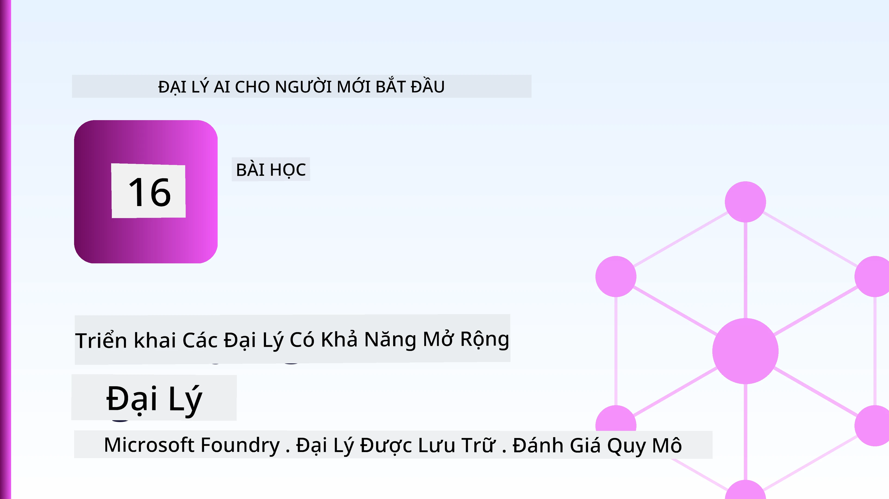
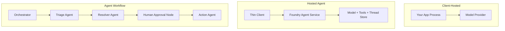
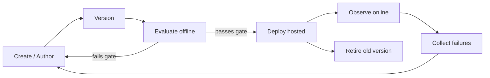
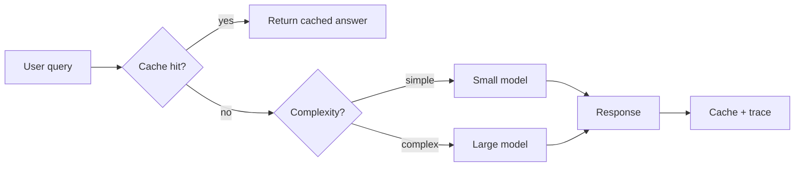
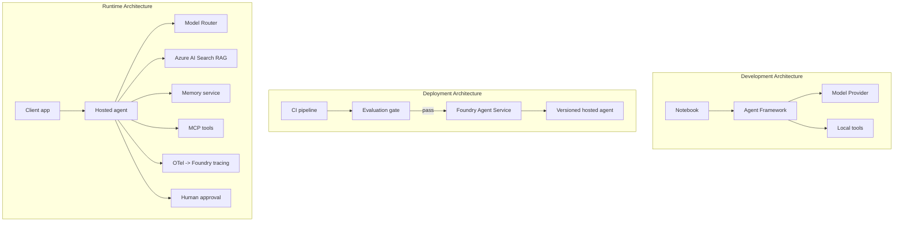

# Triển khai Các Tác Nhân Có Khả Năng Mở Rộng với Microsoft Foundry



Cho đến thời điểm này trong khóa học, bạn đã xây dựng các tác nhân chạy trên laptop của bạn, bên trong một notebook, được điều khiển bởi `az login` và một vài biến môi trường. Đó chính xác là cách đúng để học. Nhưng đó không phải là cách đúng để chạy một tác nhân mà hàng nghìn khách hàng phụ thuộc vào lúc 3 giờ sáng.

Bài học này nói về khoảng cách giữa "nó hoạt động trên máy tôi" và "nó hoạt động, đáng tin cậy và tiết kiệm, trong môi trường sản xuất." Chúng tôi đóng khoảng cách đó bằng cách sử dụng **Microsoft Foundry** và **Dịch vụ Tác nhân Microsoft Foundry**, và chúng tôi làm điều đó bằng cách xây dựng một tác nhân hỗ trợ khách hàng thực sự có các công cụ, truy xuất, bộ nhớ, đánh giá và giám sát.

## Giới thiệu

Bài học này sẽ bao gồm:

- Sự khác biệt giữa **tác nhân nguyên mẫu** và **tác nhân được triển khai**, và tại sao việc chuyển đổi chủ yếu liên quan đến mọi thứ *xung quanh* mô hình.
- **Mẫu triển khai** cho các tác nhân: được lưu trữ trên máy khách, được lưu trữ dịch vụ (Tác nhân được lưu trữ), và được phối hợp theo quy trình làm việc.
- **Vòng đời tác nhân** trên Microsoft Foundry — tạo, phiên bản, triển khai, đánh giá, quan sát, ngưng sử dụng.
- **Chiến lược mở rộng quy mô**: định tuyến mô hình, lưu bộ nhớ đệm, đồng thời, và thiết kế không trạng thái.
- **Khả năng quan sát** với OpenTelemetry và theo dõi Foundry.
- **Tối ưu hóa chi phí** thông qua lựa chọn mô hình, định tuyến và các cửa kiểm tra đánh giá.
- **Cân nhắc doanh nghiệp**: quản trị, phê duyệt bởi con người, và vận hành máy chủ MCP an toàn trong môi trường sản xuất.

## Mục Tiêu Học Tập

Sau khi hoàn thành bài học này, bạn sẽ biết cách:

- Chọn mẫu triển khai phù hợp cho một tải công việc của tác nhân.
- Triển khai một tác nhân tới Dịch vụ Tác nhân Microsoft Foundry để nó có phiên bản, được quản trị và có thể quan sát được.
- Thêm công cụ theo dõi cho tác nhân và nối dây một quy trình đánh giá chạy trước mỗi lần phát hành.
- Áp dụng định tuyến mô hình và bộ nhớ đệm để giữ độ trễ và chi phí trong tầm kiểm soát khi mở rộng quy mô.
- Thêm cửa phê duyệt của con người cho các hành động rủi ro cao và tích hợp máy chủ MCP theo cách an toàn cho sản xuất.

## Yêu Cầu Tiên Quyết

Bài học này giả định bạn đã hoàn thành các bài học trước và thành thạo:

- Xây dựng các tác nhân với [Microsoft Agent Framework](../14-microsoft-agent-framework/README.md) (Bài học 14).
- [Sử dụng Công Cụ](../04-tool-use/README.md) (Bài học 4) và [Agentic RAG](../05-agentic-rag/README.md) (Bài học 5).
- [Bộ Nhớ Tác Nhân](../13-agent-memory/README.md) (Bài học 13) và [Giao Thức Agentic / MCP](../11-agentic-protocols/README.md) (Bài học 11).
- [Khả Năng Quan Sát và Đánh Giá](../10-ai-agents-production/README.md) (Bài học 10) — bài học này xây dựng trực tiếp trên đó.

Bạn cũng cần:

- Một **đăng ký Azure** và một **dự án Microsoft Foundry** với ít nhất một mô hình trò chuyện đã được triển khai.
- **Azure CLI** đã xác thực (`az login`).
- Python 3.12+ và các gói trong kho lưu trữ [`requirements.txt`](../../../requirements.txt).

## Từ Nguyên Mẫu đến Sản Xuất: Điều Gì Thực Sự Thay Đổi

Một tác nhân nguyên mẫu và tác nhân sản xuất chia sẻ cùng vòng lặp chính — suy luận, gọi công cụ, phản hồi. Điều thay đổi là mọi thứ bao quanh vòng lặp đó. Mô hình chỉ chiếm khoảng 20% của tác nhân sản xuất; 80% còn lại là bộ khung vận hành.

| Mối Quan Tâm | Nguyên Mẫu | Sản Xuất |
| --- | --- | --- |
| **Lưu trữ** | Chạy trong notebook của bạn | Chạy như một dịch vụ lưu trữ, có phiên bản và triển khai dần dần |
| **Danh tính** | Mã token `az login` của bạn | Danh tính được quản lý với RBAC có phạm vi |
| **Trạng thái** | Trong bộ nhớ, mất khi khởi động lại | Bên ngoài (cửa hàng luồng, dịch vụ bộ nhớ) |
| **Thất bại** | Bạn thấy lại traceback | Thử lại, dự phòng, thư chết, cảnh báo |
| **Chi phí** | "Chỉ vài xu" | Theo dõi trên từng yêu cầu, định tuyến, bộ nhớ đệm, ngân sách |
| **Chất lượng** | Bạn xem xét đầu ra | Đánh giá tự động trước mỗi lần phát hành |
| **Tin cậy** | Bạn phê duyệt mọi hành động | Chính sách + con người tham gia trong các hành động rủi ro |

Hãy ghi nhớ bảng này. Mỗi phần dưới đây tương ứng với một trong những dòng này.

## Mẫu Triển Khai Tác Nhân

Có ba mẫu bạn sẽ sử dụng, thường kết hợp với nhau.

### 1. Tác Nhân Lưu Trữ Trên Khách Hàng

Đối tượng tác nhân sống bên trong quá trình ứng dụng *của bạn*. Mã của bạn gọi nhà cung cấp mô hình trực tiếp; vòng suy luận chạy trong dịch vụ của bạn. Đây là những gì mọi bài học trước đã thực hiện.

- **Sử dụng khi** bạn cần kiểm soát hoàn toàn vòng, phần mềm trung gian tùy chỉnh, hoặc bạn nhúng tác nhân bên trong backend hiện có.
- **Đổi lại**: bạn tự chịu trách nhiệm về mở rộng quy mô, trạng thái và độ bền.

### 2. Tác Nhân Được Lưu Trữ (Dịch vụ Tác nhân Foundry)

Tác nhân được *đăng ký như một tài nguyên* trong Microsoft Foundry. Foundry lưu trữ vòng suy luận, lưu trữ các luồng, thực thi an toàn nội dung và RBAC, và làm cho tác nhân hiển thị trong cổng Foundry. Ứng dụng của bạn trở thành một khách mỏng chỉ tạo luồng và đọc phản hồi.

- **Sử dụng khi** bạn muốn độ bền, khả năng quan sát tích hợp sẵn, quản trị và giảm bớt bề mặt vận hành.
- **Đổi lại**: ít kiểm soát cấp thấp hơn đổi lấy một môi trường runtime được quản lý.

### 3. Quy Trình Tác Nhân

Nhiều tác nhân (và công cụ) được ghép thành một đồ thị với luồng điều khiển rõ ràng — các bước tuần tự, phân nhánh, nút phê duyệt của con người, và các điểm kiểm tra bền vững có thể tạm dừng và tiếp tục. Đây là khả năng **Quy Trình làm việc** của Microsoft Agent Framework áp dụng ở quy mô triển khai.

- **Sử dụng khi** một nhiệm vụ đơn kéo dài qua nhiều tác nhân chuyên biệt hoặc đòi hỏi bước phê duyệt ở giữa.
- **Đổi lại**: nhiều phần chuyển động hơn; cần khả năng quan sát cấp phối hợp.



## Vòng Đời Tác Nhân trên Microsoft Foundry

Triển khai một tác nhân không phải là một thao tác `push` một lần. Đó là một vòng lặp, và nó rất giống chu trình phát hành phần mềm bởi vì đúng là như vậy.



Ý tưởng chính, tiếp nối từ [Bài học 10](../10-ai-agents-production/README.md): **đánh giá offline là một cửa kiểm, không phải là điều được nghĩ đến sau cùng.** Phiên bản tác nhân mới không được phát hành trừ khi vượt qua các ngưỡng đánh giá của bạn. Khả năng quan sát online sau đó đưa các lỗi thực tế trở lại bộ kiểm tra offline của bạn. Đó là toàn bộ vòng lặp.

## Chiến Lược Mở Rộng Quy Mô

Mở rộng một tác nhân khác với mở rộng API web không trạng thái, vì mỗi yêu cầu có thể kích hoạt nhiều lần gọi mô hình và công cụ tốn kém. Bốn kỹ thuật chịu phần lớn lượng tải.

**Xử lý yêu cầu không trạng thái.** Không giữ trạng thái người dùng riêng trong bộ nhớ quá trình của bạn. Lưu các luồng hội thoại trong cửa hàng luồng Foundry hoặc dịch vụ bộ nhớ để bất kỳ phiên bản nào cũng có thể xử lý bất kỳ yêu cầu nào. Đây là điều cho phép bạn mở rộng theo chiều ngang — thêm phiên bản, không cần phiên làm việc cố định.

**Định tuyến mô hình.** Không phải mọi yêu cầu đều cần mô hình có khả năng cao nhất (và đắt nhất) của bạn. Định tuyến các yêu cầu đơn giản — phân loại ý định, trả lời ngắn gọn các câu hỏi thực tế — đến một mô hình nhỏ, nhanh và dành mô hình lớn cho suy luận thực sự. **Bộ định tuyến Mô hình** của Foundry có thể làm điều này cho bạn, hoặc bạn có thể tự triển khai một bộ phân loại nhẹ. Bạn sẽ xây dựng phiên bản DIY trong phòng lab.

**Bộ nhớ đệm phản hồi.** Nhiều truy vấn hỗ trợ gần như trùng lặp ("làm thế nào để tôi đặt lại mật khẩu?"). Lưu câu trả lời cho các câu hỏi phổ biến và phục vụ mà không cần gọi đến mô hình. Ngay cả tỷ lệ trúng bộ nhớ đệm khiêm tốn cũng giúp cắt giảm đáng kể chi phí và độ trễ.

**Đồng thời và áp lực ngược.** Nhà cung cấp mô hình có giới hạn tốc độ. Giới hạn đồng thời, sử dụng thử lại với lùi lại số mũ, và xử lý thất bại một cách nhẹ nhàng (phản hồi "chúng tôi đang xử lý" trong hàng đợi tốt hơn mã lỗi 500).



## Khả Năng Quan Sát Trong Môi Trường Sản Xuất

Bạn không thể vận hành thứ bạn không thể quan sát. Như đã đề cập trong Bài học 10, Microsoft Agent Framework tạo ra các dấu vết **OpenTelemetry** bản địa — mọi lần gọi mô hình, khởi chạy công cụ, và bước phối hợp trở thành một khoảng thời gian theo dõi. Trong môi trường sản xuất, bạn xuất các khoảng thời gian đó đến Microsoft Foundry (hoặc bất kỳ backend tương thích OTel nào) để bạn có thể:

- Theo dõi một đơn khiếu nại khách hàng từ đầu đến cuối qua mọi lần gọi mô hình và công cụ.
- Theo dõi độ trễ p50/p95 và chi phí trên mỗi yêu cầu theo thời gian.
- Cảnh báo khi xảy ra đột biến tỷ lệ lỗi và bất thường về chi phí trước khi người dùng (hoặc đội tài chính của bạn) nhận thấy.

```python
from agent_framework.observability import get_tracer

tracer = get_tracer()

with tracer.start_as_current_span("support_request") as span:
    span.set_attribute("customer.tier", "enterprise")
    span.set_attribute("routed.model", "gpt-5-nano")
    # agent execution is traced automatically inside this span
```

Các thuộc tính như `customer.tier` và `routed.model` giúp biến một lượng lớn dấu vết thành các câu hỏi có thể trả lời được ("khách hàng doanh nghiệp có bị định tuyến sang mô hình nhỏ quá thường xuyên không?").

## Tối Ưu Hóa Chi Phí

Chi phí trong tác nhân sản xuất bị chi phối bởi token. Ba cần gạt, theo thứ tự tác động:

1. **Chọn kích thước mô hình phù hợp.** Một mô hình nhỏ vượt qua cửa kiểm đánh giá của bạn hầu như luôn rẻ hơn mô hình lớn cũng vượt qua. Dùng đánh giá để *chứng minh* mô hình nhỏ đủ tốt thay vì mặc định chọn mô hình lớn nhất để đề phòng.
2. **Định tuyến theo độ phức tạp.** Như trên — chỉ trả giá mô hình lớn cho các yêu cầu cần suy luận mô hình lớn.
3. **Lưu bộ nhớ đệm tích cực.** Cuộc gọi mô hình rẻ nhất là cuộc gọi bạn không bao giờ thực hiện.

Các cửa kiểm đánh giá và kiểm soát chi phí là cùng một kỹ thuật nhìn từ hai góc độ: đánh giá cho bạn *mức chất lượng tối thiểu*, định tuyến và lưu bộ nhớ đệm giữ bạn càng gần chi phí của mức đó càng tốt.

## Cân Nhắc Khi Triển Khai Doanh Nghiệp

**Quản trị.** Tác nhân lưu trữ kế thừa RBAC, an toàn nội dung và ghi nhật ký kiểm toán của Foundry. Cung cấp cho từng tác nhân một danh tính được quản lý với đặc quyền tối thiểu cần thiết — quyền truy cập chỉ đọc vào cơ sở tri thức, quyền truy cập có phạm vi vào API vé hỗ trợ, không hơn.

**Con người tham gia vào vòng lặp.** Một số hành động có hậu quả quá lớn để tự động hoàn toàn — hoàn tiền, xóa tài khoản, chuyển tiếp đến đội pháp lý. Microsoft Agent Framework hỗ trợ các công cụ **cần phê duyệt**: tác nhân đề xuất hành động, thực thi tạm dừng, con người phê duyệt hoặc từ chối, rồi quy trình làm việc tiếp tục. Bạn đã thấy nguyên thủy này trong [Bài học 6](../06-building-trustworthy-agents/README.md); bây giờ bạn triển khai nó.

**MCP trong sản xuất.** [MCP](../11-agentic-protocols/README.md) cho phép tác nhân của bạn sử dụng công cụ bên ngoài qua một giao diện chuẩn. Trong sản xuất, coi mỗi máy chủ MCP là một ranh giới không tin cậy: cố định phiên bản máy chủ, chạy nó với danh tính có phạm vi, kiểm tra đầu ra, và không bao giờ tiết lộ bí mật cho nó. Máy chủ MCP là một phụ thuộc, và phụ thuộc được vá lỗi, kiểm toán và giới hạn tốc độ.



Ba sơ đồ đó — phát triển, triển khai, thời gian chạy — là cùng một tác nhân ở ba giai đoạn cuộc đời nó. Phòng lab tiếp theo sẽ hướng dẫn bạn xây dựng nó.

## Phòng Lab Thực Hành: Tác Nhân Hỗ Trợ Khách Hàng Sẵn Sàng Cho Sản Xuất

Mở [`code_samples/16-python-agent-framework.ipynb`](./code_samples/16-python-agent-framework.ipynb) và làm theo từng bước. Bạn sẽ lắp ráp một **tác nhân hỗ trợ khách hàng Contoso** với mọi mối quan tâm về sản xuất được tích hợp:

1. **Gọi công cụ** — tra cứu trạng thái đơn hàng và mở vé hỗ trợ.
2. **RAG** — trả lời câu hỏi chính sách từ cơ sở tri thức (Azure AI Search, với việc dự phòng trong bộ nhớ để notebook chạy mà không cần tài nguyên Search).
3. **Bộ nhớ** — nhớ khách hàng qua các lượt hội thoại.
4. **Định tuyến mô hình** — một bộ phân loại độ phức tạp định tuyến mỗi yêu cầu đến mô hình nhỏ hoặc lớn.
5. **Lưu bộ nhớ đệm phản hồi** — các câu hỏi lặp lại được phục vụ từ bộ nhớ đệm.
6. **Phê duyệt của con người** — hoàn tiền vượt ngưỡng dừng lại để phê duyệt của con người.
7. **Đường ống đánh giá** — một bộ kiểm tra offline nhỏ chấm điểm tác nhân và đóng vai trò cửa kiểm phát hành.
8. **Khả năng quan sát** — theo dõi OpenTelemetry quanh mỗi yêu cầu.

### Hướng Dẫn

Notebook được tổ chức sao cho mỗi mối quan tâm sản xuất là một phần riêng biệt, có thể chạy độc lập. Trọng tâm là trình xử lý yêu cầu kết hợp định tuyến và lưu bộ nhớ đệm:

```python
async def handle_support_request(query: str, customer_id: str) -> str:
    # 1. Serve from cache when we can.
    cached = response_cache.get(normalize(query))
    if cached:
        return cached

    # 2. Route by complexity to control cost.
    model = "gpt-5-nano" if is_simple(query) else "gpt-5-mini"

    # 3. Run the agent inside a trace span for observability.
    with tracer.start_as_current_span("support_request") as span:
        span.set_attribute("routed.model", model)
        span.set_attribute("customer.id", customer_id)
        response = await support_agent.run(query, model=model)

    # 4. Cache and return.
    response_cache.set(normalize(query), response.text)
    return response.text
```

Cửa kiểm đánh giá bảo vệ một lần phát hành trông như thế này:

```python
async def evaluation_gate(agent, test_cases, threshold: float = 0.8) -> bool:
    passed = 0
    for case in test_cases:
        result = await agent.run(case["input"])
        if score_response(result.text, case["expected"]) >= 0.8:
            passed += 1
    pass_rate = passed / len(test_cases)
    print(f"Evaluation pass rate: {pass_rate:.0%} (gate: {threshold:.0%})")
    return pass_rate >= threshold  # only deploy if the gate passes
```

Đọc từng dòng — notebook giữ các nguyên mẫu nhỏ một cách có chủ đích để không có gì bị ẩn sau một lời gọi framework.

## Xác Thực Tác Nhân Đã Triển Khai với Các Bài Kiểm Tra Khói

Cửa kiểm đánh giá ở trên chạy *offline* chống lại đối tượng tác nhân của bạn. Khi tác nhân được triển khai dưới dạng Tác nhân được lưu trữ, bạn cần một kiểm tra nữa, rẻ hơn: **điểm cuối triển khai có thực sự trả lời không?**

Triển khai "thành công" chỉ chứng minh mặt điều khiển chấp nhận định nghĩa — không chứng minh tác nhân trả lời. Thiếu phụ thuộc, định tuyến mô hình sai, hoặc kết nối hết hạn có thể để lại triển khai xanh nhưng không trả về gì. **Kiểm tra khói** phát hiện điều đó trong vài giây, trên mỗi lần triển khai, không tốn kém như đánh giá toàn diện.

Kho lưu trữ này cung cấp đường ống kiểm tra khói sẵn dùng xây trên GitHub Action [AI Smoke Test](https://github.com/marketplace/actions/ai-smoke-test):

- **Danh mục** — [`tests/lesson-16-smoke-tests.json`](../../../tests/lesson-16-smoke-tests.json) chứa các lời nhắc và khẳng định cho tác nhân hỗ trợ Contoso (câu trả lời chính xác dựa trên chính sách, tra cứu đơn hàng, giữ đúng chủ đề, và tính liên tục hội thoại đa lượt). Các danh mục cho các tác nhân bài học khác nằm bên cạnh nó — xem [`tests/README.md`](../tests/README.md).
- **Luồng công việc** — [`.github/workflows/smoke-test.yml`](../../../.github/workflows/smoke-test.yml) đăng nhập với Azure OIDC và gửi POST mỗi lời nhắc đến điểm cuối Responses của tác nhân, thất bại công việc nếu có bất kỳ khẳng định nào không đúng.

```yaml
- name: Smoke-test hosted agent
  uses: JFolberth/ai-smoketest@v1
  with:
    project_endpoint: ${{ inputs.project_endpoint }}
    agent_name: ContosoSupportAgent
    tests_file: tests/lesson-16-smoke-tests.json
```

Chạy nó từ tab **Actions** khi tác nhân của bạn đã được triển khai, cung cấp điểm cuối dự án Foundry và tên tác nhân. Danh tính liên kết cần có vai trò **Azure AI User** ở phạm vi dự án Foundry. Hãy nghĩ về các lớp như một hình chóp: kiểm tra sơ bộ (có thể truy cập và phản hồi?) chạy trên mỗi lần triển khai, đánh giá ngoại tuyến (đủ tốt để phát hành?) chạy trước khi thăng cấp, và đánh giá trực tuyến (nó hoạt động thế nào trong thực tế?) chạy liên tục.

## Kiểm tra kiến thức

Kiểm tra hiểu biết của bạn trước khi chuyển sang bài tập.

**1. Đại khái "mô hình" chiếm bao nhiêu phần trong một tác nhân sản xuất, và phần còn lại là gì?**

<details>
<summary>Trả lời</summary>

Mô hình chiếm phần thiểu số của hệ thống — thường được trích dẫn khoảng 20%. Phần còn lại là bộ khung vận hành: lưu trữ và quản lý phiên bản, danh tính và RBAC, trạng thái bên ngoài, xử lý lỗi, theo dõi chi phí, đánh giá và các kiểm soát có người giám sát. Việc chuyển sang sản xuất chủ yếu là xây dựng mọi thứ *xung quanh* vòng suy luận.
</details>

**2. Khi nào bạn chọn Tác nhân Hosted thay vì tác nhân do khách hàng lưu trữ?**

<details>
<summary>Trả lời</summary>

Khi bạn muốn một môi trường runtime được quản lý với độ bền tích hợp (luồng chạy bền và có thể tiếp tục), khả năng quan sát, an toàn nội dung và RBAC, và bạn sẵn sàng đánh đổi một số quyền kiểm soát thấp hơn của vòng suy luận để giảm diện tích vận hành. Khách hàng lưu trữ thích hợp hơn khi bạn cần kiểm soát hoàn toàn vòng lặp hoặc nhúng tác nhân vào backend hiện có.
</details>

**3. Tại sao một tác nhân có thể mở rộng phải không lưu trạng thái trong bộ nhớ tiến trình riêng của nó?**

<details>
<summary>Trả lời</summary>

Để bất kỳ phiên bản nào cũng có thể xử lý bất cứ yêu cầu nào, điều này cho phép mở rộng ngang mà không cần phiên làm việc dính. Trạng thái hội thoại của từng người dùng được bên ngoài hóa vào kho lưu trữ luồng hoặc dịch vụ bộ nhớ. Nếu trạng thái tồn tại trong bộ nhớ tiến trình, bạn sẽ mất nó khi khởi động lại và không thể phân phối tải tự do.
</details>

**4. Vấn đề mà định tuyến mô hình giải quyết là gì, và nó liên quan thế nào đến đánh giá?**

<details>
<summary>Trả lời</summary>

Định tuyến chuyển những yêu cầu đơn giản đến một mô hình nhỏ, rẻ, nhanh và dự trữ mô hình lớn cho suy luận thật sự, kiểm soát cả độ trễ lẫn chi phí. Nó liên quan đến đánh giá vì đánh giá là thứ *chứng minh* mô hình nhỏ đủ tốt cho một loại yêu cầu — định tuyến không đánh giá chỉ là đoán mò.
</details>

**5. Một "cổng đánh giá" là gì và nó nằm ở đâu trong vòng đời?**

<details>
<summary>Trả lời</summary>

Một cổng đánh giá chạy bộ kiểm tra ngoại tuyến trên phiên bản tác nhân mới và chặn triển khai trừ khi tỷ lệ vượt qua vượt ngưỡng. Nó nằm giữa "phiên bản" và "triển khai" trong vòng đời, đặt chất lượng thành điều kiện tiên quyết cho phát hành thay vì thứ bạn kiểm tra sau khi phát hành.
</details>

**6. Tại sao một máy chủ MCP nên được xem là biên giới không tin cậy trong sản xuất?**

<details>
<summary>Trả lời</summary>

Vì nó là một phụ thuộc bên ngoài mà tác nhân của bạn gọi vào. Bạn nên đóng chặt phiên bản của nó, chạy nó với danh tính có phạm vi, xác thực đầu ra, giới hạn tốc độ và không bao giờ để lộ bí mật cho nó — kỷ luật tương tự như với bất kỳ phụ thuộc bên thứ ba nào. Đầu ra của nó chảy vào suy luận của tác nhân bạn, vì vậy tin tưởng không được xác thực là rủi ro bảo mật.
</details>

**7. Thay đổi đơn lẻ nào thường ảnh hưởng lớn nhất đến chi phí tác nhân sản xuất, và tại sao?**

<details>
<summary>Trả lời</summary>

Chọn kích thước mô hình phù hợp — sử dụng mô hình nhỏ nhất vẫn vượt cổng đánh giá của bạn. Chi phí bị chi phối bởi token, và mô hình nhỏ hơn mà đạt chất lượng thường rẻ hơn mô hình lớn. Bộ nhớ đệm và định tuyến tiếp tục giảm chi phí, nhưng chọn mô hình cơ sở đúng ảnh hưởng lớn nhất.
</details>

**8. Thuộc tính span như `customer.tier` và `routed.model` có vai trò gì trong khả năng quan sát?**

<details>
<summary>Trả lời</summary>

Chúng biến các dấu vết thô thành các câu hỏi kinh doanh có thể trả lời được. Không có thuộc tính, bạn chỉ có một bức tường các span; với chúng bạn có thể hỏi "khách hàng doanh nghiệp có thường xuyên được định tuyến đến mô hình nhỏ không?" hoặc "mô hình nào xử lý các yêu cầu chậm nhất của chúng ta?" Thuộc tính là cách bạn phân lát telemetry theo các chiều quan trọng với vận hành của bạn.
</details>

## Bài tập

Lấy tác nhân hỗ trợ khách hàng từ phòng thí nghiệm và tăng cường nó cho một kịch bản cụ thể: **tác nhân hỗ trợ thanh toán đăng ký cho một công ty SaaS.**

Bản nộp của bạn nên:

1. **Thay thế các công cụ** bằng những công cụ liên quan đến thanh toán: `get_subscription_status`, `get_invoice`, và `issue_credit` (tín dụng trên $50 cần sự phê duyệt của con người).
2. **Thêm ba tài liệu RAG** về chính sách hoàn tiền, chu kỳ thanh toán và chính sách hủy của công ty.
3. **Mở rộng bộ đánh giá** ít nhất tám trường hợp, bao gồm ít nhất hai trường hợp *nên* kích hoạt đường dẫn phê duyệt của con người, và xác nhận cổng đánh giá của bạn hoạt động đúng.
4. **Thêm một báo cáo chi phí**: sau khi chạy mười truy vấn hỗn hợp qua tác nhân, in ra số lượng truy vấn gửi tới mô hình nhỏ, mô hình lớn và số lượng truy vấn được phục vụ từ bộ nhớ đệm.

Viết một đoạn ngắn (trong ô markdown) giải thích bạn chọn quy tắc định tuyến mô hình nào và cách bạn sẽ xác thực nó với lưu lượng thực. Không có câu trả lời đúng duy nhất — bạn sẽ được đánh giá dựa trên việc liệu các quan ngại về sản xuất có được kết nối một cách mạch lạc hay không.

## Tóm tắt

Trong bài học này bạn đã chuyển một tác nhân từ nguyên mẫu sang sản xuất với Microsoft Foundry:

- Bước chuyển sang sản xuất chủ yếu là về **bộ khung vận hành** xung quanh mô hình — lưu trữ, danh tính, trạng thái, xử lý lỗi, chi phí, chất lượng và sự tin cậy.
- Bạn đã học ba **mẫu triển khai** — khách hàng lưu trữ, Tác nhân Hosted và Quy trình Công việc Tác nhân — và khi nào từng loại phù hợp.
- Bạn đã đi qua **vòng đời tác nhân**, nơi đánh giá ngoại tuyến **đóng vai trò cửa ngõ phát hành** và khả năng quan sát trực tuyến đưa thất bại trở lại với bộ kiểm tra.
- Bạn đã áp dụng **các chiến lược mở rộng** — thiết kế không trạng thái, định tuyến mô hình, bộ nhớ đệm và giới hạn song song — và liên kết chúng với **tối ưu hóa chi phí**.
- Bạn đã kết nối các **kiểm soát doanh nghiệp**: RBAC, phê duyệt có người giám sát và tích hợp MCP an toàn cho sản xuất.
- Bạn đã xây dựng một **tác nhân hỗ trợ khách hàng sẵn sàng cho sản xuất** liên kết tất cả các quan ngại này với mã có thể chạy.

Bài học tiếp theo sẽ đi theo hướng ngược lại: thay vì mở rộng các tác nhân lên đám mây, bạn sẽ đưa chúng *xuống* một máy phát triển đơn lẻ và chạy hoàn toàn cục bộ.

## Tài nguyên bổ sung

- <a href="https://learn.microsoft.com/azure/ai-foundry/what-is-azure-ai-foundry" target="_blank">Tài liệu Microsoft Foundry</a>
- <a href="https://learn.microsoft.com/azure/ai-foundry/agents/overview" target="_blank">Tổng quan Dịch vụ Tác nhân Microsoft Foundry</a>
- <a href="https://learn.microsoft.com/en-us/agent-framework/overview/?wt.mc_id=youtube_26688_organicsocial_reactor&pivots=programming-language-python" target="_blank">Khung Tác nhân Microsoft</a>
- <a href="https://learn.microsoft.com/en-us/azure/ai-foundry/openai/concepts/model-router" target="_blank">Model Router trong Microsoft Foundry</a>
- <a href="https://learn.microsoft.com/azure/search/search-what-is-azure-search" target="_blank">Azure AI Search</a>
- <a href="https://opentelemetry.io/" target="_blank">OpenTelemetry</a>
- <a href="https://github.com/marketplace/actions/ai-smoke-test" target="_blank">AI Smoke Test GitHub Action</a>
- <a href="https://modelcontextprotocol.io/" target="_blank">Model Context Protocol (MCP)</a>

## Bài học trước

[Xây dựng Tác nhân Sử dụng Máy tính (CUA)](../15-browser-use/README.md)

## Bài học tiếp

[Tạo Tác nhân AI Cục bộ](../17-creating-local-ai-agents/README.md)

---

<!-- CO-OP TRANSLATOR DISCLAIMER START -->
**Tuyên bố miễn trừ trách nhiệm**:
Tài liệu này đã được dịch bằng dịch vụ dịch thuật AI [Co-op Translator](https://github.com/Azure/co-op-translator). Mặc dù chúng tôi cố gắng đảm bảo độ chính xác, xin lưu ý rằng bản dịch tự động có thể chứa lỗi hoặc sai sót. Tài liệu gốc bằng ngôn ngữ gốc nên được coi là nguồn tin chính thức. Đối với thông tin quan trọng, nên sử dụng dịch vụ dịch thuật chuyên nghiệp bởi con người. Chúng tôi không chịu trách nhiệm về bất kỳ hiểu lầm hoặc giải thích sai nào phát sinh từ việc sử dụng bản dịch này.
<!-- CO-OP TRANSLATOR DISCLAIMER END -->