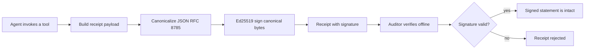
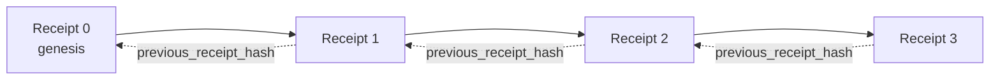

[Xem video bài học: Bảo mật tác nhân AI với Biên nhận Mã hóa](https://youtu.be/PLACEHOLDER_VIDEO_ID)

> _(Video bài học và hình thu nhỏ sẽ được nhóm nội dung Microsoft thêm vào sau khi gộp bài, theo mẫu bài học 14 / 15.)_

# Bảo mật tác nhân AI với Biên nhận Mã hóa

## Giới thiệu

Bài học này sẽ trình bày:

- Tại sao đường dẫn kiểm tra cho tác nhân AI quan trọng đối với tuân thủ, gỡ lỗi và niềm tin.
- Biên nhận mã hóa là gì và nó khác thế nào với một dòng nhật ký chưa được ký.
- Cách tạo một biên nhận đã ký cho cuộc gọi công cụ của tác nhân bằng Python thuần.
- Cách xác minh biên nhận ngoại tuyến và phát hiện việc giả mạo.
- Cách xâu chuỗi các biên nhận để loại bỏ hoặc sắp xếp lại một biên nhận sẽ làm đứt chuỗi.
- Biên nhận chứng minh được những gì và không chứng minh được gì một cách rõ ràng.

## Mục tiêu học tập

Sau khi hoàn thành bài học này, bạn sẽ biết cách:

- Xác định các chế độ lỗi thúc đẩy sự xuất xứ mã hóa đối với hành động của tác nhân.
- Tạo một biên nhận ký Ed25519 trên một phần tải JSON tiêu chuẩn.
- Xác minh một biên nhận độc lập chỉ bằng khóa công khai của người ký.
- Phát hiện giả mạo bằng cách chạy lại xác minh trên biên nhận đã bị sửa đổi.
- Xây dựng một chuỗi biên nhận được xâu bằng hàm băm và giải thích tại sao chuỗi quan trọng.
- Nhận biết ranh giới giữa những gì biên nhận chứng minh (thuộc tính, tính toàn vẹn, thứ tự) và những gì nó không chứng minh (độ chính xác của hành động, tính hợp lệ của chính sách).

## Vấn đề: Đường dẫn kiểm toán của tác nhân của bạn

Hãy tưởng tượng bạn đã triển khai một tác nhân AI cho Contoso Travel. Tác nhân đọc yêu cầu khách hàng, gọi API chuyến bay để tra cứu các lựa chọn, và đặt vé cho khách hàng thay họ. Quý trước, tác nhân này đã xử lý 50.000 đặt chỗ.

Hôm nay một kiểm toán viên đến. Họ đặt câu hỏi đơn giản: "Cho tôi xem tác nhân của bạn đã làm gì."

Bạn đưa cho họ các tệp nhật ký. Kiểm toán viên xem các tệp và đặt câu hỏi khó hơn: "Làm sao tôi biết các nhật ký này không bị chỉnh sửa?"

Đây là vấn đề đường dẫn kiểm toán. Hầu hết các triển khai tác nhân hiện nay dựa vào:

- **Nhật ký ứng dụng**: được viết bởi chính tác nhân, có thể chỉnh sửa bởi bất kỳ ai có quyền truy cập hệ thống tập tin.
- **Dịch vụ ghi nhật ký đám mây**: có thể phát hiện giả mạo ở cấp nền tảng nhưng chỉ khi kiểm toán viên tin tưởng nhà điều hành nền tảng.
- **Nhật ký giao dịch cơ sở dữ liệu**: thích hợp cho các thay đổi cơ sở dữ liệu nhưng không phải cho các cuộc gọi công cụ tùy ý.

Không cái nào trong số này có thể trả lời câu hỏi của kiểm toán viên mà không yêu cầu kiểm toán viên phải tin vào ai đó (bạn, nhà cung cấp đám mây, nhà cung cấp cơ sở dữ liệu). Đối với sử dụng nội bộ, sự tin tưởng đó thường chấp nhận được. Đối với các khối lượng công việc được quy định (tài chính, y tế, bất cứ thứ gì chịu sự điều chỉnh của EU AI Act), thì không thể.

Biên nhận mã hóa thu hẹp vấn đề này bằng cách tạo ra một tuyên bố đã ký có thể xác minh độc lập.
Kiểm toán viên vẫn cần lý do bên ngoài để tin vào khóa ký và
thành phần đã tạo tuyên bố. Khóa được nhúng chứng minh tính nhất quán nội bộ,
không chứng minh danh tính người phát hành hoặc vị trí thực thi.

## Biên nhận mã hóa là gì?

Biên nhận là một đối tượng JSON ghi lại những gì tác nhân đã làm, được ký bằng chữ ký số.



Một biên nhận tối giản trông như sau:

```json
{
  "type": "agent.tool_call.v1",
  "agent_id": "contoso-travel-bot",
  "tool_name": "lookup_flights",
  "tool_args_hash": "sha256:a3f9c1...",
  "result_hash": "sha256:7b2e1d...",
  "policy_id": "contoso-travel-policy-v3",
  "timestamp": "2026-04-25T14:30:00Z",
  "sequence": 47,
  "previous_receipt_hash": "sha256:9d4e6a...",
  "signature": {
    "alg": "EdDSA",
    "sig": "c5af83...",
    "public_key": "8f3b2c..."
  }
}
```

Ba thuộc tính đang làm việc:

1. **Chữ ký**. Biên nhận được ký bởi cổng tác nhân sử dụng khóa riêng Ed25519. Bất kỳ ai có khóa công khai tương ứng đều có thể xác minh chữ ký ngoại tuyến. Một bên phụ thuộc phải đã ghim khóa đó hoặc lấy khóa từ một đăng ký đáng tin cậy bên ngoài biên nhận. Việc giả mạo bất kỳ trường nào đã ký sẽ làm chữ ký không hợp lệ.

2. **Mã hóa tiêu chuẩn**. Trước khi ký, biên nhận được tuần tự hóa theo JSON Canonicalization Scheme (JCS, RFC 8785). Điều này đảm bảo rằng hai triển khai tạo ra cùng một biên nhận logic thì tạo ra đầu ra giống hệt nhau về byte. Không có chuẩn hóa, các bộ tuần tự JSON khác nhau sẽ tạo ra các chữ ký khác nhau cho cùng nội dung.

3. **Xâu chuỗi hàm băm**. Trường `previous_receipt_hash` liên kết mỗi biên nhận với biên nhận trước nó. Việc loại bỏ hoặc sắp xếp lại một biên nhận sẽ làm đứt chuỗi chuỗi trình bày. Phát hiện cắt bớt hoặc chỉnh sửa do người ký kiểm soát cũng cần một đầu chuỗi hiện tại đã ghim, điểm kiểm chứng được chứng kiến độc lập, hoặc cam kết dân số đóng được xác thực.

Ba thuộc tính này cung cấp ba đảm bảo:

- **Thuộc tính cho một khóa**: khóa này đã ký nội dung này. Danh tính tổ chức hoặc con người yêu cầu một liên kết khóa đáng tin cậy.
- **Tính toàn vẹn**: nội dung không bị thay đổi kể từ khi ký.
- **Thứ tự trong chuỗi đã xác minh**: biên nhận này liên kết với biên nhận trước nó.

## Tạo một Biên nhận trong Python

Bạn không cần thư viện đặc biệt để tạo một biên nhận. Các nguyên thủy mã hóa có sẵn rộng rãi và logic chỉ là vài chục dòng Python.

Các bài tập thực hành trong `code_samples/18-signed-receipts.ipynb` hướng dẫn toàn bộ quy trình. `code_samples/18-signed-receipts.execution-receipt.json` được quản lý nguồn ghi lại chính xác băm notebook, môi trường Python, số lượng cell, và các kiểm tra từ lần thực thi sạch gần nhất mà không làm thay đổi đầu ra đã lưu của bài học. Phiên bản tóm tắt:

```python
import json
import hashlib
import base64
from nacl import signing
from jcs import canonicalize  # RFC 8785 canonical JSON

def b64url_nopad(data: bytes) -> str:
    return base64.urlsafe_b64encode(data).decode("ascii").rstrip("=")

def sha256_canonical(obj) -> str:
    """SHA-256 of a Python object's JCS-canonical JSON form."""
    return f"sha256:{hashlib.sha256(canonicalize(obj)).hexdigest()}"

# Generate or load a signing key (in production, store in a key vault)
signing_key = signing.SigningKey.generate()
verify_key = signing_key.verify_key
TRUSTED_PUBLIC_KEYS = {b64url_nopad(bytes(verify_key))}  # pinned out of band by the verifier

# Build the receipt payload (no signature yet)
tool_args = {"origin": "SYD", "destination": "LAX"}
tool_result = [{"flight": "QF11", "price": 1850, "stops": 0}]

payload = {
    "type": "agent.tool_call.v1",
    "agent_id": "contoso-travel-bot",
    "tool_name": "lookup_flights",
    "tool_args_hash": sha256_canonical(tool_args),
    "result_hash": sha256_canonical(tool_result),
    "policy_id": "contoso-travel-policy-v3",
    "timestamp": "2026-04-25T14:30:00Z",
    "sequence": 0,
    "previous_receipt_hash": None,
}

# Canonicalize and sign the JCS bytes directly. PureEdDSA hashes internally.
canonical_bytes = canonicalize(payload)
signature_bytes = signing_key.sign(canonical_bytes).signature

# Attach a structured signature object.
receipt = {
    **payload,
    "signature": {
        "alg": "EdDSA",
        "sig": b64url_nopad(signature_bytes),
        "public_key": b64url_nopad(bytes(verify_key)),
    },
}
```

Đó là toàn bộ quy trình ký. Các bài tập trong notebook hướng dẫn từng bước.

## Xác minh Biên nhận và Phát hiện Giả mạo

Xác minh là thao tác nghịch đảo:

```python
import base64
import hashlib
from nacl import signing
from nacl.exceptions import CryptoError
from jcs import canonicalize

def b64url_decode(s: str) -> bytes:
    # Strict: Python's decoder skips characters outside the alphabet and also
    # accepts padding, the standard +/ alphabet and non-zero spare bits.
    # Re-encoding and comparing accepts only the one unpadded base64url form.
    padding = "=" * ((4 - len(s) % 4) % 4)
    data = base64.urlsafe_b64decode(s + padding)
    if base64.urlsafe_b64encode(data).decode("ascii").rstrip("=") != s:
        raise ValueError("not canonical unpadded base64url")
    return data

def verify_receipt(receipt: dict, trusted_public_key: str) -> bool:
    # trusted_public_key is the issuer's key, obtained from somewhere other
    # than this receipt. Never use receipt["signature"]["public_key"] here:
    # see "What Receipts Prove (and What They Do Not)" below.
    # Fails closed: anything malformed returns False instead of raising.
    if not isinstance(receipt, dict) or not isinstance(trusted_public_key, str):
        return False
    sig_obj = receipt.get("signature")
    if not isinstance(sig_obj, dict) or sig_obj.get("alg") != "EdDSA":
        return False
    sig_b64 = sig_obj.get("sig")
    if not isinstance(sig_b64, str):
        return False

    try:
        # Reconstruct the payload that was actually signed (everything except signature).
        payload = {k: v for k, v in receipt.items() if k != "signature"}
        canonical_bytes = canonicalize(payload)
        verify_key = signing.VerifyKey(b64url_decode(trusted_public_key))
        verify_key.verify(canonical_bytes, b64url_decode(sig_b64))
        return True
    except (CryptoError, TypeError, ValueError, KeyError, OverflowError):
        return False
    except Exception:
        # An undecodable key or signature, or a payload that cannot be
        # canonicalized: fail closed rather than raise.
        return False
```

Hàm này nhận một biên nhận và khóa công khai của người phát hành, trả về `True` nếu chữ ký hợp lệ và `False` nếu không hợp lệ, kể cả khi đầu vào bị lỗi. Không gọi mạng và không có dịch vụ xác minh: khi bạn có khóa của người phát hành, xác minh hoàn toàn cục bộ và ngoại tuyến. Điều nó vẫn cần là khóa đó, lấy từ đâu đó ngoài chính biên nhận.

Để thấy phát hiện giả mạo hoạt động, notebook hướng dẫn:

1. Tạo một biên nhận hợp lệ và xác nhận biên nhận đó được xác minh.
2. Sửa đổi một byte của trường `tool_args_hash`.
3. Chạy lại xác minh và thấy thất bại.
4. Lại giả mạo, nhưng lần này ký lại với khóa do kẻ tấn công tạo và nhúng khóa đó vào trong biên nhận.

Bước 4 là bước đáng để suy ngẫm. Biên nhận đó nhất quán nội bộ: chữ ký của nó là thật cho nội dung và cho khóa nó mang, nên nó xác minh được với khóa bên trong. Nó chỉ thất bại khi so sánh với khóa thật của người phát hành. Bước 2 và 3 phát hiện kẻ tấn công không ký lại; bước 4 phát hiện kẻ tấn công đã ký lại.

Đây là minh chứng thực tế rằng biên nhận phát hiện giả mạo: bất kỳ thay đổi nào vào trường đã ký sẽ làm đứt chữ ký, với điều kiện bạn xác minh bằng khóa mà kẻ tấn công không cung cấp. Đối tượng `signature` tự nó nằm ngoài các byte đã ký, đó là lý do khóa bạn xác minh phải đến từ nơi khác ngoài biên nhận.

## Xâu chuỗi Biên nhận cho Tác nhân Nhiều Bước

Một biên nhận đã ký duy nhất bảo vệ một hành động. Một chuỗi biên nhận bảo vệ một chuỗi hành động.



Mỗi biên nhận ghi lại băm của biên nhận trước nó. Để loại bỏ biên nhận thứ 2 lặng lẽ, kẻ tấn công cần phải:

- Sửa trường `previous_receipt_hash` của biên nhận 3 (làm đứt chữ ký của biên nhận 3), HOẶC
- Làm giả chữ ký mới trên biên nhận 3 đã sửa (cần khóa riêng của tác nhân).

Nếu khóa riêng nằm trong khoá phần cứng và bên xác minh kiểm tra từng biên nhận với khóa công khai của người phát hành, lấy độc lập (bộ JWK Set công bố hoặc giá trị cấu hình đã ghim), thì không cách nào thực hiện được các tấn công mà không bị phát hiện. Xuất bản khóa trong từng biên nhận không đủ: kẻ tấn công có thể ký lại bằng khóa của họ và nhúng khóa đó thay thế, đây là fixture `04_resigned_receipt.json`.

Notebook hướng dẫn:

1. Xây dựng chuỗi gồm ba biên nhận.
2. Xác minh trường `previous_receipt_hash` của mỗi biên nhận khớp với băm thực tế của biên nhận trước đó.
3. Giả mạo một biên nhận ở giữa và thấy chuỗi đứt tại điểm đó.

Đây là cách bạn tạo ra đường dẫn kiểm toán mà kiểm toán viên bên ngoài có thể xác minh bằng các
khóa người phát hành và điểm kiểm chứng chuỗi đã ghim riêng, mà không cần tin tưởng kho lưu nhật ký có thể thay đổi của bạn.

## Những gì Biên nhận Chứng minh (và không chứng minh)

Đây là phần quan trọng nhất của bài học này. Biên nhận rất mạnh mẽ nhưng sức mạnh có giới hạn.

**Biên nhận chứng minh ba điều:**

1. **Thuộc tính**: khóa cụ thể đã ký phần tải cụ thể.
2. **Tính toàn vẹn**: phần tải không bị thay đổi kể từ lúc ký.
3. **Thứ tự trong chuỗi được trình bày và xác minh**: biên nhận này liên kết với biên nhận trước đó.

**Biên nhận KHÔNG chứng minh:**

1. **Độ chính xác**: rằng hành động của tác nhân là hành động đúng. Một biên nhận có thể được ký với câu trả lời sai cũng sạch sẽ như với câu trả lời đúng.
2. **Tuân thủ chính sách**: chính sách được tham chiếu trong `policy_id` có thực sự được đánh giá hay không, hoặc nó có cho phép hành động này nếu được kiểm tra. Biên nhận ghi lại những gì được khẳng định, không phải những gì được thực thi.
3. **Danh tính vượt quá khóa**: biên nhận nói "khóa này đã ký nội dung này." Nó không nói "con người này đã ủy quyền." Kết nối khóa với con người hoặc tổ chức yêu cầu hạ tầng danh tính riêng biệt (thư mục, đăng ký khóa công khai, v.v.).
4. **Sự thật của đầu vào**: nếu tác nhân nhận một prompt bị thao túng và hành động dựa trên đó, biên nhận ghi lại hành động một cách trung thực. Biên nhận nằm ở phía sau việc kiểm tra đầu vào, không thay thế cho nó.
5. **Thực thi hoặc hiệu ứng thực tế**: một biên nhận sau cuộc gọi ghi lại những gì người phát hành tuyên bố đã xảy ra. Chứng minh sự chấp nhận hoặc đối chiếu hiệu ứng bên ngoài cần bằng chứng từ người thực thi hoặc ranh giới nhà cung cấp thực tế.
6. **Tính đầy đủ**: một biên nhận vắng mặt có thể có nghĩa là bị chặn, bị bỏ qua, bị mất, hoặc không được ghi lại. Việc vắng mặt trở thành bằng chứng chỉ trong dân số đóng được xác thực.
7. **Thời gian đáng tin cậy**: dấu thời gian đã ký chứng minh người ký có giá trị đó, không chứng minh giá trị đó là đúng. Thời gian tin cậy cần cơ quan thời gian riêng biệt hoặc điểm kiểm chứng được chứng kiến.

**Khóa trong biên nhận không phải là khóa bạn dùng để xác minh.** Điều này theo điểm 3, và đây là nơi duy nhất sự khác biệt phải thay đổi mã của bạn thay vì hiểu biết của bạn. `public_key` trong ví dụ trên có mặt để ví dụ là tự chứa. Người xác minh tuyệt đối không được tin nó. Bất kỳ ai cũng có thể lấy một biên nhận, sửa nó, ký với khóa do họ tạo và nhúng khóa đó; kết quả xác minh hoàn hảo với chính nó. Đây là fixture `04_resigned_receipt.json` trong `sample_receipts/`, và đó là lý do `verify_receipt` ở trên nhận khóa làm đối số thay vì đọc trong biên nhận. Lấy khóa người phát hành độc lập, từ bộ JWK Set trong Danh sách Kiểm tra Sản xuất dưới đây hoặc mốc bạn đã ghim trước, và xác minh với khóa đó. Một chữ ký được kiểm tra với khóa có trong cùng phong bì chỉ chứng minh phong bì đó nhất quán nội bộ.

Ranh giới này quan trọng vì hai lý do:

- Nó cho bạn biết biên nhận hữu ích cho việc gì: làm cho hành vi tác nhân có thể kiểm toán và phát hiện giả mạo, thậm chí xuyên qua các ranh giới tổ chức.
- Nó cho bạn biết những lớp bổ sung bạn vẫn cần: kiểm tra đầu vào (Bài 6), thực thi chính sách (được đề cập ngắn dưới đây), và hạ tầng danh tính (không nằm trong phạm vi bài học này).

Một sai lầm phổ biến là nghĩ rằng "chúng ta có biên nhận" nghĩa là "chúng ta được quản trị." Không phải vậy. Biên nhận chỉ là nền tảng. Quản trị là hệ thống bạn xây dựng trên đó.

## Ràng buộc Chữ ký Người Phê duyệt với Hành động Chính xác

Mục 3 trên xứng đáng một phần riêng: một biên nhận hành động nói "khóa này đã ký nội dung này," không bao giờ nói "một con người đã ủy quyền." Đối với các hành động rủi ro cao (hoàn tiền, xóa, chuyển khoản), một chữ ký người phê duyệt riêng có thể ràng buộc chính xác hành động đó. Kết nối khóa đó với con người và kiểm tra sự hiện diện con người vẫn là trách nhiệm riêng.

Notebook tiếp theo `code_samples/human-authorization-receipts.ipynb` thêm một loại biên nhận thứ hai, `human.approval.v1`, cùng hình thức phong bì với biên nhận bài học (một phần tải kiểu được ký Ed25519 trên byte JCS tiêu chuẩn, với đối tượng `signature` nằm ngoài byte đã ký). Một khóa người phê duyệt ký **hành động tiêu chuẩn đầy đủ và hàm băm của nó**; một khóa tác nhân ký một khẳng định mang **cùng hàm băm hành động** và một `parent_approval_ref`, `receipt_hash` của việc phê duyệt, quy ước giống `previous_receipt_hash` trong chuỗi bạn đã xây dựng trên. Một `verify_chain` chạy hai vật phẩm này dưới **đăng ký khóa đã ghim riêng biệt** (khóa người phê duyệt vs khóa tác nhân), nên mã được dùng chung nhưng quyền hạn không bao giờ là vậy.

Thuộc tính mà điều này mang lại, được nói cẩn thận: *khóa người phê duyệt đã ghim đã ký chính xác
hành động này, và khóa tác nhân sau đó ký một tuyên bố mang cùng hàm băm hành động.*
Đó là bằng chứng hữu ích, nhưng không phải tự nó là chứng minh hành động đã được thực hiện. Để
kiểm soát thực thi, sự phê duyệt chính xác cũng phải được bảo lưu và tiêu thụ một lần ở
ranh giới người thực thi thực tế; kết quả nhà cung cấp không rõ phải vẫn không rõ thay vì bị
thử lại mù quáng. Các fixture từ chối trong notebook thử nghiệm lớp chuỗi biên nhận:

- giả mạo, việc đại diện làm sai quy trình, khóa giả trên cả hai phía, và đầu vào bị lỗi;
- **quyền hạn hết hạn**: chữ ký vẫn xác minh được nhưng bị từ chối vì phiên bản chính sách đã thay đổi, khóa người phê duyệt đã được xoay vòng khỏi đăng ký đã ghim, hoặc sự phê duyệt hết hạn trước thời gian xác minh được cung cấp;
- **thay thế hàm băm**: một biên nhận hành động được ký hợp lệ trỏ tới một sự phê duyệt *thật* ràng buộc hành động tiêu chuẩn *khác*.

Mỗi lỗi từ chối với lý do riêng biệt, vì vậy kiểm toán viên khi đọc từ chối có thể biết quyền hạn đã hết hạn hay hành động được khai báo đã thay đổi. Xác minh chỉ đọc và có thể lặp lại: nó không tiêu thụ sự phê duyệt hay gọi nhà cung cấp. Người thực thi riêng cần bảo vệ phát lại bền vững, nguyên tử và kết quả thành công, thất bại, và không xác định rõ ràng. Biên nhận phê duyệt con người là một thành phần giáo dục được định nghĩa bởi bài học này, không phải loại biên nhận do `draft-farley-acta-signed-receipts` định nghĩa.

## Tham chiếu Sản xuất

Mã Python trong bài học này được thiết kế tối giản để bạn có thể đọc từng dòng và hiểu chính xác những gì đang xảy ra. Trong môi trường sản xuất, bạn có hai lựa chọn:

1. **Xây dựng trực tiếp trên các nguyên thủy mật mã.** 50 dòng bạn đã thấy ở trên đủ cho nhiều trường hợp sử dụng. PyNaCl (Ed25519) và gói `jcs` (JSON chuẩn) là các thư viện được duy trì và kiểm toán tốt.

2. **Sử dụng thư viện biên lai sản xuất.** Một số dự án mã nguồn mở triển khai mẫu tương tự với các tính năng bổ sung (xoay khóa, xác minh hàng loạt, phân phối JWK Set, tích hợp với máy chính sách):
   - Chuỗi ký sử dụng các quy ước JCS và phạm vi chữ ký trong một bản thảo Internet độc lập của IETF ([`draft-farley-acta-signed-receipts`](https://datatracker.ietf.org/doc/draft-farley-acta-signed-receipts/), bản sửa đổi 02). Biên lai giáo dục phẳng trong bài học này khác với phong bì `{payload, signature}` trong bản thảo và không được trình bày như một triển khai tuân thủ. Bản thảo công bố bộ kiểm tra tuân thủ chung ([agent-governance-testvectors](https://github.com/ScopeBlind/agent-governance-testvectors)) cho các triển khai nhắm vào định dạng dây của nó.
   - Bộ công cụ Quản trị Đặc vụ Microsoft kết hợp các biên lai với quyết định chính sách dựa trên Cedar; xem Bài hướng dẫn 33 trong kho lưu trữ đó để có ví dụ đầu cuối.
   - Các gói `protect-mcp` (npm) và `@veritasacta/verify` (npm) cung cấp triển khai ký biên lai và xác thực ngoại tuyến trên Node, dùng để bao bọc bất kỳ máy chủ MCP nào với đường dẫn kiểm toán có thể phát hiện sửa đổi, bao gồm dòng giữ để đồng ký mà một hành động tạm dừng phát ra biên lai phê duyệt liên kết với digest hành động (hỗ trợ WebAuthn trong luồng trên máy tính để bàn), cùng mẫu biên lai phê duyệt như sổ tay cấp phép con người ở trên.
   - **[nobulex](https://github.com/arian-gogani/nobulex)** Python SDK (`pip install nobulex`) cung cấp mẫu ký Ed25519 + JCS tương tự trong Python với tích hợp LangChain và CrewAI, bao gồm các vector kiểm tra đối chiếu xuất bản và bản đồ tuân thủ đóng góp qua [OWASP PR #2210](https://github.com/OWASP/CheatSheetSeries/pull/2210).
   - **[EMILIA Protocol](https://github.com/emiliaprotocol/emilia-protocol)** cung cấp lớp kiểm soát hành động chính xác bổ sung: biên lai phê duyệt có thể xác minh ngoại tuyến, WebAuthn hoặc quyền đa số được ghim, tiêu thụ một lần tại ranh giới thực thi viên, và một đường dẫn không xác định rõ ràng. Bộ chuyển đổi khung của nó xem biên lai như bằng chứng cần thiết thay vì bằng chứng cho thấy một hiệu ứng bên ngoài đã xảy ra.

Quyết định giữa tự xây dựng và sử dụng thư viện tương tự như quyết định giữa viết thư viện JWT của riêng bạn và sử dụng một thư viện đã được thử nghiệm: cả hai đều hợp lý; thư viện tiết kiệm thời gian và giảm bề mặt kiểm toán; cách tiếp cận từ đầu buộc bạn phải hiểu từng nguyên thủy. Bài học này dạy con đường xây dựng từ đầu để bạn có nền tảng cho cả hai lựa chọn.

## Kiểm tra kiến thức

Kiểm tra hiểu biết của bạn trước khi chuyển sang bài tập thực hành.

**1. Một biên lai được ký bằng khóa riêng Ed25519 của đặc vụ. Người kiểm toán chỉ có khóa công khai. Người kiểm toán có thể xác minh biên lai ngoại tuyến không?**

<details>
<summary>Trả lời</summary>

Có, việc xác minh mật mã chỉ yêu cầu khóa công khai và các byte đã ký. Người
kiểm toán vẫn phải nhận và ghim khóa công khai được chấp nhận độc lập với biên lai.
Không cần gọi mạng sau khi cấu hình niềm tin đó đã được thiết lập.
</details>

**2. Một kẻ tấn công sửa đổi trường `policy_id` của một biên lai để tuyên bố nó được điều chỉnh bởi một chính sách lỏng lẻo hơn. Chữ ký là trên tải trọng gốc. Điều gì xảy ra khi xác minh?**

<details>
<summary>Trả lời</summary>

Xác minh thất bại. Chữ ký được tính trên các byte chuẩn của tải trọng gốc; sửa đổi bất kỳ trường tải trọng nào sẽ thay đổi các byte đó, làm chữ ký không hợp lệ. Kẻ tấn công sẽ cần khóa riêng để tạo ra chữ ký hợp lệ mới, mà họ không có.
</details>

**3. Tại sao biên lai bao gồm `tool_args_hash` và `result_hash` mà không phải các đối số thô và kết quả?**

<details>
<summary>Trả lời</summary>

Hai lý do. Thứ nhất, biên lai có thể cần được lưu trữ hoặc truyền trong môi trường mà việc rò rỉ nội dung thô (PII, dữ liệu kinh doanh) là vấn đề. Băm giữ cho biên lai nhỏ và nội dung riêng tư; người kiểm toán xác minh băm trùng với bản sao lưu trữ riêng của nội dung thực tế. Thứ hai, băm có kích thước cố định; một biên lai có băm có kích thước giới hạn bất kể đầu vào và đầu ra lớn đến đâu.
</details>

**4. Trường `previous_receipt_hash` liên kết mỗi biên lai với biên lai trước đó. Nếu một kẻ tấn công lặng lẽ xóa một biên lai ở giữa chuỗi, điều gì sẽ trở nên không hợp lệ?**

<details>
<summary>Trả lời</summary>

Mọi biên lai đến sau biên lai đã xóa. Các trường `previous_receipt_hash` của chúng không còn khớp với chuỗi thực tế (vì biên lai mà chúng tham chiếu không còn tồn tại, hoặc chuỗi giờ trỏ tới một người tiền nhiệm khác). Để che giấu việc xóa, kẻ tấn công phải ký lại mọi biên lai sau đó, điều này yêu cầu khóa riêng của người phát hành. Việc ký lại bằng khóa khác sẽ thất bại khi kiểm tra với khóa của người phát hành.
</details>

**5. Một biên lai xác minh sạch. Điều đó có chứng minh hành động của đặc vụ là chính xác, hợp lý, hoặc tuân thủ chính sách không?**

<details>
<summary>Trả lời</summary>

Không. Dưới khóa và bối cảnh chuỗi đã ghim, biên lai hợp lệ chứng minh việc gán chữ ký,
tính toàn vẹn nội dung, và liên kết với biên lai trước được trình bày. Nó KHÔNG chứng minh rằng
hành động là đúng hay đã được thực hiện, chính sách đã được đánh giá, dấu thời gian có
đáng tin cậy, hay tập hợp bản ghi là đầy đủ. Đây là ranh giới quan trọng nhất trong bài học.
</details>

## Bài tập thực hành

Mở `code_samples/18-signed-receipts.ipynb` và hoàn thành cả bốn phần:

1. **Phần 1**: Ký biên lai đầu tiên của bạn và xác minh nó.
2. **Phần 2**: Can thiệp biên lai và quan sát xác minh thất bại.
3. **Phần 3**: Xây dựng chuỗi ba biên lai và xác minh tính toàn vẹn của chuỗi.
4. **Phần 4**: Áp dụng mẫu cho một đặc vụ xây dựng với Microsoft Agent Framework: bao bọc cuộc gọi công cụ trong ký biên lai, sau đó xác minh biên lai một cách độc lập.

**Thử thách mở rộng 1:** mở rộng sơ đồ biên lai với một trường bổ sung do bạn chọn (ví dụ, một ID yêu cầu để truy vết), cập nhật logic ký chuẩn để bao gồm nó, và xác nhận rằng biên lai vẫn qua được xác minh. Sau đó sửa đổi trường sau khi ký và xác nhận xác minh thất bại. Điều này buộc bạn phải hiểu mỗi byte trong mã hóa chuẩn đóng góp như thế nào vào chữ ký.

**Thử thách mở rộng 2:** Băm SHA-256 hai biên lai của bạn cùng nhau (nối byte chuẩn của chúng theo thứ tự xác định) và nhúng kết quả digest như một trường mới trên biên lai thứ ba trước khi ký. Xác minh rằng cả ba biên lai vẫn qua xác minh. Bạn vừa xây dựng bằng chứng bao gồm một bước: bất kỳ ai giữ biên lai thứ ba có thể chứng minh hai biên lai đầu tồn tại tại thời điểm nó được ký, mà không cần tiết lộ nội dung của chúng. Đây là mẫu mà biên lai công bố chọn lọc sử dụng trên quy mô lớn (cam kết Merkle, RFC 6962).

## Kết luận

Biên lai mật mã cung cấp cho các đặc vụ AI một đường dẫn kiểm toán:

- **Xác minh độc lập dưới niềm tin được ghim**: một bên có khóa công khai được chấp nhận và các byte đã ký có thể xác minh mà không cần phụ thuộc dịch vụ.
- **Phát hiện sửa đổi**: bất kỳ thay đổi nào đều làm chữ ký không hợp lệ.
- **Có thể di chuyển**: biên lai là một tệp JSON nhỏ; nó có thể được lưu trữ, truyền, và xác minh ở bất cứ đâu.
- **Tuân thủ tiêu chuẩn**: xây dựng trên Ed25519 (RFC 8032), JCS (RFC 8785), và SHA-256, tất cả đều là các nguyên thủy được triển khai rộng rãi.

Chúng không thay thế cho xác thực đầu vào, thực thi chính sách, chấp nhận executor,
bằng chứng kết quả, kiểm soát tính đầy đủ, hay hạ tầng định danh. Chúng là nền tảng
cho những lớp đó. Trong các quy trình quản trị có kiểm soát hoặc đa tổ chức, biên lai làm cho các
tuyên bố cụ thể của người phát hành có thể kiểm tra độc lập theo cấu hình niềm tin của người kiểm toán.

Điều quan trọng nhất cần hiểu: biên lai chứng minh rằng một khóa cụ thể đã ký một
nội dung cụ thể. Dấu thời gian đi kèm là xác nhận của người ký trừ khi có chứng thực thời gian riêng biệt. Một
biên lai không chứng minh rằng nội dung của nó là đúng, hành động đã được thực hiện, hay
tập bản ghi là đầy đủ. Hãy giữ chặt những phân biệt đó.

## Danh sách kiểm tra khi triển khai sản xuất

Khi bạn sẵn sàng từ bài học này tiến đến triển khai đặc vụ ký biên lai trong môi trường thực:

- [ ] **Di chuyển khóa ký ra khỏi máy tính xách tay của nhà phát triển.** Sử dụng Azure Key Vault, AWS KMS, hoặc mô-đun bảo mật phần cứng. Khóa riêng ký biên lai không bao giờ được lưu trong quản lý mã nguồn hoặc lưu ở dạng văn bản thuần trên máy chủ ứng dụng.
- [ ] **Thiết lập niềm tin khóa xác minh.** Công bố khóa qua JWK Set hoặc đăng ký, rồi để các bên dựa vào ghim danh tính người phát hành được chấp nhận, bộ khóa, và chính sách xoay khóa ngoài từng biên lai riêng lẻ. Khóa inline đơn không phải là một điểm neo niềm tin.
- [ ] **Ghim chuỗi bên ngoài.** Định kỳ ghi hash đầu chuỗi mới nhất lên nhật ký minh bạch (Sigstore Rekor, cơ quan xác nhận dấu thời gian RFC 3161, hoặc hệ thống nội bộ thứ hai) để bên ngoài xác nhận "chuỗi này tồn tại vào thời điểm này."
- [ ] **Lưu trữ biên lai bất biến.** Bộ lưu trữ blob chỉ thêm (Azure Storage với chính sách bất biến, AWS S3 Object Lock) ngăn người bên trong ghi lại lịch sử ở tầng lưu trữ.
- [ ] **Quyết định về việc lưu giữ.** Nhiều quy định yêu cầu lưu trữ nhiều năm. Lên kế hoạch cho sự tăng trưởng biên lai (mỗi biên lai ~500 byte; một đặc vụ thực hiện 10K cuộc gọi mỗi ngày tạo ~1.8 GB mỗi năm).
- [ ] **Ghi lại những gì biên lai không bao phủ.** Biên lai chứng minh việc gán, tính toàn vẹn, và thứ tự. Tài liệu của bạn nên liệt kê rõ ràng các kiểm soát bổ sung (xác thực đầu vào, thực thi chính sách, giới hạn tốc độ, hạ tầng định danh) đồng hành cùng biên lai trong tư thế quản trị của bạn.

### Có thắc mắc thêm về bảo mật đặc vụ AI?

Tham gia [Microsoft Foundry Discord](https://aka.ms/ai-agents/discord) để gặp gỡ những người học khác, tham gia giờ văn phòng, và nhận câu trả lời cho câu hỏi về AI Agents.

## Xa hơn bài học này

Bài học này bao gồm ký biên lai đơn và chuỗi băm xâu chuỗi. Các nguyên thủy giống nhau kết hợp thành một số mẫu nâng cao hơn bạn có thể gặp khi tư thế quản trị của bạn trưởng thành:

- **Công bố chọn lọc.** Khi các trường biên lai được cam kết độc lập (cây Merkle kiểu RFC 6962), bạn có thể tiết lộ các trường cụ thể cho các người kiểm toán nhất định và chứng minh phần còn lại không thay đổi mà không tiết lộ chúng. Hữu ích khi cùng một biên lai phải thỏa mãn cả kiểm toán toàn diện (muốn đầy đủ) và quy định giảm thiểu dữ liệu như GDPR (muốn người kiểm toán thấy ít nhất có thể).
- **Thu hồi biên lai.** Nếu khóa ký bị xâm phạm, bạn cần cách đánh dấu tất cả biên lai ký bởi khóa đó là không đáng tin kể từ một thời điểm. Mẫu tiêu chuẩn: khóa ký thời gian ngắn cộng với danh sách thu hồi công bố, hoặc nhật ký minh bạch có mục thu hồi.
- **Biên lai ký hai bên / ký phân tách.** Một số triển khai tách tải trọng đã ký thành hai nửa trước thực thi (`authorization_*`) và sau thực thi (`result_*`) với chữ ký độc lập, hữu ích khi quyết định cấp phép và kết quả quan sát được tạo bởi các tác nhân khác nhau hoặc vào các thời điểm khác nhau. Điều này cộng tác thêm trên định dạng biên lai được dạy trong bài học này.
- **Tổ hợp tải trọng.** Biên lai kín bất kỳ byte nào bạn đưa vào `result_hash`. Tải trọng thế giới thực thường giàu thông tin hơn kết quả một cuộc gọi công cụ: lập luận trước quyết định (dự đoán mô hình, các tùy chọn xem xét, bằng chứng và tính đầy đủ của nó, tư thế rủi ro, chuỗi trách nhiệm, kết quả cổng) có thể đều sống bên trong tải trọng, đóng kín bởi một biên lai duy nhất. Điều này giữ định dạng biên lai tối giản trong khi cho phép các sơ đồ tải trọng tiến hóa theo từng miền.
- **Tuân thủ chéo triển khai.** Nhiều triển khai độc lập cùng định dạng biên lai (Python, TypeScript, Rust, Go) đối chiếu chéo với các vector kiểm tra chung. Nếu bạn xây dựng triển khai riêng, xác thực với vector đã công bố xác nhận tương thích định dạng dây.
- **Di cư sau lượng tử.** Ed25519 được triển khai rộng rãi hiện nay nhưng không kháng lượng tử. Một nhãn `alg` đơn không phải là di cư: một hồ sơ phải định nghĩa mã hóa khóa ML-DSA, byte ký chuẩn, xác minh, chính sách bên dựa vào, chống hạ cấp, và ngữ nghĩa chuyển đổi. Lập kế hoạch và thử nghiệm chuyển đổi ký kép với các vector chia sẻ trước khi tuyên bố tính tương thích.

## Tài nguyên bổ sung

- <a href="https://datatracker.ietf.org/doc/draft-farley-acta-signed-receipts/" target="_blank">Bản thảo Internet của IETF: Biên lai Quyết định được ký cho Kiểm soát Truy cập Máy tới Máy</a>
- <a href="https://learn.microsoft.com/azure/ai-studio/responsible-use-of-ai-overview" target="_blank">Tổng quan AI Có Trách nhiệm (Azure AI)</a>
- <a href="https://datatracker.ietf.org/doc/html/rfc8032" target="_blank">RFC 8032: Thuật toán Chữ ký Kỹ thuật số Đường cong Edwards (EdDSA)</a>
- <a href="https://datatracker.ietf.org/doc/html/rfc8785" target="_blank">RFC 8785: Phương pháp chuẩn hóa JSON (JCS)</a>
- <a href="https://datatracker.ietf.org/doc/html/rfc6962" target="_blank">RFC 6962: Nhật ký Minh bạch Chứng chỉ</a> (Cấu trúc cây Merkle dùng bởi các biên lai công bố chọn lọc)
- <a href="https://github.com/microsoft/agent-governance-toolkit/blob/main/docs/tutorials/33-offline-verifiable-receipts.md" target="_blank">Bộ công cụ Quản trị Đặc vụ Microsoft, Bài hướng dẫn 33: Biên lai Quyết định Xác minh Ngoại tuyến</a>
- <a href="https://github.com/ScopeBlind/agent-governance-testvectors" target="_blank">Vector kiểm tra tuân thủ chéo triển khai</a> cho định dạng biên lai dùng trong bài học này (Apache-2.0)
- <a href="https://pynacl.readthedocs.io/" target="_blank">Tài liệu PyNaCl</a> (Ed25519 trong Python)

## Bài học trước

[Tạo các Đại lý AI Cục bộ](../17-creating-local-ai-agents/README.md)

---

<!-- CO-OP TRANSLATOR DISCLAIMER START -->
**Tuyên bố miễn trừ trách nhiệm**:
Tài liệu này đã được dịch bằng dịch vụ dịch thuật AI [Co-op Translator](https://github.com/Azure/co-op-translator). Mặc dù chúng tôi cố gắng đảm bảo độ chính xác, xin lưu ý rằng bản dịch tự động có thể chứa lỗi hoặc sai sót. Tài liệu gốc bằng ngôn ngữ gốc nên được coi là nguồn tin chính thức. Đối với thông tin quan trọng, nên sử dụng dịch vụ dịch thuật chuyên nghiệp bởi con người. Chúng tôi không chịu trách nhiệm về bất kỳ hiểu lầm hoặc giải thích sai nào phát sinh từ việc sử dụng bản dịch này.
<!-- CO-OP TRANSLATOR DISCLAIMER END -->