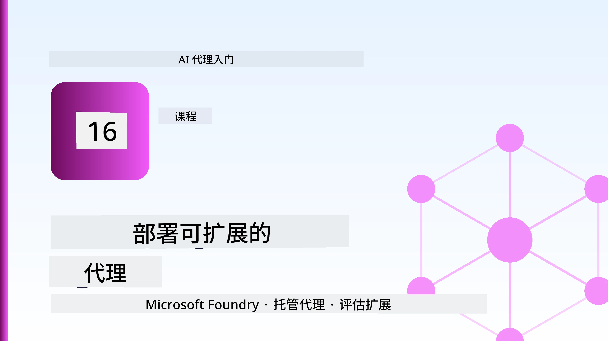
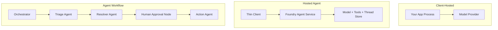
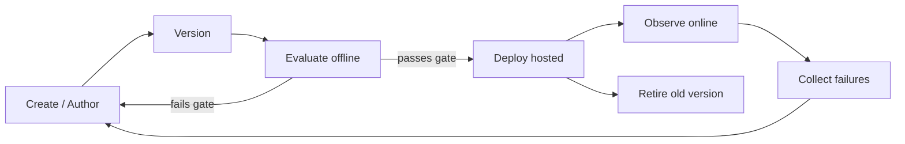
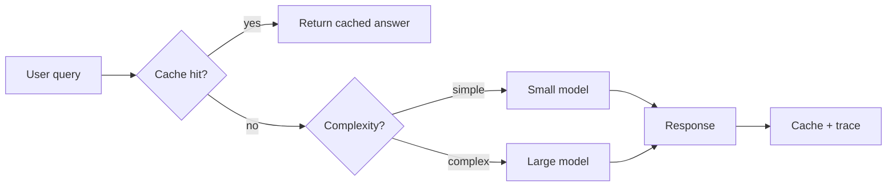
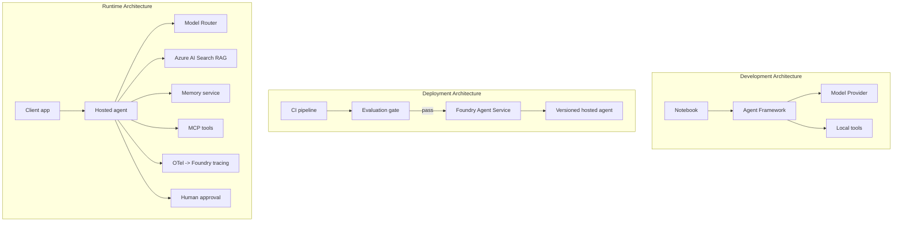

# 使用 Microsoft Foundry 部署可扩展代理



到目前为止，您已经构建了在笔记本中运行、由 `az login` 和少量环境变量驱动的笔记本电脑上的代理。这正是学习的正确方式。但是，这并不是数千客户凌晨 3 点依赖的代理的正确运行方式。

本课主题是 "在我机器上能运行" 和 "在生产环境中可靠且经济地运行" 之间的差距。我们通过使用 **Microsoft Foundry** 和 **Microsoft Foundry 代理服务** 来弥合这一差距，并通过构建一个真实的客户支持代理实现多种工具、检索、记忆、评估和监控功能。

## 简介

本课将涵盖：

- <strong>原型代理</strong> 与 <strong>部署代理</strong> 的区别，以及为何过渡主要是关于模型周围的所有部分。
- 代理的 <strong>部署模式</strong>：客户端托管、服务托管（托管代理）及工作流编排。
- Microsoft Foundry 上的 <strong>代理生命周期</strong> — 创建、版本、部署、评估、观察、退役。
- <strong>扩展策略</strong>：模型路由、缓存、并发和无状态设计。
- 使用 OpenTelemetry 和 Foundry 跟踪的 <strong>可观察性</strong>。
- 通过模型选择、路由和评估门实现的 <strong>成本优化</strong>。
- <strong>企业考量</strong>：治理、人类审批，以及安全运行 MCP 服务器于生产环境。

## 学习目标

完成本课后，您将学会：

- 针对特定代理工作负载选择正确的部署模式。
- 将代理部署到 Microsoft Foundry Agent 服务，使其具备版本控制、治理和可观察性。
- 为代理添加追踪并配置评估管道，在每次发布前执行。
- 应用模型路由和缓存以控制大规模下的延迟和成本。
- 为高风险操作添加人工审批门并以生产安全方式集成 MCP 服务器。

## 先决条件

本课假设您已经完成之前的课程，并熟悉：

- 使用 [Microsoft Agent Framework](../14-microsoft-agent-framework/README.md) 构建代理（第 14 课）。
- [工具使用](../04-tool-use/README.md)（第 4 课）与 [Agentic RAG](../05-agentic-rag/README.md)（第 5 课）。
- [代理记忆](../13-agent-memory/README.md)（第 13 课）和 [Agentic 协议 / MCP](../11-agentic-protocols/README.md)（第 11 课）。
- [可观察性与评估](../10-ai-agents-production/README.md)（第 10 课）— 本课直接建立在其基础上。

您还需要：

- <strong>Azure 订阅</strong>和至少部署了一个聊天模型的 **Microsoft Foundry 项目**。
- 已认证的 **Azure CLI** (`az login`)。
- Python 3.12+ 及仓库中的包 [`requirements.txt`](../../../requirements.txt)。

## 从原型到生产：实际改变了什么

原型代理和生产代理共享相同的核心循环 —— 推理、调用工具、响应。变化的是包裹着这个循环的所有内容。模型可能只占生产代理的 20%，其余 80% 是操作骨架。

| 关注点 | 原型 | 生产 |
| --- | --- | --- |
| <strong>托管方式</strong> | 在您的笔记本中运行 | 作为托管服务运行，带版本控制与发布 |
| <strong>身份</strong> | 您的 `az login` 令牌 | 具有限定范围 RBAC 的托管身份 |
| <strong>状态</strong> | 内存中，重启丢失 | 外部存储（线程存储，记忆服务） |
| <strong>失败处理</strong> | 您看到回溯信息 | 重试、回退、死信、告警 |
| <strong>成本</strong> | “几分钱” | 按请求跟踪，路由，缓存，预算控制 |
| <strong>质量</strong> | 您人工检查输出 | 自动化评估每次发布前 |
| <strong>信任</strong> | 您批准每个操作 | 针对高风险操作的策略和人类审查 |

请记住此表，下面每个章节对应其中一行。

## 代理部署模式

有三种模式常常组合使用。

### 1. 客户端托管代理

代理对象存在于<em>您的</em>应用进程中。代码直接调用模型提供者；推理循环在您的服务中运行。这是之前所有课程所做的方式。

- <strong>适用场景</strong> 需要完全控制循环、自定义中间件，或将代理嵌入现有后端时。
- <strong>权衡</strong>：您需要自行负责扩展、状态和弹性。

### 2. 托管代理（Foundry Agent 服务）

代理作为 Microsoft Foundry 中的<em>资源注册</em>。Foundry 托管推理循环，存储线程，强制内容安全和 RBAC，并使代理在 Foundry 门户中可见。您的应用成为一个创建线程、读取响应的轻客户端。

- <strong>适用场景</strong> 需要持久性、内建可观察性、治理和更少运维关注时。
- <strong>权衡</strong>：以受管理运行时换取更少的底层控制。

### 3. 代理工作流

多个代理（及工具）组合成带显式控制流的图——顺序步骤、分支、人工审批节点和可暂停恢复的持久检查点。这是 Microsoft Agent Framework **Workflows** 功能在部署规模上的应用。

- <strong>适用场景</strong> 单个任务跨多个专用代理或需要中间审批步骤时。
- <strong>权衡</strong>：更多移动部件，需要编排级别的可观察性。



## Microsoft Foundry 上的代理生命周期

部署代理不是一次性 `push`，而是一个循环，其非常类似软件发布周期，因为它本质上就是这样。



关键理念，继承自 [第 10 课](../10-ai-agents-production/README.md)：**离线评估是门槛，不是事后考虑。** 新代理版本只有通过评估门槛才发布。在线可观察性随后将真实世界失败反馈到离线测试集中。这就是整个循环。

## 扩展策略

扩展代理不同于扩展无状态 Web API，因为每个请求可能触发多次昂贵的模型与工具调用。有四种技术承担主要负载。

**无状态请求处理。** 保持进程内不存储每用户状态。会话线程持久化至 Foundry 线程存储或记忆服务，这样任何实例都能处理任何请求。这是水平扩展的关键——增加实例，无需粘性会话。

**模型路由。** 不是每个请求都需要您最强大（且最昂贵）的模型。把简单请求——意图分类、简短事实回答——路由给小型、快速模型，专门推理留给大型模型。Foundry 的 <strong>模型路由器</strong> 可自动实现，或者您可自行实现轻量级分类器。您将在实验中构建 DIY 版本。

**响应缓存。** 许多支持查询高度相似（“如何重置密码？”）。缓存常见问题答案，直接返回无需调用模型。即便是适度的缓存命中率也能显著降低成本和延迟。

**并发与背压。** 模型提供商有速率限制。限制并发数，使用指数回退重试，优雅失败（排队的“我们正在处理”响应比 500 错误好）。



## 生产中的可观察性

看不到便无法运营。如第10课讲述，Microsoft Agent Framework 天生支持 **OpenTelemetry** 跟踪 —— 每一次模型调用、工具调用和编排步骤都是一个跨度。生产中您将这些跨度导出到 Microsoft Foundry（或任意 OTel 兼容后端），从而：

- 跟踪单个客户投诉跨所有模型和工具调用的全过程。
- 观察各请求的 p50/p95 延迟和成本趋势。
- 在用户（或财务团队）察觉之前警报错误率峰值和成本异常。

```python
from agent_framework.observability import get_tracer

tracer = get_tracer()

with tracer.start_as_current_span("support_request") as span:
    span.set_attribute("customer.tier", "enterprise")
    span.set_attribute("routed.model", "gpt-5-nano")
    # agent execution is traced automatically inside this span
```

属性如 `customer.tier` 和 `routed.model` 是将一堆跟踪变成可回答问题的关键（“企业客户是否频繁被路由到小模型？”）。

## 成本优化

生产代理的主要成本来自令牌。有三个杠杆，按影响力排序：

1. **合理选型模型。** 通过评估门的精简模型几乎总比通过门的庞大模型便宜。用评估证明小模型够用，而非默认最大模型以保守。
2. **依据复杂度路由。** 如上——仅为复杂推理请求付出大模型成本。
3. **积极缓存。** 最便宜的模型调用是根本不调用。

评估门和成本控制是同一学科的两面：评估确定<em>质量底线</em>，路由和缓存保持成本尽可能接近该底线。

## 企业部署注意事项

**治理。** 托管代理继承 Foundry 的 RBAC、内容安全和审计日志。为每代理分配所需最小权限的托管身份——仅知识库的只读权限，票务 API 的限定权限，仅此而已。

**人类在环。** 有些操作影响重大，不能全自动——如退款、删除账户、升级法律团队。Microsoft Agent Framework 支持 <strong>审批必需</strong> 工具：代理提出操作，执行暂停，人类审批或拒绝，工作流恢复。您在 [第 6 课](../06-building-trustworthy-agents/README.md) 见过原语；此处是真正部署。

**生产中的 MCP。** [MCP](../11-agentic-protocols/README.md) 让代理通过标准接口消费外部工具。生产环境中，视每个 MCP 服务器为不可信边界：固定服务器版本，用限定身份运行，验证输出，绝不暴露秘密。MCP 服务器依赖管理包含打补丁、审计及限流。



以上三个图——开发、部署、运行时——是同一代理生命的不同阶段。后续实验带您实际构建。

## 实战实验：生产级客户支持代理

打开 [`code_samples/16-python-agent-framework.ipynb`](./code_samples/16-python-agent-framework.ipynb) 并完整完成。您将组装一个注重生产各方面的 **Contoso 客户支持代理**：

1. <strong>工具调用</strong> — 查询订单状态并打开支持工单。
2. **RAG** — 从知识库（Azure AI Search，带内存回退以支持无 Search 资源环境下运行）回答政策问题。
3. <strong>记忆</strong> — 贯穿对话轮次记住客户。
4. <strong>模型路由</strong> — 复杂度分类器决定请求用大模型或小模型。
5. <strong>响应缓存</strong> — 重复问题使用缓存回答。
6. <strong>人工审批</strong> — 超阈值退款等待人工确认。
7. <strong>评估管道</strong> — 小型离线测试集为代理打分并作为发布门槛。
8. <strong>可观察性</strong> — 每个请求的 OpenTelemetry 跟踪。

### 导览

笔记本组织为每个生产关注点为一个完整可执行部分。核心是路由加缓存请求处理器：

```python
async def handle_support_request(query: str, customer_id: str) -> str:
    # 1. Serve from cache when we can.
    cached = response_cache.get(normalize(query))
    if cached:
        return cached

    # 2. Route by complexity to control cost.
    model = "gpt-5-nano" if is_simple(query) else "gpt-5-mini"

    # 3. Run the agent inside a trace span for observability.
    with tracer.start_as_current_span("support_request") as span:
        span.set_attribute("routed.model", model)
        span.set_attribute("customer.id", customer_id)
        response = await support_agent.run(query, model=model)

    # 4. Cache and return.
    response_cache.set(normalize(query), response.text)
    return response.text
```

护航发布的评估门示例如下：

```python
async def evaluation_gate(agent, test_cases, threshold: float = 0.8) -> bool:
    passed = 0
    for case in test_cases:
        result = await agent.run(case["input"])
        if score_response(result.text, case["expected"]) >= 0.8:
            passed += 1
    pass_rate = passed / len(test_cases)
    print(f"Evaluation pass rate: {pass_rate:.0%} (gate: {threshold:.0%})")
    return pass_rate >= threshold  # only deploy if the gate passes
```

仔细读每行——笔记本将原语设计得非常简洁，没有框架隐藏逻辑。

## 使用冒烟测试验证已部署代理

上述评估门在线下对代理对象运行。代理作为托管代理部署后，您还需要一个更简单的检查：**部署的端点是否真能响应？**

“成功部署”仅证明控制平面接受定义——不保证代理响应。缺失依赖、错误模型路由或过期连接能导致看似成功的部署却不返回结果。<strong>冒烟测试</strong>能在几秒内捕获此类问题，于每次部署自动运行，成本远低于完整评估。

本仓库提供基于 [AI Smoke Test](https://github.com/marketplace/actions/ai-smoke-test) GitHub Action 的即用型冒烟测试管道：

- <strong>目录</strong> — [`tests/lesson-16-smoke-tests.json`](../../../tests/lesson-16-smoke-tests.json) 含 Contoso 支持代理的提示和断言（有据政策答案、订单查询、主题相关、多轮连续性）。其他课程代理目录与之并存——参见 [`tests/README.md`](../tests/README.md)。
- <strong>工作流</strong> — [`.github/workflows/smoke-test.yml`](../../../.github/workflows/smoke-test.yml) 用 Azure OIDC 登录，并将每条提示 POST 到代理的 Responses 端点，任一断言失败则任务失败。

```yaml
- name: Smoke-test hosted agent
  uses: JFolberth/ai-smoketest@v1
  with:
    project_endpoint: ${{ inputs.project_endpoint }}
    agent_name: ContosoSupportAgent
    tests_file: tests/lesson-16-smoke-tests.json
```

在代理部署后，从 **Actions** 选项卡运行它，提供您的 Foundry 项目端点和代理名称。联合身份在 Foundry 项目范围内需要具有 **Azure AI 用户** 角色。把这些层级想象成金字塔：冒烟测试（可达且响应？）在每次部署时运行，离线评估（是否足够好以供发布？）在晋升前运行，在线评估（实际运行表现如何？）持续进行。

## 知识检测

在进入作业前测试你的理解。

**1. 生产代理中“大约多少比例是模型”，其余部分是什么？**

<details>
<summary>答案</summary>

模型只是系统中的少数部分——通常引用为约20%。其余部分是操作骨架：托管和版本控制、身份和 RBAC、外部状态、故障处理、成本跟踪、评估和人工环节控制。上线生产主要是围绕推理循环构建所有内容。
</details>

**2. 何时选择托管代理而非客户端托管代理？**

<details>
<summary>答案</summary>

当你想要一个具备内置持久性（能够持久化和恢复线程）、可观测性、内容安全性和 RBAC 的托管运行时，并且愿意为减少运维复杂度而放弃部分低级推理循环控制时。需要完全控制推理循环或将代理嵌入现有后端时，客户端托管更优。
</details>

**3. 为什么可扩展代理必须在其自身进程内存中保持无状态？**

<details>
<summary>答案</summary>

这样任何实例都可以处理任何请求，这允许无粘性会话的横向扩展。每用户的对话状态被外部化到线程存储或内存服务中。如果状态保存在进程内存中，重启时就会丢失，并且无法自由分配负载。
</details>

**4. 模型路由解决什么问题，并且它与评估有什么关系？**

<details>
<summary>答案</summary>

路由将简单请求发送给小型、廉价且快速的模型，而将大型模型保留给真正的推理，从而控制延迟和成本。它与评估相关，因为评估证明小模型对于一类请求已经足够好——没有评估的路由是在猜测。
</details>

**5. 什么是“评估闸门”，它在生命周期中处于什么位置？**

<details>
<summary>答案</summary>

评估闸门在新代理版本上执行离线测试集，除非通过率超过阈值，否则阻止部署。它位于生命周期中“版本”和“部署”之间，使质量成为发布的前提，而不是发布后才检查的内容。
</details>

**6. 为什么 MCP 服务器在生产环境中应被视为不可信边界？**

<details>
<summary>答案</summary>

因为它是代理调用的外部依赖。你应该固定其版本，使用带范围的身份运行，验证其输出，限制速率，并且绝不向它暴露密钥——这与对待任何第三方依赖的原则相同。其输出流入代理的推理流程，因此未经验证的信任是安全风险。
</details>

**7. 通常对生产代理成本影响最大的单个改动是什么，为什么？**

<details>
<summary>答案</summary>

合理选型模型——使用通过评估闸门的最小模型。成本主要由令牌决定，满足质量标准的小模型几乎总比大模型便宜。缓存和路由可以进一步降低成本，但选择合适的基础模型是最大的第一阶影响。
</details>

**8. 像 `customer.tier` 和 `routed.model` 这样的 span 属性在可观测性中扮演什么角色？**

<details>
<summary>答案</summary>

它们把原始跟踪转换为可回答的业务问题。没有属性时只有一堆 span；有了它们，你可以问“企业客户是否过于频繁地被路由到小模型？”或“哪个模型处理了我们最慢的请求？”属性是按对运营重要的维度对遥测数据切片的方式。
</details>

## 作业

以实验中的客户支持代理为基础，加固它以满足特定场景：**某 SaaS 公司的订阅计费支持代理。**

你的提交应该包括：

1. <strong>替换工具</strong>，改用与计费相关的工具：`get_subscription_status`、`get_invoice` 和 `issue_credit`（50 美元以上的积分需人批准）。
2. **添加三份 RAG 文档**，涵盖公司的退款政策、计费周期和取消政策。
3. <strong>扩展评估集</strong>至至少八个案例，其中至少两个<em>应当</em>触发人工审批路径，并确认评估闸门能正确通过或阻止。
4. <strong>添加一个成本报告</strong>：通过代理运行十个混合查询后，打印有多少请求转到了小模型，多少请求转到了大模型，以及多少请求由缓存服务。

用一个简短段落（markdown 单元格中）说明你选择了哪条模型路由规则，以及如何用实际流量验证它。没有唯一正确答案——评估重点是生产相关问题是否合理衔接。

## 总结

本课你用 Microsoft Foundry 将代理从原型推向生产：

- 上线生产主要是构建模型周围的<strong>操作骨架</strong>——托管、身份、状态、故障处理、成本、质量和信任。
- 学会了三种<strong>部署模式</strong>——客户端托管、托管代理和代理工作流——以及各自适用场景。
- 理解了<strong>代理生命周期</strong>，离线<strong>评估作为发布闸门</strong>，在线可观测性将故障反馈到测试集。
- 应用了<strong>扩展策略</strong>——无状态设计、模型路由、缓存和有限并发——并联系到<strong>成本优化</strong>。
- 接入了<strong>企业管控</strong>：RBAC、人工环节审批和生产安全的 MCP 集成。
- 构建了一个<strong>生产就绪的客户支持代理</strong>，把这些所有关注点统一到可运行代码中。

下一课走相反路线：不是将代理扩展到云端，而是将它们<em>缩小</em>到单个开发者机器并完全本地运行。

## 相关资源

- <a href="https://learn.microsoft.com/azure/ai-foundry/what-is-azure-ai-foundry" target="_blank">Microsoft Foundry 文档</a>
- <a href="https://learn.microsoft.com/azure/ai-foundry/agents/overview" target="_blank">Microsoft Foundry 代理服务概览</a>
- <a href="https://learn.microsoft.com/en-us/agent-framework/overview/?wt.mc_id=youtube_26688_organicsocial_reactor&pivots=programming-language-python" target="_blank">Microsoft Agent Framework</a>
- <a href="https://learn.microsoft.com/en-us/azure/ai-foundry/openai/concepts/model-router" target="_blank">Microsoft Foundry 中的模型路由器</a>
- <a href="https://learn.microsoft.com/azure/search/search-what-is-azure-search" target="_blank">Azure AI 搜索</a>
- <a href="https://opentelemetry.io/" target="_blank">OpenTelemetry</a>
- <a href="https://github.com/marketplace/actions/ai-smoke-test" target="_blank">AI 冒烟测试 GitHub Action</a>
- <a href="https://modelcontextprotocol.io/" target="_blank">模型上下文协议 (MCP)</a>

## 前一课

[构建计算机使用代理 (CUA)](../15-browser-use/README.md)

## 下一课

[创建本地 AI 代理](../17-creating-local-ai-agents/README.md)

---

<!-- CO-OP TRANSLATOR DISCLAIMER START -->
**免责声明**：
本文件由 AI 翻译服务 [Co-op Translator](https://github.com/Azure/co-op-translator) 翻译完成。尽管我们力求准确，但请注意，自动翻译可能包含错误或不准确之处。原始语言版文件应视为权威来源。对于重要信息，建议使用专业人工翻译。我们对因使用本翻译而产生的任何误解或误释不承担责任。
<!-- CO-OP TRANSLATOR DISCLAIMER END -->