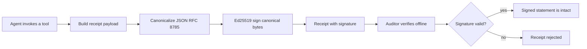
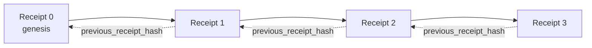

[观看课程视频：使用加密收据保护 AI 代理](https://youtu.be/PLACEHOLDER_VIDEO_ID)

> _(课程视频和缩略图将在合并后由微软内容团队添加，遵循第14 / 15课的模式。)_

# 使用加密收据保护 AI 代理

## 简介

本课将涵盖：

- 为什么 AI 代理的审计轨迹对于合规、调试和信任至关重要。
- 什么是加密收据，以及它与未签名日志行的区别。
- 如何在纯 Python 中为代理的工具调用生成签名收据。
- 如何离线验证收据并检测篡改。
- 如何将收据串联起来，使删除或重新排序其中一个就会破坏链条。
- 收据能证明什么，明确不证明什么。

## 学习目标

完成本课后，您将了解如何：

- 识别促使为代理行为提供加密溯源的失败模式。
- 对规范化 JSON 负载生成 Ed25519 签名收据。
- 使用签名者的公钥独立验证收据。
- 通过重新运行验证检测篡改的收据。
- 构建一个基于哈希串联的收据序列，并解释该链的重要性。
- 认识收据能证明的边界（归属、完整性、排序）和不能证明的内容（行为的正确性、政策的合理性）。

## 问题：代理的审计轨迹

假设您已为 Contoso Travel 部署了一个 AI 代理。该代理读取客户请求，调用航班 API 查找选项，并代表客户预订座位。上个季度，该代理处理了5万个预订。

今天一位审计员来了。他们提出一个简单的问题：“告诉我代理做了什么。”

您交出日志文件。审计员查看后提出更难的问题：“我怎么知道这些日志没有被篡改？”

这就是审计轨迹的问题。当前大多数代理部署依赖于：

- <strong>应用日志</strong>：由代理自身写入，任何有文件系统访问权限的人都可编辑。
- <strong>云日志服务</strong>：在平台层面上可检测篡改，但前提是审计员信任该平台运营方。
- <strong>数据库事务日志</strong>：适合数据库变更，但不适合任意工具调用。

这些都无法在不要求审计员信任某人的情况下回答问题（您、您的云服务提供商或数据库供应商）。对于内部使用，这种信任通常可以接受。对于受监管的工作负载（金融、医疗、受欧盟AI法案约束的任何内容），则不行。

加密收据通过使签名声明能够独立地
可验证。审计员仍然需要一个带外的理由来信任签名密钥和
生成该声明的组件。嵌入式密钥证明自洽性，
而不是发行者身份或强制执行的位置。

## 什么是加密收据？

收据是一个JSON对象，记录代理所做的事情，并带有数字签名。



一个最简收据如下：

```json
{
  "type": "agent.tool_call.v1",
  "agent_id": "contoso-travel-bot",
  "tool_name": "lookup_flights",
  "tool_args_hash": "sha256:a3f9c1...",
  "result_hash": "sha256:7b2e1d...",
  "policy_id": "contoso-travel-policy-v3",
  "timestamp": "2026-04-25T14:30:00Z",
  "sequence": 47,
  "previous_receipt_hash": "sha256:9d4e6a...",
  "signature": {
    "alg": "EdDSA",
    "sig": "c5af83...",
    "public_key": "8f3b2c..."
  }
}
```

三个属性起作用：

1. <strong>签名</strong>。收据由代理的网关使用 Ed25519 私钥签名。任何拥有相应公钥的人都可以离线验证该签名。依赖方必须固定该密钥或从收据外的受信任注册表解析它。篡改任何已签名字段都会使签名失效。

2. <strong>规范编码</strong>。签名前，收据使用 JSON 规范化方案（JCS，RFC 8785）序列化。这确保两个实现只要逻辑收据相同，生成的字节输出就完全相同。没有规范化，不同的 JSON 序列化器会为相同内容生成不同签名。

3. <strong>哈希链</strong>. `previous_receipt_hash` 字段将每个收据与其前一个收据链接起来. 删除或重新排序某个收据会破坏所呈现的序列. 检测截断或签名者控制的重写还需要一个固定的当前链头, 独立见证的检查点, 或经过认证的封闭群体承诺.

这些属性共同提供三个保证：

- <strong>对密钥的归属</strong>: 该密钥签署了此内容。组织或个人身份需要可信的密钥绑定。
- <strong>完整性</strong>：自签名后内容未改变。
- <strong>已验证序列中的顺序</strong>：该收据链接到其前驱。

## 在 Python 中生成收据

生成收据不需要特殊库。加密原语广泛可用，逻辑只需几十行 Python 代码。

在 `code_samples/18-signed-receipts.ipynb` 中的动手练习演示了整个流程。受版本控制的 `code_samples/18-signed-receipts.execution-receipt.json` 记录了最新一次干净执行的确切笔记本哈希、Python 环境、单元格数量和检查结果，并且不会更改课程已保存的输出。总结版本：

```python
import json
import hashlib
import base64
from nacl import signing
from jcs import canonicalize  # RFC 8785 canonical JSON

def b64url_nopad(data: bytes) -> str:
    return base64.urlsafe_b64encode(data).decode("ascii").rstrip("=")

def sha256_canonical(obj) -> str:
    """SHA-256 of a Python object's JCS-canonical JSON form."""
    return f"sha256:{hashlib.sha256(canonicalize(obj)).hexdigest()}"

# Generate or load a signing key (in production, store in a key vault)
signing_key = signing.SigningKey.generate()
verify_key = signing_key.verify_key
TRUSTED_PUBLIC_KEYS = {b64url_nopad(bytes(verify_key))}  # pinned out of band by the verifier

# Build the receipt payload (no signature yet)
tool_args = {"origin": "SYD", "destination": "LAX"}
tool_result = [{"flight": "QF11", "price": 1850, "stops": 0}]

payload = {
    "type": "agent.tool_call.v1",
    "agent_id": "contoso-travel-bot",
    "tool_name": "lookup_flights",
    "tool_args_hash": sha256_canonical(tool_args),
    "result_hash": sha256_canonical(tool_result),
    "policy_id": "contoso-travel-policy-v3",
    "timestamp": "2026-04-25T14:30:00Z",
    "sequence": 0,
    "previous_receipt_hash": None,
}

# Canonicalize and sign the JCS bytes directly. PureEdDSA hashes internally.
canonical_bytes = canonicalize(payload)
signature_bytes = signing_key.sign(canonical_bytes).signature

# Attach a structured signature object.
receipt = {
    **payload,
    "signature": {
        "alg": "EdDSA",
        "sig": b64url_nopad(signature_bytes),
        "public_key": b64url_nopad(bytes(verify_key)),
    },
}
```

这就是整个签名流程。笔记本中的练习详细讲解每个步骤。

## 验证收据和检测篡改

验证是逆向操作：

```python
import base64
import hashlib
from nacl import signing
from nacl.exceptions import CryptoError
from jcs import canonicalize

def b64url_decode(s: str) -> bytes:
    padding = "=" * ((4 - len(s) % 4) % 4)
    return base64.b64decode(s + padding, altchars=b"-_", validate=True)

def verify_receipt(receipt: dict, trusted_public_keys: set[str]) -> bool:
    # The signature is a structured object: {"alg", "sig", "public_key"}.
    if not isinstance(receipt, dict):
        return False
    sig_obj = receipt.get("signature")
    if not isinstance(sig_obj, dict) or sig_obj.get("alg") != "EdDSA":
        return False
    try:
        # An inline key proves only self-consistency. Trust is configured out of band.
        public_key = sig_obj.get("public_key")
        signature = sig_obj.get("sig")
        if not isinstance(public_key, str) or not isinstance(signature, str):
            return False
        if public_key not in trusted_public_keys:
            return False
        payload = {k: v for k, v in receipt.items() if k != "signature"}
        canonical_bytes = canonicalize(payload)
        verify_key = signing.VerifyKey(b64url_decode(public_key))
        verify_key.verify(canonical_bytes, b64url_decode(signature))
        return True
    except (CryptoError, TypeError, ValueError, KeyError, OverflowError):
        return False
```

该函数接收一个收据以及依赖方已固定的密钥集并返回
`True` 仅当签名在被接受的密钥下有效时才返回。验证不需要
网络调用，但密钥信任仍然是一个外部配置决定。

为了展示篡改检测，笔记本演示了：

1. 生成有效收据并确认验证通过。
2. 修改`tool_args_hash`字段的一个字节。
3. 重新验证并看到验证失败。

这是收据防篡改的实际证明：任何修改，无论多小，都破坏签名。

## 为多步骤代理串联收据

单个签名收据保护一次行动。收据链保护一系列行动。



每个收据记录前一个收据的哈希。要悄无声息地删除收据2，攻击者需要：

- 修改收据3的`previous_receipt_hash`字段（破坏收据3的签名），或者
- 伪造收据3的修改版本的新签名（需代理私钥）。

如果私钥受到保护并且验证者固定了一个独立见证的链
头，这些攻击是可检测的。在每个收据中发布该密钥并不
足够：签名者或攻击者可以出示不同的密钥、改写一个后缀，或
截断该链，除非依赖方具有外部信任与完整性锚点。

笔记本演示了：

1. 构建包含三条收据的链。
2. 验证每个收据的`previous_receipt_hash`是否匹配前一个收据的实际哈希。
3. 在中间篡改一个收据，看到链在那个点断开。

这是你生成审计轨迹的方式，外部审计员可以在其
自己固定的颁发者密钥和链检查点下验证，而无需信任你可变的日志存储。

## 收据能证明什么（和不能证明什么）

这是本课最重要的部分。收据功能强大，但其能力有限。

**收据可以证明三件事：**

1. <strong>归属</strong>：某个特定密钥签署了特定负载。
2. <strong>完整性</strong>：自签署后负载未被更改。
3. <strong>已呈现且已验证的序列中的排序</strong>：此收据链接到该前一项。

**收据不能证明：**

1. <strong>正确性</strong>：代理行为是否正确。一条收据可以为错误答案签署，跟正确答案同样干净。
2. <strong>政策合规</strong>：`policy_id`引用的政策是否真的评估过，或者如果检查过会否批准此行为。收据记录的是所声称的内容，而非执行的强制内容。
3. <strong>超越密钥的身份</strong>：收据表示“此密钥签署了此内容”，不表示“某人类授权了此操作”。将密钥与个人或组织联系需单独的身份基础设施（目录、公钥注册等）。
4. <strong>输入的真实性</strong>：如果代理接收到篡改过的提示并以此动作，收据忠实记录该行为。收据是输入验证的下游，而非替代。
5. <strong>执行或现实世界的效果</strong>：事后签发的收据记录了其发行者所声称发生的事情。证明承认或调和外部效果需要来自实际执行者或提供者边界的证据。
6. <strong>完整性</strong>：缺失的收据可能意味着被阻止、被省略、丢失，或未被记录。只有在经过认证的封闭群体内，缺席才会成为证据。
7. <strong>可信时间</strong>：带签名的时间戳证明签名者持有该值，但并不证明该值是正确的。可信时间需要独立的时间权威或见证的检查点。

这个边界重要原因有二：

- 它告诉你收据的实际用途：使代理行为可审计且可检测篡改，即使跨组织边界也是如此。
- 它告诉你还需要哪些额外层次：输入验证（第6课）、政策执行（本课后略述）、身份基础设施（本课未涵盖）。

常见误区是认为“有收据”即意味着“已治理”。并非如此。收据是基础，治理是你在此基础上构建的系统。

## 将审批人的签名绑定到特定操作

上文的第 3 条值得单独作为一节：操作收据说明 "此密钥对该内容进行了签名," 而不是 "某个人授权了此操作." 对于高风险操作 (退款、删除、银行电汇)，单独的审批人签名可以绑定确切的操作。将该密钥与某个人关联并检查该人的在场性仍然是独立的责任。

后续的笔记本 `code_samples/human-authorization-receipts.ipynb` 添加了第二种收据类型，`human.approval.v1`，采用与课程的收据相同的信封形状。 该信封包含一个类型化的有效载荷，该有效载荷使用 Ed25519 对其规范化的 JCS 字节进行签名，`signature` 对象位于签名字节之外。 批准者密钥对 <strong>完整的规范化操作及其摘要</strong> 进行签名；代理者密钥对一个声明进行签名，该声明携带 <strong>相同的操作摘要</strong> 以及一个 `parent_approval_ref`，即批准的 `receipt_hash`，采用与您在上面构建的链中 `previous_receipt_hash` 相同的约定。 一个 `verify_chain` 在 <strong>各自的已固定密钥注册表</strong> 下遍历两个工件。 批准者密钥和代理密钥保持分离，因此代码路径是共享的，但授权方永远不会共享。

这一性质带来的保证，谨慎表述为：*固定的批准者密钥签署了这个确切的
操作，且代理密钥随后签署了一份携带相同操作摘要的声明。*
这是有用的证据，但它本身并不能证明该操作已被执行。要
控制执行，确切的批准还必须在
实际执行者边界上被保留并消费一次；未知的提供者结果必须保持未知，而不是被
盲目重试。笔记本的拒绝夹具测试收据链层：

- 篡改、困惑代理、双方伪造的密钥，以及格式错误的输入；
- <strong>陈旧的授权</strong>：一个仍然可验证的签名，但仍被拒绝，因为策略版本已变更、批准者的密钥已从固定的注册表中轮换出去，或者在提供的验证时间之前审批已过期；
- <strong>摘要替代</strong>：有效签名的行动收据指向绑定不同规范动作的<em>真实</em>审批。

每次失败都会以不同的理由拒绝，因此审计员在阅读拒绝时可以判断是授权已失效还是所声称的操作发生了变化。验证是只读且可重复的：它不会消耗批准或调用提供者。单独的执行者需要持久的、原子性的重放保护以及明确的成功、失败和不确定的结果。人类批准收据是本课程定义的一种教学性组合，而不是 `draft-farley-acta-signed-receipts` 定义的收据类型。

## 生产参考

本课中的 Python 代码故意写得极简，方便你逐行阅读并完全理解。生产环境中，你有两个选择：

1. **直接基于加密原语构建。** 你刚才看到的50行代码已适用于许多场景。PyNaCl（Ed25519）和`jcs`包（规范化 JSON）是维护良好且已审计的库。

2. **使用生产用收据库。** 若干开源项目实现了相同模式并加添附加功能（密钥轮换、批量验证、JWK 集分发、与策略引擎整合）：
   - 签名流程采用了独立 IETF 互联网草案（[`draft-farley-acta-signed-receipts`](https://datatracker.ietf.org/doc/draft-farley-acta-signed-receipts/)，修订02）中的 JCS 与签名作用域约定。本课的扁平教学收据与该草案的 `{payload, signature}` 包封格式不同，不应视为其合规实现。该草案发布了共享合规套件（[agent-governance-testvectors](https://github.com/ScopeBlind/agent-governance-testvectors)），供以其线格式为目标的实现使用。
   - 微软代理治理工具包将收据与基于 Cedar 的策略决策组合；详见该仓库教程33，涵盖端到端示例。
   - `protect-mcp` （npm）和 `@veritasacta/verify` （npm）包提供了基于 Node 的收据签名及离线验证实现，可包装任何 MCP 服务器生成防篡改审计链，包括支持的共签流程——暂停操作发出绑定操作摘要的批准收据（桌面流程中基于 WebAuthn），与上述人类授权笔记本采用的批准收据方案相同。
   - **[nobulex](https://github.com/arian-gogani/nobulex)** Python SDK（`pip install nobulex`）在 Python 中实现相同的 Ed25519 + JCS 签名模式，集成了 LangChain 和 CrewAI，包含发布的交叉验证测试向量，并通过 [OWASP PR #2210](https://github.com/OWASP/CheatSheetSeries/pull/2210) 提供合规映射。
- **[EMILIA 协议](https://github.com/emiliaprotocol/emilia-protocol)** 提供了一个互补的精确动作强制层：离线可验证的批准收据、绑定的 WebAuthn 或法定人数（quorum）授权、在执行器边界的一次性消费，以及一个明确的不确定结果路径。其框架适配器将收据视为必要的证据，而不是外部效果已发生的证明。

选择自写还是用库，与选择自写 JWT 库或用测试库类似：两者合理；库节省时间，减少审计面；自写需理解每个原语。本课教授自写路径，奠定任一选择的基础。

## 知识检测

在进入练习之前测试理解。

**1. 收据用代理的 Ed25519 私钥签署。审计员只有公钥，能否离线验证收据？**

<details>
<summary>答案</summary>

是的，密码学验证仅需要公钥和被签名的字节。该
审计员仍然必须独立于收据获取并绑定被接受的公钥。
在建立该信任配置后，不需要进行任何网络调用。
</details>

**2. 攻击者修改收据的`policy_id`字段，声称它受更宽松政策管辖。签名覆盖的是原始负载。验证时会怎样？**

<details>
<summary>答案</summary>

验证失败。签名是针对原始负载的规范字节计算的；修改任何字段都会改变这些字节，使签名无效。攻击者需要私钥才能生成新的有效签名，而他们没有私钥。
</details>

**3. 为什么收据包含 `tool_args_hash` 和 `result_hash`，而不是原始参数和结果？**

<details>
<summary>答案</summary>

有两个原因。首先，收据可能需要在泄露原始内容（个人身份信息，业务数据）存在问题的环境中进行存档或传输。哈希保持收据小且内容私密；审计员验证哈希是否与单独存储的实际内容相匹配。其次，哈希具有固定大小；包含哈希的收据大小是有界的，无论输入和输出多大。
</details>

**4. `previous_receipt_hash` 字段将每个收据与其前驱链接。如果攻击者悄悄删除链中间的一个收据，会导致什么无效？**

<details>
<summary>答案</summary>

下一个呈现的收据不再链接到其预期的前一个，因此对该序列的验证
会从缺口处开始失败。如果签名者控制私钥，
它可以重写或截断一个后缀。检测到这一点需要一个固定的当前头，
外部检查点，或经认证的整体承诺。
</details>

**5. 收据验证通过。这能证明代理的行为是正确、合理或符合政策吗？**

<details>
<summary>答案</summary>

不. 在固定密钥和链上下文下, 有效的收据证明签名归属,
内容完整性, 以及与所呈示的前置记录的链接. 它并不证明该
操作是正确或已执行的, 策略已被评估, 时间戳是
可信的, 或记录集是完整的. 这是本课中最重要的界限.
</details>

## 练习题

打开 `code_samples/18-signed-receipts.ipynb` 并完成所有四个部分：

1. **第1部分**：签署你的第一个收据并验证它。
2. **第2部分**：篡改收据并观察验证失败。
3. **第3部分**：构建一个三个收据的链并验证链的完整性。
4. **第4部分**：将该模式应用于使用 Microsoft Agent Framework 构建的代理：在工具调用中加入收据签名，然后独立验证收据。

**扩展挑战1：** 扩展收据模式，新增你选择的字段（例如，用于追踪的请求 ID），更新规范签名逻辑以包含该字段，并确认收据仍可通过验证。然后在签名后修改该字段，确认验证失败。此练习迫使你理解规范编码的每一个字节如何影响签名。

**扩展挑战2：** 对你的两个收据的规范字节进行 SHA-256 哈希（按确定顺序连接），并将结果摘要作为第三个收据的新字段嵌入，然后签名。验证这三个收据均可完整回环。你刚刚构建了一个一步包含证明：任何持有第三个收据的人都能证明前两个收据在签名时存在，而无需暴露它们的内容。这是规模化选择性披露收据（Merkle 承诺，RFC 6962）使用的模式。

## 结论

密码学收据为 AI 代理提供了一个审计轨迹，它是：

- <strong>在固定信任下可独立验证</strong>: 拥有已接受的公钥和签名字节的一方可以在无需依赖服务的情况下进行验证。
- <strong>篡改可见的</strong>：任何修改都会使签名无效。
- <strong>便携的</strong>：收据是小型 JSON 文件；可被存档、传输和任何地方验证。
- <strong>标准兼容的</strong>：基于 Ed25519（RFC 8032）、JCS（RFC 8785）和 SHA-256，均为广泛部署的基本原语。

它们不能替代输入验证、策略执行、执行者准入，
结果证据、完整性控制或身份基础设施。它们是一个基础
用于那些层。在受监管或多组织的工作流程中，收据使特定
发行者声明可以在审计员自己的信任配置下独立核查。

最重要的要点：收据证明特定密钥对特定
内容。随附的时间戳是签署者的断言，除非另行经时间见证。
收据并不证明其内容为真、某项操作已执行，或
记录集是完整的。务必严格区分这些概念。

## 生产清单

准备好从本课毕业，部署签收据的代理于真实环境时：

- [ ] **将签名密钥移出开发者笔记本。** 使用 Azure Key Vault、AWS KMS 或硬件安全模块。用于签名收据的私钥绝不能出现在源码管理或应用机器的明文中。
- [ ] **建立验证器密钥的信任。** 通过 JWK 集或注册表发布密钥，然后让依赖方在单个收据之外固定已接受的发行者身份、密钥集和轮换策略。单独的内联密钥本身不是信任锚。
- [ ] **在外部锚定链。** 定期将最新链头哈希写入透明日志（Sigstore Rekor、RFC 3161 时间戳权威或第二个内部系统），让外部方确认“此链当时存在”。
- [ ] **不可变存储收据。** 追加式对象存储（Azure Storage 不变性策略，AWS S3 对象锁定）防止内部人员在存储层重写历史。
- [ ] **决定保留期限。** 多个合规规制要求多年保留。规划收据增长（每份收据约500字节；代理每天调用 10K 次约产出 1.8 GB/年）。
- [ ] **记录收据不涵盖的内容。** 收据证明归属、完整性和顺序。你的运行手册应明确列出收据治理姿态中并列使用的额外控制（输入验证、政策执行、速率限制、身份基础设施）。

### 想了解更多关于保障 AI 代理安全的内容？

加入 [Microsoft Foundry Discord](https://aka.ms/ai-agents/discord)，与其他学习者会面，参加办公时间，获取你的 AI 代理问题的答案。

## 超越本课

本课涵盖单一收据签名和哈希链序列。以下更高级模式也是成熟治理姿态中常见的组合：

- **选择性披露。** 当收据字段被独立承诺（RFC 6962 风格的 Merkle 树）时，可以向特定审计者披露特定字段，并证明其余字段未被更改且未被暴露。当同一收据既需进行全面审计（要求完整性），又受限于如 GDPR 之类的数据最小化法规时特别有用。
- **收据撤销。** 若签名密钥泄露，需要标记该密钥签名的所有收据从某时间点起不再可信。标准方案包括使用短期签名密钥加公开撤销列表，或带有撤销条目的透明日志。
- **双边/分割签名收据。** 某些实现将签名负载拆分为执行前（`authorization_*`）和执行后（`result_*`）两半并分别签名，适用于授权决策和观察结果由不同实体或在不同时间生成的情况。该模式可叠加于本课所示的收据格式之上。
- **负载组合。** 收据封装放入 `result_hash` 的任意字节。现实负载通常比单次工具调用结果更丰富：决策前的推理（模型预测、考虑选项、证据及其完整性、风险态势、责任链、门控结果）都可以包含其中，由单一收据封装。这样保持收据格式极简，同时允许按领域演进负载模式。
- **跨实现一致性。** 多种独立实现（Python、TypeScript、Rust、Go）交叉验证共享测试向量。如果你自行实现，验证已发布向量确认线兼容性。
- **后量子迁移。** Ed25519 目前已广泛部署，但并非量子安全。仅仅一个 `alg` 标签并不构成迁移：配置文件必须定义 ML-DSA 密钥编码、规范签名字节、验证、依赖方策略、防降级能力和迁移语义。在声称兼容性之前，应针对共享向量对双重签名迁移进行规划和测试。

## 额外资源

- <a href="https://datatracker.ietf.org/doc/draft-farley-acta-signed-receipts/" target="_blank">IETF Internet-Draft：机器对机器访问控制的签名决策收据</a>
- <a href="https://learn.microsoft.com/azure/ai-studio/responsible-use-of-ai-overview" target="_blank">负责任的 AI 概述（Azure AI）</a>
- <a href="https://datatracker.ietf.org/doc/html/rfc8032" target="_blank">RFC 8032：爱德华兹曲线数字签名算法（EdDSA）</a>
- <a href="https://datatracker.ietf.org/doc/html/rfc8785" target="_blank">RFC 8785：JSON 规范化方案（JCS）</a>
- <a href="https://datatracker.ietf.org/doc/html/rfc6962" target="_blank">RFC 6962：证书透明度</a>（选择性披露收据所用的 Merkle 树构造）
- <a href="https://github.com/microsoft/agent-governance-toolkit/blob/main/docs/tutorials/33-offline-verifiable-receipts.md" target="_blank">Microsoft Agent Governance Toolkit，教程33：离线可验证决策收据</a>
- <a href="https://github.com/ScopeBlind/agent-governance-testvectors" target="_blank">本课收据格式的跨实现一致性测试向量</a>（Apache-2.0）
- <a href="https://pynacl.readthedocs.io/" target="_blank">PyNaCl 文档</a>（Python 中的 Ed25519）

## 上一课

[创建本地 AI 代理](../17-creating-local-ai-agents/README.md)

---

<!-- CO-OP TRANSLATOR DISCLAIMER START -->
**免责声明**：
本文件由 AI 翻译服务 [Co-op Translator](https://github.com/Azure/co-op-translator) 翻译完成。尽管我们力求准确，但请注意，自动翻译可能包含错误或不准确之处。原始语言版文件应视为权威来源。对于重要信息，建议使用专业人工翻译。我们对因使用本翻译而产生的任何误解或误释不承担责任。
<!-- CO-OP TRANSLATOR DISCLAIMER END -->
