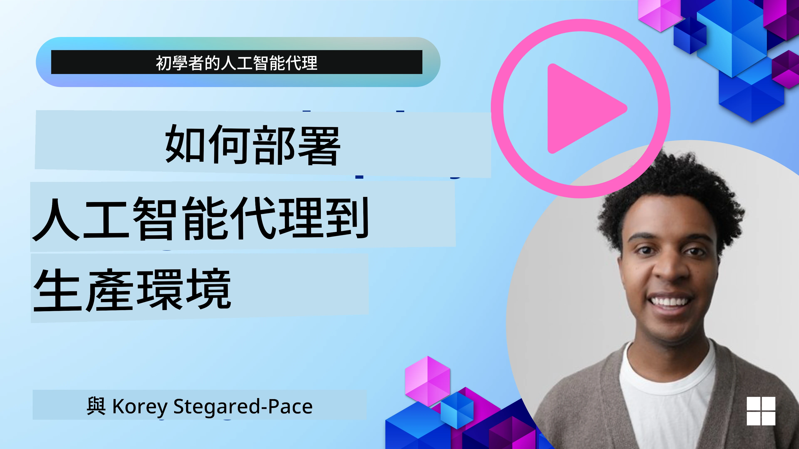

# 生產環境中的 AI 代理人：可觀察性與評估

[](https://youtu.be/l4TP6IyJxmQ?si=reGOyeqjxFevyDq9)

隨著 AI 代理人從實驗原型轉向實際應用，理解其行為、監控性能並系統性評估輸出的能力變得非常重要。

## 學習目標

完成本課程後，您將會知道如何/了解：
- 代理人可觀察性與評估的核心概念
- 提升代理人性能、成本與效能的技術
- 如何系統性評估 AI 代理人的輸出及表現
- 部署 AI 代理人到生產環境時如何控制成本
- 如何為使用 Microsoft Agent Framework 構建的代理人添加監控儀器

本課程目標是裝備您具備將「黑盒」代理人轉變為透明、可管理且可靠系統的知識。

_**注意：** 部署安全且值得信賴的 AI 代理人十分重要。請同時參考[建立值得信賴的 AI 代理人](../06-building-trustworthy-agents/README.md)的課程。_

## 追蹤與跨度

可觀察性工具如 [Langfuse](https://langfuse.com/) 或 [Microsoft Foundry](https://learn.microsoft.com/en-us/azure/ai-foundry/what-is-azure-ai-foundry) 通常將代理人運行表現表示為追蹤與跨度。

- **追蹤（Trace）** 代表完整的代理人任務，從開始到結束（例如處理用戶查詢）。
- **跨度（Spans）** 是追蹤中的個別步驟（例如呼叫語言模型或擷取資料）。


<!-- Image URL retained for illustration purposes -->

若缺乏可觀察性，AI 代理人可能就像「黑盒」——其內部狀態和推理過程不透明，很難診斷問題或優化效能。具備可觀察性後，代理人成為「玻璃盒」，提供必要的透明度，對建立信任並確保其按預期運作至關重要。

## 為何可觀察性在生產環境中至關重要

將 AI 代理人遷移至生產環境帶來一系列新的挑戰和需求。可觀察性不再是「可有可無」，而是一項關鍵能力：

*   <strong>除錯與根本原因分析</strong>：當代理人失敗或產生意外輸出時，可觀察性工具提供必要的追蹤，幫助釐清錯誤來源。這對於包含多次大型語言模型呼叫、工具交互和條件邏輯的複雜代理人尤為重要。
*   <strong>延遲與成本管理</strong>：AI 代理人經常依賴根據字元計費的 LLM 和其他外部 API 呼叫。可觀察性可精確追蹤這些呼叫，有助辨識過慢或過高成本的運行，讓團隊優化提示語、挑選更有效率的模型，或重新設計流程以控制運營成本並確保良好用戶體驗。
*   **信任、安全與合規**：在許多應用中，確保代理人行為安全且符合道德標準十分重要。可觀察性提供代理人行動與決策的審計追蹤，可用於偵測並緩解如提示注入、有害內容生成或個人可識別信息（PII）誤處理等問題。例如，您可以查看追蹤以了解代理人為何給出特定回應或使用特定工具。
*   <strong>持續改進迴圈</strong>：可觀察性資料是持續迭代開發的基礎。透過監測代理人在實際環境中的表現，團隊可識別改進方向、收集微調模型所需資料，並驗證更改的影響，形成線上評估反饋指導離線實驗和優化的循環，持續提升代理人表現。

## 需追蹤的關鍵指標

為監控與理解代理人行為，應追蹤多種指標與信號。具體指標會依代理人用途不同而異，但有些是普遍重要的。

以下為可觀察性工具最常監測的幾個指標：

**延遲（Latency）：** 代理人回應速度有多快？過長等待時間會負面影響用戶體驗。應透過追蹤代理人運作，測量整體任務及各步驟延遲。例如某代理人所有模型呼叫合計20秒，可透過使用更快模型或平行呼叫模型優化加速。

**成本（Costs）：** 每次代理人執行花費多少？AI 代理人依賴按字元計費的 LLM 呼叫或外部 API。頻繁使用工具或多次提示會快速增加成本。例如如果代理人為微小質量提升重複呼叫 LLM 五次，需評估成本是否合理，是否可減少呼叫次數或改用較便宜模型。實時監控還可協助偵測非預期成本激增（如因錯誤導致無限 API 迴圈）。

**請求錯誤（Request Errors）：** 代理人失敗的請求數量為何？包括 API 錯誤或工具調用失敗。為讓代理人在生產更穩健，可設置後備方案或重試邏輯。例如主 LLM 供應商 A 宕機時，轉用備用 LLM 供應商 B。

**用戶反饋（User Feedback）：** 實施直接用戶評價提供寶貴見解。包括明確評分（👍 喜歡/👎 不喜歡，⭐1-5 星）或文字評論。持續負面反饋應提醒代理人表現異常。

**隱含用戶反饋（Implicit User Feedback）：** 即使沒有明確評分，用戶行為也提供間接反饋。包括立即改寫問題、重複查詢或點擊重試按鈕。例如用戶不斷重複同一問題，表示代理人表現不符預期。

**準確度（Accuracy）：** 代理人產出正確或理想結果的頻率。準確度定義依用途而異（如問題解決正確率、資訊檢索準確性、用戶滿意度）。第一步是定義成功標準。可透過自動檢查、評分或任務完成標籤來追蹤，例如標記追蹤為“成功”或“失敗”。

**自動化評估指標（Automated Evaluation Metrics）：** 可設置自動評分。例如利用 LLM 為代理人輸出評分，判斷是否有用、準確與否。也有多款開源函式庫輔助評分代理人不同面向，如適用於 RAG 代理人的 [RAGAS](https://docs.ragas.io/)、偵測有害語言或提示注入的 [LLM Guard](https://github.com/protectai/llm-guard)。

實際上，這些指標結合可最佳覆蓋 AI 代理人的健康狀態。在本章的[示例筆記本](./code_samples/10-expense_claim-demo.ipynb)中，我們會展示這些指標在實例中的呈現，但首先先了解典型評估流程。

## 為代理人添加監控儀器

為收集追蹤資料，需要為代碼加入監控儀器。目標是讓代理人代碼輸出可被可觀察性平台捕捉、處理及視覺化的追蹤與指標。

**OpenTelemetry (OTel)：** [OpenTelemetry](https://opentelemetry.io/) 已成為 LLM 可觀察性的產業標準。提供產生、收集與匯出遙測資料的 API、SDK 和工具。

有許多監控庫封裝現有代理人框架，方便將 OpenTelemetry 跨度輸出至可觀察性工具。Microsoft Agent Framework 原生支持 OpenTelemetry。以下是為 MAF 代理人添加監控儀器的範例：

```python
from agent_framework.observability import get_tracer, get_meter

tracer = get_tracer()
meter = get_meter()

with tracer.start_as_current_span("agent_run"):
    # Agent execution is traced automatically
    pass
```

本章的[示例筆記本](./code_samples/10-expense_claim-demo.ipynb)將演示如何為 MAF 代理人添加監控儀器。

**手動創建跨度：** 雖然監控庫提供良好基線，但通常也需更多細節或客製化資訊。您可手動創建跨度以加入自定義應用邏輯。更重要的是，它們可用自訂屬性（即標籤或元資料）豐富自動或手動創建的跨度。這些屬性可包含商業專屬資料、中間計算結果，或有助除錯與分析的上下文，例如 `user_id`、`session_id` 或 `model_version`。

以下為用 [Langfuse Python SDK](https://langfuse.com/docs/sdk/python/sdk-v3) 手動創建追蹤與跨度的範例：

```python
from langfuse import get_client
 
langfuse = get_client()
 
span = langfuse.start_span(name="my-span")
 
span.end()
```

## 代理人評估

可觀察性提供指標，但評估是分析這些資料（並執行測試）來判斷 AI 代理人表現好壞及改進方式的過程。換句話說，取得追蹤與指標後，如何利用它們來評斷代理人並作出決策？

定期評估很重要，因為 AI 代理人常為非確定性，且可能隨更新或模型行為偏移而演變——缺乏評估時，無法洞察您的「智慧代理人」是否能夠妥善執行任務或是否已退步。

AI 代理人評估分為兩類：<strong>線上評估</strong>與<strong>離線評估</strong>，兩者均有價值且相輔相成。一般由離線評估開始，這是部署任何代理人的最低必要步驟。

### 離線評估


於受控環境中評估代理人，通常使用測試資料集而非即時用戶查詢。使用已策劃且預期輸出或正確行為已知的資料集，讓代理人執行並評估表現。

例如，若您建立了數學文字題代理人，可能有一個包含 100 題附答案的[測試資料集](https://huggingface.co/datasets/openai/gsm8k)。離線評估常用於開發階段（也可納入 CI/CD 流程）驗證改進或防止回退。其優點是<strong>可重複執行且擁有明確準確率指標，因為有真實標準</strong>。您還可以模擬用戶查詢，將代理人回答與理想答案比對，或使用上述自動指標。

離線評估的主要挑戰是確保測試資料集全面且持續相關——代理人在固定測試集表現良好，但生產環境可能遇到截然不同查詢。因此應持續更新測試集，加入反映真實場景的新邊緣案例與示例。小型「冒煙測試」和大型評估集的組合很有用：小型方便快速檢查，大型則提供更廣泛的性能指標。

### 線上評估


指在實際生產環境中評估代理人，即在實際使用中監控代理人與用戶互動的表現並持續分析結果。

例如您可追蹤成功率、用戶滿意度分數或其他即時流量指標。線上評估優勢在於<strong>捕捉實驗室環境難以預見的情況</strong>—可觀察模型偏移（隨輸入模式變化代理效能下降）及未納入測試資料的突發查詢或狀況，呈現代理人在真實環境的真實行為。

線上評估經常包含收集隱含與明確用戶反饋，以及可能執行影子測試或 A/B 測試（新版本代理與舊版本並行運行以對比）。挑戰在於取得可靠的即時互動標籤或分數，可能需依賴用戶反饋或下游指標（如用戶是否點擊結果）。

### 綜合應用

線上與離線評估並非對立關係，而是高度互補。線上監控（例如新型用戶查詢中代理表現不佳）可用於豐富、優化離線測試資料集。反之，離線測試表現良好的代理人能更有信心地部署並於線上監控。

許多團隊實行如下迴圈：

_離線評估 -> 部署 -> 線上監控 -> 收集新失效案例 -> 加入離線資料集 -> 優化代理人 -> 重複以上流程_。

## 常見問題

在部署 AI 代理人至生產環境過程中，您可能會遇到各種挑戰。以下為一些常見問題及潛在解決方案：

| <strong>問題</strong>        | <strong>可能解決方案</strong>          |
| ------------- | ------------------ |
| AI 代理人執行任務不一致 | - 優化提供給 AI 代理人的提示語，明確任務目標。<br>- 確認是否可將任務拆分為多個子任務由多代理處理。 |
| AI 代理人進入持續迴圈         | - 設有明確終止條件，讓代理人知道何時停止。<br>- 複雜任務需推理與規劃時，使用擅長推理的更大模型。 |
| AI 代理人呼叫的工具表現不佳   | - 在代理系統外測試並驗證工具輸出質量。<br>- 優化工具參數、提示語與命名。 |
| 多代理系統執行不一致        | - 針對每個代理優化提示語，確保其具有針對性且彼此區隔。<br>- 建立層級系統，利用「路由」或控制代理決定由哪個代理執行任務。 |

許多問題借助可觀察性可以更有效地被識別。前述追蹤與指標有助精準定位代理人工作流程中問題所在，大幅提升除錯與優化效率。

## 成本管理

以下為部署 AI 代理人至生產環境中的成本管理策略：

**使用較小型模型：** 小型語言模型 (SLMs) 在某些代理使用案例中表現良好，並能顯著降低成本。如前所述，建立評估系統來判斷並比較與大型模型的性能，是了解SLM在您的使用案例中表現如何的最佳方式。考慮將SLMs用於較簡單的任務，如意圖分類或參數提取，同時將大型模型保留給複雜推理。

**使用路由模型：** 類似的策略是使用多樣化的模型和不同規模。您可以使用LLM/SLM或無伺服器函數，根據複雜度將請求路由至最合適的模型。這也有助於降低成本，同時確保在適當的任務上達到良好性能。例如，將簡單查詢路由至較小且較快的模型，僅在複雜推理任務時使用昂貴的大型模型。

**快取回應：** 識別常見請求和任務，在它們通過您的代理系統之前提供回應，是減少類似請求量的有效方法。您甚至可以實作一個流程，使用較基本的AI模型來判斷請求與快取請求的相似度。此策略能顯著降低常見問題或常用工作流程的成本。

## 讓我們看看實際運作情況

在本節的[範例筆記本](./code_samples/10-expense_claim-demo.ipynb)中，我們將看到如何使用可觀察性工具來監控和評估我們的代理。


### 對生產中的AI代理有更多疑問？

加入[Microsoft Foundry Discord](https://discord.com/invite/ATgtXmAS5D)，與其他學習者會面，參加辦公時間並獲得您的AI代理問題解答。

## 上一課

[元認知設計模式](../09-metacognition/README.md)

## 下一課

[代理協議](../11-agentic-protocols/README.md)

---

<!-- CO-OP TRANSLATOR DISCLAIMER START -->
**免責聲明**：
本文件由 AI 翻譯服務 [Co-op Translator](https://github.com/Azure/co-op-translator) 翻譯而成。雖然我們致力於確保準確性，但請注意，機器自動翻譯可能包含錯誤或不準確之處。原始文件的母語版本應被視為權威來源。對於重要資訊，建議進行專業人工翻譯。我們不對因使用本翻譯而產生的任何誤解或誤釋承擔責任。
<!-- CO-OP TRANSLATOR DISCLAIMER END -->