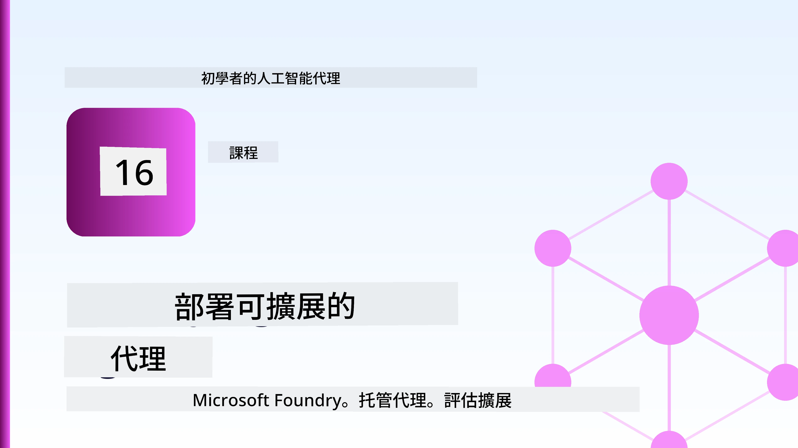
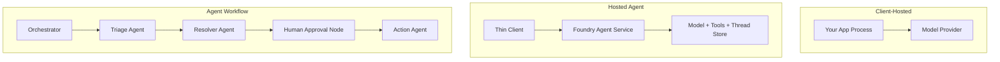
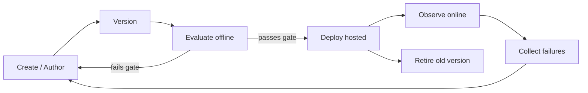
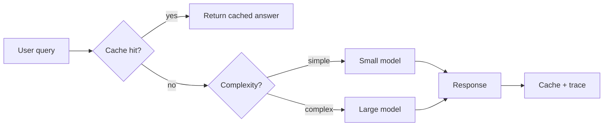
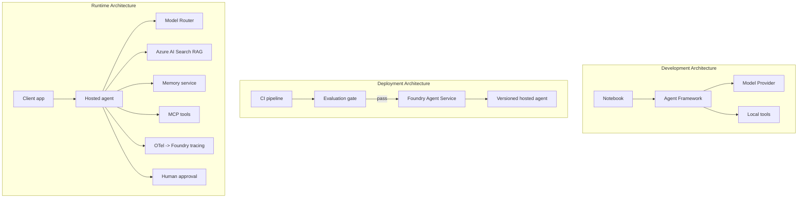

# 使用 Microsoft Foundry 部署可擴展代理



到目前為止，本課程你已經建立了在筆記本電腦上運行的代理，透過 `az login` 和少量環境變數驅動。這是學習的正確方式。但這並非讓數千客戶依賴、深夜 3 點穩定運行代理的正確方式。

本課程討論「只在我機器可運行」與「穩定且經濟地在生產環境運行」之間的鴻溝。我們將使用 **Microsoft Foundry** 與 **Microsoft Foundry 代理服務** 來彌補這個差距，並透過建置一個具備工具、檢索、記憶、評估與監控的真實客服代理來實現。

## 簡介

本課程將涵蓋：

- <strong>原型代理</strong> 與 <strong>部署代理</strong> 的區別，以及轉變主要關乎模型 <em>周圍</em> 的所有其它事物。
- 代理的 <strong>部署模式</strong>：客戶端主機、服務主機（托管代理）與工作流程協調。
- Microsoft Foundry 上的 <strong>代理生命週期</strong> — 創建、版本管理、部署、評估、觀察、退役。
- <strong>擴展策略</strong>：模型路由、快取、並發和無狀態設計。
- 使用 OpenTelemetry 與 Foundry 追蹤實現的 <strong>可觀察性</strong>。
- 透過模型選擇、路由與評估門檻實現的 <strong>成本優化</strong>。
- <strong>企業考量</strong>：治理、人為審批，以及如何安全運行 MCP 伺服器於生產環境。

## 學習目標

完成本課程後，你將學會如何：

- 為特定代理工作負載選擇正確的部署模式。
- 將代理部署到 Microsoft Foundry 代理服務，以實現版本控制、治理和可觀察性。
- 為代理執行追蹤儀表，並在每次發布前接線評估管線。
- 應用模型路由與快取，於大規模下保持延遲和成本的可控。
- 為高風險操作添加人工審批閘門，並以生產安全方式整合 MCP 伺服器。

## 先決條件

本課程假設你已完成早期課程，並熟悉：

- 使用 [Microsoft Agent Framework](../14-microsoft-agent-framework/README.md) 建立代理（第 14 課）。
- [工具使用](../04-tool-use/README.md)（第 4 課）與 [Agentic RAG](../05-agentic-rag/README.md)（第 5 課）。
- [代理記憶](../13-agent-memory/README.md)（第 13 課）與 [Agentic Protocols / MCP](../11-agentic-protocols/README.md)（第 11 課）。
- [可觀察性與評估](../10-ai-agents-production/README.md)（第 10 課）— 本課程直接建立在此基礎上。

你還需要：

- 一個 **Azure 訂閱** 和一個至少部署有一個聊天模型的 **Microsoft Foundry 專案**。
- 已驗證的 **Azure CLI**（`az login`）。
- Python 3.12+ 與存放庫中的套件 [`requirements.txt`](../../../requirements.txt)。

## 從原型到生產：實際變化

原型代理與生產代理共享相同的核心迴圈 — 推理、調用工具、回應。不同的是包裹該迴圈的所有其他事物。模型大約佔生產代理的 20%；其餘 80% 是運營骨架。

| 關注點 | 原型 | 生產 |
| --- | --- | --- |
| <strong>主機</strong> | 在你的筆記本中運行 | 作為托管服務運行，具版本並可逐步推出 |
| <strong>身份</strong> | 你的 `az login` 令牌 | 具範圍 RBAC 的管理身份 |
| <strong>狀態</strong> | 記憶體中，重啟丟失 | 外部化（線程存儲、記憶服務） |
| <strong>失敗處理</strong> | 你看到錯誤回溯 | 重試、備援、死信、警報 |
| <strong>成本</strong> | 「幾分錢」 | 按請求追蹤、路由、快取、預算控制 |
| <strong>品質</strong> | 你目視判斷輸出 | 每次發布前自動評估 |
| <strong>信任</strong> | 每個動作你批准 | 風險行動由政策 + 人工介入審核 |

記住此表。以下各節均對應其一行。

## 代理部署模式

有三種主要模式，常結合使用。

### 1. 客戶端主機代理

代理物件存在於<em>你的</em>應用程序進程中。你的程式碼直接調用模型提供者；推理迴圈在你的服務中執行。這是之前所有課程的做法。

- <strong>使用時機</strong> 當你需要完全控制迴圈、自訂中介軟件，或是將代理嵌入現有後端。
- <strong>取捨</strong>：你自行負責擴展、狀態和韌性。

### 2. 托管代理（Foundry 代理服務）

代理作為資源<em>註冊於</em> Microsoft Foundry。Foundry 托管推理迴圈，存儲線程，執行內容安全和 RBAC，並在 Foundry 入口網站中展示代理。你的應用成為薄客戶端，負責創建線程和讀取回應。

- <strong>使用時機</strong> 當你需要持久性、內建可觀察性、治理與更少的運營負擔。
- <strong>取捨</strong>：換取託管執行環境，減少底層控制。

### 3. 代理工作流程

多個代理（與工具）組成一個帶有明確控制流的圖形 — 順序步驟、分支、人為審核節點，以及可暫停與恢復的持久檢查點。這是 Microsoft Agent Framework 在部署規模上的 <strong>工作流程</strong> 功能。

- <strong>使用時機</strong> 單一任務涵蓋多個專門代理，或需要中途審批。
- <strong>取捨</strong>：更多運作元件，需具編排層級的可觀察性。



## Microsoft Foundry 上的代理生命週期

部署代理不是一次性的 `push`。它是一個迴圈，看起來很像軟件發布週期，因為本質上正是如此。



關鍵理念，來自於 [第 10 課](../10-ai-agents-production/README.md)：**離線評估是一個門檻，而非事後考慮。** 新代理版本未能通過評估門檻，則不會發佈。線上可觀察性將實際故障回饋至離線測試集。這就是整個迴圈。

## 擴展策略

擴展代理不同於擴展無狀態 Web API，因為每個請求可能觸發多個昂貴的模型與工具調用。以下四項技術承擔大部分負載。

**無狀態請求處理。** 不在進程記憶體中保留每個用戶的狀態。將對話線程持久化到 Foundry 線程存儲或記憶服務，以便任一實例可處理任一請求。這讓你能橫向擴展 — 增加實例，無須黏性會話。

**模型路由。** 並非所有請求需使用你最強大（且最昂貴）的模型。簡單請求（意圖分類、短答事實問題）導向小且快速模型，大模型僅保留處理真正的推理。Foundry 的 <strong>模型路由器</strong> 可為你完成此事，或你可自行實作輕量分類器。實驗室中你將構建此自助版本。

**回應快取。** 許多客服查詢幾乎是重複問題（「如何重設密碼？」）。快取常見問題答案，無需調用模型直接回應。即使是適度的快取命中率，也能顯著降低成本和延遲。

**併發與背壓。** 模型提供者有限速限制。限制你的併發量，使用帶指數退避的重試，並優雅失敗（一個排隊中的「我們正在處理」回應優於 500 錯誤）。



## 生產環境中的可觀察性

你無法管理看不見的事物。正如第 10 課所述，Microsoft Agent Framework 原生發出 **OpenTelemetry** 追蹤 — 每次模型調用、工具呼叫及編排步驟皆成為一個跨度。生產環境中，你會將這些跨度匯出到 Microsoft Foundry（或任意 OTel 相容後端），以便：

- 完整追蹤單一客戶投訴，涵蓋所有模型與工具調用。
- 紀錄各請求的 p50/p95 延遲與成本趨勢。
- 在使用者（或財務團隊）察覺前，對錯誤率激增與成本異常發出警報。

```python
from agent_framework.observability import get_tracer

tracer = get_tracer()

with tracer.start_as_current_span("support_request") as span:
    span.set_attribute("customer.tier", "enterprise")
    span.set_attribute("routed.model", "gpt-5-nano")
    # agent execution is traced automatically inside this span
```

類似 `customer.tier` 與 `routed.model` 屬性，讓一堆追蹤訊息變成可回答的問題（「企業客戶是否過於頻繁被導至小模型？」）。

## 成本優化

生產代理的成本主要由標記(token)決定。三個槓桿，依影響力排序：

1. **模型尺寸適宜。** 通過評估門檻的小模型幾乎總是比能通過的大模型便宜。使用評估結果來 <em>證明</em> 小模型足夠好，而非因謹慎而直接選最大模型。
2. **依複雜度路由。** 如前所述—僅對需要用大模型推理的請求付出大模型價格。
3. **積極快取。** 最便宜的模型調用是不做的那個。

評估門閘與成本控制是同一紀律的兩面：評估告訴你<em>品質底線</em>，路由與快取讓你盡量接近該底線的<em>成本</em>。

## 企業部署考量

**治理。** 托管代理繼承 Foundry 的 RBAC、內容安全與審計記錄。給每個代理一個嚴格最小權限的管理身份 — 只讀知識庫、有限範圍的票務 API，無其他權限。

**人工介入。** 某些操作過於關鍵，不宜全自動化 — 退款、刪除帳戶、升級法務團隊。Microsoft Agent Framework 支援 <strong>需要批准</strong> 的工具：代理提議動作，執行暫停，人為允許或拒絕，工作流程繼續。你在 [第 6 課](../06-building-trustworthy-agents/README.md) 看過該原語；此處進行部署。

**生產中的 MCP。** [MCP](../11-agentic-protocols/README.md) 讓代理透過標準介面調用外部工具。生產環境中，每個 MCP 伺服器皆視為不受信任邊界：鎖定版本，帶範圍身份運行，驗證輸出，且永不暴露密鑰。MCP 伺服器是一個依賴項，依賴項要打補丁、審計與限速。



這三張圖 — 開發、部署、執行時 — 是相同代理的生命三階段。接下來的實驗室將帶你實作它。

## 實作實驗室：生產就緒客戶支持代理

開啟 [`code_samples/16-python-agent-framework.ipynb`](./code_samples/16-python-agent-framework.ipynb) 從頭到尾完成。本實驗室將組裝一個 **Contoso 客戶支持代理**，其包含所有生產考量：

1. <strong>工具呼叫</strong> — 查詢訂單狀態與開啟支援工單。
2. **RAG** — 從知識庫回答政策問題（Azure AI Search，內存備援，讓筆記本可在無搜尋服務情況下運作）。
3. <strong>記憶</strong> — 於對話回合中記住客戶。
4. <strong>模型路由</strong> — 複雜度分類器將請求導向小或大模型。
5. <strong>回應快取</strong> — 重複問題直接從快取回應。
6. <strong>人工審批</strong> — 超過門檻的退款暫停等待人工簽核。
7. <strong>評估管線</strong> — 小型離線測試集評分代理並作為發布門檻。
8. <strong>可觀察性</strong> — 對每一請求進行 OpenTelemetry 追蹤。

### 實作導覽

筆記本結構化為每個生產考量為獨立可執行段落。核心是路由加快取的請求處理器：

```python
async def handle_support_request(query: str, customer_id: str) -> str:
    # 1. Serve from cache when we can.
    cached = response_cache.get(normalize(query))
    if cached:
        return cached

    # 2. Route by complexity to control cost.
    model = "gpt-5-nano" if is_simple(query) else "gpt-5-mini"

    # 3. Run the agent inside a trace span for observability.
    with tracer.start_as_current_span("support_request") as span:
        span.set_attribute("routed.model", model)
        span.set_attribute("customer.id", customer_id)
        response = await support_agent.run(query, model=model)

    # 4. Cache and return.
    response_cache.set(normalize(query), response.text)
    return response.text
```

保護發布的評估門閘如下所示：

```python
async def evaluation_gate(agent, test_cases, threshold: float = 0.8) -> bool:
    passed = 0
    for case in test_cases:
        result = await agent.run(case["input"])
        if score_response(result.text, case["expected"]) >= 0.8:
            passed += 1
    pass_rate = passed / len(test_cases)
    print(f"Evaluation pass rate: {pass_rate:.0%} (gate: {threshold:.0%})")
    return pass_rate >= threshold  # only deploy if the gate passes
```

仔細看每行 — 筆記本刻意保持原語簡潔，避免隱藏於框架調用背後。

## 使用煙霧測試驗證已部署代理

上述評估門閘於 <em>離線</em> 執行於代理物件上。當代理部署為托管代理時，還需一種更便宜的檢查：**部署端點是否實際有回應？**

所謂「部署成功」只是控管平面接受定義，不代表代理有回應。缺失依賴、模型路由錯誤或連線過期都可能導致部署綠燈但無回應。<strong>煙霧測試</strong>能秒抓此類問題，且每次部署皆執行，成本遠低於完整評估。

本存放庫附帶一套即用的煙霧測試管線，基於 [AI Smoke Test](https://github.com/marketplace/actions/ai-smoke-test) GitHub Action：

- <strong>目錄</strong> — [`tests/lesson-16-smoke-tests.json`](../../../tests/lesson-16-smoke-tests.json) 包含 Contoso 支援代理的提示與斷言（基於政策答案、訂單查詢、保持主題與多回合線程連貫）。其他課程代理的目錄並列其旁—見 [`tests/README.md`](../tests/README.md)。
- <strong>工作流程</strong> — [`.github/workflows/smoke-test.yml`](../../../.github/workflows/smoke-test.yml) 使用 Azure OIDC 登入，並將每個提示 POST 至代理的 Responses 端點，任一斷言失敗則使任務失敗。

```yaml
- name: Smoke-test hosted agent
  uses: JFolberth/ai-smoketest@v1
  with:
    project_endpoint: ${{ inputs.project_endpoint }}
    agent_name: ContosoSupportAgent
    tests_file: tests/lesson-16-smoke-tests.json
```

當你的代理部署完成後，請在 **Actions** 標籤頁中運行它，並提供你的 Foundry 專案端點和代理名稱。聯邦身份需要在 Foundry 專案範疇中擁有 **Azure AI User** 角色。把這些層次想像成一個金字塔：冒煙測試（是否可達且有回應？）會在每次部署時執行，離線評估（是否足夠良好可上線？）會在晉升前執行，線上評估（在實際運行中表現如何？）則持續執行。

## 知識檢核

在進入作業之前，先測試你的理解。

**1. 大約生產代理中「模型」佔多少比例，剩下的是什麼？**

<details>
<summary>答案</summary>

模型通常只佔系統的一小部分——常被引用約為20%。其餘部分是運行骨架：托管與版本控制、身份與 RBAC、外部狀態、故障處理、成本追蹤、評估以及人工介入控制。上線生產主要是建立<em>推理迴圈外圍的一切</em>。
</details>

**2. 何時會選擇 Hosted Agent 而非用戶端托管代理？**

<details>
<summary>答案</summary>

當你想要一個內建耐久性（可持續的執行緒且可恢復）、可觀察性、內容安全及 RBAC 的託管執行環境，且願意為減少運維表面換取少部分推理迴路的低層控制權時，會選托管代理。若需要完全控制推理迴路或將代理嵌入既有後端，則用戶端托管較佳。
</details>

**3. 為何可擴展代理必須在其自身進程記憶體中保持無狀態？**

<details>
<summary>答案</summary>

如此任何實例都可以處理任何請求，這使得橫向擴展無需黏性會話成為可能。每用戶對話狀態外部化到執行緒存儲或記憶服務。若狀態存於進程記憶體，重啟時將遺失，且無法自由分散負載。
</details>

**4. 模型路由解決了什麼問題，且與評估有何關聯？**

<details>
<summary>答案</summary>

路由將簡單請求送到小型、便宜且快速的模型，將大型模型保留給真正推理任務，從而控制延遲和成本。它與評估相關，因為評估證明小模型對某一類請求已足夠良好——沒有評估的路由只是猜測。
</details>

**5. 何謂「評估閘門」，它位於生命週期的哪個階段？**

<details>
<summary>答案</summary>

評估閘門對新代理版本執行離線測試集，若通過率未達門檻則阻止部署。它位於「版本」與「部署」之間，使品質成為發布的前提，而非事後檢查。
</details>

**6. 為什麼 MCP 伺服器在生產環境中應被視為不可信邊界？**

<details>
<summary>答案</summary>

因為它是代理調用的外部依賴。你應鎖定其版本、用指定身份運行、驗證輸出、速率限制，且絕不暴露秘密給它——這是你對任何第三方依賴應有的紀律。其輸出流入代理的推理，未經驗證的信任即為安全風險。
</details>

**7. 哪個單一變更通常對生產代理成本影響最大？為什麼？**

<details>
<summary>答案</summary>

正確尺寸化模型——使用評估閘門能通過的最小模型。成本主要來自 Token，且符合質量標準的較小模型幾乎總比大模型便宜。緩存與路由進一步降低成本，但選對基礎模型有最大的第一階影響。
</details>

**8. 像 `customer.tier` 和 `routed.model` 這類追蹤屬性在可觀察性中扮演什麼角色？**

<details>
<summary>答案</summary>

它們將原始追蹤轉化為可回答的商業問題。無屬性時你得面對一面跨度牆；有了屬性，你能問「企業客戶是否過於頻繁被路由到小模型？」或「哪個模型處理我們最慢的請求？」屬性讓你能依照對業務運營最重要的維度切分遙測資料。
</details>

## 作業

以實驗室的客戶支援代理為基礎，針對特定場景強化它：**一家 SaaS 公司的訂閱計費支援代理。**

你的提交應該包括：

1. <strong>替換工具</strong>為與計費相關的：`get_subscription_status`、`get_invoice`、以及 `issue_credit`（超過 50 美元需人工核准）。
2. **新增三份 RAG 文件**，涵蓋公司的退款政策、計費週期與取消政策。
3. <strong>擴充評估集</strong>至至少八個案例，其中至少兩個<em>應該</em>觸發人工核准路徑，並確認你的評估閘門能正確通過或失敗。
4. <strong>新增一份成本報告</strong>：在用代理執行十個混合查詢後，列印出有多少查詢走小模型，有多少走大模型，以及多少從快取服務。

撰寫一小段（在 markdown 儲存格中）說明你所選的模型路由規則，以及你將如何用實際流量驗證它。沒有唯一正確答案——評估重點是各項生產面向是否連結有序。

## 總結

本課中你將代理從原型推向 Microsoft Foundry 的生產：

- 生產上線主要是模型周遭的<strong>運營骨架</strong>——托管、身份、狀態、故障處理、成本、質量與信任。
- 你了解了三種<strong>部署模式</strong>——用戶端托管、Hosted Agents 以及 Agent 工作流程，以及各自適用情境。
- 你走過了<strong>代理生命週期</strong>，其中離線<strong>評估作為發布閘門</strong>，線上可觀察性則將故障回饋入測試集。
- 你應用了<strong>擴展策略</strong>——無狀態設計、模型路由、快取以及有界併發，並連結到<strong>成本優化</strong>。
- 你結合了<strong>企業控管</strong>：RBAC、人工核准以及生產安全的 MCP 整合。
- 你建置了一個<strong>生產就緒的客戶支援代理</strong>，將這些面向都串聯在可執行的程式碼中。

下一課將走相反的路線：不再將代理擴展到雲端，而是將它們<em>縮小</em>到單一開發者機器並完全在本地運行。

## 參考資源

- <a href="https://learn.microsoft.com/azure/ai-foundry/what-is-azure-ai-foundry" target="_blank">Microsoft Foundry 文件</a>
- <a href="https://learn.microsoft.com/azure/ai-foundry/agents/overview" target="_blank">Microsoft Foundry 代理服務概述</a>
- <a href="https://learn.microsoft.com/en-us/agent-framework/overview/?wt.mc_id=youtube_26688_organicsocial_reactor&pivots=programming-language-python" target="_blank">Microsoft Agent Framework</a>
- <a href="https://learn.microsoft.com/en-us/azure/ai-foundry/openai/concepts/model-router" target="_blank">Microsoft Foundry 中的模型路由器</a>
- <a href="https://learn.microsoft.com/azure/search/search-what-is-azure-search" target="_blank">Azure AI 搜尋</a>
- <a href="https://opentelemetry.io/" target="_blank">OpenTelemetry</a>
- <a href="https://github.com/marketplace/actions/ai-smoke-test" target="_blank">AI 冒煙測試 GitHub Action</a>
- <a href="https://modelcontextprotocol.io/" target="_blank">模型上下文協定 (MCP)</a>

## 前一課

[打造電腦使用代理 (CUA)](../15-browser-use/README.md)

## 下一課

[建立本地 AI 代理](../17-creating-local-ai-agents/README.md)

---

<!-- CO-OP TRANSLATOR DISCLAIMER START -->
**免責聲明**：
本文件由 AI 翻譯服務 [Co-op Translator](https://github.com/Azure/co-op-translator) 翻譯而成。雖然我們致力於確保準確性，但請注意，機器自動翻譯可能包含錯誤或不準確之處。原始文件的母語版本應被視為權威來源。對於重要資訊，建議進行專業人工翻譯。我們不對因使用本翻譯而產生的任何誤解或誤釋承擔責任。
<!-- CO-OP TRANSLATOR DISCLAIMER END -->