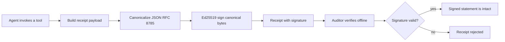
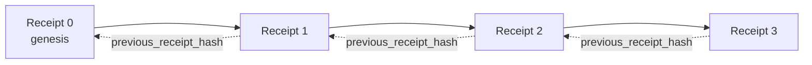

[觀看課程影片：使用密碼學憑證保障 AI 代理安全](https://youtu.be/PLACEHOLDER_VIDEO_ID)

> _(課程影片與縮圖將由 Microsoft 內容團隊於合併後新增，符合第 14 / 15 課模式。)_

# 以密碼學憑證保障 AI 代理安全

## 介紹

本課將涵蓋：

- 為何 AI 代理的稽核軌跡對合規、除錯及信任至關重要。
- 什麼是密碼學憑證，以及它與未簽名日誌行的不同。
- 如何用純 Python 產生代理工具呼叫的簽署憑證。
- 如何離線驗證憑證並偵測竄改。
- 如何串接憑證鏈，使刪除或重排任一憑證會破壞整條鏈。
- 憑證能證明什麼，以及明確無法證明什麼。

## 學習目標

完成本課後，您將能夠：

- 辨識促使代理行為須使用密碼學可追溯性之失效模式。
- 產生使用 Ed25519 簽名的憑證，對一個標準的 JSON 載荷。
- 僅憑簽署者的公開鑰匙，獨立驗證憑證。
- 透過於變更後憑證重驗，偵測竄改。
- 建立串接的哈希憑證序列，並解釋為何此串連關鍵。
- 辨識憑證能證明（歸屬、完整性、排序）與無法證明（行為正確性、政策健全性）之界限。

## 問題：您的代理稽核軌跡

想像您在 Contoso Travel 部署了 AI 代理。該代理閱讀客戶請求，呼叫航班 API 查詢方案，並代客訂票。上一季，該代理處理了 5 萬筆訂位。

今日一位稽核人員來到，問了一個簡單的問題：「請給我看你的代理做了什麼。」

您交出日誌檔案。稽核人員看過後問了更難的問題：「我怎麼知道這些日誌沒有被篡改？」

這就是稽核軌跡問題。當前多數代理部署依賴：

- <strong>應用日誌</strong>：代理自寫，擁有檔案系統存取權的人均可修改。
- <strong>雲端日誌服務</strong>：平台層檢測竄改但前提是稽核人信任平台營運者。
- <strong>資料庫交易日誌</strong>：適合資料庫變更，卻不適合任意工具呼叫。

若不信任任何人（您、雲端提供者、資料庫商），以上都無法回答稽核人問題。內部使用此信任常可接受，但對受管制工作負載（金融、醫療、受 EU AI 法規）則不可。

加密收據透過令已簽署的聲明可以獨立地
驗證。審計者仍然需要一個帶外的理由去信任簽署金鑰及
產生該聲明的組件。內嵌金鑰證明的是自我一致性，
而不是簽發者身份或執行所在位置。

## 什麼是密碼學憑證？

憑證是一個記錄代理行為的 JSON 物件，並以數位簽章簽署。



最基本的憑證看起來像這樣：

```json
{
  "type": "agent.tool_call.v1",
  "agent_id": "contoso-travel-bot",
  "tool_name": "lookup_flights",
  "tool_args_hash": "sha256:a3f9c1...",
  "result_hash": "sha256:7b2e1d...",
  "policy_id": "contoso-travel-policy-v3",
  "timestamp": "2026-04-25T14:30:00Z",
  "sequence": 47,
  "previous_receipt_hash": "sha256:9d4e6a...",
  "signature": {
    "alg": "EdDSA",
    "sig": "c5af83...",
    "public_key": "8f3b2c..."
  }
}
```

有三個特性在發揮效用：

1. <strong>簽名</strong>。收據由代理的網關使用 Ed25519 私鑰簽署。任何持有相應公鑰的人均可離線驗證該簽名。依賴方必須釘選該公鑰或從收據之外的受信託登記處解析該公鑰。對任何已簽署欄位的篡改都會使簽名失效。

2. <strong>標準編碼</strong>。簽署前先用 JSON 標準化方案（JCS, RFC 8785）序列化。此確保兩個產生相同邏輯憑證的實作產生位元組一致輸出。若無標準化，不同 JSON 序列化器會對相同內容產生不同簽章。

3. <strong>雜湊鏈</strong>。 `previous_receipt_hash` 欄位將每張收據連結到前一張。 移除或重排收據會破壞所呈現的序列。 偵測截斷或由簽署者控制的改寫亦需要一個已固定的當前鏈頭、獨立見證的檢查點，或經認證的封閉群體承諾。

這些特性合力提供三項保證：

- <strong>歸屬於一把金鑰</strong>: 此金鑰已對該內容簽名。組織或個人身份需要受信任的金鑰綁定。
- <strong>完整性</strong>：內容自簽署後未被改變。
- <strong>在已驗證序列中的排序</strong>: 此收據連結到該前一項.

## 在 Python 中產生憑證

您不需要特殊函式庫就能產生憑證。密碼學基元廣泛可用，邏輯只有數十行 Python 代碼。

在 `code_samples/18-signed-receipts.ipynb` 的實作練習會帶你走完整個流程。受版本控制的 `code_samples/18-signed-receipts.execution-receipt.json` 會記錄最後一次乾淨執行中的精確筆記本雜湊值、Python 環境、單元格數量，以及檢查項目，而不會更改課程已儲存的輸出。簡短版本：

```python
import json
import hashlib
import base64
from nacl import signing
from jcs import canonicalize  # RFC 8785 canonical JSON

def b64url_nopad(data: bytes) -> str:
    return base64.urlsafe_b64encode(data).decode("ascii").rstrip("=")

def sha256_canonical(obj) -> str:
    """SHA-256 of a Python object's JCS-canonical JSON form."""
    return f"sha256:{hashlib.sha256(canonicalize(obj)).hexdigest()}"

# Generate or load a signing key (in production, store in a key vault)
signing_key = signing.SigningKey.generate()
verify_key = signing_key.verify_key
TRUSTED_PUBLIC_KEYS = {b64url_nopad(bytes(verify_key))}  # pinned out of band by the verifier

# Build the receipt payload (no signature yet)
tool_args = {"origin": "SYD", "destination": "LAX"}
tool_result = [{"flight": "QF11", "price": 1850, "stops": 0}]

payload = {
    "type": "agent.tool_call.v1",
    "agent_id": "contoso-travel-bot",
    "tool_name": "lookup_flights",
    "tool_args_hash": sha256_canonical(tool_args),
    "result_hash": sha256_canonical(tool_result),
    "policy_id": "contoso-travel-policy-v3",
    "timestamp": "2026-04-25T14:30:00Z",
    "sequence": 0,
    "previous_receipt_hash": None,
}

# Canonicalize and sign the JCS bytes directly. PureEdDSA hashes internally.
canonical_bytes = canonicalize(payload)
signature_bytes = signing_key.sign(canonical_bytes).signature

# Attach a structured signature object.
receipt = {
    **payload,
    "signature": {
        "alg": "EdDSA",
        "sig": b64url_nopad(signature_bytes),
        "public_key": b64url_nopad(bytes(verify_key)),
    },
}
```

這就是完整的簽署流程。筆記本練習逐步演示。

## 驗證憑證與偵測竄改

驗證是逆運算：

```python
import base64
import hashlib
from nacl import signing
from nacl.exceptions import CryptoError
from jcs import canonicalize

def b64url_decode(s: str) -> bytes:
    padding = "=" * ((4 - len(s) % 4) % 4)
    return base64.b64decode(s + padding, altchars=b"-_", validate=True)

def verify_receipt(receipt: dict, trusted_public_keys: set[str]) -> bool:
    # The signature is a structured object: {"alg", "sig", "public_key"}.
    if not isinstance(receipt, dict):
        return False
    sig_obj = receipt.get("signature")
    if not isinstance(sig_obj, dict) or sig_obj.get("alg") != "EdDSA":
        return False
    try:
        # An inline key proves only self-consistency. Trust is configured out of band.
        public_key = sig_obj.get("public_key")
        signature = sig_obj.get("sig")
        if not isinstance(public_key, str) or not isinstance(signature, str):
            return False
        if public_key not in trusted_public_keys:
            return False
        payload = {k: v for k, v in receipt.items() if k != "signature"}
        canonical_bytes = canonicalize(payload)
        verify_key = signing.VerifyKey(b64url_decode(public_key))
        verify_key.verify(canonical_bytes, b64url_decode(signature))
        return True
    except (CryptoError, TypeError, ValueError, KeyError, OverflowError):
        return False
```

此函數接收一個收據以及依賴方已釘選的金鑰集合，並返回
`True` 只會在簽名在被接受的金鑰下有效時返回。驗證不需要
網絡請求，但金鑰信任仍然是外部配置的決定。

欲展示偵測竄改實況，筆記本將示範：

1. 建立有效憑證並確認驗證成功。
2. 修改 `tool_args_hash` 欄位一個位元組。
3. 重新驗證並看到失敗。

實際演示憑證具偵測竄改能力：任何微小變更皆破壞簽章。

## 多步代理的憑證串接

單一簽署憑證保護一項行動；憑證鏈保護多項序列行動。



每個憑證記錄了前一憑證的哈希。若攻擊者想偷偷刪除第 2 個憑證，必須：

- 修改第 3 個憑證的 `previous_receipt_hash` 欄位（會破壞第 3 個憑證的簽章），或
- 偽造修改後第 3 個憑證的新簽章（需要代理的私鑰）。

如果私鑰受到保護，且驗證者釘選了一個有獨立見證的鏈頭，
這些攻擊便可被偵測。僅在每個收執內發布該鑰匙並不足夠：
簽署者或攻擊者可以提出不同的鑰匙、改寫後綴或
截斷鏈，除非依賴方擁有外部的信任和完整性錨點。

筆記本示範：

1. 建立三個憑證的鏈。
2. 驗證每張憑證的 `previous_receipt_hash` 與前一憑證的實際哈希符不符。
3. 竄改鏈中憑證之一，看到鏈在該點斷裂。

 這就是你如何產生一個審計軌跡，外部審計員可以在其
 自身固定的簽發者金鑰和鏈檢查點下驗證，而無需信任你可變的日誌儲存庫。

## 憑證能證明什麼（和不能證明什麼）

這是本課最重要的一節。憑證很強大，但能力有限。

**憑證證明三件事：**

1. <strong>歸屬</strong>：特定鑰匙簽署了特定載荷。
2. <strong>完整性</strong>：載荷自簽署後未被改動。
3. <strong>在已呈示並已驗證的序列中的排序</strong>: 此收據連結到該前一項.

**憑證不能證明：**

1. <strong>正確性</strong>：代理行為是否正確。錯誤與正確答案均可清晰簽署。
2. <strong>政策合規</strong>：`policy_id` 所指政策是否真的被評估，或若檢查過是否允許此行為。憑證記錄的是聲稱而非強制。
3. <strong>身份超越鑰匙</strong>：憑證說「此鑰匙簽了此內容」，不說「此人授權此事」。連結鑰匙與人或組織需另有身份基礎設施（目錄、公開鑰匙登記等）。
4. <strong>輸入真實性</strong>：若代理收到被操控的提示並依此行動，憑證忠實記錄該行動。憑證站位於輸入驗證之後，非替代品。
5. <strong>執行或實際世界效應</strong>: 事後回執記錄發出者聲稱發生嘅事。要證明承認或核對一個外部效應，需要來自實際執行者或提供者邊界嘅證據.
6. <strong>完整性</strong>: 缺失嘅回執可以代表被封鎖、被遺漏、遺失，或者未被記錄。只有喺經身份驗證嘅封閉群體內，缺失先會成為證據.
7. <strong>受信任嘅時間</strong>: 已簽名嘅時間戳證明簽署者帶有該值，但並唔係證明該值係正確嘅。受信任嘅時間需要獨立嘅時間權威或有見證嘅檢查點.

此界限重要有兩原因：

- 它告訴您憑證的用途：使代理行為可稽核且具竄改證據性，即使跨組織。
- 它告訴您還需哪些額外層面：輸入驗證（第 6 課）、政策執行（稍後簡述）、身份基礎設施（本課未涵蓋）。

常見錯誤是以為「有憑證」即「被治理」。非也。憑證是基礎，治理是您疊加構建的系統。

## 綁定核准者的簽名到確切操作

上面的第 3 項值得獨立成一節：一張操作收據會寫「這把金鑰為這個內容簽名」，不會寫「某位人類已授權此項」。對於高風險操作（退款、刪除、電匯），可由獨立的核准者簽名來綁定具體的操作。將該金鑰與某位人類連結，以及檢查人類是否在場，仍然是分開的責任。

後續的筆記本 `code_samples/human-authorization-receipts.ipynb` 新增了第二種收據類型 `human.approval.v1`，與教學中的收據採用相同的信封形狀。 該信封包含一個已由 Ed25519 對其規範化的 JCS 位元組簽署之帶類型載荷，且 `signature` 物件位於被簽署的位元組之外。 一個批准者金鑰會簽署 <strong>完整的規範化操作及其摘要</strong>；代理者金鑰會簽署一個聲明，該聲明攜帶 <strong>相同的操作摘要</strong> 以及 `parent_approval_ref`，即批准的 `receipt_hash`，與你在上面建立的鏈中 `previous_receipt_hash` 採用相同的慣例。 一個 `verify_chain` 將兩個工件放到 <strong>各自獨立的已釘選金鑰註冊表</strong> 下。 審批者金鑰與代理人金鑰保持分離，因此程式碼路徑可以共用，但授權方永遠不會被共用。

這樣可獲得的屬性，謹慎陳述：*已固定的核准者金鑰簽署了這個精確的
動作，且代理金鑰後來簽署了一份聲明，載有相同的動作摘要.*
這是有用的證據，但它本身並不能證明該動作已被執行。要
控制執行，該精確的批准也必須在
實際執行者邊界；未知的提供者結果必須保持未知，而不是被
盲目重試。筆記本中的拒絕測試用例會測試收據鏈層：

- 篡改、混淆代理（confused deputy）、任一方偽造金鑰，以及格式錯誤的輸入；
- <strong>陳舊授權</strong>: 簽名仍可驗證，但仍被拒絕，原因可能是政策版本已變更、核准者的金鑰已從已釘選的註冊表中旋轉移除，或核准在提供的驗證時間之前已過期；
- <strong>摘要替換</strong>：一有效簽署的行動憑證指向<em>不同</em>標準化行動的<em>真實</em>核准。

每一次失敗都會以不同的原因被拒絕，因此審計員閱讀拒絕時可以判斷是授權已失效還是所聲稱的操作已變更。驗證是唯讀且可重複的：它不會消耗批准或呼叫提供者。獨立的執行者需要耐久、原子性的重放保護，以及明確的成功、失敗和不確定結果。人工批准收據是本課程定義的一種教學性組合，而不是 `draft-farley-acta-signed-receipts` 定義的收據類型。

## 產業參考

本課 Python 程式碼特意極簡，方便您閱讀每行並清楚理解。如用於生產，您有兩個選擇：

1. **直接基於密碼學基元建構。** 您看到的 50 行足以應付多數情境。PyNaCl（Ed25519）與 `jcs` 套件（標準化 JSON）均為健全且受審計的函式庫。

2. **使用生產憑證函式庫。** 數個開源專案實作相同模式，附加額外功能（密鑰輪替、批次驗證、JWK 集合分發、整合政策引擎）：
   - 簽署流程採用 IETF 草案（[`draft-farley-acta-signed-receipts`](https://datatracker.ietf.org/doc/draft-farley-acta-signed-receipts/)，修訂版 02）中 JCS 與簽章範圍慣例。本課教育性平面憑證不同於草案的 `{payload, signature}` 包裝格式，非合規實作。該草案公開了針對其通訊格式的共通符合性測試套件（[agent-governance-testvectors](https://github.com/ScopeBlind/agent-governance-testvectors)）。
   - Microsoft Agent Governance Toolkit 以 Cedar 政策決策組合憑證；該套件中第 33 教學示範端對端案例。
   - `protect-mcp`（npm）與 `@veritasacta/verify`（npm）套件提供 Node.js 版的憑證簽署與離線驗證實作，用於將任何 MCP 伺服器包裝成具竄改證據的審計軌跡，包括保留共簽流程，其中暫停的行動會發出綁定動作摘要的核准憑證（桌面流程借助 WebAuthn），就是前述人類授權筆記本的同一核准憑證模式。
   - **[nobulex](https://github.com/arian-gogani/nobulex)** Python SDK（`pip install nobulex`）在 Python 中提供相同 Ed25519 + JCS 簽署模式，搭配 LangChain 與 CrewAI 整合，含公開的跨驗證測試向量及由 [OWASP PR #2210](https://github.com/OWASP/CheatSheetSeries/pull/2210) 貢獻的合規對映表。
- **[EMILIA Protocol](https://github.com/emiliaprotocol/emilia-protocol)** 提供一個互補的精確動作執行層：離線可驗證的批准收據、綁定的 WebAuthn 或法定人數授權、在執行器邊界一次性消耗，以及一條明確的未決結果路徑。其框架適配器將收據視為必要的證據，而非外部效果已發生的證明。

自行開發與使用函式庫的抉擇如同自行撰寫 JWT 函式庫或用經考驗函式庫之選擇：兩者皆合理；函式庫節省時間並減少審計面積；從零實作逼迫你拆解每個基元。本課著重零基礎路徑，為兩種選項奠定基礎。

## 知識檢測

在進入實作練習前，先測驗您的理解。

**1. 憑證以代理的私鑰 Ed25519 簽署。稽核人僅有公開鑰匙。稽核人能否離線驗證憑證？**

<details>
<summary>答案</summary>

是的，密碼學驗證只需要公鑰和已簽署的位元組。該
審計員仍然必須在不依賴收據的情況下，獨立取得並固定被接受的公鑰。
在該信任設定建立之後，無需任何網絡呼叫。
</details>

**2. 攻擊者修改憑證的 `policy_id` 欄位以聲稱採用更寬鬆的政策。原始載荷被簽署。驗證時會發生什麼事？**

<details>
<summary>答案</summary>


驗證失敗。簽名是基於原始載荷的標準位元組計算的；修改任何欄位都會改變這些位元組，因此簽名就會失效。攻擊者需要擁有私鑰才能產生新的有效簽名，但他們並沒有私鑰。
</details>

**3. 為何收據會包含 `tool_args_hash` 和 `result_hash`，而不是原始的參數和結果？**

<details>
<summary>答案</summary>

有兩個原因。首先，收據可能需要在不便洩露原始內容（如個人識別信息、商業資料）的環境中被存檔或傳輸。使用雜湊可以保持收據小巧且內容私密；審計員會驗證雜湊是否與另存的實際內容相符。其次，雜湊大小是固定的；不論輸入和輸出的大小如何，帶雜湊的收據尺寸都有限制。
</details>

**4. `previous_receipt_hash` 欄位將每個收據與前一個收據連結。如果攻擊者悄悄刪除鏈中間的一個收據，什麼會變得無效？**

<details>
<summary>答案</summary>

下一個呈交的收據已不再連結到其預期的前一項，因此驗證
該呈交序列會由該間隙起驗證失敗。如果簽署者控制私有
密鑰，它可以重寫或截斷後綴。要偵測到這情況需要一個已釘選的當前 head，
外部檢查點，或經驗證的人口承諾。
</details>

**5. 收據驗證通過了。這是否證明代理的行動是正確、合理或符合法規？**

<details>
<summary>答案</summary>

不。在已釘選的金鑰和鏈上下文下，一個有效的收據證明簽名歸屬，
內容完整性，以及與所呈示前一項的連結。它並不證明該
操作是否正確或已執行、政策是否已被評估、時間戳是否
受到信任，或記錄集是否完整。這是本課程中最重要的界限。
</details>

## 練習題

開啟 `code_samples/18-signed-receipts.ipynb` 並完成全部四個部分：

1. <strong>第一部分</strong>：簽署你的第一張收據並驗證它。
2. <strong>第二部分</strong>：篡改收據並觀察驗證失敗。
3. <strong>第三部分</strong>：建立一個三個收據的鏈條並驗證鏈條完整性。
4. <strong>第四部分</strong>：將模式應用於使用 Microsoft Agent Framework 建立的代理：將工具調用包裹在收據簽署中，然後獨立驗證收據。

**擴展挑戰 1：** 用你自選的額外欄位擴展收據結構（例如用於追蹤的請求 ID），更新簽署的標準邏輯以包含該欄位，並確認收據仍可通過驗證。然後在簽署後修改此欄位，並確認驗證失敗。這會迫使你理解標準編碼中每個位元組如何影響簽名。

**擴展挑戰 2：** 將兩張收據的標準位元組透過 SHA-256 雜湊合併（以確定性的順序串接），並將所得摘要嵌入第三張收據的一個新欄位後簽名。驗證三張收據仍可相互通過驗證。你剛完成了一階包含證明：持有第三張收據的人可以證明前兩張收據在簽名時存在，無需揭露其內容。這是選擇性披露收據在大規模使用的模式（梅克爾承諾，RFC 6962）。

## 結論

密碼學收據為 AI 代理提供以下審計軌跡：

- <strong>在已釘選的信任下可獨立驗證</strong>：擁有已接受的公鑰和已簽名位元組的一方可以在沒有服務依賴的情況下進行驗證。
- <strong>篡改即顯示</strong>：任何更動都會使簽名失效。
- <strong>可攜帶</strong>：收據是一個小型 JSON 檔案，可於任何地方存檔、傳輸與驗證。
- <strong>符合標準</strong>：基於 Ed25519 (RFC 8032)、JCS (RFC 8785) 與 SHA-256，全是廣泛部署的原語。

它們並不能取代輸入驗證、政策執行、執行者的準入、
結果證據、完整性控制，或身份基礎設施。它們是這些層的基礎
在受監管或跨多組織的工作流程中，收據使特定的
發行者的聲明能夠在審計者自己的信任配置下被獨立檢核。

最重要的重點：收據證明某個特定的金鑰簽署了特定的
內容。隨附的時間戳記是簽署者的一項聲明，除非另有獨立的時間見證。
收據並不證明其內容為真、某項動作已執行，或該
記錄集是完整的。務必嚴格區分這些不同點。

## 生產檢查清單

當你準備從本課程畢業並在真實環境部署收據簽署代理時：

- [ ] **將簽署金鑰移出開發人員筆記型電腦。** 使用 Azure Key Vault、AWS KMS 或硬體安全模組。簽署收據的私鑰絕不可存於原始碼控制或應用機器的明文中。
- [ ] **建立驗證者金鑰信任。** 透過 JWK Set 或註冊表發布金鑰，然後讓依賴方在個別收據之外固定已接受的發行者身分、金鑰集與輪換政策。單靠內嵌金鑰並非信任錨點。
- [ ] **向外部錨定鏈條。** 定期將最新鏈頭的雜湊寫入透明度日誌（Sigstore Rekor、RFC 3161 時戳授權中心或第二套內部系統），以供外部方確認「此鏈在此時存在」。
- [ ] **不變式存儲收據。** 追加式 Blob 存儲（Azure Storage 設不可變性策略、AWS S3 物件鎖定）防止內部人於存儲層改寫歷史。
- [ ] **決定保留期限。** 多數合規規範要求多年保留。計劃收據膨脹（每張收據約 500 字節；代理每日調用 1 萬次每年產約 1.8 GB）。
- [ ] **紀錄收據未涵蓋範圍。** 收據證明歸屬、完整性和排序。你的運行手冊應明列額外控管（輸入驗證、政策強制、速率限制、身份基礎建設）如何與收據共存於治理架構中。

### 想了解更多 AI 代理安全問題？

加入 [Microsoft Foundry Discord](https://aka.ms/ai-agents/discord)，與其他學習者會面，參加辦公時間，並獲取你的 AI 代理問題回答。

## 課程延伸

本課程涵蓋單張收據簽署與雜湊鏈序列。相同原語可構成若干高階模式，隨著你的治理態勢成熟，你可能會遇到：

- **選擇性披露。** 當收據欄位獨立承諾（RFC 6962 式梅克爾樹）時，可向特定審計員揭露特定欄位，並證明其餘欄位未變而不揭露它們。適用於同一收據需同時滿足全面審計（要求完整性）與資料最小化規範如 GDPR（讓審計員只見必要資訊）。
- **收據撤銷。** 若簽署金鑰遭洩，需要一套機制標記該金鑰簽署的所有收據自某時起不再信任。標準模式：短期簽署金鑰加上公開撤銷名單，或帶有撤銷條目的透明度日誌。
- **雙邊／分裂簽名收據。** 有些實作將簽署載荷拆為執行前（`authorization_*`）與執行後（`result_*`）兩半，各自簽名，適用於授權決策與實際結果由不同角色或時間點產生的狀況。此架構可加成於本課程教授的格式。
- **載荷組合。** 收據封存你放入 `result_hash` 的任何位元組。實務載荷往往比單一工具調用結果更豐富：預決策推理（模型預測、考慮選項、證據及其完整性、風險態勢、問責鏈、門控結果）皆可納入載荷，由單一收據封存。保持收據格式精簡，同時讓載荷結構可依領域發展。
- **跨實作一致性。** 不同獨立實作（Python、TypeScript、Rust、Go）針對共享測試向量互相驗證。若自行打造實作，驗證公開向量可確保兼容。
- **後量子遷移。** Ed25519 目前被廣泛部署，但並非抗量子。單靠 `alg` 標籤並不等同於遷移：一個設定檔必須定義 ML-DSA 金鑰編碼、規範化的簽署位元組、驗證、依賴方策略、降級抗性，以及過渡語義。作出相容性聲明之前，應針對共享向量規劃並測試雙重簽名過渡。

## 附加資源

- <a href="https://datatracker.ietf.org/doc/draft-farley-acta-signed-receipts/" target="_blank">IETF Internet-Draft：機器對機器存取控制的簽名決策收據</a>
- <a href="https://learn.microsoft.com/azure/ai-studio/responsible-use-of-ai-overview" target="_blank">負責任的 AI 概覽（Azure AI）</a>
- <a href="https://datatracker.ietf.org/doc/html/rfc8032" target="_blank">RFC 8032：愛德華曲線數位簽名演算法 (EdDSA)</a>
- <a href="https://datatracker.ietf.org/doc/html/rfc8785" target="_blank">RFC 8785：JSON 標準格式化方案 (JCS)</a>
- <a href="https://datatracker.ietf.org/doc/html/rfc6962" target="_blank">RFC 6962：憑證透明度</a>（選擇性披露收據使用的梅克爾樹結構）
- <a href="https://github.com/microsoft/agent-governance-toolkit/blob/main/docs/tutorials/33-offline-verifiable-receipts.md" target="_blank">Microsoft Agent Governance Toolkit，教學 33：離線驗證決策收據</a>
- <a href="https://github.com/ScopeBlind/agent-governance-testvectors" target="_blank">本課程使用的收據格式跨實作測試向量</a>（Apache-2.0）
- <a href="https://pynacl.readthedocs.io/" target="_blank">PyNaCl 文件</a>（Python 中的 Ed25519）

## 前一課

[建立本地 AI 代理](../17-creating-local-ai-agents/README.md)

---

<!-- CO-OP TRANSLATOR DISCLAIMER START -->
**免責聲明**：
本文件由 AI 翻譯服務 [Co-op Translator](https://github.com/Azure/co-op-translator) 翻譯而成。雖然我們致力於確保準確性，但請注意，機器自動翻譯可能包含錯誤或不準確之處。原始文件的母語版本應被視為權威來源。對於重要資訊，建議進行專業人工翻譯。我們不對因使用本翻譯而產生的任何誤解或誤釋承擔責任。
<!-- CO-OP TRANSLATOR DISCLAIMER END -->
