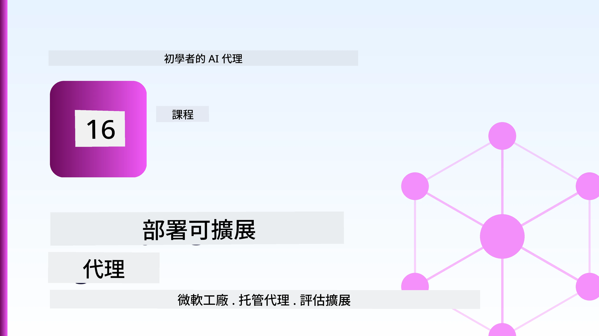
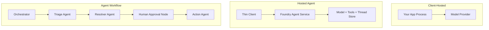
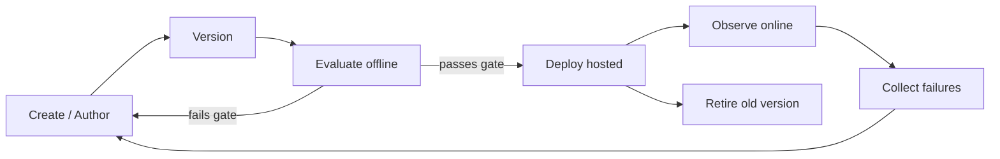
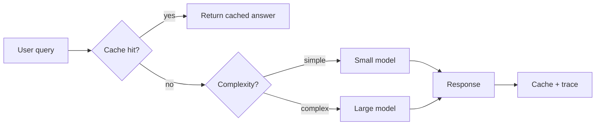
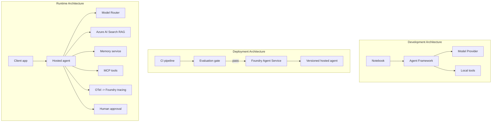

# 使用 Microsoft Foundry 部署可擴展代理



到目前為止，您已經建立了在筆記本中運行的代理，使用 `az login` 和少量環境變量來驅動。這確實是學習的正確方式。但這並非適合在凌晨三點有數千客戶依賴時執行代理的方式。

本課程講述「在我的機器上可以運行」與「在生產中可靠且經濟地運行」之間的差距。我們使用 **Microsoft Foundry** 和 **Microsoft Foundry Agent Service** 來彌合這個差距，並通過構建具有工具、檢索、記憶、評估和監控的真實客戶支持代理來實現。

## 介紹

本課程將涵蓋：

- <strong>原型代理</strong>與<strong>部署代理</strong>之間的差異，及為何轉換主要是模型「周圍」的一切。
- 代理的<strong>部署模式</strong>：客戶端託管、服務託管（託管代理）及工作流程編排。
- Microsoft Foundry 上的<strong>代理生命週期</strong> — 創建、版本管理、部署、評估、觀察、退役。
- <strong>擴展策略</strong>：模型路由、快取、並發及無狀態設計。
- 使用 OpenTelemetry 及 Foundry 追蹤進行的<strong>可觀察性</strong>。
- 通過模型選擇、路由及評估門控實現的<strong>成本優化</strong>。
- <strong>企業考量</strong>：治理、人為批准及生產安全運行 MCP 伺服器。

## 學習目標

完成本課程後，您將了解如何：

- 根據代理工作負載選擇合適的部署模式。
- 將代理部署到 Microsoft Foundry Agent Service，使其版本化、治理和可觀察。
- 為代理儀表板追蹤並連接釋出前運行的評估流水線。
- 應用模型路由和快取，在規模化時控制延遲和成本。
- 為高風險操作添加人為批准闸門，並以生產安全的方式整合 MCP 伺服器。

## 預備知識

本課假設您已完成之前課程並熟悉：

- 使用 [Microsoft Agent Framework](../14-microsoft-agent-framework/README.md) 建立代理（第14課）。
- [工具使用](../04-tool-use/README.md)（第4課）及 [Agentic RAG](../05-agentic-rag/README.md)（第5課）。
- [代理記憶](../13-agent-memory/README.md)（第13課）及 [Agentic Protocols / MCP](../11-agentic-protocols/README.md)（第11課）。
- [可觀察性與評估](../10-ai-agents-production/README.md)（第10課）——本課直接建立於此之上。

您還需要：

- 一個 **Azure 訂閱** 及一個至少部署了一個聊天模型的 **Microsoft Foundry 專案**。
- 已認證的 **Azure CLI** (`az login`)。
- Python 3.12+ 和倉庫中的套件 [`requirements.txt`](../../../requirements.txt)。

## 從原型到生產：實際改變了什麼

原型代理和生產代理核心迴圈相同 — 推理、呼叫工具、回應。變化的是包裹該迴圈的所有其他部分。模型大約佔生產代理的20％；其餘80％是運營骨架。

| 關注點 | 原型 | 生產 |
| --- | --- | --- |
| <strong>託管</strong> | 在您的筆記本運行 | 作為託管服務運行，有版本和滾動發布 |
| <strong>身份</strong> | 您的 `az login` 令牌 | 由管理身份以範圍 RBAC 管理 |
| <strong>狀態</strong> | 內存中，重啟時丟失 | 外部化（線程存儲，記憶服務） |
| <strong>失敗</strong> | 您看到追蹤記錄 | 重試、備援、死信、警報 |
| <strong>成本</strong> | 「幾分錢」 | 按請求跟蹤、路由、快取、預算控制 |
| <strong>品質</strong> | 您肉眼審視輸出 | 每次發布前自動評估 |
| <strong>信任</strong> | 您批准每個操作 | 政策 + 高風險操作人為介入 |

請記住此表。以下每節對應表中一行。

## 代理部署模式

有三種您常用的模式，且經常結合使用。

### 1. 客戶端託管代理

代理對象位於<em>您的</em>應用程序進程內。您的代碼直接調用模型提供者；推理迴圈在您的服務中運行。這是之前每個課程的做法。

- <strong>何時使用</strong>：當您需要完全控制迴圈、自訂中介軟體或將代理嵌入現有後端時。
- <strong>取捨</strong>：您自己負責擴展、狀態及韌性。

### 2. 託管代理（Foundry Agent Service）

代理作為資源<em>註冊</em>在 Microsoft Foundry 中。Foundry 托管推理迴圈，儲存線程，強制內容安全及 RBAC，並使代理在 Foundry 門戶中可見。您的應用成為創建線程和讀取回應的輕量客戶端。

- <strong>何時使用</strong>：當您需要持久性、內建可觀察性、治理及較少運營面積時。
- <strong>取捨</strong>：放棄較低層次控制以換取受管理的運行時。

### 3. 代理工作流

多個代理（和工具）組合成有明確控制流程的圖形 — 順序步驟、分支、人為批准節點及可暫停恢復的持久檢查點。這是 Microsoft Agent Framework <strong>工作流</strong> 功能在部署規模上的應用。

- <strong>何時使用</strong>：當單一任務涵蓋多個專門代理或中途需批准時。
- <strong>取捨</strong>：更多複雜部件，需要編排層面的可觀察性。



## Microsoft Foundry 上的代理生命週期

部署代理不是一次性的 `push`。它是一個迴圈，看起來很像軟體發布週期，因為它的確如此。



關鍵理念，從 [第10課](../10-ai-agents-production/README.md) 延續：<strong>離線評估是一道門檻，而非事後想法。</strong>新代理版本未通過評估門檻不會發布。線上可觀察性將實際失敗回饋到離線測試數據，這是完整循環。

## 擴展策略

擴展代理不同於擴展無狀態的網絡 API，因為每個請求可觸發多個昂貴的模型及工具呼叫。四種技術承擔大部分負載。

**無狀態請求處理。** 不要在進程內存中保存任何每用戶狀態。對話線程保存在 Foundry 線程存儲或記憶服務中，使任何實例都能處理任何請求。這讓您能水平擴展 — 添加實例，無需黏性會話。

**模型路由。** 不是每個請求都需要您最強大（且最昂貴）的模型。針對簡單請求 — 意圖分類、簡短事實答案 — 發到小模型，大模型留給真正的推理。Foundry 的 <strong>模型路由器</strong> 可幫您完成，或者您可自行實現輕量分類器。您將在實驗中打造 DIY 版本。

**回應快取。** 許多支持查詢是近似重複（如「如何重設密碼？」）。對常見問題快取答案，服務時不必觸碰模型。即使是適度快取率，也顯著降低成本和延遲。

**並發與背壓。** 模型提供者有限流率。限制並發數，使用帶指數退避的重試，且優雅失敗（一個排隊的「我們正在處理」回應勝過 500 錯誤）。



## 生產中的可觀察性

您無法操作您看不見的東西。如第10課所述，Microsoft Agent Framework 原生發出 **OpenTelemetry** 追蹤 — 每次模型呼叫、工具調用及編排步驟成為一個跨度。在生產中，您將這些跨度導出到 Microsoft Foundry（或任何 OTel 兼容後端），以便：

- 追蹤單一客戶投訴跨越所有模型及工具呼叫的端對端流程。
- 隨時間監視請求的 p50/p95 延遲和成本。
- 在用戶（或財務團隊）察覺前警報錯誤率飆升及成本異常。

```python
from agent_framework.observability import get_tracer

tracer = get_tracer()

with tracer.start_as_current_span("support_request") as span:
    span.set_attribute("customer.tier", "enterprise")
    span.set_attribute("routed.model", "gpt-5-nano")
    # agent execution is traced automatically inside this span
```

属性如 `customer.tier` 和 `routed.model` 將大量追蹤轉化為可解答問題（「企業客戶是否過於頻繁被路由到小模型？」）。

## 成本優化

生產代理的成本主要由 token 決定。三個調節桿，按影響力排序：

1. **合適調整模型大小。** 通過評估門檻的小模型幾乎永遠比通過的大小模型更便宜。用評估證明小模型足夠好，而非預設使用最大模型以求安全。
2. **按複雜度路由。** 如上所述 — 只為需要大模型推理的請求付大模型成本。
3. **積極快取。** 最便宜的模型呼叫是你永遠不需要做的那一次。

評估門和成本控制是同一學科的兩個角度：評估告訴您<em>品質底線</em>，路由和快取使您盡可能接近該底線<em>成本</em>。

## 企業部署考量

**治理。** 託管代理繼承 Foundry 的 RBAC、內容安全與審計日誌。給每個代理一個最小權限的管理身份 — 只讀知識庫，範圍限制的工單 API 存取，且不多餘。

**人為介入。** 有些操作太重要無法完全自動執行 — 發放退款、刪除帳號、升級法律團隊。Microsoft Agent Framework 支援 <strong>需批准</strong> 工具：代理提出操作，執行暫停，人類批准或拒絕，工作流程復原。您在[第6課](../06-building-trustworthy-agents/README.md)見過原始範例；這裡您部署它。

**生產用 MCP。** [MCP](../11-agentic-protocols/README.md) 讓代理通過標準介面調用外部工具。生產環境中，將每個 MCP 伺服器視為不受信任邊界：固定伺服器版本，使用限權身份運行，驗證輸出，切勿暴露機密。MCP 伺服器是依賴，依賴需要修補、審計及限流。



這三張圖 — 開發、部署、運行時 — 是同一代理生命週期的三階段。接下來的實驗將帶您構建它。

## 實作實驗：生產就緒客戶支持代理

打開 [`code_samples/16-python-agent-framework.ipynb`](./code_samples/16-python-agent-framework.ipynb) 並全程實作。您將組裝一個具有所有生產考量的<strong>Contoso 客戶支持代理</strong>：

1. <strong>工具調用</strong> — 查詢訂單狀態及開啟支持工單。
2. **RAG** — 從知識庫回答政策問題（Azure AI Search，並有內存回退以便筆記本無需搜索資源即可運行）。
3. <strong>記憶</strong> — 在對話回合中記住客戶。
4. <strong>模型路由</strong> — 複雜度分類器將每個請求路由到小模型或大模型。
5. <strong>回應快取</strong> — 重複問題從快取中服務。
6. <strong>人為批准</strong> — 超過門檻的退款須人工簽核。
7. <strong>評估流水線</strong> — 小型離線測試集對代理打分並作為釋出閘門。
8. <strong>可觀察性</strong> — 每次請求周圍的 OpenTelemetry 追蹤。

### 步驟說明

筆記本組織方式使每個生產考量成為自包含、可運行的區塊。核心是路由加快取的請求處理器：

```python
async def handle_support_request(query: str, customer_id: str) -> str:
    # 1. Serve from cache when we can.
    cached = response_cache.get(normalize(query))
    if cached:
        return cached

    # 2. Route by complexity to control cost.
    model = "gpt-5-nano" if is_simple(query) else "gpt-5-mini"

    # 3. Run the agent inside a trace span for observability.
    with tracer.start_as_current_span("support_request") as span:
        span.set_attribute("routed.model", model)
        span.set_attribute("customer.id", customer_id)
        response = await support_agent.run(query, model=model)

    # 4. Cache and return.
    response_cache.set(normalize(query), response.text)
    return response.text
```

守護釋出的評估門如下所示：

```python
async def evaluation_gate(agent, test_cases, threshold: float = 0.8) -> bool:
    passed = 0
    for case in test_cases:
        result = await agent.run(case["input"])
        if score_response(result.text, case["expected"]) >= 0.8:
            passed += 1
    pass_rate = passed / len(test_cases)
    print(f"Evaluation pass rate: {pass_rate:.0%} (gate: {threshold:.0%})")
    return pass_rate >= threshold  # only deploy if the gate passes
```

細讀每行 — 筆記本刻意保持原始小且無框架調用影藏。

## 用冒煙測試驗證部署代理

上述評估門對代理對象<em>離線</em>運行。一旦代理以託管代理部署，您還需要另一種更廉價的檢查：**部署的端點實際在回答嗎？**

「成功」部署僅證明控制平面接受了定義 — 不證明代理回應。一個缺失依賴、錯誤的模型路由或過期連接可能產生表面綠燈卻無回應的部署。<strong>冒煙測試</strong>能數秒內捕獲這點，每次部署均運行，成本小於完整評估。

本倉庫提供一個可立即使用的冒煙測試流水線，建基於 [AI Smoke Test](https://github.com/marketplace/actions/ai-smoke-test) GitHub Action：

- <strong>目錄</strong> — [`tests/lesson-16-smoke-tests.json`](../../../tests/lesson-16-smoke-tests.json) 收錄 Contoso 支持代理的提示和斷言（有根據的政策答案、訂單查詢、主題集中、多回合線程持續性）。其他課程代理的目錄與之並列 — 請參閱 [`tests/README.md`](../tests/README.md)。
- <strong>工作流</strong> — [`.github/workflows/smoke-test.yml`](../../../.github/workflows/smoke-test.yml) 使用 Azure OIDC 登錄並將每個提示 POST 到代理的 Responses 端點，任何斷言失敗即失敗該工作。

```yaml
- name: Smoke-test hosted agent
  uses: JFolberth/ai-smoketest@v1
  with:
    project_endpoint: ${{ inputs.project_endpoint }}
    agent_name: ContosoSupportAgent
    tests_file: tests/lesson-16-smoke-tests.json
```

在您的代理部署完成後，從 **Actions** 頁籤啟動它，並提供您的 Foundry 專案端點與代理名稱。聯邦身份需要在 Foundry 專案範疇內擁有 **Azure AI User** 角色。請將這些層次想像成金字塔：冒煙測試（是否可達且有回應？）在每次部署時執行，離線評估（品質是否足以發佈？）在升級前執行，而線上評估（實際運行表現如何？）則持續進行。

## 知識檢測

在進入作業前，先測試您對內容的理解。

**1. 大概生產代理中的 “模型” 佔多少比例，剩下的是什麼？**

<details>
<summary>答案</summary>

模型是系統中的少數部分—通常約占 20%。其餘則是操作骨架：託管與版本控制、身份識別與 RBAC、外部化狀態、故障處理、成本追蹤、評估，以及人機回路控制。投入生產主要是建立圍繞推理迴路的一切。
</details>

**2. 什麼時候會選擇 Hosted Agent 而非客戶端託管代理？**

<details>
<summary>答案</summary>

當你需要一個內建耐久性（持續且可恢復的執行緒）、可觀察性、內容安全和 RBAC 的託管運行環境，且願意犧牲對推理迴路的部分底層控制以減少運維負擔時，Hosted Agent 是適合的選擇。當你需要對迴路完全掌控，或將代理嵌入現有後端時，客戶端託管比較理想。
</details>

**3. 為什麼可擴展的代理必須在它自己的進程記憶體中無狀態？**

<details>
<summary>答案</summary>

這樣任何實例都能處理任何請求，這就是允許水平擴展而無需使用黏性會話的原因。每位用戶的會話狀態被外部化存放在執行緒存儲或記憶服務中。如果狀態存於進程記憶體中，系統重啟時狀態將遺失，且無法自由分配負載。
</details>

**4. 模型路由解決了什麼問題？它與評估有什麼關係？**

<details>
<summary>答案</summary>

路由將簡單的請求發送給小型、廉價且快速的模型，並把大型模型留給真正的推理，從而控制延遲和成本。它與評估的關係在於，評估是證明小模型對某類請求足夠好的依據—沒有評估的路由只是猜測。
</details>

**5. 什麼是 “評估閘門”，它在生命週期中位於何處？**

<details>
<summary>答案</summary>

評估閘門會對新代理版本執行離線測試集，除非通過率達到門檻，否則阻止部署。它位於生命週期中「版本」與「部署」之間，使品質成為發布的前提，而非發佈後的檢查項目。
</details>

**6. 為什麼 MCP 服務器在生產環境中應視為不受信任的邊界？**

<details>
<summary>答案</summary>

因為它是你的代理呼叫的外部依賴。你應該固定其版本，使用範圍身份運行，驗證其輸出，限制速率，並且絕不向其暴露機密—這與對待任何第三方依賴的紀律相同。它的輸出流入代理的推理過程，因此未經驗證的信任是安全風險。
</details>

**7. 哪項單一變更通常對生產代理成本影響最大？為什麼？**

<details>
<summary>答案</summary>

模型尺寸調整—使用符合評估閘門的最小模型。成本主要受代幣數量影響，而符合品質標準的較小模型幾乎總比較大模型便宜。快取和路由進一步降低成本，但選擇合適的基本模型有最大的一級影響。
</details>

**8. 如 `customer.tier` 與 `routed.model` 等 span 屬性在可觀察性中扮演什麼角色？**

<details>
<summary>答案</summary>

它們將原始追蹤轉換為可回答的業務問題。沒有屬性時，只有一團跨度；有了屬性，你就可以問：「企業客戶是否被過度路由到小模型？」或「哪個模型處理我們最慢的請求？」屬性是依據對營運重要的維度切割遙測資料的方式。
</details>

## 作業

使用實驗室中的客戶支援代理，針對特定情境進行強化：**針對 SaaS 公司的訂閱計費支援代理。**

你的提交應包含：

1. <strong>替換工具</strong> 為與計費相關的工具：`get_subscription_status`、`get_invoice`、和 `issue_credit`（超過 50 美元的信用額須經人工核准）。
2. **新增三份 RAG 文件**，涵蓋公司的退款政策、帳單週期與取消政策。
3. <strong>擴充評估集</strong> 至至少八個案件，其中至少兩個應該觸發人工核准路徑，並確認評估閘門正確通過或失敗。
4. <strong>新增一份成本報告</strong>：在透過代理執行十個混合查詢後，列印多少請求送往小模型，多少送往大模型，多少來自快取。

請寫一段簡短說明（md 單元）解釋你選擇了哪個模型路由規則，以及你如何用真實流量驗證它。沒有正確答案—評分依據是製作的生產考量是否連貫。

## 總結

本課程中，你將代理從原型推向生產，使用 Microsoft Foundry：

- 推進生產主要是圍繞模型的 <strong>操作骨架</strong> — 託管、身份、狀態、故障處理、成本、品質與信任。
- 你學會了三種 <strong>部署模式</strong> — 客戶端託管、Hosted Agent 和代理工作流程—及其適合時機。
- 你了解了 <strong>代理生命週期</strong>，其中離線 <strong>評估作為發布閘門</strong>，線上可觀察性將故障反饋回測試集。
- 你應用了 <strong>擴展策略</strong> — 無狀態設計、模型路由、快取與限制併發—並與 <strong>成本優化</strong> 連結。
- 你整合了 <strong>企業控管</strong>：RBAC、人機回路核准，以及生產安全的 MCP 整合。
- 你打造了一個 <strong>生產可用的客戶支援代理</strong>，將上述所有考量以可執行碼結合。

下一課將展開相反旅程：不是擴展代理到雲端，而是將它們 <em>縮回</em> 單一開發者機器上，完全本地運行。

## 附加資源

- <a href="https://learn.microsoft.com/azure/ai-foundry/what-is-azure-ai-foundry" target="_blank">Microsoft Foundry 文件</a>
- <a href="https://learn.microsoft.com/azure/ai-foundry/agents/overview" target="_blank">Microsoft Foundry 代理服務概述</a>
- <a href="https://learn.microsoft.com/en-us/agent-framework/overview/?wt.mc_id=youtube_26688_organicsocial_reactor&pivots=programming-language-python" target="_blank">Microsoft Agent Framework</a>
- <a href="https://learn.microsoft.com/en-us/azure/ai-foundry/openai/concepts/model-router" target="_blank">Microsoft Foundry 中的模型路由器</a>
- <a href="https://learn.microsoft.com/azure/search/search-what-is-azure-search" target="_blank">Azure AI Search</a>
- <a href="https://opentelemetry.io/" target="_blank">OpenTelemetry</a>
- <a href="https://github.com/marketplace/actions/ai-smoke-test" target="_blank">AI 冒煙測試 GitHub 動作</a>
- <a href="https://modelcontextprotocol.io/" target="_blank">模型上下文協定 (MCP)</a>

## 前一課

[構建電腦使用代理（CUA）](../15-browser-use/README.md)

## 下一課

[創建本地 AI 代理](../17-creating-local-ai-agents/README.md)

---

<!-- CO-OP TRANSLATOR DISCLAIMER START -->
**免責聲明**：
本文件使用 AI 翻譯服務 [Co-op Translator](https://github.com/Azure/co-op-translator) 進行翻譯。雖然我們力求準確，但請注意，自動翻譯可能包含錯誤或不準確之處。原始文件的母語版本應被視為權威來源。對於重要資訊，建議尋求專業人工翻譯。我們不對因使用本翻譯而引起的任何誤解或曲解承擔責任。
<!-- CO-OP TRANSLATOR DISCLAIMER END -->