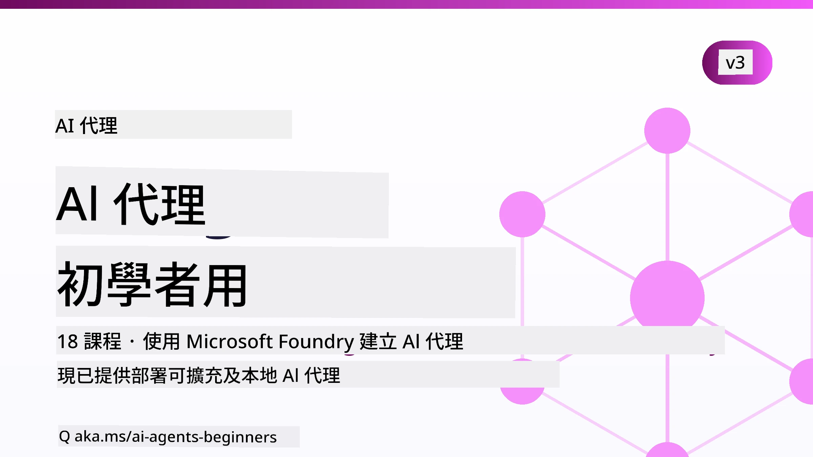

# 新手人工智能代理課程



## 教你開始構建人工智能代理所需知道的所有知識課程

[](https://github.com/microsoft/ai-agents-for-beginners/blob/master/LICENSE?WT.mc_id=academic-105485-koreyst)
[](https://GitHub.com/microsoft/ai-agents-for-beginners/graphs/contributors/?WT.mc_id=academic-105485-koreyst)
[](https://GitHub.com/microsoft/ai-agents-for-beginners/issues/?WT.mc_id=academic-105485-koreyst)
[](https://GitHub.com/microsoft/ai-agents-for-beginners/pulls/?WT.mc_id=academic-105485-koreyst)
[](http://makeapullrequest.com?WT.mc_id=academic-105485-koreyst)

### 🌐 多語言支援

#### 翻譯由 [Co-op Translator](https://github.com/Azure/co-op-translator) 維護

<!-- CO-OP TRANSLATOR LANGUAGES TABLE START -->
[Arabic](../ar/README.md) | [Bengali](../bn/README.md) | [Bulgarian](../bg/README.md) | [Burmese (Myanmar)](../my/README.md) | [Chinese (Simplified)](../zh-CN/README.md) | [Chinese (Traditional, Hong Kong)](../zh-HK/README.md) | [Chinese (Traditional, Macau)](./README.md) | [Chinese (Traditional, Taiwan)](../zh-TW/README.md) | [Croatian](../hr/README.md) | [Czech](../cs/README.md) | [Danish](../da/README.md) | [Dutch](../nl/README.md) | [Estonian](../et/README.md) | [Finnish](../fi/README.md) | [French](../fr/README.md) | [German](../de/README.md) | [Greek](../el/README.md) | [Hebrew](../he/README.md) | [Hindi](../hi/README.md) | [Hungarian](../hu/README.md) | [Indonesian](../id/README.md) | [Italian](../it/README.md) | [Japanese](../ja/README.md) | [Kannada](../kn/README.md) | [Khmer](../km/README.md) | [Korean](../ko/README.md) | [Lithuanian](../lt/README.md) | [Malay](../ms/README.md) | [Malayalam](../ml/README.md) | [Manipuri (Meitei Mayek)](../mni/README.md) | [Marathi](../mr/README.md) | [Nepali](../ne/README.md) | [Nigerian Pidgin](../pcm/README.md) | [Norwegian](../no/README.md) | [Persian (Farsi)](../fa/README.md) | [Polish](../pl/README.md) | [Portuguese (Brazil)](../pt-BR/README.md) | [Portuguese (Portugal)](../pt-PT/README.md) | [Punjabi (Gurmukhi)](../pa/README.md) | [Romanian](../ro/README.md) | [Russian](../ru/README.md) | [Serbian (Cyrillic)](../sr/README.md) | [Slovak](../sk/README.md) | [Slovenian](../sl/README.md) | [Spanish](../es/README.md) | [Swahili](../sw/README.md) | [Swedish](../sv/README.md) | [Tagalog (Filipino)](../tl/README.md) | [Tamil](../ta/README.md) | [Telugu](../te/README.md) | [Thai](../th/README.md) | [Turkish](../tr/README.md) | [Ukrainian](../uk/README.md) | [Urdu](../ur/README.md) | [Vietnamese](../vi/README.md)

> **喜歡本地複製？**
>
> 本存儲庫包含50多種語言翻譯，下載大小明顯增加。如需不含翻譯的複製，請使用稀疏檢出功能：
>
> **Bash / macOS / Linux:**
> ```bash
> git clone --filter=blob:none --sparse https://github.com/microsoft/ai-agents-for-beginners.git
> cd ai-agents-for-beginners
> git sparse-checkout set --no-cone '/*' '!translations' '!translated_images'
> ```
>
> **CMD (Windows):**
> ```cmd
> git clone --filter=blob:none --sparse https://github.com/microsoft/ai-agents-for-beginners.git
> cd ai-agents-for-beginners
> git sparse-checkout set --no-cone "/*" "!translations" "!translated_images"
> ```
>
> 這樣你便可用更快速度下載到完成課程所需的一切內容。
<!-- CO-OP TRANSLATOR LANGUAGES TABLE END -->

**更多語言選項，請見 [Co-op Translator 支援語言](https://github.com/Azure/co-op-translator/blob/main/docs/supported-languages.md)。**

[](https://GitHub.com/microsoft/ai-agents-for-beginners/watchers/?WT.mc_id=academic-105485-koreyst)
[](https://GitHub.com/microsoft/ai-agents-for-beginners/network/?WT.mc_id=academic-105485-koreyst)
[](https://GitHub.com/microsoft/ai-agents-for-beginners/stargazers/?WT.mc_id=academic-105485-koreyst)

[](https://discord.com/invite/ATgtXmAS5D)


## 🌱 開始入門

本課程包括構建人工智能代理的基礎課程。各課程覆蓋獨立主題，歡迎從任意課程開始學習！

本課程支持多語言。請前往我們的[可用語言頁面](#-multi-language-support)。

如果你是首次使用生成式人工智能模型構建，請看看我們的[新手生成式人工智能](https://aka.ms/genai-beginners)課程，其中包括二十一課關於生成式 AI 的建構教學。

別忘了給本存儲庫 [點星 (🌟)](https://docs.github.com/en/get-started/exploring-projects-on-github/saving-repositories-with-stars?WT.mc_id=academic-105485-koreyst) 和 [分叉](https://github.com/microsoft/ai-agents-for-beginners/fork) 以運行代碼。

### 認識其他學員，獲取問題解答

如果你遇到困難或有關構建人工智能代理的任何問題，請加入我們的專用 Discord 頻道：[Microsoft Foundry Discord](https://aka.ms/ai-agents/discord)。

### 你需要準備什麼

本課程每課均包含代碼示例，代碼位於 code_samples 資料夾。你可以[分叉本存儲庫](https://github.com/microsoft/ai-agents-for-beginners/fork)創建自己的複製。  

本課程的代碼示例使用 Microsoft Agent Framework 和 Microsoft Foundry Agent Service V2：

- [Microsoft Foundry](https://aka.ms/ai-agents-beginners/ai-foundry) - 需 Azure 帳戶

本課程使用微軟的多個人工智能代理框架和服務：

- [Microsoft Agent Framework (MAF)](https://learn.microsoft.com/agent-framework/overview/)
- [Microsoft Foundry Agent Service V2](https://aka.ms/ai-agents-beginners/ai-agent-service)

部分代碼示例亦支持替代的 OpenAI 兼容提供方，如提供大上下文模型（最高204K代幣）的[MiniMax](https://platform.minimaxi.com/)。詳情見[課程設置](./00-course-setup/README.md)。

欲了解執行本課程代碼的更多信息，請見[課程設置](./00-course-setup/README.md)。

## 🙏 想要幫忙嗎？

有建議或發現拼寫或代碼錯誤？[提出 issue](https://github.com/microsoft/ai-agents-for-beginners/issues?WT.mc_id=academic-105485-koreyst) 或 [創建 pull request](https://github.com/microsoft/ai-agents-for-beginners/pulls?WT.mc_id=academic-105485-koreyst)


## 📂 每課內容包含

- 一篇置於 README 的書面課程和一段短視頻
- 使用 Microsoft Agent Framework 和 Microsoft Foundry 的 Python 代碼示例
- 繼續學習的更多資源連結


## 🗃️ 課程目錄

| <strong>課程</strong>                                | <strong>文本與代碼</strong>                                 | <strong>視頻</strong>                                                | <strong>額外學習資源</strong>                                                                      |
|----------------------------------------|----------------------------------------------|--------------------------------------------------------|-------------------------------------------------------------------------------------|
| 人工智能代理介紹與代理應用案例        | [連結](./01-intro-to-ai-agents/README.md)             | [視頻](https://youtu.be/3zgm60bXmQk?si=z8QygFvYQv-9WtO1)                        | [連結](https://aka.ms/ai-agents-beginners/collection?WT.mc_id=academic-105485-koreyst)                                                    |
| 探索人工智能代理框架                  | [連結](./02-explore-agentic-frameworks/README.md)             | [視頻](https://youtu.be/ODwF-EZo_O8?si=Vawth4hzVaHv-u0H)                        | [連結](https://aka.ms/ai-agents-beginners/collection?WT.mc_id=academic-105485-koreyst)                                                    |
| 理解人工智能代理設計模式              | [連結](./03-agentic-design-patterns/README.md)             | [視頻](https://youtu.be/m9lM8qqoOEA?si=BIzHwzstTPL8o9GF)                        | [連結](https://aka.ms/ai-agents-beginners/collection?WT.mc_id=academic-105485-koreyst)                                                    |
| 工具使用設計模式                      | [連結](./04-tool-use/README.md)             | [視頻](https://youtu.be/vieRiPRx-gI?si=2z6O2Xu2cu_Jz46N)                       | [連結](https://aka.ms/ai-agents-beginners/collection?WT.mc_id=academic-105485-koreyst)                                                   |
| 代理檔案檢索生成模型（RAG）          | [連結](./05-agentic-rag/README.md)            | [視頻](https://youtu.be/WcjAARvdL7I?si=gKPWsQpKiIlDH9A3)                       | [連結](https://aka.ms/ai-agents-beginners/collection?WT.mc_id=academic-105485-koreyst)                                                   |
| 打造可信賴的人工智能代理              | [連結](./06-building-trustworthy-agents/README.md)            | [視頻](https://youtu.be/iZKkMEGBCUQ?si=jZjpiMnGFOE9L8OK)                       | [連結](https://aka.ms/ai-agents-beginners/collection?WT.mc_id=academic-105485-koreyst)                                                   |
| 計劃設計模式                          | [連結](./07-planning-design/README.md)            | [視頻](https://youtu.be/kPfJ2BrBCMY?si=6SC_iv_E5-mzucnC)                       | [連結](https://aka.ms/ai-agents-beginners/collection?WT.mc_id=academic-105485-koreyst)                                                   |
| 多代理設計模式                       | [連結](./08-multi-agent/README.md)            | [視頻](https://youtu.be/V6HpE9hZEx0?si=rMgDhEu7wXo2uo6g)                       | [連結](https://aka.ms/ai-agents-beginners/collection?WT.mc_id=academic-105485-koreyst)                                                   |
| 元認知設計模式                       | [連結](./09-metacognition/README.md)            | [視頻](https://youtu.be/His9R6gw6Ec?si=8gck6vvdSNCt6OcF)                       | [連結](https://aka.ms/ai-agents-beginners/collection?WT.mc_id=academic-105485-koreyst)                                                   |
| 生產環境中的人工智能代理             | [連結](./10-ai-agents-production/README.md)            | [視頻](https://youtu.be/l4TP6IyJxmQ?si=31dnhexRo6yLRJDl)                       | [連結](https://aka.ms/ai-agents-beginners/collection?WT.mc_id=academic-105485-koreyst)                                                   |
| 使用代理通訊協議（MCP、A2A 和 NLWeb） | [連結](./11-agentic-protocols/README.md)            | [視頻](https://youtu.be/X-Dh9R3Opn8)                       | [連結](https://aka.ms/ai-agents-beginners/collection?WT.mc_id=academic-105485-koreyst)                                                   |
| 人工智能代理上下文工程              | [連結](./12-context-engineering/README.md)            | [視頻](https://youtu.be/F5zqRV7gEag)                       | [連結](https://aka.ms/ai-agents-beginners/collection?WT.mc_id=academic-105485-koreyst)                                                   |
| 管理代理記憶                         | [連結](./13-agent-memory/README.md)            | [視頻](https://youtu.be/QrYbHesIxpw?si=vZkVwKrQ4ieCcIPx)                        |                                                                                     |
| 探索微軟代理框架                     | [連結](./14-microsoft-agent-framework/README.md)            |                                                        |                                                                                     |
| 建構電腦使用代理（CUA）              | [連結](./15-browser-use/README.md)            |                                                        | [連結](https://docs.browser-use.com/examples/templates/playwright-integration)                                                   |
| 部署可擴展代理                       | [連結](./16-deploying-scalable-agents/README.md)            |                                                        | [連結](https://learn.microsoft.com/azure/ai-foundry/agents/overview)                                                   |
| 創建本地人工智能代理                | [連結](./17-creating-local-ai-agents/README.md)            |                                                        | [連結](https://learn.microsoft.com/azure/ai-foundry/foundry-local/)                                                   |
| 保障人工智能代理安全                | [連結](./18-securing-ai-agents/README.md)            |                                                        | [連結](https://aka.ms/ai-agents-beginners/collection?WT.mc_id=academic-105485-koreyst)                                                   |

## 🎒 其他課程

我們團隊還製作了其他課程！請查看：

<!-- CO-OP TRANSLATOR OTHER COURSES START -->
### LangChain
[](https://aka.ms/langchain4j-for-beginners)
[](https://aka.ms/langchainjs-for-beginners?WT.mc_id=m365-94501-dwahlin)
[](https://github.com/microsoft/langchain-for-beginners?WT.mc_id=m365-94501-dwahlin)
---

### Azure / Edge / MCP / Agents
[](https://github.com/microsoft/AZD-for-beginners?WT.mc_id=academic-105485-koreyst)
[](https://github.com/microsoft/edgeai-for-beginners?WT.mc_id=academic-105485-koreyst)
[](https://github.com/microsoft/mcp-for-beginners?WT.mc_id=academic-105485-koreyst)
[](https://github.com/microsoft/ai-agents-for-beginners?WT.mc_id=academic-105485-koreyst)

---
 
### 生成式人工智能系列
[](https://github.com/microsoft/generative-ai-for-beginners?WT.mc_id=academic-105485-koreyst)
[-9333EA?style=for-the-badge&labelColor=E5E7EB&color=9333EA)](https://github.com/microsoft/Generative-AI-for-beginners-dotnet?WT.mc_id=academic-105485-koreyst)
[-C084FC?style=for-the-badge&labelColor=E5E7EB&color=C084FC)](https://github.com/microsoft/generative-ai-for-beginners-java?WT.mc_id=academic-105485-koreyst)
[-E879F9?style=for-the-badge&labelColor=E5E7EB&color=E879F9)](https://github.com/microsoft/generative-ai-with-javascript?WT.mc_id=academic-105485-koreyst)

---
 
### 核心學習
[](https://aka.ms/ml-beginners?WT.mc_id=academic-105485-koreyst)
[](https://aka.ms/datascience-beginners?WT.mc_id=academic-105485-koreyst)
[](https://aka.ms/ai-beginners?WT.mc_id=academic-105485-koreyst)
[](https://github.com/microsoft/Security-101?WT.mc_id=academic-96948-sayoung)
[](https://aka.ms/webdev-beginners?WT.mc_id=academic-105485-koreyst)
[](https://aka.ms/iot-beginners?WT.mc_id=academic-105485-koreyst)
[](https://github.com/microsoft/xr-development-for-beginners?WT.mc_id=academic-105485-koreyst)

---
 
### 助理系列
[](https://aka.ms/GitHubCopilotAI?WT.mc_id=academic-105485-koreyst)
[](https://github.com/microsoft/mastering-github-copilot-for-dotnet-csharp-developers?WT.mc_id=academic-105485-koreyst)
[](https://github.com/microsoft/CopilotAdventures?WT.mc_id=academic-105485-koreyst)
<!-- CO-OP TRANSLATOR OTHER COURSES END -->

## 🌟 社群感謝

感謝 [Shivam Goyal](https://www.linkedin.com/in/shivam2003/) 貢獻重要示範 Agentic RAG 的程式碼範例。

## 貢獻方式

本專案歡迎貢獻和建議。大部分貢獻須您同意
貢獻者授權協議（CLA），聲明您有權利且確實授予我們
使用您貢獻內容的權利。詳情請見 <https://cla.opensource.microsoft.com>。

提交 pull request 時，CLA 機器人會自動判定您是否需要提供
CLA 並適當標示 PR（例如狀態檢查、評論）。只需照著機器人
指示操作即可。對於使用我們 CLA 的所有 repo，您只需完成此步驟一次。

本專案已採用 [Microsoft 開放原始碼行為準則](https://opensource.microsoft.com/codeofconduct/)。
詳情請見 [行為準則常見問題](https://opensource.microsoft.com/codeofconduct/faq/)，或
聯絡 [opencode@microsoft.com](mailto:opencode@microsoft.com) 詢問任何額外問題或意見。

## 商標

本專案可能包含專案、產品或服務的商標或標誌。微軟商標或標誌的
授權使用須遵守並依照
[Microsoft 商標與品牌指引](https://www.microsoft.com/legal/intellectualproperty/trademarks/usage/general)。
在本專案修改版本中使用微軟商標或標誌不得造成混淆或暗示微軟贊助。
任何使用第三方商標或標誌均須遵守該第三方的政策。

## 尋求協助


如果卡住，或對開發 AI 應用有任何疑問，請加入：

[](https://aka.ms/foundry/discord)

如果對產品有回饋或開發中發生錯誤，請造訪：

[](https://aka.ms/foundry/forum)

---

<!-- CO-OP TRANSLATOR DISCLAIMER START -->
**免責聲明**：
本文件使用 AI 翻譯服務 [Co-op Translator](https://github.com/Azure/co-op-translator) 進行翻譯。雖然我們力求準確，但請注意，自動翻譯可能包含錯誤或不準確之處。原始文件的母語版本應被視為權威來源。對於重要資訊，建議尋求專業人工翻譯。我們不對因使用本翻譯而引起的任何誤解或曲解承擔責任。
<!-- CO-OP TRANSLATOR DISCLAIMER END -->