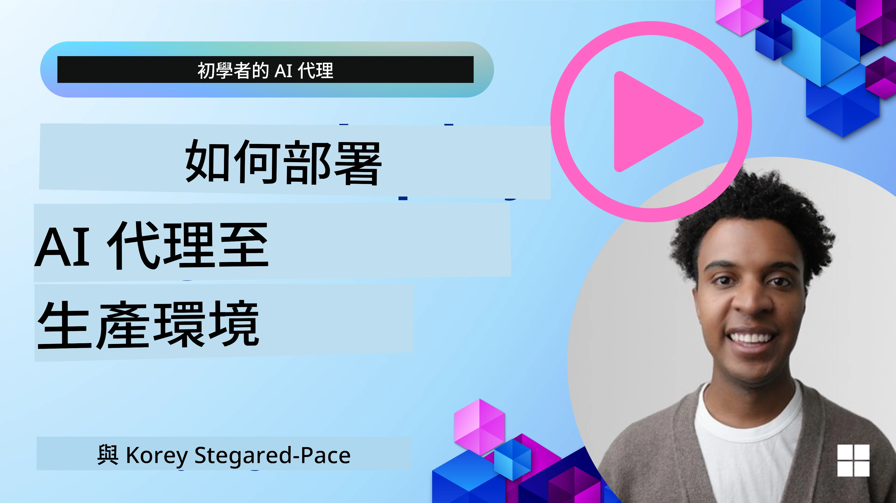

# 生產環境中的 AI 代理：可觀察性與評估

[](https://youtu.be/l4TP6IyJxmQ?si=reGOyeqjxFevyDq9)

當 AI 代理從實驗原型轉向真實應用時，理解其行為、監控性能並系統性評估其輸出變得十分重要。

## 學習目標

完成本課程後，您將會了解/知道如何：
- 代理的可觀察性和評估核心概念
- 改善代理性能、成本與效能的技術
- 系統性評估 AI 代理的內容與方法
- 在生產環境部署 AI 代理時如何控制成本
- 如何為使用 Microsoft Agent Framework 建立的代理撰寫監控程式碼

目標是賦予您知識，將您的「黑盒子」代理轉變為透明、可管理且可靠的系統。

_**注意：** 部署安全且值得信賴的 AI 代理相當重要。請參考[打造值得信賴的 AI 代理](../06-building-trustworthy-agents/README.md)課程。_

## 追蹤與跨度

可觀察性工具如 [Langfuse](https://langfuse.com/) 或 [Microsoft Foundry](https://learn.microsoft.com/en-us/azure/ai-foundry/what-is-azure-ai-foundry) 通常將代理運行表示為追蹤（trace）及跨度（span）。

- **追蹤（Trace）** 代表整個代理任務的完整流程（例如處理使用者查詢）。
- **跨度（Spans）** 是追蹤中的個別步驟（例如呼叫語言模型或擷取資料）。


<!-- Image URL retained for illustration purposes -->

若沒有可觀察性，AI 代理就像一個「黑盒子」—其內部狀態與推理過程不透明，難以診斷問題或優化性能。擁有可觀察性後，代理變成「玻璃盒子」，提供關鍵透明度，有助於建立信任並確保其按預期運作。

## 為什麼生產環境中可觀察性很重要

將 AI 代理轉移至生產環境會帶來一系列新挑戰和需求。可觀察性已非「可有可無」，而是關鍵能力：

*   <strong>除錯與根本原因分析</strong>：當代理失敗或輸出異常結果時，可觀察性工具提供追蹤以定位錯誤根源。這在多次調用大型語言模型、工具互動和條件邏輯複雜的代理中特別重要。
*   <strong>延遲與成本管理</strong>：AI 代理常依賴按令牌或呼叫計費的 LLM 和外部 API。可觀察性讓您精確追蹤這些呼叫，有助識別過慢或過貴的操作。團隊可據此優化提示詞、選擇更高效模型或重新設計流程來管控運營成本並確保良好用戶體驗。
*   **信賴、安全與合規**：在許多應用中，確保代理行為安全且合乎倫理十分重要。可觀察性提供代理行動和決策的審計軌跡，可用以偵測並減輕提示詞注入、有害內容生成或個人識別資訊（PII）處理不當等問題。例如，您可以檢視追蹤以了解代理為何提供某特定回應或使用特定工具。
*   <strong>持續改進循環</strong>：可觀察性資料是反覆開發過程的基礎。透過監控代理在真實世界中的表現，團隊可找出改進空間，收集微調模型的資料，並驗證改動成效。這形成一個反饋循環，讓生產中線上評估的見解指導離線實驗和完善，逐步提升代理表現。

## 需追蹤的關鍵指標

為了監控並理解代理行為，應追蹤多種指標和信號。具體指標會因代理用途而異，但某些指標具普遍重要性。

以下是可觀察性工具常見監控的指標：

**延遲（Latency）：** 代理回應速度有多快？等待時間過長會影響使用者體驗。您應該透過追蹤代理執行過程來測量任務和個別步驟的延遲。例如，若代理所有模型調用共花 20 秒，可考慮使用更快速模型或平行執行調用來加速。

**成本（Costs）：** 每次代理執行花費多少？AI 代理依賴按令牌計費的 LLM 呼叫或外部 API。頻繁的工具使用或多次提示可快速增加成本。舉例來說，若代理為了稍微提升質量而呼叫 LLM 五次，您必須評估成本是否合理，或者是否可以減少呼叫次數或使用更便宜模型。實時監控也能辨識異常爆增（如 BUG 導致過度 API 迴圈）。

**請求錯誤（Request Errors）：** 代理失敗的請求數量。包含 API 錯誤或工具調用失敗。為保持代理在生產環境的穩定性，可設定備援或重試機制。如 LLM 提供者 A 故障時，切換為 B 作為後備。

**使用者反饋（User Feedback）：** 實施直接使用者評估可獲得寶貴見解。包含明確評分（👍讚/👎否，⭐1-5 星）或文字評論。持續負面反饋須警示您：代理未達預期。

**隱含使用者反饋（Implicit User Feedback）：** 使用者行為即使無明確評分也提供間接反饋。舉例包括立即重新措詞、重複詢問或點擊重試按鈕。若發現使用者反覆問同樣問題，顯示代理表現不佳。

**準確率（Accuracy）：** 代理產出正確或理想結果的頻率。準確率定義視情況而異（例如解題正確性、資訊檢索準確性、使用者滿意度）。首步是明確界定代理成功標準。您可以透過自動檢查、評估分數或任務完成標記來追蹤準確率。例如將追蹤標記為「成功」或「失敗」。

**自動評估指標（Automated Evaluation Metrics）：** 您也可設定自動評估。舉例使用 LLM 來評分代理輸出是否有幫助、準確。也有多個開源庫協助評分代理不同面向，如用於 RAG 代理的 [RAGAS](https://docs.ragas.io/)，或用於偵測有害語言或提示注入的 [LLM Guard](https://github.com/protectai/llm-guard)。

實務上，多指標結合最能全面反映 AI 代理健康狀況。這章的[範例筆記本](./code_samples/10-expense_claim-demo.ipynb)將示範這些指標在真實範例中的情形，但首先，我們先了解典型評估工作流程。

## 為您的代理編寫監控程式碼

若要收集追蹤資料，您需要為程式碼編寫監控程式碼。目標是擴增代理程式碼以產生可由可觀察性平台擷取、處理並視覺化的追蹤與指標。

**OpenTelemetry (OTel)：** [OpenTelemetry](https://opentelemetry.io/) 已成為 LLM 可觀察性的業界標準。它提供一組 API、SDK 和工具，用於產生、收集及匯出遙測資料。

有許多監控程式庫包裝既有代理框架，方便將 OpenTelemetry 跨度匯出至可觀察性工具。Microsoft Agent Framework 原生整合了 OpenTelemetry。以下為監控 MAF 代理的範例：

```python
from agent_framework.observability import get_tracer, get_meter

tracer = get_tracer()
meter = get_meter()

with tracer.start_as_current_span("agent_run"):
    # Agent execution is traced automatically
    pass
```

本章的[範例筆記本](./code_samples/10-expense_claim-demo.ipynb)將示範如何為您的 MAF 代理編寫監控程式碼。

**手動創建跨度（Manual Span Creation）：** 雖然監控程式庫能提供良好基線，但常有需要更詳細或自訂資訊的情況。您可以手動創建跨度來添加自訂應用邏輯。更重要的是，您可以為自動或手動創建的跨度增添自訂屬性（又稱標籤或元資料）。這些屬性可包括業務特定資料、中間計算結果，或任何有助於除錯或分析的上下文，如 `user_id`、`session_id` 或 `model_version`。

以下為使用 [Langfuse Python SDK](https://langfuse.com/docs/sdk/python/sdk-v3) 手動創建追蹤與跨度的範例：

```python
from langfuse import get_client
 
langfuse = get_client()
 
span = langfuse.start_span(name="my-span")
 
span.end()
```

## 代理評估

可觀察性提供指標，評估則是分析這些資料（並執行測試）以判斷 AI 代理表現與改進空間。換句話說，擁有追蹤和指標後，如何利用它們來評判代理並做決策？

定期評估相當重要，因為 AI 代理通常是非確定性的，且可能因更新或模型行為漂移而演變——無評估，您無法判斷您的「智慧代理」是否真的表現良好或有退步。

AI 代理評估分為兩類：<strong>線上評估</strong>與<strong>離線評估</strong>。兩者皆有價值且相輔相成。通常會先從離線評估開始，這是部署任何代理前的最低必要步驟。

### 離線評估


離線評估指在受控環境中評估代理，通常使用測試資料集，而非即時使用者查詢。使用策劃好的資料集（清楚知道預期輸出或正確行為），執行代理測試。

舉例來說，若您建立一個數學應用題代理，可能會有一個 [測試資料集](https://huggingface.co/datasets/openai/gsm8k)，包含 100 道已知答案的題目。離線評估通常於開發階段執行（並可做為 CI/CD 流程一環），用以檢查改進或避免退步。優點是<strong>可重複且可獲得明確的準確率指標，因為有正確答案作比對</strong>。您也可模擬使用者查詢，將代理回應與理想答案對照，或使用前述自動指標。

離線評估的主要挑戰是確保測試資料集完整且持續相關——代理可能在固定測試集表現良好，但在生產環境遇到截然不同查詢。因此，應定期更新測試集，納入反映真實世界情況的新邊緣案例與範例。小型「煙霧測試」與大型評估集混合使用最理想：小集快速檢查，大集用於更廣泛績效指標。

### 線上評估


線上評估指在實際生產環境中，即真實使用時評估代理。線上評估包含監控代理於真實使用者互動的表現並持續分析結果。

例如，您可追蹤成功率、使用者滿意度分數或其他即時流量指標。線上評估的優勢是<strong>能捕捉您在實驗室環境難以預期的事情</strong>—可觀察模型漂移（當輸入模式變化導致代理效能下降）及未包含於測試資料的意外查詢或情況。它提供代理在實際運作中的真實狀況。

線上評估通常也包含收集隱含與明確使用者反饋，並可能進行暗影測試或 A/B 測試（新版本代理與舊版本同時運行以比較）。挑戰在於難以取得可靠的標籤或分數—可能需依賴使用者反饋或下游指標（如使用者是否點擊結果）。

### 結合兩者

線上與離線評估並非互斥，反而高度互補。線上監控的洞察（例如代理表現差的使用者新型態查詢）可用於擴充與改善離線測試資料集。反過來，離線表現良好的代理，可更有信心地部署並在線上監控。

事實上，許多團隊採用以下循環：

_離線評估 -> 部署 -> 線上監控 -> 收集新失敗案例 -> 加入離線測試集 -> 精進代理 -> 重複_。

## 常見問題

在您將 AI 代理部署至生產環境時，可能會遇到各種挑戰。以下列出一些常見問題及其潛在解決方案：

| <strong>問題</strong>    | <strong>潛在解決方案</strong>   |
| ------------- | ------------------ |
| AI 代理無法穩定執行任務 | - 精煉給 AI 代理的提示詞，明確目標。<br>- 確定是否可將任務拆分為子任務，由多個代理分別處理。 |
| AI 代理陷入連續迴圈 | - 確保有明確的終止條件，讓代理知道何時停止流程。<br>- 對需推理與規劃的複雜任務，使用更大且專門進行推理的模型。 |
| AI 代理的工具調用表現不佳 | - 在代理系統外測試及驗證工具輸出。<br>- 精煉工具參數、提示詞與命名。 |
| 多代理系統表現不一致 | - 精煉各代理接收之提示，確保內容具體且彼此區別明顯。<br>- 建立層級系統，利用「路由」或控制代理決定正確代理。 |

許多問題透過可觀察性可更有效識別。我們先前討論的追蹤與指標可精確定位代理流程中問題發生處，使除錯和優化效率提升。

## 成本管理

以下是管理 AI 代理部署成本的一些策略：

**使用較小的模型：** 小型語言模型 (SLM) 在某些自主任務上表現良好，並且能顯著降低成本。如前所述，建立評估系統來判斷並比較與大型模型的效能，是理解 SLM 如何適用於您的使用案例的最佳方法。考慮在像意圖分類或參數擷取等較簡單的任務中使用 SLM，並保留大型模型處理複雜推理。

**使用路由模型：** 類似策略是使用多元化的模型和規模。您可以透過 LLM/SLM 或無伺服器函式，依據複雜度將請求路由至最合適的模型。這也有助於降低成本，同時確保在適合任務上的效能。例如，將簡單查詢導向較小且較快的模型，只在複雜推理任務時使用昂貴的大型模型。

**快取回應：** 識別常見請求及任務，並在它們送入您的自主系統前先提供回應，是減少類似請求量的好方法。您甚至可以實作一個流程，使用較基礎的 AI 模型判斷請求與快取請求的相似度。此策略可大幅降低常見問題或常用工作流程的成本。

## 讓我們看看實際運作情況

在本節的 [範例筆記本](./code_samples/10-expense_claim-demo.ipynb) 中，我們將看到如何使用可觀察性工具來監控和評估我們的代理。


### 對生產環境中的 AI 代理有更多問題嗎？

加入 [Microsoft Foundry Discord](https://discord.com/invite/ATgtXmAS5D)，與其他學習者互動，參加辦公時間並獲得您的 AI 代理問題解答。

## 上一課

[元認知設計模式](../09-metacognition/README.md)

## 下一課

[自主協定](../11-agentic-protocols/README.md)

---

<!-- CO-OP TRANSLATOR DISCLAIMER START -->
**免責聲明**：
此文件已使用 AI 翻譯服務 [Co-op Translator](https://github.com/Azure/co-op-translator) 進行翻譯。雖然我們努力追求準確性，但請注意自動翻譯可能包含錯誤或不準確之處。原始文件的母語版本應視為權威來源。對於關鍵資訊，建議採用專業人工翻譯。我們不對因使用此翻譯所產生的任何誤解或誤譯承擔責任。
<!-- CO-OP TRANSLATOR DISCLAIMER END -->