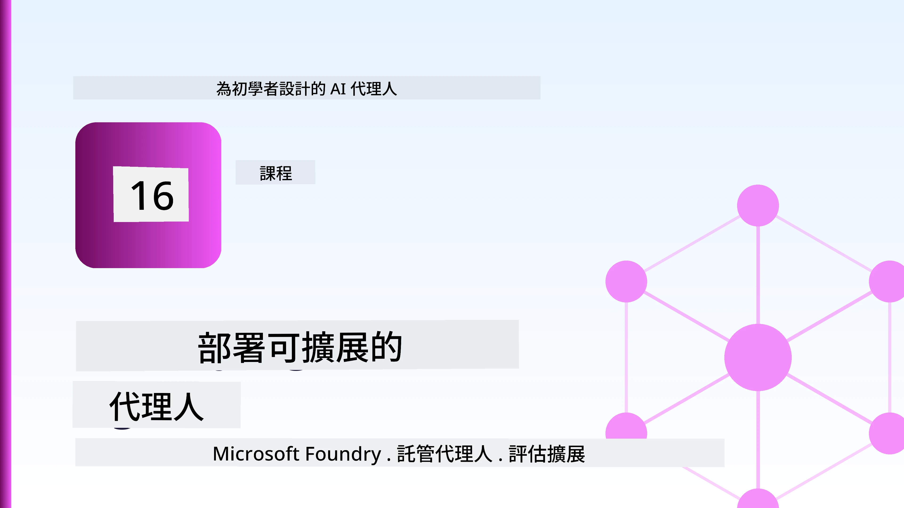
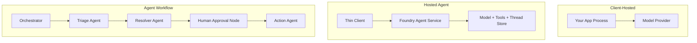
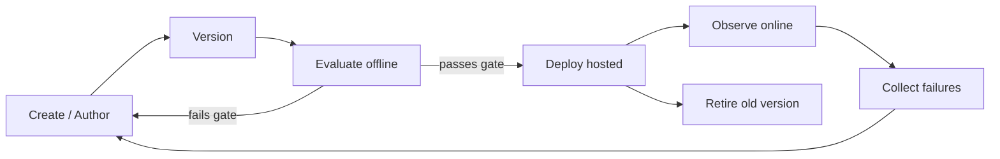
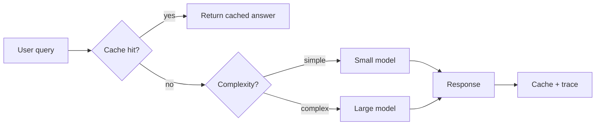
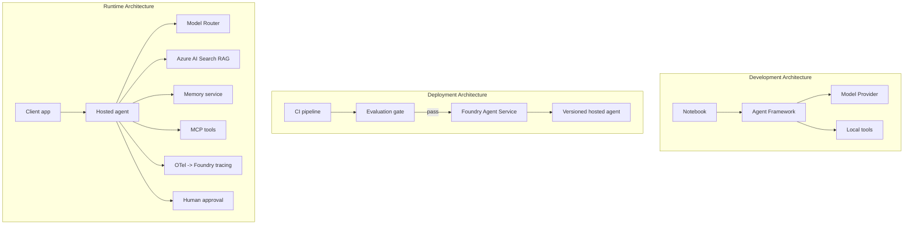

# 使用 Microsoft Foundry 部署可擴展代理



到目前為止，您已經建立了在筆記型電腦上運行、在筆記本中執行、由 `az login` 和少量環境變數驅動的代理。這正是學習的正確方式。但這並非成千上萬客戶依賴的凌晨三點穩定運作代理的正確方式。

本課程將探討「它在我的機器上運行良好」和「在生產環境中可靠且經濟地運作」之間的差距。我們將利用 **Microsoft Foundry** 和 **Microsoft Foundry Agent Service** 來彌合這個差距，並建構一個具備工具、檢索、記憶、評估和監控的真實客戶支持代理。

## 簡介

本課程將涵蓋：

- <strong>原型代理</strong> 與 <strong>部署代理</strong> 之間的差異，以及為何轉換大多關乎模型周圍的一切。
- 代理的 <strong>部署模式</strong>：客戶端承載、服務承載（托管代理）與工作流程協調。
- Microsoft Foundry 上的 <strong>代理生命周期</strong> — 創建、版本化、部署、評估、觀察、退役。
- <strong>擴展策略</strong>：模型路由、快取、併發及無狀態設計。
- 利用 OpenTelemetry 和 Foundry 追蹤的 <strong>可觀察性</strong>。
- 通過模型選擇、路由和評估門控的 <strong>成本優化</strong>。
- <strong>企業考量</strong>：治理、人為審批，以及在生產環境中安全運行 MCP 伺服器。

## 學習目標

完成本課程後，您將能夠：

- 為特定代理工作負載選擇正確的部署模式。
- 將代理部署到 Microsoft Foundry Agent Service，使其具備版本管理、治理和可觀察性。
- 為代理添加追蹤，並串接評估管線，在每次發佈前執行。
- 應用模型路由和快取，於大規模下控制延遲與成本。
- 為高風險操作新增人工審批閘，並以生產安全方式整合 MCP 伺服器。

## 先決條件

本課程假設您已完成前面課程，並熟悉：

- 使用 [Microsoft Agent Framework](../14-microsoft-agent-framework/README.md) 建立代理（第14課）。
- [工具使用](../04-tool-use/README.md)（第4課）和 [自治 RAG](../05-agentic-rag/README.md)（第5課）。
- [代理記憶](../13-agent-memory/README.md)（第13課）和 [自治協議 / MCP](../11-agentic-protocols/README.md)（第11課）。
- [可觀察性與評估](../10-ai-agents-production/README.md)（第10課）— 本課程直接建立在其上。

您還需要：

- 一個 **Azure 訂閱** 和一個 **Microsoft Foundry 專案**，以及部署至少一個聊天模型。
- 已認證的 **Azure CLI** (`az login`)。
- Python 3.12+ 和存放庫中的套件 [`requirements.txt`](../../../requirements.txt)。

## 從原型到生產：究竟改變了什麼

原型代理與生產代理共享相同的核心循環—推理、呼叫工具、回應。改變的是包裹該循環的所有周邊。模型大概只佔生產代理的 20%；其他 80% 是運營骨架。

| 關注點 | 原型 | 生產 |
| --- | --- | --- |
| <strong>承載</strong> | 運行於筆記本中 | 作為托管服務運行，有版本控制和推出流程 |
| <strong>身份</strong> | 您的 `az login` 令牌 | 具有限定 RBAC 的管理身份 |
| <strong>狀態</strong> | 在記憶體中，重啟後遺失 | 外部化（線程存儲、記憶服務） |
| <strong>失敗處理</strong> | 您看到錯誤追蹤 | 重試、備援、死信、警報 |
| <strong>成本</strong> | 「只有幾分錢」 | 每請求追蹤，路由，快取，有預算控管 |
| <strong>品質</strong> | 人工檢視輸出 | 每次發佈前自動評估 |
| <strong>信任</strong> | 您審批每項行動 | 政策規範 + 高風險行動有人審核 |

請記住此表格，下方每節內容對應其一列。

## 代理部署模式

您會使用三種模式，且常混合搭配。

### 1. 客戶端承載代理

代理物件存在於<em>您的</em>應用程序進程中。您的程式碼直接呼叫模型提供者；推理循環在您的服務中執行。這就是之前所有課程的作法。

- <strong>使用時機</strong>：當您需要對循環擁有完全控制、自訂中介軟體，或將代理嵌入現有後端時。
- <strong>取捨</strong>：您必須自行負責擴展、狀態和韌性。

### 2. 托管代理（Foundry Agent Service）

代理作為資源<em>註冊於</em> Microsoft Foundry。Foundry 承載推理循環，存放線程，強制內容安全和 RBAC，並在 Foundry 入口網站中展示代理。您的應用成為簡易客戶端，負責建立線程和讀取回應。

- <strong>使用時機</strong>：當您需要耐久性、內建可觀察性、治理及減少運營範圍。
- <strong>取捨</strong>：以受控執行環境換取較低的底層控制權。

### 3. 代理工作流程

多個代理（和工具）組成一個以明確控制流程的圖—順序步驟、分支、人為審核節點及可暫停續行的耐久檢查點。這是 Microsoft Agent Framework <strong>工作流程</strong> 功能於部署規模的應用。

- <strong>使用時機</strong>：當單一任務橫跨多個專用代理，或中途需審核步驟時。
- <strong>取捨</strong>：更多活動部件，需要協調層級的可觀察性。



## Microsoft Foundry 上的代理生命周期

部署代理並非一次性的 `push`。這是一個循環，酷似軟體釋出週期，因為它正是軟體釋出週期。



關鍵觀念，承襲自 [第10課](../10-ai-agents-production/README.md)：**離線評估是門檻，而非事後想法。** 新版本代理必須通過評估門檻才能發佈。線上可觀察性會將真實世界失敗回饋至離線測試集合。這就是完整的循環。

## 擴展策略

擴展代理不同於擴展無狀態 Web API，因為每個請求可能觸發多次昂貴的模型和工具呼叫。有四種技術承擔大部分負載。

**無狀態請求處理。** 不在您的進程記憶體中保留每使用者狀態。將對話線程保存在 Foundry 線程存儲或記憶服務中，以便任何實例都能處理任意請求。這就是讓您可以水平擴展 — 新增實例，無需黏性會話。

**模型路由。** 並非每個請求都需用到您最強大（且最昂貴）的模型。將簡單請求—意圖分類、簡短事實性回答—路由給體積小、速度快的模型，大模型則保留給真正推理需求。Foundry 的 <strong>模型路由器</strong> 可以幫您做到這點，或者您可自行實作輕量分類器。實驗室會教您 DIY 版本。

**回應快取。** 許多客服查詢極為相似（「我該如何重設密碼？」）。將常見問題的答案快取起來，直接提供，不需再呼叫模型。即使中等快取命中率，也能有效降低成本和延遲。

**併發與背壓。** 模型供應商有速率限制。限制您的併發，使用帶指數退避的重試，且優雅失敗（比起 500，排隊回應「我們正在處理」更佳）。



## 生產環境中的可觀察性

您無法運營看不到的系統。如第10課所述，Microsoft Agent Framework 本地生成 **OpenTelemetry** 追蹤—每次模型呼叫、工具調用及協調步驟都成為一個 span。於生產環境中，您將這些 span 匯出至 Microsoft Foundry（或任何 OTel 兼容後端），能夠：

- 追蹤單一客戶投訴，跨越所有模型和工具呼叫。
- 觀察請求的 p50/p95 延遲與成本變化。
- 於用戶（或財務團隊）察覺前，對錯誤率與成本異常發出警報。

```python
from agent_framework.observability import get_tracer

tracer = get_tracer()

with tracer.start_as_current_span("support_request") as span:
    span.set_attribute("customer.tier", "enterprise")
    span.set_attribute("routed.model", "gpt-5-nano")
    # agent execution is traced automatically inside this span
```

屬性如 `customer.tier` 與 `routed.model`，是將一堆追蹤轉化為可解答問題（「企業客戶是否過度被導往小模型？」）的關鍵。

## 成本優化

生產代理的成本主要由標記數(token)主導。三項槓桿，依重要性排序：

1. **模型恰當大小。** 通過評估門檻的小模型幾乎總比通過的大模型便宜。利用評估證明小模型足夠，勿因謹慎而預設用最大模型。
2. **依複雜度路由。** 如前所述—只為需要大模型推理的請求支付大模型費用。
3. **積極快取。** 最便宜的模型呼叫是您永遠不需要的呼叫。

評估門控和成本控制是同一紀律的兩面：評估告訴您 <em>品質底線</em>，路由與快取則協助將成本維持在該底線之下。

## 企業部署考量

**治理。** 托管代理繼承 Foundry 的 RBAC、內容安全與稽核記錄。為每個代理指派具最小權限的管理身份—僅有知識庫唯讀存取、限定票務 API 存取，無多餘權限。

**人為介入。** 某些操作過於重要，不能全自動—發送退款、刪除帳號、升級至法務團隊。Microsoft Agent Framework 支援 <strong>需審批</strong> 工具：代理提出操作，執行暫停，人員批准或拒絕後工作流程續行。您於 [第6課](../06-building-trustworthy-agents/README.md) 看到該原語；此處進行部署。

**生產環境中的 MCP。** [MCP](../11-agentic-protocols/README.md) 允許代理透過標準介面使用外部工具。生產中將每個 MCP 伺服器視為不受信任邊界：鎖定伺服器版本、以限定身份運行、驗證輸出，且嚴禁洩露機密。MCP 伺服器是依賴項，依賴項需修補、稽核並限制速率。



這三張圖—開發、部署、執行時—是在代理生命週期的三個階段。緊接著的實作坊將帶您逐步建立它。

## 實作坊：生產就緒客戶支持代理

打開 [`code_samples/16-python-agent-framework.ipynb`](./code_samples/16-python-agent-framework.ipynb)，完整完成練習。您將組裝一個包含所有生產考量的 **Contoso 客戶支持代理**：

1. <strong>工具呼叫</strong> — 查詢訂單狀態與開啟支持工單。
2. **RAG** — 從知識庫回答政策問題（Azure AI Search，並內建記憶體備援，讓筆記本可無需 Search 資源運行）。
3. <strong>記憶</strong> — 在對話多輪中記住客戶。
4. <strong>模型路由</strong> — 複雜度分類器將請求導向小模型或大模型。
5. <strong>回應快取</strong> — 重複問題由快取伺服。
6. <strong>人工審批</strong> — 超過門檻的退款暫停，待人工簽核。
7. <strong>評估管線</strong> — 小型離線測試集合評分代理，作為發佈閘門。
8. <strong>可觀察性</strong> — OpenTelemetry 追蹤每次請求。

### 操作導覽

筆記本組織為每項生產考量均為獨立、可執行段落。核心是路由加快取的請求處理程序：

```python
async def handle_support_request(query: str, customer_id: str) -> str:
    # 1. Serve from cache when we can.
    cached = response_cache.get(normalize(query))
    if cached:
        return cached

    # 2. Route by complexity to control cost.
    model = "gpt-5-nano" if is_simple(query) else "gpt-5-mini"

    # 3. Run the agent inside a trace span for observability.
    with tracer.start_as_current_span("support_request") as span:
        span.set_attribute("routed.model", model)
        span.set_attribute("customer.id", customer_id)
        response = await support_agent.run(query, model=model)

    # 4. Cache and return.
    response_cache.set(normalize(query), response.text)
    return response.text
```

保護發佈的評估閘門如下：

```python
async def evaluation_gate(agent, test_cases, threshold: float = 0.8) -> bool:
    passed = 0
    for case in test_cases:
        result = await agent.run(case["input"])
        if score_response(result.text, case["expected"]) >= 0.8:
            passed += 1
    pass_rate = passed / len(test_cases)
    print(f"Evaluation pass rate: {pass_rate:.0%} (gate: {threshold:.0%})")
    return pass_rate >= threshold  # only deploy if the gate passes
```

請詳讀每行—筆記本故意保持基元小巧，避免隱藏在框架調用背後。

## 使用煙霧測試驗證已部署代理

上述評估閘門會<em>離線</em>執行於您的代理物件。代理被部署為托管代理後，您還需一項更簡易的檢查：**已部署的端點是否真有回應？**

「部署成功」僅證明控制平面接受定義—不保證代理會回應。缺少依賴、模型路由錯誤、連線逾時都可能導致部署綠燈但無回應。<strong>煙霧測試</strong>能在數秒內偵測此狀況，每次部署皆執行，且成本遠低於全面評估。

本存放庫提供已組態的煙霧測試管線，基於 [AI Smoke Test](https://github.com/marketplace/actions/ai-smoke-test) GitHub Action：

- <strong>目錄</strong>— [`tests/lesson-16-smoke-tests.json`](../../../tests/lesson-16-smoke-tests.json) 收錄 Contoso 支援代理的提示與斷言（根據政策回答、訂單查詢、保持主題及多輪線程連續性）。其他課程代理的目錄與其並列，詳見 [`tests/README.md`](../tests/README.md)。
- <strong>工作流程</strong>— [`.github/workflows/smoke-test.yml`](../../../.github/workflows/smoke-test.yml) 使用 Azure OIDC 登入，並對代理的 Responses 端點 POST 每條提示，任何斷言失敗即標記作業失敗。

```yaml
- name: Smoke-test hosted agent
  uses: JFolberth/ai-smoketest@v1
  with:
    project_endpoint: ${{ inputs.project_endpoint }}
    agent_name: ContosoSupportAgent
    tests_file: tests/lesson-16-smoke-tests.json
```

部署您的代理後，從 <strong>操作</strong> 標籤中執行，並提供您的 Foundry 專案端點和代理名稱。聯邦身份需要在 Foundry 專案範圍中擁有 **Azure AI 使用者** 角色。可以將層級想像成金字塔：每次部署時都會執行煙霧測試（是否可達並回應？）、提升前執行離線評估（是否足夠好可出貨？），而線上評估（實際應用如何？）則持續運行。

## 知識檢查

在進入作業前先測試您的理解。

**1. 大約多少比例的生產代理是「模型」，其餘的是什麼？**

<details>
<summary>答案</summary>

模型是系統中的少數部分 — 常被引用約為 20%。其餘部分是操作架構：託管與版本控管、身份與 RBAC、外部化狀態、故障處理、成本追蹤、評估，以及人機互動控制。進入生產階段主要是建立推理循環 <em>周圍</em> 的所有東西。
</details>

**2. 何時會選擇託管代理而不是客戶端託管代理？**

<details>
<summary>答案</summary>

當您需要具有內建耐久性（持續存在且可恢復的執行緒）、可觀察性、內容安全及 RBAC 的受管理執行環境，且願意以較少的運營範圍換取對推理循環的低階控制時，則選擇託管代理。當您需要完全控制推理循環或將代理嵌入既有後端時，客戶端託管較為合適。
</details>

**3. 為什麼可擴展的代理必須在其自身的程序記憶體中是無狀態的？**

<details>
<summary>答案</summary>

如此一來，任何實例都能處理任意請求，這就是允許水平擴展而不使用黏著會話的關鍵。每位使用者的對話狀態會外部化到執行緒存儲或記憶體服務。如果狀態保存在程序記憶體中，重啟時會遺失，且無法自由分配負載。
</details>

**4. 模型路由解決了什麼問題，它與評估的關係是什麼？**

<details>
<summary>答案</summary>

路由會將簡單請求發送到小型、便宜、快速的模型，並將大型模型保留給真正的推理，以控制延遲與成本。它與評估的關係是，評估 <em>證明</em> 小模型對某類請求已足夠好 — 沒有評估的路由只是猜測。
</details>

**5. 什麼是「評估閘門」，它在生命週期中位於哪裡？**

<details>
<summary>答案</summary>

評估閘門會對新代理版本執行離線測試集，除非通過率達到門檻，否則阻止部署。它位於生命週期中的「版本」與「部署」之間，使品質成為發佈的前置條件，而非事後檢查。
</details>

**6. 為什麼 MCP 伺服器在生產環境中必須被視為不受信任的邊界？**

<details>
<summary>答案</summary>

因為它是代理所呼叫的外部依賴。您應該固定其版本，使用範圍限定的身份執行，驗證其輸出，限制頻率，且切勿向其洩露機密 — 這是對任何第三方依賴所應有的紀律。其輸出會流入代理的推理中，若未驗證即信任，將構成安全風險。
</details>

**7. 通常哪個單一改變對生產代理成本影響最大？為什麼？**

<details>
<summary>答案</summary>

合理選型模型 — 使用能通過評估閘門的最小模型。成本主要由代幣決定，符合質量標準的較小模型幾乎總是比大型模型便宜。緩存與路由進一步降低成本，但選擇合適的基礎模型擁有最大的一階效果。
</details>

**8. 像 `customer.tier` 和 `routed.model` 這樣的追蹤屬性在可觀察性中扮演什麼角色？**

<details>
<summary>答案</summary>

它們將原始追蹤轉變為可答覆的業務問題。沒有屬性時，您只能看到一堆追蹤片段；有了屬性，您可以詢問「企業客戶是否經常被路由到小模型？」或「哪個模型處理我們最慢的請求？」屬性是您按重要維度切分遙測資料的方式。
</details>

## 作業

使用實驗室中的客服代理並強化以適應特定情境：**一個針對 SaaS 公司的訂閱計費支援代理。**

您的提交應包含：

1. <strong>替換工具</strong>，使用與計費相關的工具：`get_subscription_status`、`get_invoice` 和 `issue_credit`（超過 50 美元的點數需要人工審核）。
2. **新增三份 RAG 文件**，涵蓋公司的退款政策、計費週期和取消政策。
3. <strong>擴展評估集合</strong> 至至少八個案例，其中至少兩個 <em>應該</em> 觸發人工審核流程，並確認您的評估閘門能正確通過或失敗。
4. <strong>新增一份成本報告</strong>：在通過代理執行十個混合查詢後，列印有多少請求導向小模型、有多少導向大型模型、以及多少來自緩存。

請用一段簡短的段落（於 markdown 單元中）說明您選擇了哪個模型路由規則，以及您如何用實際流量來驗證它。沒有唯一正確答案 — 評分重點是您是否能連貫地整合生產顧慮。

## 摘要

本課程帶您將代理從原型轉移到微軟 Foundry 的生產環境：

- 跳到生產主要是關於模型 <em>周圍</em> 的 <strong>操作架構</strong> — 託管、身份、狀態、故障處理、成本、品質與信任。
- 您學習了三種 <strong>部署模式</strong> — 客戶端託管、託管代理，與代理工作流程 — 以及它們適合的情境。
- 您經歷了 <strong>代理生命週期</strong>，其中離線 <strong>評估作為發佈閘門</strong>，線上可觀察性將失敗反饋至測試集。
- 您應用了 <strong>擴展策略</strong> — 無狀態設計、模型路由、緩存與有界併發 — 並連結至 <strong>成本優化</strong>。
- 您整合了 <strong>企業控管</strong>：RBAC、人機互動審核，以及生產安全的 MCP 整合。
- 您建置了一個 <strong>生產就緒的客服代理</strong>，將這些顧慮全都融合在可執行代碼中。

下一課程將走相反的路線：不是將代理擴展至雲端，而是將它們 <em>縮小</em> 到單一開發者機器，完全在本地執行。

## 額外資源

- <a href="https://learn.microsoft.com/azure/ai-foundry/what-is-azure-ai-foundry" target="_blank">Microsoft Foundry 文件</a>
- <a href="https://learn.microsoft.com/azure/ai-foundry/agents/overview" target="_blank">Microsoft Foundry 代理服務概述</a>
- <a href="https://learn.microsoft.com/en-us/agent-framework/overview/?wt.mc_id=youtube_26688_organicsocial_reactor&pivots=programming-language-python" target="_blank">Microsoft 代理框架</a>
- <a href="https://learn.microsoft.com/en-us/azure/ai-foundry/openai/concepts/model-router" target="_blank">Microsoft Foundry 中的模型路由器</a>
- <a href="https://learn.microsoft.com/azure/search/search-what-is-azure-search" target="_blank">Azure AI 搜尋</a>
- <a href="https://opentelemetry.io/" target="_blank">OpenTelemetry</a>
- <a href="https://github.com/marketplace/actions/ai-smoke-test" target="_blank">AI 煙霧測試 GitHub 動作</a>
- <a href="https://modelcontextprotocol.io/" target="_blank">模型上下文協定 (MCP)</a>

## 上一課

[建置電腦使用代理 (CUA)](../15-browser-use/README.md)

## 下一課

[創建本地 AI 代理](../17-creating-local-ai-agents/README.md)

---

<!-- CO-OP TRANSLATOR DISCLAIMER START -->
**免責聲明**：
此文件已使用 AI 翻譯服務 [Co-op Translator](https://github.com/Azure/co-op-translator) 進行翻譯。雖然我們努力追求準確性，但請注意自動翻譯可能包含錯誤或不準確之處。原始文件的母語版本應視為權威來源。對於關鍵資訊，建議採用專業人工翻譯。我們不對因使用此翻譯所產生的任何誤解或誤譯承擔責任。
<!-- CO-OP TRANSLATOR DISCLAIMER END -->