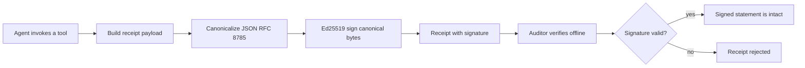
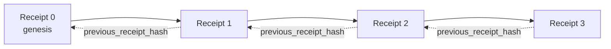

[觀看課程影片：使用加密收據確保 AI 代理安全](https://youtu.be/PLACEHOLDER_VIDEO_ID)

> _(課程影片與縮圖將由 Microsoft 內容團隊於合併後補上，符合第 14 / 15 課程的樣式。)_

# 使用加密收據確保 AI 代理安全

## 介紹

本課程涵蓋：

- 為什麼 AI 代理的審計追蹤對合規、除錯和信任很重要。
- 什麼是加密收據，及其與未簽署日誌行的不同。
- 如何用純 Python 為代理的工具呼叫產生簽署收據。
- 如何離線驗證收據及偵測竄改。
- 如何串接收據，使刪除或重排其中之一會破壞整個鏈條。
- 收據能證明什麼，以及明確無法證明什麼。

## 學習目標

完成本課程後，你將能：

- 辨識推動代理動作加密來源追蹤的失效模式。
- 產生基於標準 JSON 的 Ed25519 簽署收據。
- 僅用簽署者的公鑰獨立驗證收據。
- 重跑驗證以偵測篡改。
- 建立哈希鏈接的收據序列並解釋鏈的意義。
- 辨別收據證明範圍（歸屬、完整性、排序）與不證明的部分（動作正確性、政策合理性）。

## 問題：你的代理審計追蹤

想像你部署了一個 Contoso Travel 的 AI 代理。該代理讀取顧客請求，呼叫航班 API 查詢選項，並代表顧客訂位。上季該代理處理了 50,000 筆預訂。

今天一位稽核人員來了，他問一個簡單的問題：「給我看你的代理做了什麼。」

你交出日誌檔。稽核人員接著問更艱難的問題：「我怎麼知道這些日誌沒有被編輯過？」

這就是審計追蹤問題。現今多數代理部署依賴於：

- <strong>應用程式日誌</strong>：由代理自己寫入，任何擁有檔案系統存取的人可編輯。
- <strong>雲端記錄服務</strong>：在平台層級具防篡改性，但前提是稽核人員信任平台營運者。
- <strong>資料庫交易日誌</strong>：適合資料庫變更，但不適用於任意工具呼叫。

以上皆無法回答稽核人的問題而不需要他信任某人（你、你的雲端供應商、資料庫廠商）。對內部使用而言，這種信任通常可接受；但對受規範的工作負載（金融、醫療、或受歐盟 AI 法案管制者）則不然。

密碼學收據透過讓已簽署的聲明可以被獨立驗證，從而縮小了這個問題。
審計者仍然需要一個帶外的理由來信任簽署金鑰以及產生該聲明的組件。
內嵌金鑰證明的是自我一致性，而非發行者身份或執行位置。

## 什麼是加密收據？

收據是一個 JSON 物件，紀錄代理所進行的動作，並以數位簽章簽署。



最簡單的收據看起來像這樣：

```json
{
  "type": "agent.tool_call.v1",
  "agent_id": "contoso-travel-bot",
  "tool_name": "lookup_flights",
  "tool_args_hash": "sha256:a3f9c1...",
  "result_hash": "sha256:7b2e1d...",
  "policy_id": "contoso-travel-policy-v3",
  "timestamp": "2026-04-25T14:30:00Z",
  "sequence": 47,
  "previous_receipt_hash": "sha256:9d4e6a...",
  "signature": {
    "alg": "EdDSA",
    "sig": "c5af83...",
    "public_key": "8f3b2c..."
  }
}
```

有三個特性在發揮作用：

1. <strong>簽名</strong>. 收據由代理的閘道使用 Ed25519 私鑰簽署。任何擁有對應公鑰的人都可以離線驗證簽名。依賴方必須釘選該金鑰或從收據外的信任註冊表解析該金鑰。竄改任何已簽名的欄位會使簽名無效。

2. <strong>標準化編碼</strong>。簽署前收據以 JSON 正規化方案（JCS，RFC 8785）序列化。確保兩個實作只要結果相同，輸出位元組完全一致。若無正規化，不同的 JSON 序列化器會為相同內容產生不同簽章。

3. <strong>雜湊鏈結</strong>. The `previous_receipt_hash` 欄位將每張收據連結到前一張。移除或重新排序收據會破壞所呈現的序列。偵測截斷或由簽署者控制的改寫，還需要一個已固定的當前鏈頭、獨立見證的檢查點，或經過驗證的封閉族群承諾。

這三項特性共同提供三重保證：

- <strong>歸因於金鑰</strong>：此金鑰簽署了此內容。組織或個人身分需要受信任的金鑰綁定。
- <strong>完整性</strong>：內容自簽署後未被更改。
- <strong>已驗證序列中的排序</strong>: 此收據連結到該前一筆。

## 在 Python 裡產生收據

你不需要特殊函式庫就能產生收據。密碼學原語廣泛可用，而邏輯只需數十行 Python。

`code_samples/18-signed-receipts.ipynb` 的實作練習會引導你完成整個流程。受版本控制的 `code_samples/18-signed-receipts.execution-receipt.json` 記錄了最新一次乾淨執行的精確筆記本雜湊、Python 環境、儲存格數量與檢查項目，而不會改變課程所儲存的輸出。摘要版本：

```python
import json
import hashlib
import base64
from nacl import signing
from jcs import canonicalize  # RFC 8785 canonical JSON

def b64url_nopad(data: bytes) -> str:
    return base64.urlsafe_b64encode(data).decode("ascii").rstrip("=")

def sha256_canonical(obj) -> str:
    """SHA-256 of a Python object's JCS-canonical JSON form."""
    return f"sha256:{hashlib.sha256(canonicalize(obj)).hexdigest()}"

# Generate or load a signing key (in production, store in a key vault)
signing_key = signing.SigningKey.generate()
verify_key = signing_key.verify_key
TRUSTED_PUBLIC_KEYS = {b64url_nopad(bytes(verify_key))}  # pinned out of band by the verifier

# Build the receipt payload (no signature yet)
tool_args = {"origin": "SYD", "destination": "LAX"}
tool_result = [{"flight": "QF11", "price": 1850, "stops": 0}]

payload = {
    "type": "agent.tool_call.v1",
    "agent_id": "contoso-travel-bot",
    "tool_name": "lookup_flights",
    "tool_args_hash": sha256_canonical(tool_args),
    "result_hash": sha256_canonical(tool_result),
    "policy_id": "contoso-travel-policy-v3",
    "timestamp": "2026-04-25T14:30:00Z",
    "sequence": 0,
    "previous_receipt_hash": None,
}

# Canonicalize and sign the JCS bytes directly. PureEdDSA hashes internally.
canonical_bytes = canonicalize(payload)
signature_bytes = signing_key.sign(canonical_bytes).signature

# Attach a structured signature object.
receipt = {
    **payload,
    "signature": {
        "alg": "EdDSA",
        "sig": b64url_nopad(signature_bytes),
        "public_key": b64url_nopad(bytes(verify_key)),
    },
}
```

這就是整個簽署管線。筆記本中有逐步教學。

## 驗證收據及偵測竄改

驗證是逆向操作：

```python
import base64
import hashlib
from nacl import signing
from nacl.exceptions import CryptoError
from jcs import canonicalize

def b64url_decode(s: str) -> bytes:
    padding = "=" * ((4 - len(s) % 4) % 4)
    return base64.b64decode(s + padding, altchars=b"-_", validate=True)

def verify_receipt(receipt: dict, trusted_public_keys: set[str]) -> bool:
    # The signature is a structured object: {"alg", "sig", "public_key"}.
    if not isinstance(receipt, dict):
        return False
    sig_obj = receipt.get("signature")
    if not isinstance(sig_obj, dict) or sig_obj.get("alg") != "EdDSA":
        return False
    try:
        # An inline key proves only self-consistency. Trust is configured out of band.
        public_key = sig_obj.get("public_key")
        signature = sig_obj.get("sig")
        if not isinstance(public_key, str) or not isinstance(signature, str):
            return False
        if public_key not in trusted_public_keys:
            return False
        payload = {k: v for k, v in receipt.items() if k != "signature"}
        canonical_bytes = canonicalize(payload)
        verify_key = signing.VerifyKey(b64url_decode(public_key))
        verify_key.verify(canonical_bytes, b64url_decode(signature))
        return True
    except (CryptoError, TypeError, ValueError, KeyError, OverflowError):
        return False
```

這個函式會接受一個收據以及依賴方的釘選金鑰集，並回傳
`True` 僅當簽名在被接受的金鑰下有效時。驗證不需要任何
網路呼叫，但金鑰信任仍屬外部配置的決策。

要看到篡改偵測的實際運作，筆記本展示：

1. 產生有效收據並證實驗證成功。
2. 修改 `tool_args_hash` 欄位中一個位元組。
3. 重新驗證並看到失敗。

這是收據具篡改顯示性的實務示範：任何修改，不論多小，都會破壞簽章。

## 串接多步驟代理的收據

單一簽署收據保護一個動作，收據鏈則保護一連串動作。



每張收據記錄前一張收據的哈希。要悄悄刪掉第 2 張收據，攻擊者必須：

- 改變第 3 張收據的 `previous_receipt_hash` 欄位（將破壞第 3 張收據簽章），或
- 偽造修改後的第 3 張收據簽章（需持有代理私鑰）。

如果私鑰受到保護，且驗證者鎖定一個由獨立見證者所見證的鏈
頭，這些攻擊是可以被偵測的。將私鑰放在每張收據中並不
足夠：簽署者或攻擊者可以出示不同的私鑰、改寫一段後綴，或
截短鏈，除非依賴方有外部的信任與完整性錨點。

筆記本演示：

1. 建立三張收據的鏈條。
2. 驗證每張收據的 `previous_receipt_hash` 均與前張收據真實哈希匹配。
3. 篡改中間一張收據，導致鏈條恰好在該處斷裂。

這就是你如何產生一個稽核追蹤，外部稽核者可以在其
自己已釘選的發行者金鑰和鏈上檢查點下驗證，而不需信任你可變的日誌存放。

## 收據證明什麼（以及不證明什麼）

這是本課程最重要的章節。收據功能強大，但其能力有限。

**收據證明三件事：**

1. <strong>歸屬</strong>：特定金鑰簽署了特定負載。
2. <strong>完整性</strong>：負載自簽署後未被改變。
3. <strong>在已呈現且已驗證的序列中的順序</strong>: 該收據連結到其前一筆。

**收據不證明：**

1. <strong>正確性</strong>：代理的動作是否正確。一張簽過收據可同樣簽署錯誤答案與正確答案。
2. <strong>政策遵循</strong>：`policy_id` 指定的政策是否實際被評估，或若評估是否會許可這個動作。收據記錄的是主張的內容，而非強制的結果。
3. <strong>金鑰以外的身份認證</strong>：收據說「這把金鑰簽署了這內容」，並非「某人類批准此事」。要把金鑰連結至人或組織，需另有身份基礎設施（如目錄或公鑰註冊）。
4. <strong>輸入真實性</strong>：若代理收到偽造提示並對其採取行動，收據忠實記錄該動作。收據在輸入驗證之後，而非驗證的替代品。
5. <strong>執行或現實世界的效果</strong>: 呼叫後的收據記錄發行者聲稱發生的事。要證明承認或調和外部效果，需來自實際執行者或提供者邊界的證據。
6. <strong>完整性</strong>: 缺少的收據可能表示被阻擋、被遺漏、遺失，或未被儀器化。只有在已驗證的封閉族群內，缺席才可視為證據。
7. <strong>受信任的時間</strong>: 已簽名的時間戳證明簽署者持有該值，但不證明該值正確。受信任的時間需要獨立的時間權威或被見證的檢查點。

這個界限重要有兩個原因：

- 它告訴你收據的用途：使代理行為可審計且防竄改，即使跨組織界線。
- 它告訴你還需要哪些額外層級：輸入驗證（第 6 課）、政策執行（稍後簡介）、與身份基礎設施（本課程未涵蓋）。

常見誤解是認為「有了收據」就代表「被治理」。事實非然。收據是基礎，治理是你建立在其上的系統。

## 將核准者的簽名綁定到特定操作

上面的第3項值得獨立成一節：動作收據會寫 "此金鑰對此內容簽章"，絕不會寫 "某人授權此項"。對於高風險操作 (退款, 刪除, 電匯)，額外的核准者簽章可以約束確切的操作。將該金鑰與某人連結，以及檢查該人的在場，仍然是分開的責任。

後續的筆記本 `code_samples/human-authorization-receipts.ipynb` 在與課程收據相同的信封形狀中新增第二種收據類型 `human.approval.v1`。 該信封包含一個帶類型的載荷，該載荷使用 Ed25519 對其標準化的 JCS 位元組進行簽名，且 `signature` 物件位於簽名的位元組之外。 核准金鑰會簽署 <strong>完整的規範化操作及其摘要</strong>；代理金鑰會簽署一個聲明，該聲明攜帶 <strong>相同的操作摘要</strong> 以及一個 `parent_approval_ref`，作為該核准的 `receipt_hash`，與你在上面建立的鏈中的 `previous_receipt_hash` 採用相同的慣例。 一個 `verify_chain` 在<strong>獨立的已釘選金鑰註冊表</strong>下遍歷兩個工件。 核准者金鑰與代理人金鑰保持分離，因此程式碼路徑是共用的，但授權資訊永遠不會共用。

這能帶來的屬性，謹慎陳述為：*已固定的核准者金鑰簽署了這個精確的
動作，且代理金鑰稍後簽署了一份承載相同動作摘要的聲明。*
那是有用的證據，但僅憑它並不能證明該動作已執行。要
控制執行時，該精確的批准也必須被預留並一次性在
實際執行者邊界；未知的提供者結果必須保持未知，而不是被
盲目重試。該筆記本的拒絕測試夾具會測試收據鏈層：

- 篡改、混淆代理、雙方偽造的金鑰，以及格式錯誤的輸入;
- <strong>過時的授權</strong>: 一個仍能驗證的簽名，但仍被拒絕，因為政策版本已更動、核准者金鑰已從固定註冊表中輪換出去，或是在提供的驗證時間之前核准已過期;
- <strong>摘要替換</strong>：一張有效簽署的動作收據指向一個綁定<strong>不同標準動作</strong>的<em>真實</em>批准。

每次拒絕都會給出不同的理由，因此審核者在閱讀拒絕時可以判斷是授權已過期還是所宣稱的動作已變更。驗證為唯讀且可重複：它不會消耗批准或呼叫提供者。執行者需為獨立角色，並具備耐久且原子性的重放保護，以及明確的成功、失敗與不確定結果。人工批准收據是本課程所定義的教學性組合，而非 `draft-farley-acta-signed-receipts` 所定義的收據類型。

## 產品參考

本課程的 Python 程式碼刻意寫得簡潔，以便你閱讀每一行並清楚了解發生的事。正式環境有兩個選擇：

1. **直接基於密碼學原語開發。** 上面示範約 50 行，對多數用例已足夠。PyNaCl（Ed25519）和 `jcs` 套件（標準 JSON）皆為維護良好且經審計的函式庫。

2. **使用正式收據函式庫。** 多個開源專案實作相同模式且提供額外功能（金鑰輪替、批次驗證、JWK 集合散發、與政策引擎整合）：
   - 簽署流程採用一份獨立 IETF 網際網路草案（[`draft-farley-acta-signed-receipts`](https://datatracker.ietf.org/doc/draft-farley-acta-signed-receipts/)，第 02 版）的 JCS 和簽章範圍約定。本課程使用的扁平教育性收據與草案的 `{payload, signature}` 封套不同，且不宣稱符合該實作標準。草案發布共同符合度測試套件（[agent-governance-testvectors](https://github.com/ScopeBlind/agent-governance-testvectors)）供實作標的參照。
   - Microsoft Agent Governance Toolkit 將收據與 Cedar 基政策決策組合；該專案的教程 33 提供端對端範例。
   - `protect-mcp`（npm）與 `@veritasacta/verify`（npm）套件提供基於 Node 的收據簽署和離線驗證實作，能包裹任何 MCP 伺服器成防篡改審計追蹤，含擱置共簽流程，在該流程中暫停動作發出綁定行動摘要的批准收據（桌面流程中以 WebAuthn 支援），採用與上述人類授權筆記本相同批准收據模式。
   - **[nobulex](https://github.com/arian-gogani/nobulex)** Python SDK（`pip install nobulex`）在 Python 裡提供相同 Ed25519 + JCS 簽署模式，整合 LangChain 和 CrewAI，包含發布的交叉驗證測試向量及透過 [OWASP PR #2210](https://github.com/OWASP/CheatSheetSeries/pull/2210) 貢獻的合規映射。
- **[EMILIA Protocol](https://github.com/emiliaprotocol/emilia-protocol)** 提供一個互補的精確動作強制層: 離線可驗證的批准收據、固定的 WebAuthn 或多數權限、在執行者邊界的一次性消耗，以及一條明確的不確定結果路徑。其框架適配器將收據視為必要的證據，而非外部效果已發生的證明。

自行實作與使用函式庫間的選擇，就如同自己寫 JWT 函式庫或用現有成熟函式庫一樣：兩者都合理；函式庫節省時間並減少審計範圍；自行寫則讓你了解每個原語。本課程教授自行寫法，讓你打好基礎，二擇其一。

## 知識測驗

在進入練習前測試你的理解。

**1. 收據用代理私鑰 Ed25519 簽署。稽核人員只有公鑰。稽核人員能離線驗證收據嗎？**

<details>
<summary>答案</summary>

是的，密碼學驗證僅需要公鑰和已簽署的位元組。該
稽核者仍然必須在收據之外，獨立地取得並釘選被接受的公鑰。
在建立該信任配置後，不需要任何網路呼叫。
</details>

**2. 攻擊者修改收據的 `policy_id` 欄位，聲稱受到更寬鬆政策管轄。簽章是對原始負載簽署。驗證時會怎樣？**

<details>
<summary>答案</summary>


驗證失敗。簽名是針對原始負載的標準字節計算的；任何欄位的修改都會改變這些字節，使簽名無效。攻擊者需要私鑰才能產生新的有效簽名，但他們並沒有。
</details>

**3. 為什麼收據包含 `tool_args_hash` 和 `result_hash`，而不是原始參數和結果？**

<details>
<summary>答案</summary>

有兩個原因。首先，收據可能需要在洩漏原始內容（PII、商業資料）成為問題的環境中存檔或傳輸。雜湊保持收據大小小且內容私密；審核者會驗證雜湊是否與另行存放的實際內容相符。其次，雜湊大小固定；不論輸入輸出多大，帶雜湊的收據大小都有上限。
</details>

**4. `previous_receipt_hash` 欄位將每個收據與前一個收據串連。如果攻擊者從鏈中間靜默刪除一張收據，什麼會失效？**

<details>
<summary>答案</summary>

下一個呈現的收據不再連結到其預期的前一筆，因此對該呈現序列的驗證
自缺口處起便會失敗。如果簽署者控制私鑰，
它可以重寫或截斷一個後綴。偵測到這需要一個已釘選的當前 head，
外部檢查點，或經過驗證的族群承諾。
</details>

**5. 收據驗證通過。這是否證明代理的行為正確、合理，或符合政策？**

<details>
<summary>答案</summary>

不是。在已釘選金鑰與鏈的上下文中，一份有效的收據證明簽名歸屬，
內容完整性，以及與所呈現的前一項的連結。它並不證明該
操作是正確或已執行、政策已被評估、時間戳是
受信任，或記錄集是否完整。這是本課程中最重要的界限。
</details>

## 練習題

打開 `code_samples/18-signed-receipts.ipynb` 並完成所有四個部分：

1. <strong>第一部分</strong>：簽署你的第一張收據並驗證它。
2. <strong>第二部分</strong>：篡改收據並觀察驗證失敗。
3. <strong>第三部分</strong>：建立三張收據串鏈並驗證鏈條完整性。
4. <strong>第四部分</strong>：將此模式應用於使用 Microsoft Agent Framework 建立的代理：用收據簽署包裝工具調用，然後獨立驗證收據。

**擴充挑戰 1：** 使用你自訂欄位擴展收據結構（例如用於追蹤的請求 ID），更新簽署的標準邏輯納入此欄位，並確認收據依然能通過驗證。然後在簽署後修改該欄位並確認驗證失敗。這迫使你理解標準編碼中每個字節如何影響簽名。

**擴充挑戰 2：** 將任兩張收據的標準字節串在一起取 SHA-256 雜湊，然後將結果摘要作為第三張收據中的新欄位，在簽署前嵌入其中。驗證三張收據依然能通過輪轉。你剛建立了一步包含證明：持有第三張收據者可證明前兩張收據在簽署時存在，且無需揭露其內容。這是選擇性揭露收據在大規模使用時的模式（Merkle 承諾，RFC 6962）。

## 結論

密碼學收據為 AI 代理提供了：

- <strong>在釘選信任下可獨立驗證</strong>: 擁有已接受的公鑰和已簽署的位元組的一方可以在不依賴任何服務的情況下驗證。
- <strong>防篡改</strong>：任何修改都使簽名無效。
- <strong>可攜帶</strong>：收據是小型 JSON 檔，可存檔、傳輸並在任何地方驗證。
- <strong>標準對齊</strong>：基於 Ed25519 (RFC 8032)、JCS (RFC 8785) 和 SHA-256，均為廣泛部署的原語。

它們不是輸入驗證、政策執行、執行者準入的替代品，
結果證據、完整性控管或身分識別基礎設施。它們是那些層的基礎
。在受監管或多組織的工作流程中，收據使特定的
發行者的聲明能在稽核者自身的信任設定下被獨立檢查。

最重要的重點：收據證明特定的金鑰簽署了特定的
內容。隨帶的時間戳記是簽署者的聲明，除非另行作時間證明。
收據並不證明其內容為真、某個行為已執行，或是
紀錄集是完整的。嚴格區分這些差異。

## 產線檢查清單

當你準備從此課程畢業，真正部署簽署收據的代理時：

- [ ] **不要將簽署金鑰存放在開發者筆電。** 使用 Azure Key Vault、AWS KMS 或硬體安全模組。用來簽署收據的私鑰絕不可出現在原始碼管控或明文存於應用機器中。
- [ ] **建立驗證者金鑰信任。** 透過 JWK Set 或註冊表發佈金鑰，然後讓依賴方在個別收據之外固定被接受的發行者身份、金鑰集與輪換政策。單獨的內嵌金鑰本身並非信任錨。
- [ ] **外部錨定鏈條。** 定期將最新鏈頭雜湊寫入透明度日誌（Sigstore Rekor、RFC 3161 時戳授權或另一內部系統），以利外部方確認「此鏈當時存在」。
- [ ] **不可變存放收據。** 附加式 Blob 儲存（Azure Storage 不可變政策、AWS S3 物件鎖定）能防止內部人士於儲存層重寫歷史。
- [ ] **決定保存期限。** 多數合規制度要求多年留存。規劃收據體積成長（每張約 500 字節；代理每天 1 萬次呼叫約產生每年 1.8GB）。
- [ ] **文件化收據未涵蓋範圍。** 收據證明歸屬、完整性與順序。你的運行手冊應列明伴隨收據治理的其他控管（輸入驗證、政策執行、速率限制、身份基礎架構）。

### 還有關於保障 AI 代理的問題？

加入 [Microsoft Foundry Discord](https://aka.ms/ai-agents/discord) ，與學習者交流、參加辦公時間並獲得 AI 代理相關問題解答。

## 課程之後

本課涵蓋單張收據簽署與雜湊鏈序列。同樣原語可組成以下進階模式，隨治理成熟你或許會遇到：

- **選擇性揭露。** 當收據欄位獨立承諾時（RFC 6962 式 Merkle 樹），你可對指定審核者揭露特定欄位，同時證明其他欄位未改變但不揭露。適用於同張收據既需滿足完整審核，又需符合例如 GDPR 這類最小資料原則。
- **收據撤銷。** 若簽署金鑰外洩，需有機制將該金鑰簽署的收據標記為自某時間點起不可信。標準模式：短命簽署金鑰加發佈撤銷清單，或伴隨撤銷條目之透明日誌。
- **雙邊／分割簽署收據。** 某些實作將簽署負載分為執行前（`authorization_*`）與執行後（`result_*`）半部，分別簽署，適用於授權決策與結果由不同主體或在不同時刻產出者。可疊加於本課教的收據格式。
- **負載組合。** 收據封存你放入 `result_hash` 的所有字節。實務中負載往往比單純工具呼叫結果更豐富：決策前推理（模型預測、考慮選項、證據及完整性、風險態勢、問責鍊、控管結果）皆可放入負載，由單一收據封存。保持格式簡潔同時讓負載架構依領域演進。
- **跨實作相容。** 多種獨立實作（Python、TypeScript、Rust、Go）根據共用測試向量互驗。若你自行開發實作，驗證公開向量能確認線路相容。
- **Post-quantum migration.** Ed25519 目前被廣泛部署，但並不具備抗量子攻擊能力。僅有一個 `alg` 標籤並不等同於遷移：一個設定檔必須定義 ML-DSA 金鑰編碼、正規化的簽署位元組、驗證、依賴方政策、降級抵抗性，以及過渡語義。在宣稱相容性之前，應針對共用向量規劃並測試雙重簽名過渡。

## 額外資源

- <a href="https://datatracker.ietf.org/doc/draft-farley-acta-signed-receipts/" target="_blank">IETF 網際網路草案：機器對機器存取控制的簽署決定收據</a>
- <a href="https://learn.microsoft.com/azure/ai-studio/responsible-use-of-ai-overview" target="_blank">負責任 AI 概覽 (Azure AI)</a>
- <a href="https://datatracker.ietf.org/doc/html/rfc8032" target="_blank">RFC 8032: Edwards 曲線數位簽章演算法 (EdDSA)</a>
- <a href="https://datatracker.ietf.org/doc/html/rfc8785" target="_blank">RFC 8785: JSON 標準化方案 (JCS)</a>
- <a href="https://datatracker.ietf.org/doc/html/rfc6962" target="_blank">RFC 6962: 證書透明性</a>（選擇性揭露收據所用的 Merkle 樹結構）
- <a href="https://github.com/microsoft/agent-governance-toolkit/blob/main/docs/tutorials/33-offline-verifiable-receipts.md" target="_blank">Microsoft Agent Governance Toolkit 教學 33：離線可驗證決定收據</a>
- <a href="https://github.com/ScopeBlind/agent-governance-testvectors" target="_blank">本課程所用收據格式跨實作合規測試向量</a>（Apache-2.0）
- <a href="https://pynacl.readthedocs.io/" target="_blank">PyNaCl 文件</a>（Python 中的 Ed25519）

## 前一課

[建立本地 AI 代理](../17-creating-local-ai-agents/README.md)

---

<!-- CO-OP TRANSLATOR DISCLAIMER START -->
**免責聲明**：
此文件已使用 AI 翻譯服務 [Co-op Translator](https://github.com/Azure/co-op-translator) 進行翻譯。雖然我們努力追求準確性，但請注意自動翻譯可能包含錯誤或不準確之處。原始文件的母語版本應視為權威來源。對於關鍵資訊，建議採用專業人工翻譯。我們不對因使用此翻譯所產生的任何誤解或誤譯承擔責任。
<!-- CO-OP TRANSLATOR DISCLAIMER END -->
